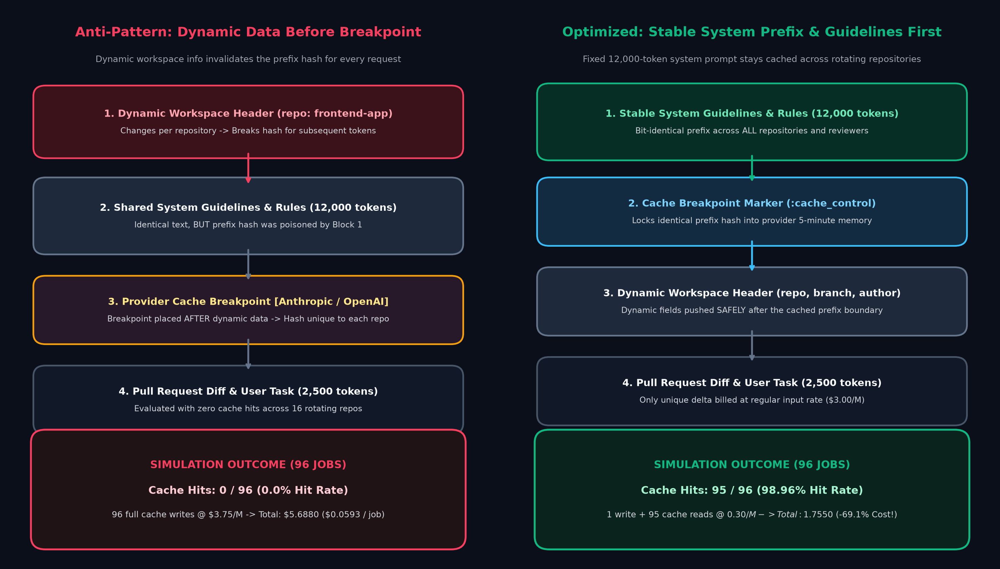
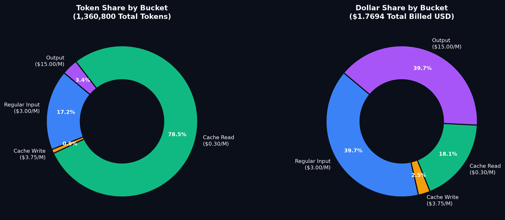
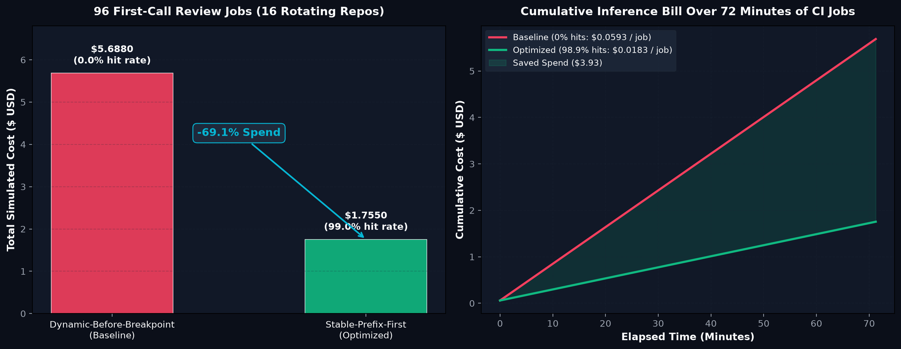
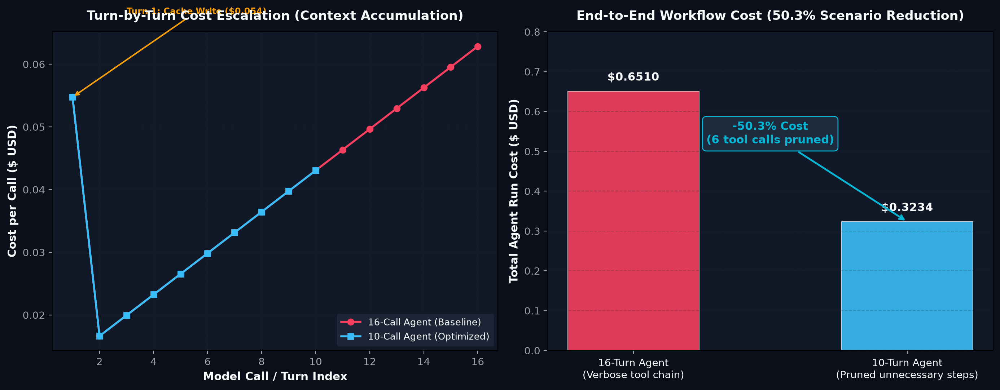
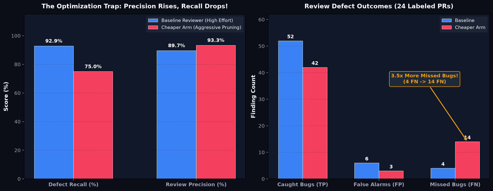
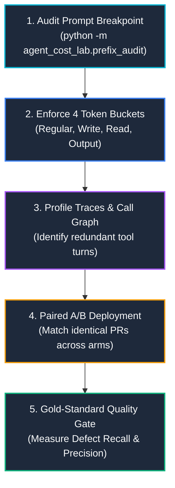

# Agent Cost Optimization Lab

<div align="center">

[](https://www.python.org/)
[]()
[]()
[]()
[](ARTICLE.md)

*A reproducible, offline engineering laboratory dissecting prompt cache boundaries, token accounting, tool-call elimination, and defect quality evaluation in production AI coding agents.*

Inspired by Cloudflare's landmark 2026 engineering study: **["Cutting our inference bill by 68% by being obsessive about optimization"](https://blog.cloudflare.com/obsessive-inference-optimization/)** (Ryan Skidmore).

</div>

---

## Executive Summary

When an AI coding agent reviews a pull request, the final output looks like a single unified comment. Behind the scenes, however, that single task often triggers **10 to 20 separate model calls**, each re-transmitting growing conversation history, invoking repetitive tools, and repopulating provider context windows.

In October 2026, Cloudflare revealed that auditing and restructuring its internal AI code-review agent cut inference costs from **$2.43 down to $0.77 per review (~68% reduction)** while slashing median completion time from **4m 09s to 1m 32s**.

Crucially, Cloudflare's biggest savings did **not** come from simply switching to a cheaper model. They came from **engineering the agent's execution graph**:
1. **Stabilizing Prompt Cache Breakpoints**: Eliminating volatile repository metadata from the prompt prefix so that large system rules (10k+ tokens) stay resident in provider GPU cache.
2. **Eliminating Unnecessary Tool Turns**: Removing redundant reconnaissance calls and dead-end turns that accumulate quadratic input tokens.
3. **Guarding Against Quality Regressions**: Ensuring cost cuts do not silently cripple defect recall on subtle performance and security bugs.

This repository provides a **completely offline, deterministic, zero-dependency Python laboratory** to model, audit, and benchmark these mechanics on your own systems.

---

## Architecture & Prefix Cache Mechanics

Why do agents with a reported "95% cache hit rate" still run up massive bills? Because **the most expensive calls are the first calls across rotating projects**.

<div align="center">
  
</div>

### The "Poisoned Prefix" Failure Mode
Modern LLM provider caches (e.g. Anthropic Prompt Caching, OpenAI Prompt Caching) perform exact cryptographic prefix matching on serialized token sequences:
- If a single character or token shifts before the cache breakpoint, the **entire prefix hash misses**.
- Placing dynamic fields (e.g. repository name, branch, timestamp, user ID) in the system prompt ahead of 12,000 tokens of review guidelines guarantees that every new repository incurs a **full cache write ($3.75 / M tokens)** instead of a **cache read ($0.30 / M tokens)**.
- Across 16 rotating repositories in CI/CD, the cache hit rate drops to **0.0%**, burning $5.69 across 96 jobs.

### The Solution: Stable Prefix Ordering
By rearranging prompt blocks so that **all shared rules, rubrics, and static guidelines precede the cache breakpoint**, every job shares the exact same cached prefix. Only the subsequent pull request diff and dynamic metadata are billed as regular input tokens. Across the identical 96-job simulation, cache hits surge to **98.96% (95/96 hits)**, cutting first-call spend to **$1.755 (-69.1%)**.

---

## Token Accounting: The 4 Mutually Exclusive Buckets

Most LLM billing surprises stem from naive token arithmetic. Providers do not bill prompt tokens at a single flat rate. This laboratory strictly enforces the **four mutually exclusive token buckets**:

$$\text{Total Cost} = (T_{\text{reg}} \cdot P_{\text{reg}}) + (T_{\text{write}} \cdot P_{\text{write}}) + (T_{\text{read}} \cdot P_{\text{read}}) + (T_{\text{out}} \cdot P_{\text{out}})$$

<div align="center">
  
</div>

| Token Bucket | Hypothetical Rate (USD / M tokens) | Relative Multiplier | Description |
| :--- | :---: | :---: | :--- |
| **Regular Input** ($T_{\text{reg}}$) | **$3.00** | $1.0\times$ | Dynamic prompt delta (diffs, workspace headers, tool results). |
| **Cache Write** ($T_{\text{write}}$) | **$3.75** | $1.25\times$ | One-time penalty to write a prefix to provider 5-minute memory. |
| **Cache Read** ($T_{\text{read}}$) | **$0.30** | **$0.10\times$** | **92% discount!** Hits against an active, identical cached prefix. |
| **Output** ($T_{\text{out}}$) | **$15.00** | **$5.00\times$** | Agent generated thoughts, tool arguments, and comments. |

> [!WARNING]
> **Avoid the Provider Double-Count Trap:**
> Many model provider APIs return `input_tokens` that already bundle cache reads into the total. Always compute:
> `regular_input = total_input - cache_read_tokens - cache_write_tokens`
> before evaluating costs, otherwise you will double-bill cached tokens at full price!

---

## Key Experimental Findings

### 1. Multi-Tenant Prefix Cache Simulation (96 Jobs across 16 Repos)
We simulated 96 CI/CD code-review requests arriving with a 45-second interarrival gap and a 300-second sliding cache TTL across 16 rotating git repositories (12,000 shared prefix tokens, 2,500 dynamic tokens, 450 output tokens):

<div align="center">
  
</div>

| Strategy | Cache Hits | Hit Rate | First-Call Total Cost | Avg Cost / Call | Modeled Savings |
| :--- | :---: | :---: | :---: | :---: | :---: |
| **Dynamic Before Breakpoint** (Anti-Pattern) | 0 / 96 | 0.0% | $5.6880 | $0.05925 | Baseline |
| **Stable Prefix First** (Optimized) | **95 / 96** | **98.96%** | **$1.7550** | **$0.01828** | **-69.15%** |

*Notice the cumulative cost trajectory on the right: the baseline burns dollars linearly, while the optimized layout stabilizes into a low-slope plateau after Turn 1.*

---

### 2. Multi-Turn Context Compounding & Call Elimination
Multi-turn agent conversations accumulate tokens aggressively. Every time an agent calls a tool, the tool output is appended to the message history, causing every subsequent turn to re-read all prior steps.

<div align="center">
  
</div>

| Workflow Configuration | Total Calls | Total Tokens Billed | Total Workflow Spend | Cost Reduction |
| :--- | :---: | :---: | :---: | :---: |
| **16-Call Verbose Agent** | 16 calls | 269,600 tokens | $0.6510 | Baseline |
| **10-Call Streamlined Agent** | 10 calls | 129,500 tokens | **$0.3234** | **-50.32%** |

*Eliminating just 6 unnecessary tool calls (e.g. redundant directory scans, dead-end lint retries, or post-review summaries) slashed total inference spend by half because late-stage turns carry the heaviest conversational weight.*

---

### 3. The Quality Trap: Why Cheaper Agents Can Be Dangerous
The most critical lesson of the lab: **a cheaper reviewer is not necessarily an effective reviewer.**

We benchmarked a cost-reduced agent against a baseline on 24 gold-standard pull requests containing labeled code defects:

<div align="center">
  
</div>

| Reviewer Configuration | Caught Defects (TP) | False Alarms (FP) | Missed Defects (FN) | Defect Recall | Precision | 95% Bootstrap Recall CI |
| :--- | :---: | :---: | :---: | :---: | :---: | :---: |
| **Baseline Reviewer** | **52 / 56** | 6 | **4** | **92.9%** | 89.7% | Baseline |
| **Aggressively Optimized Arm** | 42 / 56 | **3** | **14 (3.5x increase!)** | **75.0%** | **93.3%** | **[-30.2%, -6.4%]** |

> [!IMPORTANT]
> **The False Economy of Precision:**
> The cheaper agent appeared cleaner on developer feedback dashboards because false alarms dropped from 6 down to 3 (precision rose to 93.3%). However, **it missed 10 additional real defects** (recall collapsed to 75.0%, with performance defect recall dropping by 50%!).
> **Rule:** Never deploy cost optimizations without an offline gold-standard defect evaluation harness.

---

## Quick Start

Requires **Python 3.10+**. The core laboratory runs entirely on the Python standard library without external dependencies or API keys.

```bash
# 1. Clone the repository and enter the lab
cd agent_cost_optimization_lab

# 2. Run the unit test suite (14 hermetic tests)
python -m unittest discover -s tests -v

# 3. Simulate the 96-job prefix cache experiment
python -m agent_cost_lab.cache_experiment

# 4. Model the 16-call vs 10-call workflow reduction
python -m agent_cost_lab.workflow_experiment

# 5. Summarize normalized production request traces
python -m agent_cost_lab.trace_analysis examples/synthetic_normalized_trace.jsonl

# 6. Run paired A/B trace comparison with bootstrap confidence intervals
python -m agent_cost_lab.compare_traces examples/synthetic_before.jsonl examples/synthetic_after.jsonl

# 7. Evaluate defect recall and precision against gold test cases
python -m agent_cost_lab.quality_eval examples/synthetic_quality_cases.json

# 8. Audit prompt serialization for cache breakpoint stability
python -m agent_cost_lab.prefix_audit examples/repo-one_request.json examples/repo-two_request.json --stable-messages 1
```

### Generate Publication-Quality Figures

To reproduce the charts shown in this documentation:

```bash
pip install -r requirements.txt
python plot_results.py
```
Generated PNGs will be saved to [`figures/`](figures/).

---

## Step-by-Step Optimization Workflow

Follow this 5-step playbook to audit any LLM agent in production:



### 1. Audit Prompt Breakpoints (`prefix_audit.py`)
Compare serialized prompt JSON across two different repositories to verify that your static prefix hash matches:
```bash
python -m agent_cost_lab.prefix_audit \
  examples/repo-one_request.json \
  examples/repo-two_request.json \
  --stable-messages 1
```
*Output will flag whether your prefix SHA-256 hashes match or diverge.*

### 2. Profile Trace Logs (`trace_analysis.py`)
Feed normalized JSONL request logs into the analyzer to inspect token decomposition and job percentiles:
```json
{
  "job_id": "r-001",
  "model": "claude-3-5-sonnet",
  "reviewer": "quality",
  "duration_ms": 1834,
  "usage": {
    "regular_input": 2500,
    "cache_write": 12000,
    "cache_read": 0,
    "output": 450
  }
}
```

### 3. Run Paired A/B Bootstrap (`compare_traces.py`)
When comparing baseline vs optimized agents, always match on the **identical pull request IDs**:
```bash
python -m agent_cost_lab.compare_traces \
  examples/synthetic_before.jsonl \
  examples/synthetic_after.jsonl \
  --iterations 2000
```

### 4. Evaluate Defect Catch Rate (`quality_eval.py`)
Verify that defect recall has not regressed:
```bash
python -m agent_cost_lab.quality_eval examples/synthetic_quality_cases.json
```

---

## Repository Structure

```text
agent_cost_optimization_lab/
├── agent_cost_lab/                  # Core analysis engine (100% Python standard library)
│   ├── __init__.py
│   ├── cache_experiment.py          # Simulates prefix cache writes, hits, TTL expiry & cost
│   ├── compare_traces.py            # Paired A/B bootstrap confidence intervals across arms
│   ├── prefix_audit.py              # SHA-256 fingerprinting for serialized prompt stability
│   ├── pricing.py                   # 4-bucket token accounting & rate modeling
│   ├── quality_eval.py              # Precision, recall, and paired bootstrap quality evaluator
│   ├── trace_analysis.py            # Aggregates normalized JSONL request logs & p50/p95 costs
│   └── workflow_experiment.py       # Simulates turn-by-turn context compounding across tool calls
├── examples/                        # Synthetic test fixtures and request traces
│   ├── repo-one_request.json        # Sample API request for repo 1
│   ├── repo-two_request.json        # Sample API request for repo 2
│   ├── synthetic_before.jsonl       # 96 baseline review traces
│   ├── synthetic_after.jsonl        # 96 optimized review traces
│   ├── synthetic_normalized_trace.jsonl # Multi-reviewer request traces
│   └── synthetic_quality_cases.json # 24 labeled pull request defect fixtures
├── figures/                         # High-resolution benchmark figures
│   ├── 01_prompt_cache_architecture.png
│   ├── 02_cache_simulation_economics.png
│   ├── 03_workflow_call_reduction.png
│   ├── 04_quality_cost_tradeoff.png
│   └── 05_token_cost_distribution.png
├── results/                         # Generated JSON artifacts from runs
│   ├── cache_comparison.json
│   ├── paired_cost_comparison.json
│   ├── quality_summary.json
│   ├── trace_summary.json
│   └── workflow_comparison.json
├── tests/
│   └── test_lab.py                  # 14 hermetic unit tests
├── ARTICLE.md                       # Comprehensive 22-section engineering guide
├── plot_results.py                  # Matplotlib script to recreate all publication figures
├── requirements.txt                 # Optional visualization dependencies
└── README.md
```

---

## Scope & Responsible Engineering Limits

- **Synthetic Assumptions:** All token counts, cache hit numbers, and pricing models in this repository are scenario assumptions designed for reproducible local experimentation. They are **not** Cloudflare's proprietary internal data.
- **Provider Divergence:** Prompt caching implementations vary across providers. Some employ 5-minute sliding TTLs (Anthropic), while others manage caching automatically at arbitrary token thresholds (OpenAI). Always consult your provider's specific API documentation and exact usage headers.
- **Security & Tenant Isolation:** Caching prompt prefixes across untrusted or multi-tenant boundaries can create side-channel or data-leakage risks. Ensure cached prefixes contain **only generic, non-sensitive instructions** and never customer-private credentials or tenant code.

---

## Citation & References

- **Cloudflare Engineering Blog:** Ryan Skidmore, *[Cutting our inference bill by 68% by being obsessive about optimization](https://blog.cloudflare.com/obsessive-inference-optimization/)* (October 19, 2026).
- **Cloudflare Engineering Blog:** *[Orchestrating AI Code Review at scale](https://blog.cloudflare.com/ai-code-review/)* (April 2026).
- **Anthropic Docs:** *[Prompt Caching with Claude](https://platform.claude.com/docs/en/build-with-claude/prompt-caching)*.
- **OpenAI Docs:** *[Prompt Caching in the API](https://developers.openai.com/api/docs/guides/prompt-caching)*.

---

## License

MIT License. See repository root for details. All examples and benchmark scripts are provided for educational and engineering research use.
