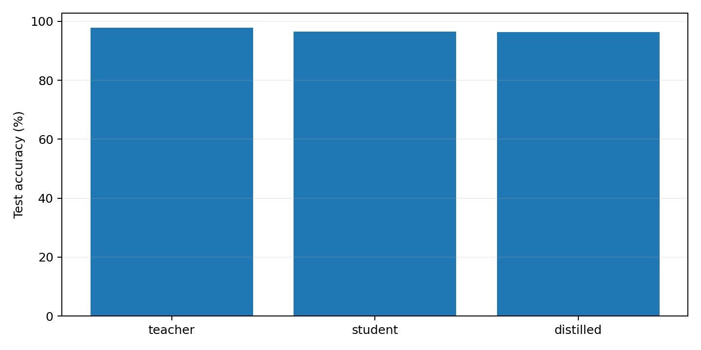
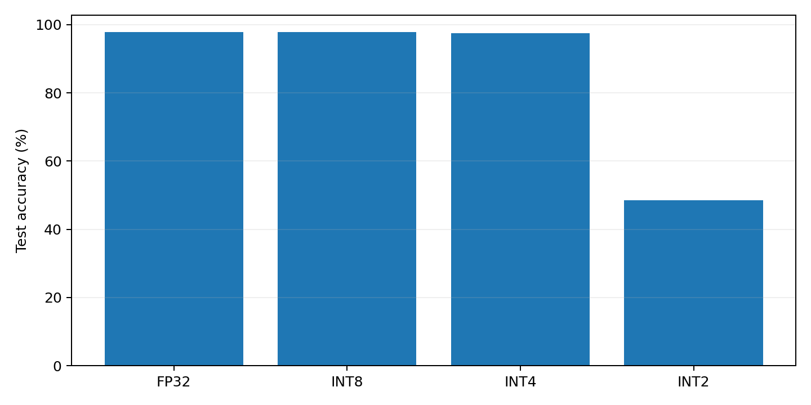
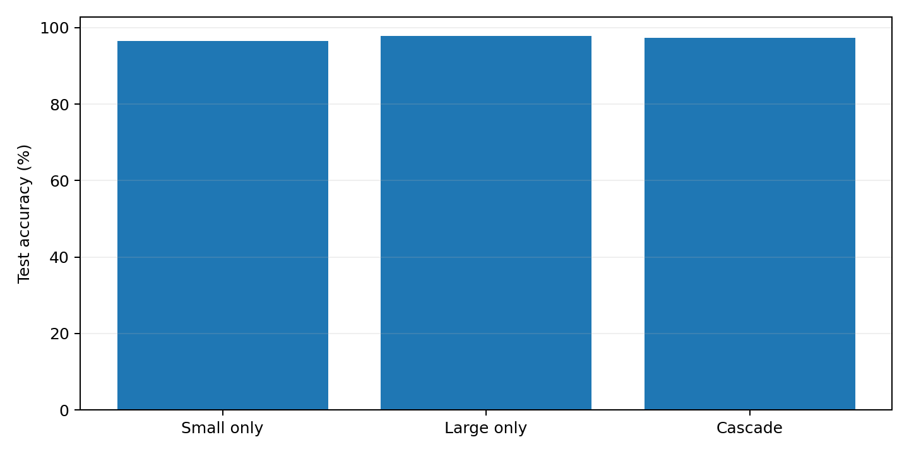

# Applied Deep Learning Lab (Chapter 12)

[](https://www.python.org/)
[](https://pytorch.org/)
[](https://scikit-learn.org/)
[](#verification)

Six self-contained CPU experiments accompanying [`article.md`](./article.md): **teacher/student distillation**, **simulated per-row weight quantization (INT8/INT4/INT2)**, **confidence-routed model cascades**, **exact CTC alignment enumeration**, **add-1 smoothed bigrams**, and **low-rank matrix factorization**.

> **Scope notes:** The cascade is evaluated offline by computing both models' outputs; quantization reconstructs `float32` weights and reports ideal payload bytes rather than packed-kernel runtime savings; and the recommendation matrix is intentionally noise-free to isolate low-rank recovery.

---

## Key Results (`results.json`)

### 1. Teacher / Student / Distillation (Digits, 3 Seeds)
`1,078 / 359 / 360` train/val/test split across seeds `{11, 22, 33}`:

| Model | Parameters | Mean test accuracy |
| --- | ---: | ---: |
| Teacher (`width=256`) | 19,210 | **97.9%** |
| Student (`width=16`) | 1,210 | 96.5% |
| Distilled (`width=16`, `T=3`) | 1,210 | 96.4% |



### 2. Simulated Weight Quantization (Teacher, 3 Seeds)
Per-row symmetric quantization of the `19,210`-parameter teacher:

| Precision | Ideal payload (bytes) | Mean test accuracy |
| --- | ---: | ---: |
| FP32 | — | 97.9% |
| INT8 | 21,072 | **97.8%** |
| INT4 | 11,600 | **97.4%** |
| INT2 | 6,864 | 48.5% |



### 3. Confidence-Routed Cascade (3 Seeds)
Validation-selected confidence threshold routing uncertain examples from the `1,210`-parameter student to the `19,210`-parameter teacher:
- **Student only:** `96.5%`
- **Cascade:** **`97.3%`** while routing only **`2.1%`** of test examples to the teacher
- **Teacher only:** `97.9%`



### 4. Exact CTC Enumeration, Smoothed Bigrams & Matrix Factorization
- **CTC alignment parity:** Enumerating all `5` valid 3-frame paths for target `[1, 2]` gives total probability `0.494` (`loss = 0.7052`), matching `torch.nn.functional.ctc_loss` within `1e-12`.
- **Add-1 smoothed bigram distribution (`context = 'a'`):** `[0.167, 0.500, 0.167, 0.167]` over `['a', 'b', 'c', 'd']` (sums to `1.0`).
- **Rank-4 matrix factorization (`100 × 80`, 80% observed):** Held-out RMSE drops from **`1.912`** (mean baseline) to **`7.85e-7`**.

---

## Quickstart

```bash
pip install -r requirements.txt
python3 lab.py
```

*(On platforms where the local `torch==2.10.0+cpu` wheel suffix is unavailable, install the matching public CPU release from PyTorch.)*

## Verification

```bash
python3 -m unittest discover -s tests -v
```

## Files

| Path | Description |
| --- | --- |
| [`lab.py`](./lab.py) | End-to-end script reproducing all six studies and figures |
| [`results.json`](./results.json) | Saved metrics across all runs and studies |
| [`run.log`](./run.log) | Reference execution log |
| [`article.md`](./article.md) | Companion technical write-up |
| [`tests/test_applied.py`](./tests/test_applied.py) | Unit and artifact verification suite |
| [`figures/`](./figures) | Generated plots (`distillation.png`, `quantization.png`, `cascade.png`) |
