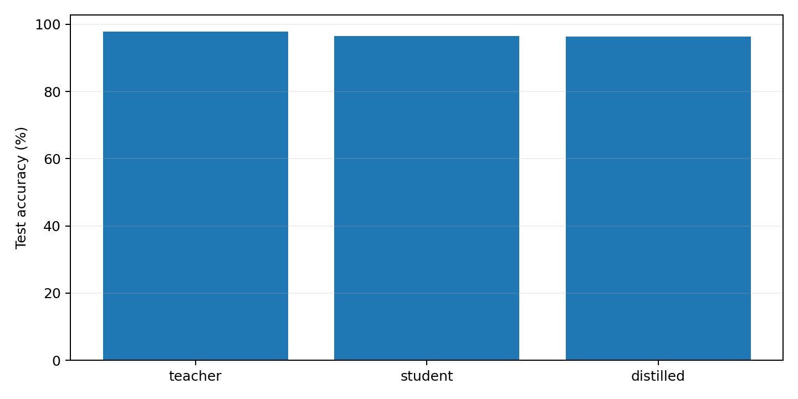
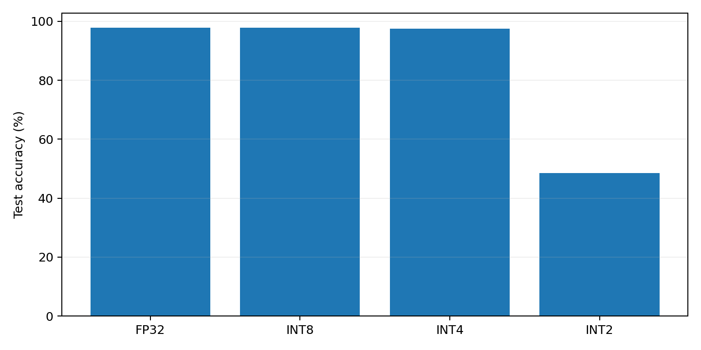
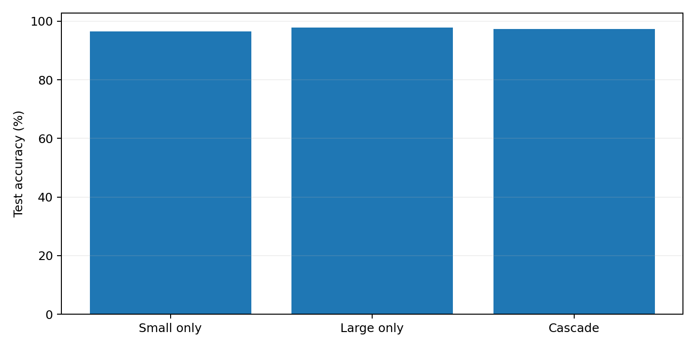

# I Ran the Bigger Neural Network on Just 2% of the Inputs. Accuracy Barely Changed.

*From model compression and mixture of experts to computer vision, speech recognition, and modern LLM inference: how researchers make deep learning more efficient without sacrificing its usefulness.*

I trained two neural networks on the same dataset. The larger one had 19,210 parameters; the smaller one had just 1,210. The larger achieved 97.87% test accuracy, and the smaller achieved 96.48%. Instead of choosing between them, I let the smaller network process every input and called the larger network only when the smaller one was uncertain. The resulting system achieved 97.31% accuracy while invoking the larger model on just 2.13% of test inputs, averaged across three seeds.

This is a controlled handwritten-digit experiment, not a production benchmark. Yet it captures an idea that connects classical classifier cascades to modern mixture-of-experts systems: not every prediction requires the same computation. How much of a neural network do we actually need to execute?

## Abstract

This tutorial revisits Chapter 12 of Goodfellow, Bengio and Courville (2016), covering hardware, distributed computation, compression, dynamic computation, vision, speech, language modeling, recommendation and knowledge representation. We extend its historical perspective with modern research on efficient inference and multimodal systems. A CPU-only companion lab trains nine classifiers across three seeds, evaluates weight rounding and confidence-based routing, verifies connectionist temporal classification (CTC) by enumerating alignments, implements smoothed bigrams and fits a synthetic recommendation matrix. We distinguish measured accuracy from estimated compute and storage, and do not claim GPU speedups or production performance.

## 1. Why computation became part of the research problem

Imagine deploying a speech recognizer to a phone. Training may consume thousands of accelerator hours, but a user expects a response before the conversation moves on. The model must coexist with other applications, fit into memory, and operate under a power budget. A benchmark score alone cannot tell us if it is usable.

The original chapter traces the transition from optimized CPU implementations to general-purpose GPU computing. The central principle survives: the cost of an algorithm depends on how it maps to hardware. CPUs have sophisticated control flow and caches; GPUs organize many threads to exploit regular parallel computation. Neither is automatically faster. Small batches, transfers, launch overhead and irregular work can make CPUs competitive. Modern GPUs have caches too; historical descriptions of GPU memory behavior should not be read as universal contemporary hardware specifications.

Consider a dense layer with input shape B × D and weight shape H × D. Its forward pass performs approximately 2BDH floating-point operations if a multiply and an addition count separately. At batch size one, the weight matrix may be streamed from memory for a single vector. At larger batch sizes the same weights can be reused across multiple examples. This changes arithmetic intensity, the ratio of operations to bytes transferred.

The roofline model (Williams et al., 2009) gives an idealized upper bound:

**Attainable FLOP/s ≤ min(peak FLOP/s, bandwidth × arithmetic intensity).**

A workload can therefore be memory-bound even on a processor with tremendous arithmetic throughput. Kernel fusion removes intermediate memory traffic; tiling reuses data in faster memory. FlashAttention (Dao et al., 2022) applies this principle to exact attention, avoiding materialization of the full attention matrix in high-bandwidth memory. Its dense attention arithmetic still scales quadratically in sequence length. It is not a different attention approximation.

```python
# Approximate weight-only arithmetic intensity, not a profiler.
B, D, H = 1, 4096, 4096
flops = 2 * B * D * H
weight_bytes = 2 * D * H  # BF16
print(flops / weight_bytes)  # 1 FLOP/byte
```

This simplified example excludes activations and output traffic and assumes weights are read once. Increase B to 32 and the weight-only ratio becomes 32. Actual performance depends on cache behavior, alignment, kernels and device architecture. The lesson for a compiler engineer is to optimize data movement as well as arithmetic.

## 2. Training a model across machines

The chapter describes asynchronous SGD and parameter servers, including Hogwild (Recht et al., 2011) and DistBelief (Dean et al., 2012). These were important steps in scaling deep learning. Modern large-model training commonly uses synchronous collectives instead, combined with several kinds of parallelism.

In data parallelism, workers hold replicas of the model, compute gradients on different examples and aggregate them. With equally sized local batches and mean-reduced losses, averaging gradients produces the gradient of the combined batch, subject to numerical differences and compatible model behavior. Unequal token counts require appropriate weighting. The effective batch size is local batch × workers × accumulation steps; increasing it also changes the optimization problem.

Tensor parallelism splits individual operations across devices, for example dividing a linear projection's output channels. Pipeline parallelism distributes layers and schedules microbatches to reduce idle time. Expert parallelism places different experts on different devices and routes tokens between them. ZeRO (Rajbhandari et al., 2020) and fully sharded data parallelism reduce replicated optimizer, gradient and parameter storage. Megatron-LM (Shoeybi et al., 2019) and GPipe (Huang et al., 2019) illustrate complementary approaches.

The costs are not interchangeable. Tensor parallelism introduces frequent collectives; pipeline parallelism incurs bubbles; expert parallelism incurs token dispatch and load imbalance. A fast single-device kernel does not guarantee a fast distributed training job.

```python
# Illustrative memory accounting, decimal GB.
P = 1_000_000_000
weights = 2 * P  # BF16
moments = 8 * P  # two FP32 Adam moments
print(weights / 1e9, moments / 1e9)
```

This is not total training memory. Gradients, master weights, activations, temporary buffers, communication and allocator overhead may all matter. Activation checkpointing trades recomputation for reduced saved activations (Chen et al., 2016). Mixed precision (Micikevicius et al., 2018) exploits low-precision arithmetic while preserving higher precision where needed. Specialized accelerators, including TPUs (Jouppi et al., 2017), use hardware designed for regular tensor operations. FPGAs offer configurable datapaths; ASICs trade flexibility for specialized efficiency. Real deployment should be evaluated with workload-specific latency, energy and quality measurements.

## 3. Can a smaller network learn what a larger one knows?

Model compression predates today's LLMs. Buciluă et al. (2006) investigated replacing expensive ensembles with smaller models trained to imitate them. Hinton, Vinyals and Dean (2015) made knowledge distillation a widely used technique by emphasizing soft target distributions.

Suppose a teacher assigns probabilities 0.80, 0.15 and 0.05 to three classes. A hard label tells a student only that the first class is correct. The remaining probabilities may encode relationships learned by the teacher. Distillation tries to transfer that information.

For teacher logits z and temperature T, the softened probabilities are softmax(z/T). We combine the ordinary label loss with a KL divergence from teacher to student:

**L = α CE(y, student) + (1 − α) T² KL(p_teacher,T || p_student,T).**

The T² factor compensates approximately for temperature-dependent gradient scaling. A higher temperature makes probabilities less concentrated, but neither higher temperature nor higher distillation weight guarantees better generalization.

### Experiment 1: Train a teacher and two students

The lab uses scikit-learn's 1,797 8×8 digit images. The fixed stratified train/validation/test split is 1,078/359/360. We normalize by 16, train with AdamW for 60 epochs using batches of up to 64, and repeat seeds 11, 22 and 33. The teacher is 64→256→10; both students are 64→16→10, with matched initialization and minibatch ordering within each seed. The distillation temperature is 3 and α is 0.4. No hyperparameter sweep is performed.

```python
import torch
from torch.nn import functional as F

# teacher, student, x and y are provided by lab.py.
with torch.no_grad():
    soft_targets = (teacher(x) / 3).softmax(-1)
logits = student(x)
loss = 0.4 * F.cross_entropy(logits, y)
loss += 0.6 * 9 * F.kl_div(
    (logits / 3).log_softmax(-1), soft_targets,
    reduction='batchmean'
)
```

The teacher averaged 97.87% test accuracy. The ordinary student averaged 96.48%. The distilled student averaged 96.39%. The student has approximately 15.88 times fewer parameters. Distillation did not improve its mean accuracy in this particular recipe. This negative result matters: a useful technique is not a universal guarantee. Teacher calibration, temperature, student capacity, data diversity and optimization all influence transfer. A stronger study would choose temperature and loss weights using validation, evaluate across several independent splits, and report confidence intervals.



*Figure 1. Mean held-out accuracy of the teacher, ordinary student and distilled student across three seeds. The student uses 1,210 parameters versus 19,210 for the teacher.*

Other compression techniques include pruning, low-rank factorization and parameter sharing. Han et al. (2016) combined pruning, quantization and coding in Deep Compression. DistilBERT (Sanh et al., 2019) applied distillation to pretrained language models. LoRA (Hu et al., 2022) instead reduces trainable adaptation parameters; it is not automatically a reduction in the deployed base model's parameter count. After merging the low-rank update, the resulting dense weight can occupy the same storage as before.

## 4. What happens when we remove bits from the weights?

A float32 weight occupies four bytes. A four-bit code ideally occupies half a byte. But reducing precision is not the same as deleting information uniformly. A quantization scale tells us how to map real-valued weights onto representable integers.

For symmetric per-output-channel quantization, let Q = 2^(b−1) − 1. For each row, s = max(abs(w))/Q, q = round(w/s), and reconstructed w = sq. We clamp to [−Q,Q]. This convention uses three levels at two bits, not four. Zero rows need a nonzero denominator safeguard.

```python
import torch

def round_weights(w, bits):
    qmax = 2**(bits - 1) - 1
    scale = w.abs().amax(1, keepdim=True).clamp_min(1e-8) / qmax
    codes = (w / scale).round().clamp(-qmax, qmax)
    return codes * scale
```

### Experiment 2: Precision versus quality

We round the trained teacher's weights at 8, 4 and 2 bits and evaluate the reconstructed FP32 network. Biases remain FP32. Across three seeds the unmodified accuracy is 97.87%; 8-bit gives 97.78%, 4-bit gives 97.41%, and 2-bit gives 48.52%. The ideal packed payload for weights, FP32 per-row scales and biases is 21,072 bytes at 8 bits, 11,600 bytes at 4 bits and 6,864 bytes at 2 bits, compared with 76,840 bytes for original FP32 parameters.



*Figure 2. Weight-rounding sensitivity of the same teacher models. The experiment simulates quantization numerically; it does not execute packed integer kernels.*

The surprising result is not simply that four bits works. It is that two bits breaks this particular model while four bits preserves most of its accuracy. Different layers and architectures have different sensitivity. The ideal payload excludes serialization overhead, alignment and runtime workspaces. Actual tensors in this experiment remain float32, so no memory or latency speedup was measured.

GPTQ (Frantar et al., 2023) uses approximate second-order information for post-training weight quantization. AWQ (Lin et al., 2024) uses activation information to protect important weight channels. SmoothQuant (Xiao et al., 2023) redistributes quantization difficulty between activations and weights. QLoRA (Dettmers et al., 2023) trains low-rank adapters through a quantized frozen base model. These methods address different problems: a quantized training representation, a weight-only inference format and an integer activation kernel should not be conflated.

## 5. Why execute every parameter for every input?

Viola and Jones (2001) used classifier cascades for fast object detection: cheap stages reject many irrelevant windows before expensive stages examine the survivors. The chapter also describes early mixture-of-experts research (Jacobs et al., 1991), where a gating network chooses or combines specialized predictors. Both ideas use input-dependent computation, but a cascade can defer to a more powerful model while an expert router chooses specialized subnetworks.

### Experiment 3: Build a confidence-based cascade

Our ordinary student runs first. If its maximum predicted probability falls below a threshold, invoke the teacher and use the teacher prediction. For each seed we search thresholds 0 to 1 in increments of 0.01 on validation only, choosing the lowest teacher invocation fraction among thresholds with validation accuracy within one percentage point of the teacher. We then evaluate the frozen threshold on test.

```python
@torch.no_grad()
def cascade(student, teacher, x, threshold):
    p = student(x).softmax(-1)
    pred = p.argmax(-1)
    route = p.max(-1).values < threshold
    if route.any():
        pred[route] = teacher(x[route]).argmax(-1)
    return pred, route
```

The selected thresholds were 0.51, 0.58 and 0.33. On test, teacher invocation rates were 2.50%, 3.89% and 0%. Mean cascade accuracy was 97.31%, versus 97.87% for the teacher and 96.48% for the student. The largest model ran on only 2.13% of inputs on average. Our evaluation code computes teacher outputs for all examples to compare policies offline; the routing function above illustrates how to avoid that in a deployed system.



*Figure 3. Test accuracy of small model, large model and confidence cascade. The cascade invokes the teacher on 2.13% of inputs on average.*

Counting multiply-accumulates for the two dense layers gives 1,184 for the student and 18,944 for the teacher per input. The expected cascade count is 1,184 + 0.0212963 × 18,944 ≈ 1,587, roughly 8.38% of the teacher-only count. This is an analytical estimate, not measured speed: it excludes activations, softmax, indexing, scheduling and dispatch. Both models must be stored if resident. Confidence need not be calibrated, and rare hard inputs may concentrate errors in particular subgroups. Validate conditional policies under realistic distribution shifts.

### From cascades to modern mixture of experts

A soft mixture computes a weighted sum of expert outputs, often evaluating every expert. Sparse MoE routes each token to a small subset. Shazeer et al. (2017) demonstrated sparsely gated MoE layers; Switch Transformers (Fedus et al., 2022) simplified routing to one expert per token. Mixtral (Jiang et al., 2024) uses sparse expert selection, and DeepSeek-V3 (DeepSeek-AI, 2024) combines sparse experts with other architectural and systems choices.

For E experts and top-k routing, expert arithmetic may be roughly k/E of evaluating every expert of identical size. Shared attention and router costs remain. Total parameters do not shrink merely because fewer are active; expert weights must be available somewhere. Expert imbalance can overload devices and make dispatch expensive. Dropped tokens, capacity limits and communication can degrade quality or efficiency. Unlike the simple confidence cascade, a learned MoE router is trained jointly with the model, often with load-balancing objectives. Do not infer real MoE throughput from our digit results.

Recent 2026 work directly addresses these tradeoffs. Elango et al. (2026) revisit efficiency–accuracy scaling in MoE architectures; Deng et al. (2026) formulate global expert-level mixed-precision allocation and router adaptation in GEMQ; Qin et al. (2026) investigate modality-adaptive quantization of vision-language experts in VEQ. Zhao et al. (2026) explore expert merging and bit-packed inference in PuzzleMoE, while Yang et al. (2026) study lossless compression and cache-affinity scheduling for on-device MoE in ZipMoE. These conference papers illustrate research directions, not results replicated by this lab. An additional September 2026 preprint examines sparse MoE backbones for retrieval under matched serving configurations. The key question is no longer merely how many parameters a model activates, but how reliably and cheaply those parameters can be made available.

## 6. Computer vision: the model is only part of the pipeline

Imagine the digit classifier is installed in a camera application. Its input is no longer a neatly centered 8×8 array. A camera produces different resolutions, illumination, compression artifacts and backgrounds. Training on clean images and deploying on arbitrary crops changes the input distribution. Before changing the architecture, define the input contract.

A vision model may classify an entire image, detect bounding boxes, segment pixels, reconstruct missing content or generate a representation for retrieval. Classification accuracy cannot directly measure all these tasks. Detection uses metrics such as average precision at intersection-over-union thresholds; segmentation often uses IoU or Dice; restoration can use PSNR and perceptual measures. Evaluate the metric that reflects the actual deployment task.

The textbook distinguishes global contrast normalization (GCN) and local contrast normalization (LCN). GCN subtracts the image mean and divides by its standard deviation with a safeguard against near-zero variance. LCN estimates these statistics in neighborhoods. A constant image maps to zero rather than producing a division error. Global normalization removes image-wide contrast and brightness information; local normalization emphasizes spatial variation and may also erase useful low-frequency content. Do not remove intensity when it carries information about the target.

```python
import torch

def global_contrast(x, eps=1e-6):
    # x: [batch, channels, height, width]
    dims = (1, 2, 3)
    centered = x - x.mean(dim=dims, keepdim=True)
    rms = centered.square().mean(dim=dims, keepdim=True).sqrt()
    return centered / rms.clamp_min(eps)
```

Modern preprocessing must match the pretrained model's expected channel order, resolution, range and normalization. An image scaled to [0,1] must not silently be interpreted as [0,255]. The training split alone should determine fitted preprocessing statistics. Augmentations are not universally label preserving: horizontal flips may be reasonable for dogs but not for text; rotating a digit can alter its identity. Mixup (Zhang et al., 2018) interpolates examples and labels, while CutMix (Yun et al., 2019) mixes image regions and labels. Both are training strategies, not substitutes for realistic test data.

The historical progression from AlexNet (Krizhevsky et al., 2012) to residual networks (He et al., 2016) and Vision Transformers (Dosovitskiy et al., 2021) changed feature extraction. CLIP (Radford et al., 2021) learned aligned image and text representations through contrastive supervision. Segment Anything (Kirillov et al., 2023) introduced a promptable segmentation model. These are different objectives: a contrastive embedding is not inherently a pixel-level mask, and a segmentation foundation model does not automatically solve a domain-specific classification task.

A two-stage vision system can use a detector to crop an object and a recognizer to transcribe it. As in the book's Street View example, an upstream crop that cuts off a digit can make downstream recognition impossible. A stronger recognizer cannot reconstruct evidence that was never supplied. This is why the original chapter's emphasis on complete pipelines still matters.

## 7. Speech recognition: learning without frame-level transcripts

Suppose a recording contains the word “cat.” We know the transcript, but we do not know which precise audio frame corresponds to each character. Audio has hundreds of frames; its transcript may have only a few tokens. Assigning labels to every frame would be expensive and sometimes ambiguous.

Traditional ASR combined hidden Markov models for temporal structure with Gaussian mixtures for acoustic likelihoods. Deep neural networks improved acoustic modeling (Hinton et al., 2012), and end-to-end methods reduced the need for explicit phoneme alignments. Graves et al. (2006) introduced connectionist temporal classification, which sums over paths that collapse to a target sequence. The blank symbol represents frames not emitting a label. Repeated adjacent labels are merged before blanks are removed. Thus A, blank, A becomes AA, while A, A becomes A.

For frame probabilities p_t and a target sequence y, CTC computes:

**P(y | x) = Σ over paths π with collapse(π)=y of ∏ over frames t of p_t(π_t).**

The CTC loss is the negative logarithm of this probability. The number of paths grows exponentially, so practical algorithms use dynamic programming. The conditional independence of frame emissions given encoder outputs is a modeling assumption; an encoder can itself use broad context.

### Experiment 4: Verify CTC by enumeration

Our toy model uses three frames and symbols blank, A and B. Its probabilities are:

```python
import torch
from torch.nn import functional as F
p = torch.tensor([[.2, .7, .1],
                  [.4, .5, .1],
                  [.2, .2, .6]], dtype=torch.float64)
loss = F.ctc_loss(p.log().unsqueeze(1), torch.tensor([1, 2]),
                  torch.tensor([3]), torch.tensor([2]),
                  reduction='sum')
print(loss.item())
```

There are 27 possible frame paths, five of which collapse to AB. Enumerating these gives probability 0.494 and negative log-likelihood 0.7052197617942144. The implementation checks that PyTorch produces the same probability within 10⁻¹². This is a correctness demonstration, not an acoustic recognition benchmark. Try target AA to discover why an intervening blank is necessary.

RNN-Transducer (Graves, 2012) adds a prediction network conditioned on emitted labels, making it useful in streaming systems. Conformer (Gulati et al., 2020) combines attention with convolution for acoustic modeling. wav2vec 2.0 (Baevski et al., 2020) uses self-supervised speech pretraining; Whisper (Radford et al., 2023) uses large-scale weak supervision and an encoder-decoder architecture. These advances do not remove deployment tradeoffs. A noncausal encoder may require future audio; streaming models must control lookahead. Measure word error rate (substitutions + deletions + insertions divided by reference words), real-time factor, endpoint latency and performance by accent and noise conditions. A 2026 audio-visual speech review (linked below) discusses incorporating visual and language-model context; it remains necessary to evaluate missing modalities and synchronization errors.

## 8. Language modeling: from counting words to predicting tokens

A simple language model is a probability distribution over sequences. The chain rule writes P(x₁,…,xₙ) as the product of conditional next-token probabilities. An n-gram model restricts the context to the previous n−1 tokens. Counting is cheap, but unseen contexts are unavoidable. Without smoothing, unseen sequences can receive zero probability and infinite negative log-likelihood.

### Experiment 5: A bigram model in a few lines

```python
from collections import Counter
pairs = [('a','b'), ('a','b'), ('b','c'), ('c','a')]
counts = Counter(pairs)
vocab = ['a','b','c','d']
context_count = sum(counts['a', w] for w in vocab)
p = [(counts['a', w] + 1) / (context_count + len(vocab))
     for w in vocab]
print(p)  # [1/6, 1/2, 1/6, 1/6]
```

This is add-one smoothing, equivalent to a symmetric Dirichlet prior's posterior predictive distribution. It provides nonzero probabilities, but may overallocate mass to unseen events in large vocabularies. Kneser-Ney smoothing and backoff models use more informative statistics (Chen and Goodman, 1999).

Neural language models introduced learned embeddings to share statistical strength across similar contexts (Bengio et al., 2003). A one-hot vector places every distinct word at the same Euclidean distance from every other word. A learned embedding provides a continuous geometry, although proximity does not guarantee synonymy or factual equivalence. Word2vec (Mikolov et al., 2013) and GloVe (Pennington et al., 2014) developed scalable word representations. Modern models often use subword or byte tokenization; the unit of perplexity is therefore important when comparing models.

### The output layer is a computation problem

A vocabulary V and hidden width d require a dense output matrix of V × d weights. For V=128,000 and d=4,096 this is 524,288,000 weights. In BF16 the matrix alone occupies roughly 1.05 decimal GB, before weight tying or other model components. Weight tying can share input and output parameters, but does not remove the output projection arithmetic. Exact softmax requires the denominator across vocabulary entries.

The chapter discusses several alternatives that still teach useful design principles. A shortlist handles frequent words with a neural model and assigns remaining probability to a tail model. Hierarchical softmax decomposes a word probability into conditional tree decisions. For a balanced binary tree, a known word requires O(log V) decisions, although finding the global argmax is not necessarily cheap. Adaptive softmax groups words by frequency to save computation (Grave et al., 2017). Importance sampling approximates contributions from negative words; self-normalized importance estimates are generally biased at finite sample size. Noise-contrastive estimation (Gutmann and Hyvärinen, 2010; Mnih and Teh, 2012) learns to distinguish data from noise; a ranking loss instead encourages true-token scores to exceed negatives by a margin. Neither is simply an exact softmax computed faster.

Modern autoregressive LLMs typically still use dense output projections, often optimized with fused or chunked kernels. Perplexity is exp(mean token NLL); compare it on identical tokenization or use a common unit such as bits per byte. A model can achieve favorable perplexity yet fail at instruction following, factuality or tool use. The training objective and application objective are related, not identical.

## 9. Machine translation, attention and the cost of context

Early neural translation systems scored candidate phrases and later used an encoder-decoder architecture to generate variable-length target sequences (Cho et al., 2014; Sutskever et al., 2014). Compressing an entire source sentence into a fixed-size vector creates a bottleneck. Bahdanau et al. (2015) enabled the decoder to attend to different encoder states at each generation step. The Transformer (Vaswani et al., 2017) built its sequence transformations around attention rather than recurrence.

Scaled dot-product attention computes softmax(QKᵀ/√d) V. Each query compares itself to keys, normalizes scores and mixes values. During causal generation, past keys and values can be cached. A KV cache avoids recomputing past projections but grows with sequence length. With L layers, H_kv key/value heads, head dimension D, T tokens and b bytes per scalar, cache payload per sequence is approximately 2 L H_kv D T b. For 32 layers, 8 KV heads, dimension 128, 32,768 tokens and BF16, the payload is exactly 4 GiB, excluding allocation overhead. This is an arithmetic example, not a specification for a particular model.

Grouped-query attention (Ainslie et al., 2023) shares key/value heads across query heads, reducing cache size. PagedAttention (Kwon et al., 2023) manages cache blocks to improve allocation and serving efficiency. Speculative decoding (Leviathan et al., 2023) uses a draft model and target verification; its acceptance/correction procedure can preserve the target sampling distribution under its assumptions. These mechanisms solve different problems: cache allocation, model architecture and sequential generation cost. Measure prefill throughput, time to first token, time per output token and latency percentiles under realistic concurrency. A faster prefill may not improve decode latency.

The 2026 literature on efficient vision-language inference extends these issues to visual tokens and modality-specific compression. Visual inputs can consume large context budgets even before text generation begins. Reducing visual tokens may help throughput but damage small-object recognition or OCR. A system should test those capabilities rather than relying solely on aggregate benchmarks.

## 10. Recommender systems: learning from what users actually see

A recommendation problem starts with a sparse user-item matrix. Most users have not rated most items. Replacing missing entries by zeros creates artificial negative labels. Instead, factorization estimates latent vectors from observed interactions. A simple predictor is r̂_ui = μ + b_u + b_i + p_uᵀq_i. Train it by minimizing squared error on observed pairs, with regularization as appropriate (Koren et al., 2009).

### Experiment 6: Recover a synthetic preference matrix

The lab generates a noise-free 100×80 matrix as the product of two rank-four Gaussian factors. It holds out 1,600 entries and fits embeddings to the remaining 6,400 using Adam for 300 full-batch updates. It compares against predicting the training mean for every held-out entry.

```python
# Given user and item index tensors u, i and observed ratings r:
pred = (user_embedding[u] * item_embedding[i]).sum(-1)
loss = (pred - r).square().mean()
```

The mean baseline has test RMSE 1.912447; rank-four factorization obtains 7.85 × 10⁻⁷. This near-exact recovery is expected under a clean, correctly specified low-rank synthetic generator with dense observation coverage. Real user preferences are noisy, time-varying and much less completely observed. The result is not evidence of comparable real-world performance. Cold-start users and items cannot be addressed with ID embeddings alone; content features and contextual information help.

Modern recommenders often use retrieval followed by ranking. Two-tower networks map users and items into a common embedding space, enabling approximate nearest-neighbor candidate retrieval. A more expensive ranker processes those candidates, using interaction features and calibrated predictions. This is another cascade: spend compute on a small candidate set. DLRM (Naumov et al., 2019) combines dense and sparse feature interactions. Ranking metrics such as Recall@K and NDCG complement rating error. The target must reflect user benefit rather than clicks alone; exposure bias and feedback loops can distort offline evaluation.

### Exploration versus exploitation

If a system only recommends the item currently believed to be best, it may never observe a better alternative. Contextual bandits model this as choosing an action given context and observing only its reward (Li et al., 2010). An epsilon-greedy policy occasionally explores; other methods use uncertainty estimates. Logged propensity scores enable inverse propensity weighting for off-policy evaluation when there is overlap between logging and target policies. Extremely small propensities produce high variance. Doubly robust estimation (Dudík et al., 2011) combines a reward model and propensity correction under appropriate assumptions. Do not interpret offline clicks as unbiased evidence of satisfaction or deploy unconstrained exploration in high-stakes settings.

## 11. Knowledge representation: knowing where to look

The chapter concludes with relational embeddings and question answering. A knowledge graph represents facts as triples (subject, relation, object). TransE (Bordes et al., 2013) embeds entities and relations such that plausible triples approximately satisfy h + r ≈ t. It can rank candidate links, but a missing edge is not necessarily false. Negative sampling and filtered ranking are useful evaluation conventions, not proof of factual completeness.

Retrieval-augmented generation (Lewis et al., 2020) combines a retriever with a generator to condition responses on external evidence. Dense passage retrieval (Karpukhin et al., 2020) learns question and passage embeddings. A real retrieval system needs document ingestion, chunking, indexing, access controls, metadata filtering, ranking and source attribution. The generator should be allowed to abstain when evidence is missing. A retrieved passage is not automatically correct, current or authorized to disclose.

```python
import numpy as np
# Unit-normalized document vectors and query vector.
scores = document_vectors @ query_vector
indices = np.argsort(-scores)[:5]
```

Evaluate retrieval recall separately from answer quality. A good answer with a failed retriever might come from memorized knowledge, while a bad answer with correct retrieval might indicate a generation or context-integration problem. Recent research on efficient MoE retrievers explores whether sparse architectures can improve encoding efficiency at comparable retrieval quality; the September 2026 preprint cited below is evidence of an active direction, not a conclusion applicable to every retrieval service.

## 12. What should we measure before deploying?

The experiments suggest a repeatable design process. Start with a simple end-to-end baseline; define accuracy and application metrics, latency constraints, memory limits and acceptable failure modes. Then profile the actual workload. A matrix multiplication benchmark cannot reveal queueing delay, and a model-only parameter count cannot predict total process memory. Use fixed hardware and software versions, representative batch sizes and sequence lengths, warmup, synchronization on accelerators, repeated timing and percentile statistics. Separate cold starts from steady state. Report preprocessing and postprocessing costs as well as model execution.

A compact model can reduce storage without reducing latency if its format lacks an efficient kernel. Sparse routing can reduce arithmetic while increasing communication. Distillation can fail, as our experiment demonstrates. A cascade can be inexpensive on average yet generate large tail latency if difficult requests require both models. In vision, audio and retrieval, upstream failures can cap the quality of downstream components. The right optimization depends on the bottleneck rather than the trendiest architecture.

## 13. Reproduce the experiments

Download the companion repository archive, extract it, and run:

```bash
python -m venv .venv
source .venv/bin/activate
pip install -r requirements.txt
python lab.py
```

On Windows, activate with `.venv\Scripts\activate`. The dataset ships with scikit-learn; no external data or GPU is required. Results and PNG figures are written beside the script. The three classifier configurations run across three seeds; quantization and routing evaluate the trained models rather than retraining them. CTC, bigrams and matrix factorization are independent small examples. The accompanying JSON includes per-seed measurements. Article snippets outside these experiments are explanatory and may require variables defined elsewhere.

## Discussion and limitations

We have not trained a large language model, run a real speech corpus, profiled accelerators, implemented a production quantized kernel or measured real-world serving latency. The digits experiments use a single dataset split, three training seeds and fixed recipes. The routing threshold is selected on validation and evaluated on test, but the test accuracy target is not guaranteed. The arithmetic savings are theoretical, not a latency measurement. Our selected research references are representative rather than an exhaustive systematic review.

The surprising result at the beginning of this article is not that large models are unnecessary. It is that the value of a model depends on when and how it is used. Neural networks became practical through joint advances in algorithms, representations, hardware and software. The next useful improvement may not require another billion parameters. It may require a better decision about where the computation should happen.

## References

- Goodfellow, I., Bengio, Y., & Courville, A. (2016). Deep Learning, Chapter 12: Applications. [MIT Press](https://www.deeplearningbook.org/contents/applications.html).
- Williams, S., Waterman, A., & Patterson, D. (2009). Roofline: An insightful visual performance model for multicore architectures. [CACM](https://doi.org/10.1145/1498765.1498785).
- Recht, B., et al. (2011). Hogwild!: A lock-free approach to parallelizing stochastic gradient descent. [NeurIPS](https://arxiv.org/abs/1106.5730).
- Dean, J., et al. (2012). Large scale distributed deep networks. [NeurIPS](https://research.google/pubs/large-scale-distributed-deep-networks/).
- Chen, T., et al. (2016). Training deep nets with sublinear memory cost. [arXiv](https://arxiv.org/abs/1604.06174).
- Micikevicius, P., et al. (2018). Mixed precision training. [ICLR](https://arxiv.org/abs/1710.03740).
- Jouppi, N. P., et al. (2017). In-datacenter performance analysis of a tensor processing unit. [ISCA](https://arxiv.org/abs/1704.04760).
- Shoeybi, M., et al. (2019). Megatron-LM: Training multi-billion parameter language models using model parallelism. [arXiv](https://arxiv.org/abs/1909.08053).
- Huang, Y., et al. (2019). GPipe: Efficient training of giant neural networks using pipeline parallelism. [NeurIPS](https://arxiv.org/abs/1811.06965).
- Rajbhandari, S., et al. (2020). ZeRO: Memory optimizations toward training trillion parameter models. [SC](https://arxiv.org/abs/1910.02054).
- Buciluă, C., Caruana, R., & Niculescu-Mizil, A. (2006). Model compression. [KDD](https://doi.org/10.1145/1150402.1150464).
- Hinton, G., Vinyals, O., & Dean, J. (2015). Distilling the knowledge in a neural network. [arXiv](https://arxiv.org/abs/1503.02531).
- Han, S., Mao, H., & Dally, W. J. (2016). Deep compression. [ICLR](https://arxiv.org/abs/1510.00149).
- Sanh, V., et al. (2019). DistilBERT. [arXiv](https://arxiv.org/abs/1910.01108).
- Hu, E. J., et al. (2022). LoRA: Low-rank adaptation of large language models. [ICLR](https://arxiv.org/abs/2106.09685).
- Frantar, E., et al. (2023). GPTQ. [ICLR](https://arxiv.org/abs/2210.17323).
- Lin, J., et al. (2024). AWQ: Activation-aware weight quantization for LLM compression and acceleration. [MLSys](https://arxiv.org/abs/2306.00978).
- Xiao, G., et al. (2023). SmoothQuant. [ICML](https://arxiv.org/abs/2211.10438).
- Dettmers, T., et al. (2023). QLoRA. [NeurIPS](https://arxiv.org/abs/2305.14314).
- Viola, P., & Jones, M. (2001). Rapid object detection using a boosted cascade of simple features. [CVPR](https://doi.org/10.1109/CVPR.2001.990517).
- Jacobs, R. A., et al. (1991). Adaptive mixtures of local experts. [Neural Computation](https://doi.org/10.1162/neco.1991.3.1.79).
- Shazeer, N., et al. (2017). Outrageously large neural networks: The sparsely-gated mixture-of-experts layer. [ICLR](https://arxiv.org/abs/1701.06538).
- Fedus, W., Zoph, B., & Shazeer, N. (2022). Switch Transformers. [JMLR](https://arxiv.org/abs/2101.03961).
- Jiang, A. Q., et al. (2024). Mixtral of experts. [arXiv](https://arxiv.org/abs/2401.04088).
- DeepSeek-AI. (2024). DeepSeek-V3 technical report. [arXiv](https://arxiv.org/abs/2412.19437).
- Elango, V., et al. (2026). Revisiting efficiency–accuracy scaling in mixture-of-experts architectures. [ICML](https://proceedings.mlr.press/v306/elango26a.html).
- Deng, J., et al. (2026). GEMQ: Global expert-level mixed-precision quantization for MoE LLMs. [ICML](https://proceedings.mlr.press/v306/deng26t.html).
- Qin, G., et al. (2026). VEQ: Modality-adaptive quantization for MoE vision-language models. [ICML](https://proceedings.mlr.press/v306/qin26d.html).
- Zhao, Y., Wang, Z., & Zhang, M. (2026). PuzzleMoE. [ICML](https://proceedings.mlr.press/v306/zhao26ay.html).
- Yang, Y., et al. (2026). ZipMoE. [ICML](https://proceedings.mlr.press/v306/yang26ds.html).
- Krizhevsky, A., Sutskever, I., & Hinton, G. (2012). ImageNet classification with deep convolutional neural networks. [NeurIPS](https://doi.org/10.1145/3065386).
- He, K., et al. (2016). Deep residual learning for image recognition. [CVPR](https://arxiv.org/abs/1512.03385).
- Dosovitskiy, A., et al. (2021). An image is worth 16x16 words. [ICLR](https://arxiv.org/abs/2010.11929).
- Radford, A., et al. (2021). Learning transferable visual models from natural language supervision. [ICML](https://arxiv.org/abs/2103.00020).
- Kirillov, A., et al. (2023). Segment Anything. [ICCV](https://arxiv.org/abs/2304.02643).
- Zhang, H., et al. (2018). mixup: Beyond empirical risk minimization. [ICLR](https://arxiv.org/abs/1710.09412).
- Yun, S., et al. (2019). CutMix. [ICCV](https://arxiv.org/abs/1905.04899).
- Hinton, G., et al. (2012). Deep neural networks for acoustic modeling in speech recognition. [IEEE](https://doi.org/10.1109/MSP.2012.2205597).
- Graves, A., et al. (2006). Connectionist temporal classification. [ICML](https://doi.org/10.1145/1143844.1143891).
- Graves, A. (2012). Sequence transduction with recurrent neural networks. [arXiv](https://arxiv.org/abs/1211.3711).
- Gulati, A., et al. (2020). Conformer. [Interspeech](https://arxiv.org/abs/2005.08100).
- Baevski, A., et al. (2020). wav2vec 2.0. [NeurIPS](https://arxiv.org/abs/2006.11477).
- Radford, A., et al. (2023). Robust speech recognition via large-scale weak supervision. [ICML](https://arxiv.org/abs/2212.04356).
- Multimodal Audio-Visual Speech Recognition in the Era of Large Language Models (2026). [Review](https://link.springer.com/article/10.1007/s12559-026-10682-8).
- Chen, S. F., & Goodman, J. (1999). An empirical study of smoothing techniques for language modeling. [Computer Speech & Language](https://doi.org/10.1006/csla.1999.0128).
- Bengio, Y., et al. (2003). A neural probabilistic language model. [JMLR](https://jmlr.org/papers/v3/bengio03a.html).
- Mikolov, T., et al. (2013). Efficient estimation of word representations in vector space. [arXiv](https://arxiv.org/abs/1301.3781).
- Pennington, J., Socher, R., & Manning, C. (2014). GloVe. [EMNLP](https://aclanthology.org/D14-1162/).
- Grave, E., et al. (2017). Efficient softmax approximation for GPUs. [ICML](https://arxiv.org/abs/1609.04309).
- Gutmann, M., & Hyvärinen, A. (2010). Noise-contrastive estimation. [AISTATS](https://proceedings.mlr.press/v9/gutmann10a.html).
- Mnih, A., & Teh, Y. W. (2012). A fast and simple algorithm for training neural probabilistic language models. [ICML](https://arxiv.org/abs/1206.6426).
- Cho, K., et al. (2014). Learning phrase representations using RNN encoder-decoder. [EMNLP](https://arxiv.org/abs/1406.1078).
- Sutskever, I., Vinyals, O., & Le, Q. V. (2014). Sequence to sequence learning with neural networks. [NeurIPS](https://arxiv.org/abs/1409.3215).
- Bahdanau, D., Cho, K., & Bengio, Y. (2015). Neural machine translation by jointly learning to align and translate. [ICLR](https://arxiv.org/abs/1409.0473).
- Vaswani, A., et al. (2017). Attention is all you need. [NeurIPS](https://arxiv.org/abs/1706.03762).
- Dao, T., et al. (2022). FlashAttention. [NeurIPS](https://arxiv.org/abs/2205.14135).
- Ainslie, J., et al. (2023). GQA: Training generalized multi-query transformer models from multi-head checkpoints. [EMNLP](https://arxiv.org/abs/2305.13245).
- Kwon, W., et al. (2023). Efficient memory management for large language model serving with PagedAttention. [SOSP](https://arxiv.org/abs/2309.06180).
- Leviathan, Y., Kalman, M., & Matias, Y. (2023). Fast inference from transformers via speculative decoding. [ICML](https://arxiv.org/abs/2211.17192).
- Efficient Inference for Large Vision-Language Models: Bottlenecks, Techniques, and Prospects (2026). [Findings of ACL](https://aclanthology.org/2026.findings-acl.1057/).
- Koren, Y., Bell, R., & Volinsky, C. (2009). Matrix factorization techniques for recommender systems. [IEEE Computer](https://doi.org/10.1109/MC.2009.263).
- Naumov, M., et al. (2019). Deep learning recommendation model for personalization and recommendation systems. [arXiv](https://arxiv.org/abs/1906.00091).
- Li, L., et al. (2010). A contextual-bandit approach to personalized news article recommendation. [WWW](https://arxiv.org/abs/1003.0146).
- Dudík, M., Langford, J., & Li, L. (2011). Doubly robust policy evaluation and learning. [ICML](https://arxiv.org/abs/1103.4601).
- Bordes, A., et al. (2013). Translating embeddings for modeling multi-relational data. [NeurIPS](https://proceedings.neurips.cc/paper/2013/hash/1cecc7a77928ca8133fa24680a88d2f9-Abstract.html).
- Lewis, P., et al. (2020). Retrieval-augmented generation for knowledge-intensive NLP tasks. [NeurIPS](https://arxiv.org/abs/2005.11401).
- Karpukhin, V., et al. (2020). Dense passage retrieval for open-domain question answering. [EMNLP](https://arxiv.org/abs/2004.04906).
- Mixture-of-Experts Language Models Can Be Strong and Efficient Retrievers (2026). [Preprint](https://arxiv.org/abs/2609.13486).
- scikit-learn. [Digits dataset documentation](https://scikit-learn.org/stable/modules/generated/sklearn.datasets.load_digits.html).
