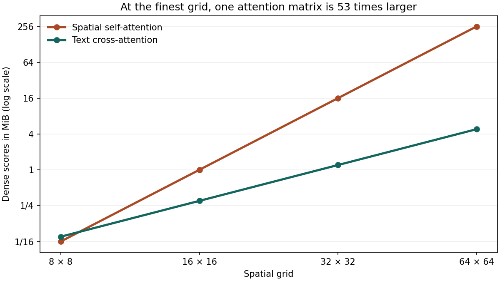

# Stable Diffusion v1 U-Net Attention Geometry & Online Tiling

<div align="center">

[](https://www.python.org/)
[]()
[](test_attention.py)
[](https://github.com/CompVis/stable-diffusion)
[](https://nn.labml.ai/diffusion/stable_diffusion/model/unet_attention.html)
[](LICENSE)

*A clean, zero-dependency educational laboratory dissecting the spatial self-attention and text cross-attention tensor geometry of the Stable Diffusion v1 U-Net, the quadratic 16× resolution explosion, Classifier-Free Guidance batch doubling, and exact online tiled attention (FlashAttention).*

Based on foundational generative diffusion architectures:  
**["High-Resolution Image Synthesis with Latent Diffusion Models"](https://arxiv.org/abs/2112.10752)** (Rombach et al., CVPR 2022)  
and **["FlashAttention: Fast and Memory-Efficient Exact Attention with IO-Awareness"](https://arxiv.org/abs/2205.14135)** (Dao et al., NeurIPS 2022).

</div>

---

## Executive Summary

When generating a $512 \times 512$ image with Stable Diffusion v1, the latent representation is compressed by the VAE down to $64 \times 64$ ($4,096$ spatial tokens). Within the denoising U-Net, two distinct attention mechanisms process feature representations at each resolution stage:

1. **Spatial Self-Attention**: Queries and keys both come from the spatial feature map ($N \times N$).
2. **Text Cross-Attention**: Queries come from spatial features ($N$), while keys and values come from the 77-token CLIP text embedding ($K = 77$).

While cross-attention scales linearly with spatial resolution ($\mathcal{O}(N \cdot K)$), self-attention scales quadratically ($\mathcal{O}(N^2)$). At the finest grid level ($64 \times 64$), a single dense self-attention score matrix requires **256 MiB** in FP16, whereas text cross-attention requires only **4.81 MiB**—a **$53.2\times$ memory disparity**!

```
Spatial Grid Hierarchy (512x512 Image Input, 8 Attention Heads, FP16):
Stage 1: 64 x 64 (4096 tokens)  | Self-Attention: 256.000 MiB  | Text Cross-Attention: 4.812 MiB  (53.2x gap!)
Stage 2: 32 x 32 (1024 tokens)  | Self-Attention:  16.000 MiB  | Text Cross-Attention: 1.203 MiB
Stage 3: 16 x 16 ( 256 tokens)  | Self-Attention:   1.000 MiB  | Text Cross-Attention: 0.301 MiB
Stage 4:  8 x  8 (  64 tokens)  | Self-Attention:   0.062 MiB  | Text Cross-Attention: 0.075 MiB
```

```
The Quadratic Resolution Trap (512x512 -> 1024x1024):
- Spatial Tokens Quadruple: 4,096 -> 16,384 tokens
- Self-Attention Memory Scales (2x)² = 16x: 256 MiB -> 4,096 MiB (4 GiB per single layer!)
- Text Cross-Attention Scales 4x:           4.81 MiB -> 19.25 MiB
- Classifier-Free Guidance (CFG):           Concatenates conditioned + unconditioned (Batch = 2),
                                            doubling all figures across every step.
```

To eliminate the necessity of materializing this dense $256 \text{ MiB}$ (or $4 \text{ GiB}$) matrix in high-bandwidth GPU memory, modern engines utilize **Online Tiled Attention** (FlashAttention).

---

## Visual Gallery: Dense Score Memory Across U-Net Stages

<div align="center">



*Figure 1: Dense attention score tensor sizes in MiB (log₂ scale) across the four spatial grid levels of the Stable Diffusion v1 U-Net (8 heads, FP16). Spatial self-attention experiences exponential growth at fine resolutions, while text cross-attention remains manageable.*

</div>

---

## Mathematical Foundations

### 1. Dense Score Tensor Memory Accounting

For a sequence of $S$ query tokens and $K$ key tokens evaluated across $H$ attention heads with batch size $B$ in 16-bit precision (2 bytes per float):

$$\text{Memory}_{\text{bytes}} = B \cdot H \cdot S \cdot K \cdot 2$$
$$\text{Memory}_{\text{MiB}} = \frac{B \cdot H \cdot S \cdot K \cdot 2}{2^{20}}$$

#### For Spatial Self-Attention:
On a latent grid of side $d = \frac{R}{8 \cdot 2^l}$, the spatial sequence length is $S = K = d^2$:
$$\text{Memory}_{\text{self}} = \frac{2 \cdot B \cdot H \cdot d^4}{2^{20}} \propto R^4$$
Because $d \propto R$, doubling image resolution $R$ multiplies self-attention memory by $2^4 = \mathbf{16\times}$!

#### For Text Cross-Attention:
Queries are spatial ($S = d^2$), while keys are fixed prompt embeddings ($K = 77$):
$$\text{Memory}_{\text{cross}} = \frac{2 \cdot B \cdot H \cdot d^2 \cdot 77}{2^{20}} \propto R^2$$
Doubling image resolution multiplies cross-attention memory by $2^2 = \mathbf{4\times}$.

---

### 2. Exact Online Tiled Attention (FlashAttention Algorithm)

Traditional dense attention materializes the full score matrix $A = \text{softmax}(Q K^T / \sqrt{d}) \in \mathbb{R}^{S \times K}$ before multiplying by $V$.

Online tiled attention partitions keys and values into blocks of size $B_{\text{block}}$ and maintains running normalization statistics using the online softmax trick:

$$m_{\text{new}} = \max\left( m_{\text{old}}, \; \max(S_{\text{chunk}}) \right)$$
$$\alpha = \exp(m_{\text{old}} - m_{\text{new}})$$
$$\text{mass}_{\text{new}} = \text{mass}_{\text{old}} \cdot \alpha + \sum_{j} \exp(S_j - m_{\text{new}})$$
$$\text{weighted}_{\text{new}} = \text{weighted}_{\text{old}} \cdot \alpha + \sum_{j} \exp(S_j - m_{\text{new}}) \cdot V_j$$

Upon consuming all blocks:
$$\text{Output} = \frac{\text{weighted}}{\text{mass}}$$

In `attention.py`, `tiled()` implements this exact algorithm in pure Python and proves bitwise/numerical equivalence (`abs(dense - tiled) == 0.0`) without allocating quadratic buffers.

---

## Empirical Benchmark & Resolution Sweeps

### 1. Default Baseline ($512 \times 512, B=1$)
```bash
python3 attention.py
```
```
 64 x 64   head width  40  self   256.000 MiB  text   4.812 MiB
 32 x 32   head width  80  self    16.000 MiB  text   1.203 MiB
 16 x 16   head width 160  self     1.000 MiB  text   0.301 MiB
  8 x 8    head width 160  self     0.062 MiB  text   0.075 MiB
Dense/tiled absolute error: 0
```

### 2. Hypothesized Resolution Scaling ($1024 \times 1024, B=1$)
```bash
python3 attention.py --resolution 1024
```
```
128 x 128  head width  40  self  4096.000 MiB  text  19.250 MiB  (16x self-attention growth!)
 64 x 64   head width  80  self   256.000 MiB  text   4.812 MiB
 32 x 32   head width 160  self    16.000 MiB  text   1.203 MiB
 16 x 16   head width 160  self     1.000 MiB  text   0.301 MiB
```

### 3. Classifier-Free Guidance Batch Doubling ($512 \times 512, B=2$)
```bash
python3 attention.py --batch 2
```
```
 64 x 64   head width  40  self   512.000 MiB  text   9.625 MiB
 32 x 32   head width  80  self    32.000 MiB  text   2.406 MiB
 16 x 16   head width 160  self     2.000 MiB  text   0.602 MiB
  8 x 8    head width 160  self     0.125 MiB  text   0.150 MiB
```

---

## Quickstart & Verification

Requires Python 3.9+ standard library only:

```bash
cd attention-lab

# 1. Run unit test suite
python3 -m unittest -v

# 2. Run standard SD v1 resolution profile
python3 attention.py

# 3. Explore 1024x1024 resolution scaling
python3 attention.py --resolution 1024

# 4. Explore Classifier-Free Guidance (CFG) batch doubling
python3 attention.py --batch 2

# 5. (Optional) Re-generate publication plot (requires matplotlib)
python3 plot_sizes.py
```

---

## Unit Testing & Verification

4 unit tests verify exact theoretical memory geometries, the $16\times$ vs $4\times$ resolution scaling ratios, tiled online softmax reduction across varying block sizes, and constant value invariance:

```bash
python3 -m unittest -v test_attention.py
```

```
test_constant_values (test_attention.AttentionTests.test_constant_values) ... ok
test_geometry (test_attention.AttentionTests.test_geometry) ... ok
test_resolution_growth (test_attention.AttentionTests.test_resolution_growth) ... ok
test_tiling_with_new_maximum (test_attention.AttentionTests.test_tiling_with_new_maximum) ... ok

----------------------------------------------------------------------
Ran 4 tests in 0.000s

OK
```

---

## Repository Structure

```
attention-lab/
├── README.md           # This comprehensive engineering and mathematical guide
├── attention.py        # Geometry calculator, dense attention reference, and online tiled softmax
├── attention-sizes.png # Publication log-scale comparison plot
├── plot_sizes.py       # Matplotlib script generating attention-sizes.png
└── test_attention.py   # 4 unit tests verifying tensor footprints, scaling invariants, and tiling
```

---

## Academic References

1. **Robin Rombach, Andreas Blattmann, Dominik Lorenz, Patrick Esser, Björn Ommer (2022)**. *High-Resolution Image Synthesis with Latent Diffusion Models*. CVPR 2022. [arXiv:2112.10752](https://arxiv.org/abs/2112.10752).
2. **Tri Dao, Daniel Y. Fu, Stefano Ermon, Atri Rudra, Christopher Ré (2022)**. *FlashAttention: Fast and Memory-Efficient Exact Attention with IO-Awareness*. NeurIPS 2022. [arXiv:2205.14135](https://arxiv.org/abs/2205.14135).
3. **Maxim Milakov, Natalia Gimelshein (2018)**. *Online normalizer calculation for softmax*. [arXiv:1805.02867](https://arxiv.org/abs/1805.02867).
4. **LabML.ai (2022)**. *Stable Diffusion U-Net Attention Implementation*. [nn.labml.ai](https://nn.labml.ai/diffusion/stable_diffusion/model/unet_attention.html).

---

## License

This project is released under the [MIT License](../LICENSE).
