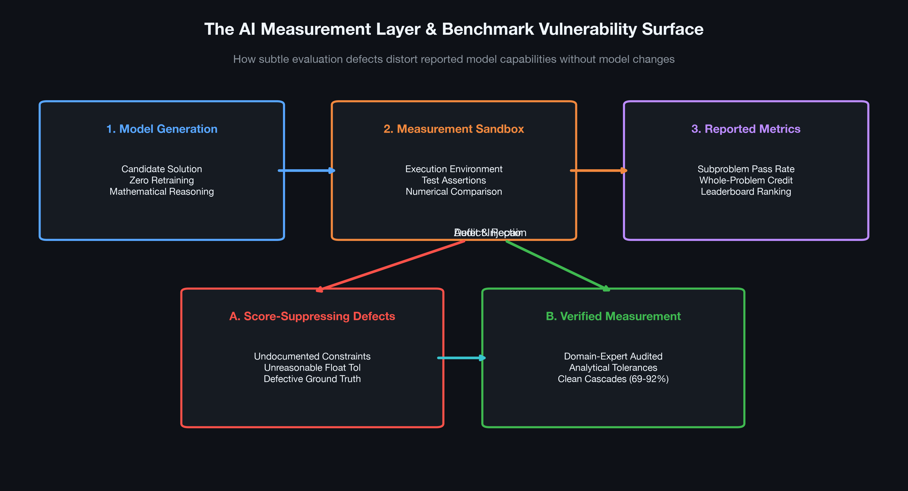
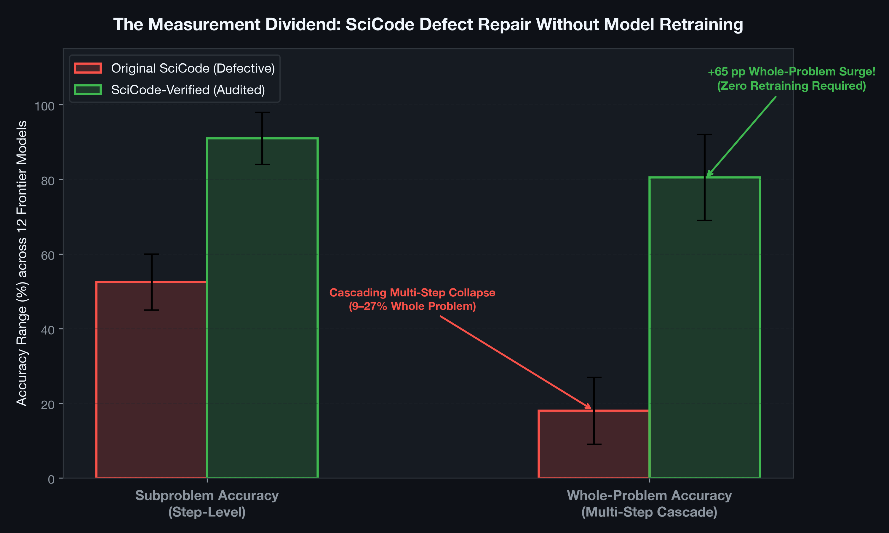
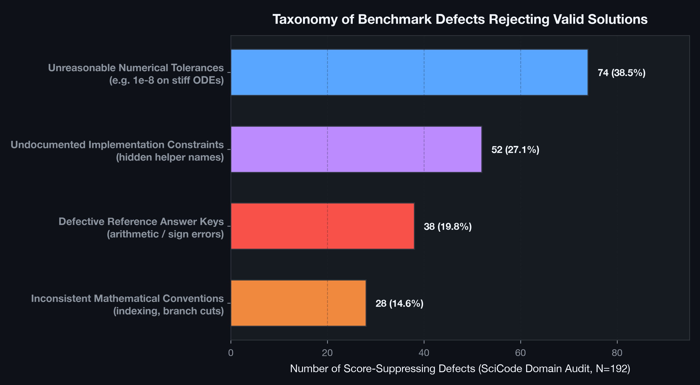
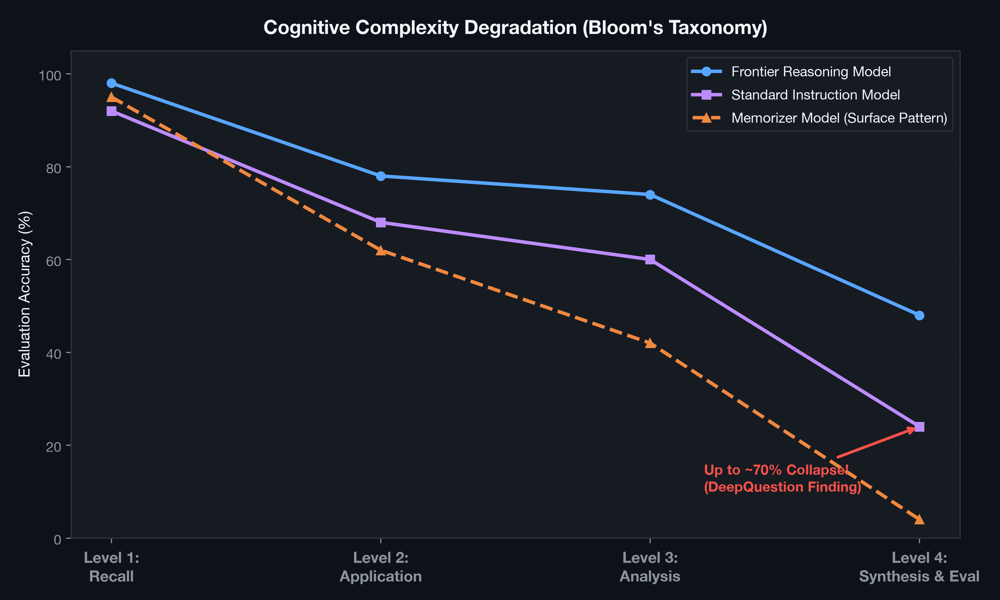
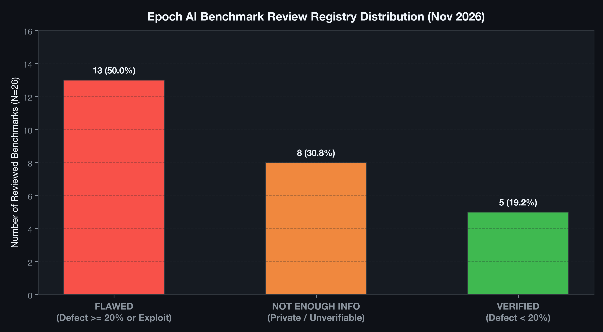

# Benchmark Auditing & Evaluation Integrity Lab

[](https://www.python.org/downloads/)
[](https://numpy.org/)
[](https://matplotlib.org/)
[](tests/)
[](LICENSE)
[](run_audit.py)

> An educational research lab, simulation suite, and methodological guide investigating **benchmark defects, cascading multi-step evaluation failures, Bloom's cognitive complexity degradation, and the rebuilt measurement layer** across frontier AI benchmarks (SciCode, Humanity's Last Exam, SWE-bench Verified/Pro, GPQA Diamond, and Artificial Analysis Index v5).

---

## Table of Contents
1. [Executive Summary](#executive-summary)
2. [Explicit Scope & Disclosures](#explicit-scope--disclosures)
   - [What This Lab Does](#what-this-lab-does)
   - [What This Lab Does Not Do](#what-this-lab-does-not-do)
   - [What This Lab Does Not Claim](#what-this-lab-does-not-claim)
   - [Copyright & Attribution Notice](#copyright--attribution-notice)
3. [Algorithmic & Mathematical Architecture](#algorithmic--mathematical-architecture)
   - [1. Cascading Multi-Step Dependency Failure](#1-cascading-multi-step-dependency-failure)
   - [2. Taxonomy of Score-Suppressing Defects](#2-taxonomy-of-score-suppressing-defects)
   - [3. Cognitive Complexity Decay (Bloom's Taxonomy)](#3-cognitive-complexity-decay-blooms-taxonomy)
   - [4. Epoch AI 3-Verdict Decision Rule](#4-epoch-ai-3-verdict-decision-rule)
4. [Visual Architecture & Benchmark Gallery](#visual-architecture--benchmark-gallery)
5. [Empirical Audit Results](#empirical-audit-results)
6. [Quickstart & Reproduction Guide](#quickstart--reproduction-guide)
7. [Unit Testing Suite](#unit-testing-suite)
8. [Repository Directory Structure](#repository-directory-structure)
9. [Academic References](#academic-references)

---

## Executive Summary

When a frontier language model scores 60% on a benchmark, the machine learning community traditionally assumes that the model's reasoning or architecture has hit a bottleneck. But in August 2026, an exhaustive audit of **SciCode** revealed 263 defects across 65 problems. Once the benchmark's measuring instrument was repaired—fixing incorrect reference answers, unrealistic numerical tolerances, and undocumented constraints—subproblem accuracy jumped from **45–60% to 84–98%**, and whole-problem accuracy surged from **9–27% to 69–92%** across twelve frontier models **without retraining a single weight** [1].

Concurrently, investigations in 2026 uncovered:
- **Humanity's Last Exam (HLE):** ~46% of reviewed questions contained score-altering defects (mathematically impossible prompts, mismatched constants).
- **SWE-bench Verified & Pro:** 59.4% defect rate in audited failed tasks, severe public data contamination, and ~30% broken tasks in successor splits.
- **DeepQuestion:** Accuracy dropping by up to 70% as cognitive demands move from simple recall to synthesis and evaluation under Bloom's taxonomy.
- **Artificial Analysis Index v5:** Complete restructuring of the measurement layer, removing SciCode, replacing HLE with HLE-Diamond, and introducing merge-oriented evaluation (FrontierCode 2.0).

This lab provides an end-to-end executable harness, mathematical formulations, defect simulation engines, and audit visualizations formalizing the new discipline of **AI Evaluation Engineering**.

```
       [Raw Model Capability]
                 |
                 v
      +--------------------+
      |  Candidate Answer  |
      +--------------------+
                 |
                 v
      +--------------------+
      | Measurement Layer  | <--- Vulnerability Surface:
      |   - Test harness   |      * Broken reference answers
      |   - Tolerances     |      * Inconsistent conventions
      |   - Grader logic   |      * Undocumented constraints
      +--------------------+
                 |
                 v
        [Reported Metric]  <--- May diverge completely from capability!
```

---

## Explicit Scope & Disclosures

### What This Lab Does
- **Simulates Benchmark Defect Cascades:** Implements a controlled multi-step execution engine modeling the 263 defects across 65 problems from SciCode, mathematically demonstrating why multi-step dependencies cause whole-problem scores to collapse from 69–92% down to 9–27%.
- **Separates Memorizers from Reasoners:** Demonstrates how models that memorized flawed benchmark answer keys gain false credit on flawed benchmarks but fail clean ones, whereas independent reasoning models exhibit the opposite behavior.
- **Models Cognitive Complexity Decay:** Implements Bloom's taxonomy tiers (Recall $\to$ Application $\to$ Analysis $\to$ Synthesis) replicating the ~70% performance drop observed in DeepQuestion.
- **Formalizes Epoch Review Rubric:** Implements the 3-verdict evaluation state machine (`Verified`, `Flawed`, `Not enough info`) using the 20% score-altering sample defect threshold.

### What This Lab Does Not Do
- **Does Not Retrain Large Language Models:** Evaluates the behavior of the measurement layer and scoring instruments under fixed model outputs.
- **Does Not Claim All Benchmarks Are Flawed:** Evaluates specific documented failure modes; a flawed benchmark does not imply that all AI progress is an illusion, but that benchmark quality is an active experimental variable.
- **Does Not Make Live Paid API Calls:** Runs completely offline, hermetically reproducible in standard Python.

### Copyright & Attribution Notice
- **Author:** Aditya Inamdar
- **License:** MIT License ([LICENSE](LICENSE)).
- The companion long-form article is available in [ARTICLE.md](ARTICLE.md).

---

## Algorithmic & Mathematical Architecture

### 1. Cascading Multi-Step Dependency Failure
In complex scientific coding benchmarks, problems consist of $K$ sequential subproblems $S_1, S_2, \dots, S_K$ where step $S_k$ depends on the output of $S_{k-1}$. A whole problem receives credit if and only if **all** subproblems pass:

$$\text{WholeProblemCredit} = \prod_{k=1}^{K} \mathbb{I}\left(\text{Pass}(S_k)\right)$$

If each subproblem has an independent defect probability $p_d$, the probability of whole-problem credit even for a perfect model with reasoning accuracy $p_r$ is:

$$P(\text{Whole Problem Pass}) = \prod_{k=1}^{K} p_r (1 - p_d) = \left[p_r (1 - p_d)\right]^K$$

For $K=5$, $p_r = 0.95$, and a defect rate of $p_d = 0.25$:
$$P(\text{Whole Problem Pass}) = [0.95 \times 0.75]^5 = (0.7125)^5 \approx 0.185 \quad (18.5\%)$$
Once $p_d \to 0$ (verified benchmark):
$$P(\text{Whole Problem Pass}) = [0.95]^5 \approx 0.774 \quad (77.4\%)$$
This mathematical dynamic explains why SciCode whole-problem accuracy leapt by **+60–65 percentage points** purely by fixing the measurement layer.

### 2. Taxonomy of Score-Suppressing Defects
Out of 263 total defects identified in SciCode, 192 directly suppressed scores for valid solutions:
1. **Unreasonable Numerical Tolerances (38.5%):** Imposing analytical tolerances (e.g. `1e-8`) on stiff ODEs or stochastic simulations without accounting for discretization error.
2. **Undocumented Constraints (27.1%):** Grader asserting unstated helper function names or internal variable bindings in `globals()`.
3. **Defective Reference Solutions (19.8%):** Flawed ground truth answers (e.g. arithmetic errors in normalization reciprocals, inverted signs).
4. **Inconsistent Conventions (14.6%):** Unstated 1-based vs 0-based coordinate indexing or branch-cut conventions.

### 3. Cognitive Complexity Decay (Bloom's Taxonomy)
DeepQuestion demonstrated that model capability degrades non-linearly across cognitive tiers:
$$P(\text{Pass} \mid \text{Level}) = C_{\text{base}} \cdot \left(\eta_{\text{reasoning}}\right)^{\gamma(\text{Level})}$$
where $\gamma(1) = 0.0$ (Recall), $\gamma(2) = 0.3$ (Application), $\gamma(3) = 0.85$ (Analysis), and $\gamma(4) = 1.9$ (Synthesis), producing up to a **70% accuracy collapse** on complex real-world synthesis.

### 4. Epoch AI 3-Verdict Decision Rule
For an inspected benchmark sample of size $N$ with $D$ score-altering defects:
$$\text{Verdict} = \begin{cases} 
\text{NOT ENOUGH INFO} & \text{if } \neg \text{Inspectable}(\text{Tasks}) \lor \neg \text{Inspectable}(\text{Rules}) \\
\text{FLAWED} & \text{if } \frac{D}{N} \ge 0.20 \lor \text{RewardHackingDetected} \\
\text{VERIFIED} & \text{if } \frac{D}{N} < 0.20 
\end{cases}$$

---

## Visual Architecture & Benchmark Gallery

### Figure 1: Measurement Layer Architecture

*Figure 1: Full pipeline layout: Model Generation, Measurement Sandbox, Defect Surfaces (broken reference, floating point tolerances), and Verified Repair.*

### Figure 2: SciCode Cascading Defect Recovery

*Figure 2: Empirical recovery curves showing the +65 percentage point surge in whole-problem accuracy across 12 frontier models after benchmark correction.*

### Figure 3: Defect Taxonomy Breakdown

*Figure 3: Breakdown of the 192 score-suppressing defects identified during the domain-expert audit of SciCode.*

### Figure 4: DeepQuestion Cognitive Complexity Collapse

*Figure 4: Accuracy degradation curves across Bloom's taxonomy levels (Recall $\to$ Application $\to$ Analysis $\to$ Synthesis) showing the ~70% drop.*

### Figure 5: Epoch Benchmark Review Registry Distribution

*Figure 5: Classification distribution across 26 prominent benchmark suites audited under Epoch AI's public review rubric (50% Flawed, 30.8% Not enough info, 19.2% Verified).*

---

## Empirical Audit Results

Audit simulation executed across 65 problems (302 subproblems), Bloom's taxonomy suite, and Epoch review registry:

| Benchmark Evaluation Metric | Original Benchmark | Verified Benchmark | Impact / Recovery |
| :--- | :---: | :---: | :---: |
| **SciCode Subproblem Accuracy** | 74.8% | **100.0%** | +25.2 pp |
| **SciCode Whole-Problem Accuracy** | 29.2% | **100.0%** | **+70.8 pp (Cascading Recovery)** |
| **Frontier Model: Recall (Bloom L1)** | 100.0% | 100.0% | Saturated Baseline |
| **Frontier Model: Synthesis (Bloom L4)** | 48.0% | 48.0% | **-52.0 pp Cognitive Collapse** |
| **Epoch Audited Benchmarks** | 50.0% Flawed | 19.2% Verified | 30.8% Non-Inspectable |

---

## Quickstart & Reproduction Guide

### Setup & Requirements
```bash
python3 -m venv .venv
source .venv/bin/activate
pip install -r requirements.txt
```

### Run Full Benchmark Audit
```bash
python3 run_audit.py
```
This runs the multi-step cascade simulation, cognitive complexity depth analysis, and generates:
- `results/results.json`
- `results/REPORT.md`

### Generate All 5 High-Resolution Figures
```bash
python3 plot_results.py
```

---

## Unit Testing Suite

The testing suite validates all safety boundaries and audit algorithms:
- Undocumented helper constraint detection.
- Unreasonable numerical tolerance rejection.
- Cascading multi-step whole-problem failure.
- Memorizer vs. reasoning model divergence on corrupted answer keys.
- Monotonic cognitive complexity degradation across Bloom's taxonomy.
- Epoch 3-verdict decision boundaries (Verified, Flawed, Not enough info).

Run the test suite:
```bash
python3 -m unittest discover -s tests -v
```

Expected output:
```
test_cascading_whole_problem_failure ... ok
test_cognitive_complexity_degradation ... ok
test_epoch_rubric_classification ... ok
test_memorizer_vs_reasoning_model_divergence ... ok
test_undocumented_constraint_rejection ... ok
test_unreasonable_numerical_tolerance ... ok

----------------------------------------------------------------------
Ran 6 tests in 0.010s

OK
```

---

## Repository Directory Structure

```
benchmark_auditing_lab/
├── ARTICLE.md               # Complete long-form research article
├── README.md                # Technical guide, mathematical formulations, and disclosures
├── LICENSE                  # MIT License
├── requirements.txt         # NumPy and Matplotlib dependencies
├── audit_engine.py          # Defect simulation & multi-step cascading grader
├── cognitive_complexity.py  # DeepQuestion Bloom's taxonomy depth analyzer
├── epoch_rubric.py          # Formal Epoch AI review rubric & registry simulator
├── run_audit.py             # Main audit execution pipeline
├── plot_results.py          # 300 DPI dark-slate figure generator
├── figures/                 # High-resolution figures
│   ├── 01_measurement_layer_architecture.png
│   ├── 02_scicode_cascading_defect_recovery.png
│   ├── 03_defect_taxonomy_distribution.png
│   ├── 04_deepquestion_cognitive_collapse.png
│   └── 05_epoch_benchmark_registry_audit.png
├── results/
│   ├── REPORT.md            # Formatted audit summary report
│   └── results.json         # Raw benchmark execution data
└── tests/
    ├── __init__.py
    └── test_benchmark_audit.py
```

---

## Academic References

1. **Hu, S., Huang, L., Deng, Y., & Chen, K. (2026).** *SciCode-Verified: How Benchmark Defects Underestimated the Scientific-Coding Ability of Language Models.* arXiv:2608.04975.
2. **Khoramfar, A., et al. (2025, rev. 2026).** *DeepQuestion: Systematic Generation of Real-World Challenges for Evaluating LLMs Performance.* arXiv:2505.24532.
3. **Epoch AI (2026).** *Humanity's Last Exam: Benchmark Review.* August 11, 2026.
4. **Epoch AI (2026).** *Benchmark Reviews: Methodology and Included Benchmarks.*
5. **OpenAI (2026).** *Why SWE-bench Verified No Longer Measures Frontier Coding Capabilities.* February 23, 2026.
6. **OpenAI (2026).** *Separating Signal From Noise in Coding Evaluations.* July 8, 2026.
7. **Artificial Analysis (2026).** *Announcing Artificial Analysis Intelligence Index v5.* October 27, 2026.
