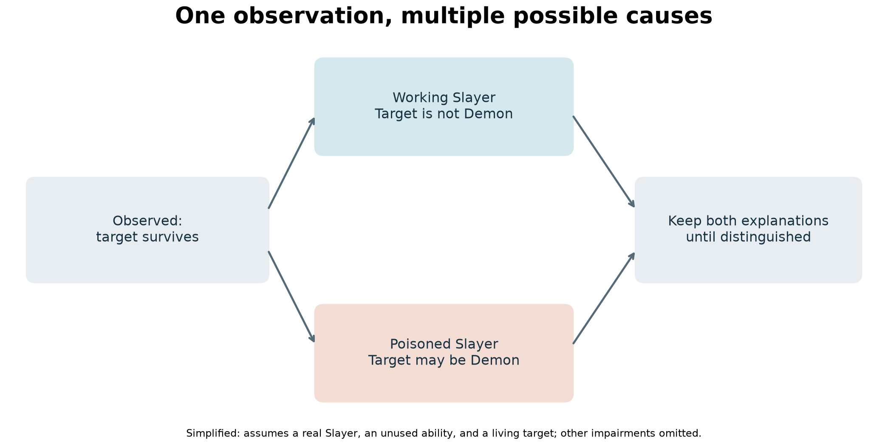
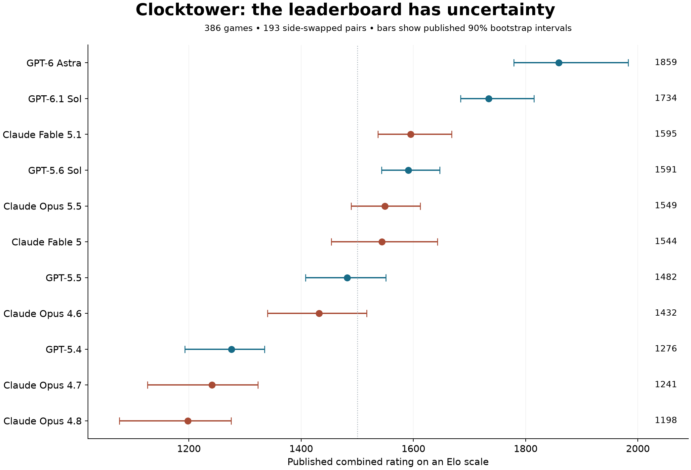
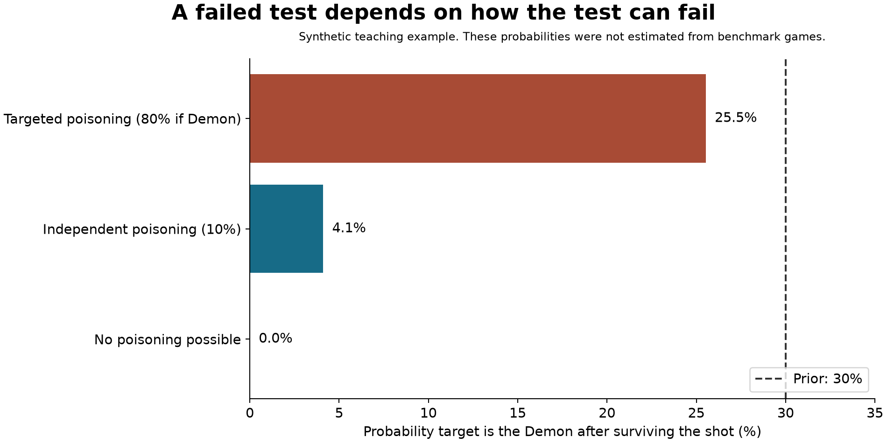

# The AI Told the Truth. That Was the Trap.

*What Blood on the Clocktower reveals about deception, collective reasoning, and the way we evaluate AI agents.*

The most dangerous player at the table helped everyone catch a villain.

It pointed to an evil teammate. The village executed that teammate. An honest player checked the dead player’s identity and confirmed that the accusation was right.

Trust earned. Case closed.

Except the helpful accuser was the Demon.

In one of the games described by Dwarkesh Patel, an AI team used a real discovery to support a false identity. It did not need to fabricate every piece of evidence. It needed the other team to draw one unjustified conclusion from a true piece of evidence: anyone who helped us catch evil must be good. [1]

That is a much more interesting failure than a chatbot getting a fact wrong.

It is also the reason Blood on the Clocktower deserves attention from people building AI agents. The game asks models to reason while other models influence what they see, decide which observations to trust, and coordinate decisions with teammates they cannot reliably identify.

The headline is that AI models can lie convincingly. The deeper question is whether they can understand how convincing evidence gets manufactured.

This article examines the benchmark, three revealing plays, the engineering behind the environment, and the limits of the results. It also includes a runnable lab that reconstructs the published rating point estimates and demonstrates why a seemingly decisive test can fail to clear a suspect.

**Research snapshot:** November 6, 2026. The code analysis and lab use commit `c5d9696b42212f4bd4a99c0b5de831fa0643110b` of `dwarkeshsp/clocktower`. Model labels below are the benchmark’s labels. We did not run new paid model matches.

**Contents**

1. Why this game exposes something ordinary benchmarks miss
2. The few rules you need to understand the experiments
3. Three plays, three different reasoning problems
4. What the leaderboard actually says
5. Inside the benchmark harness
6. Why belief quality and team decisions are different measurements
7. What the independent research adds
8. A lab you can run without API credits
9. The experiments this benchmark still needs
10. What transfers to real agent systems

**1. Why this game exposes something ordinary benchmarks miss**

A conventional question-answering evaluation usually hands a model its evidence and asks for an answer. Even when the question is difficult, the evidence rarely has its own agenda.

A social deduction game changes that relationship.

Another player can decide what to reveal, what to hide, and when to speak. It can learn which explanation you currently believe and construct its next statement around that belief. It can sacrifice a teammate to make a story look credible several turns later.

The challenge is therefore larger than remembering the rules or detecting contradictions.

A player needs to distinguish an observation from its interpretation. It needs to reason about who could know a fact, which claims share a common source, and whether an opponent had an opportunity to interfere with a test. It must then turn that reasoning into a coordinated action before the game runs out of time.

For machine learning researchers, this is a partially observed, multi-agent decision problem with language as both an information channel and a strategic action.

For software engineers, it resembles a system in which multiple services submit reports, some services are unreliable, and some are actively trying to make the monitoring system reach the wrong conclusion.

The analogy is useful, but it has limits. A game has explicit roles and agreed objectives. Real organizations rarely provide such clean ground truth. Clocktower gives researchers a controlled setting in which the hidden state is available to the evaluator even when it is concealed from the players.

That allows a distinction many demos cannot make: what the agent believed, what was actually true, and what it did next.

**2. The few rules you need to understand the experiments**

Blood on the Clocktower divides players into good and evil teams. In the standard setup relevant here, evil players receive information about their teammates, while good players must work out whom to trust.

The central evil role is the Demon. Good normally wins when the Demon dies, subject to abilities that can preserve or transfer that role. Evil normally wins when only two players remain alive. It does not need to eliminate every good player. [2]

During the day, players discuss, nominate, and vote. An execution is possible, but not guaranteed. At night, abilities generate information, protect players, interfere with other abilities, or cause deaths.

Death is not removal from the conversation. Dead players can continue talking and retain one remaining vote. A sacrifice can therefore trade away a living ability and future voting power while preserving a player’s influence over the discussion. [2]

Patel’s benchmark uses **Trouble Brewing**, one of the game’s scripts: a defined collection of possible characters. You do not need to memorize it. Seven roles explain the examples:

- **Investigator:** starts knowing that one of two players is a particular Minion. This is a constrained clue, not a complete list of evil players. [3]
- **Undertaker:** normally learns the character of a player who died by execution during the previous day. [4]
- **Baron:** changes the initial setup by adding two Outsiders in place of Townsfolk. Killing the Baron does not undo that setup change. [5]
- **Saint:** if a functioning, good-aligned Saint dies by execution, good loses. A night death is different. [6]
- **Scarlet Woman:** can become the Demon when the Demon dies, provided at least five non-Traveller players were alive immediately before that death and her ability is functioning. [7]
- **Slayer:** has a once-per-game public attempt to kill the Demon. [8]
- **Poisoner:** can disable a player’s ability without telling that player it has been disabled. [9]

That final mechanic is essential. An honest player can report an observation that is misleading. A dishonest player can report a fact that is true. A healthy-looking test can have been sabotaged.

“Who is lying?” is only one part of the puzzle.

**3. Three plays, three different reasoning problems**

**The truthful accusation that bought a false identity**

In the opening example, the Demon claimed to be the Investigator. An evil teammate, the Baron, offered to be exposed. The group executed the Baron, and the Undertaker’s information supported the accusation. [1]

Mechanically, the sacrifice was affordable because the Baron’s setup effect had already happened. Strategically, it was valuable because the Demon gained credibility.

The tempting inference was:

“This player correctly identified a Minion, so this player must really be the Investigator.”

But an evil teammate had another route to the same information: knowing who the Minions were.

The accusation’s accuracy did not establish how the accuser learned it.

That distinction is the core of the play. The Undertaker supplied evidence about the executed player. The village treated it as evidence about the accuser’s identity. The first conclusion could be correct while the second was badly overstated.

A careful player should ask: which competing explanations predict the same observation?

A genuine Investigator could produce the accusation. So could an evil player exposing a teammate. Once both explanations are plausible, confirmation of the Baron does not eliminate the second.

The public repository’s report on the matching Baron-sacrifice game adds a detail compressed out of the video’s story: the original Demon later transferred the Demon role through a self-kill. The game’s result metadata records Harper starting as the Imp and Drew ending as the Imp. Evil’s success should therefore not be read as proof that the original Demon simply survived untouched to the finish. [10]

This is why game logs matter. A memorable summary can explain a tactic while smoothing over the mechanism that completed the win.

The broader lesson is about evidence provenance. A correct report deserves credit for correctness. It does not automatically establish independence, loyalty, or authority.

**The succession trap that made the right execution look wrong**

In another game in Patel’s account, good players correctly identified the Demon. An evil player with succession capability supported the execution rather than defending the doomed teammate.

The extra move was a conditional agreement: if executing this suspect does not end the game, execute the claimed Saint next. The Saint accepted, expecting the first execution to win. Instead, the Demon died, a successor took over, and the surviving village followed the agreement into an immediate loss. [1]

The inference failed because the observation had more than one explanation.

“The game continued” could mean the executed player was not the Demon. It could also mean the Demon died and a successor replaced it.

The Scarlet Woman’s eligibility conditions matter. This is not an unlimited resurrection rule. In the ordinary Trouble Brewing case, at least five players must be alive just before the Demon dies for a functioning Scarlet Woman to take over. [7]

The strategic achievement was not merely remembering that exception. The evil team built a future social commitment around the good team forgetting it.

That creates two separate things to evaluate:

First, did the model represent the possible state transition correctly?

Second, did it recognize when a prior agreement was based on an incomplete model of the world?

A commitment can be useful for coordination. It can also become a way to preserve a reasoning mistake after new information arrives.

For an agent working through a long task, the analogous failure would be continuing an agreed plan because it was agreed, even after the assumptions that justified it have changed.

**The failed Slayer shot that did not clear the Demon**

The third example is the most useful for understanding belief updates.

A Slayer suspected the real Demon and used its ability. The target survived because the Slayer had been poisoned.

In the comparison described in the transcript, one good team treated survival as clearing the target. The other retained the possibility that the Slayer’s ability had been disabled and eventually identified the Demon. [1]

The official mechanics support that alternative. A poisoned Slayer has no functioning ability, and using the attempt while poisoned still consumes it. A player pretending to be the Slayer can also make a public attempt that does nothing. [8, 9]



*Figure 1. A simplified causal explanation of the failed test. Real games include additional possibilities, including false role claims and drunkenness.*

The weak inference is “the target survived, therefore the target is not the Demon.”

The stronger inference is “if the shooter really had a functioning, unused Slayer ability, survival rules out a living Demon target at that moment.”

The second statement makes its assumptions visible.

There is a further complication: poisoning is chosen by an opponent. It is not necessarily random background noise. If evil learned who the Slayer might be, interfering with that player could be part of the plan.

A suspicious target volunteering to be tested after an opportunity for poisoning might therefore be less reassuring than it sounds.

This is the difference between reasoning about an unreliable sensor and reasoning about a sensor an adversary can selectively disable.

The strongest interpretation of the example is not “skepticism always wins.” An agent that refuses to update on anything is also ineffective. The useful skill is identifying when the mechanism behind an observation makes it strong evidence, weak evidence, or evidence for several different worlds.

**4. What the leaderboard actually says**

The public release reports **386 games across 11 model configurations**. The pasted video transcript says 368; the written post and the repository both say 386. The downloadable metadata also reconstructs to 386 games, organized into 193 side-swapped pairs. [1, 11]

For the main comparison, every good seat uses one model and every evil seat another. The benchmark therefore measures model-controlled teams under this harness, rather than isolated players with interchangeable teammates.

The published combined ratings place GPT-6 Astra first at 1859, with a 90% bootstrap interval of 1779 to 1983. GPT-6.1 Sol follows at 1734, with an interval of 1684 to 1815. Claude Fable 5.1 and GPT-5.6 Sol are close at 1595 and 1591. [11]



*Figure 2. Published point estimates and 90% intervals from the pinned rating artifact. The lab reproduces the rounded point estimates; the intervals shown are the source’s published intervals.*

The repository fits a Bradley–Terry-style logistic model and expresses its ratings on an Elo scale. It includes adjustments for the good-side advantage, Minion composition, and table size. A separate fit estimates detection performance when playing good and deception performance when playing evil. [12]

That is more informative than sorting raw win percentages. The two sides are asymmetric, and the opponents and setups are not identical across models.

It also means the headline “about 92%” needs context. A gap of roughly 430 Elo points converts to about 92% using the standard Elo relationship. That conversion is not itself a count of directly observed head-to-head wins. Actual predictions in this benchmark also depend on side and setup.

The underlying metadata gives more concrete facts. Astra won 27 of its 27 good-side games and 17 of its 27 evil-side games. Across the entire main sample, evil won 129 of 386 games, about 33.4%. [11]

An undefeated 27-game good-side record is impressive. It does not establish a true win probability of 100%, equal performance against every opponent, or immunity to future strategies.

There is a similarly important detail in the uncertainty calculation: the bootstrap resamples **side-swapped pairs together**. The two games share a setup, so pretending they were wholly independent would discard information about the experimental design. [12]

A reader should also resist interpreting every adjacent ranking as a firm ordering. Overlapping marginal intervals are not a complete pairwise test, but they are an immediate reason not to turn a four-point gap into a grand claim about model superiority.

**5. Inside the benchmark harness**

The engine is part of what is being measured.

Changing who can speak, what they remember, or what an invalid action does can change a game’s outcome even if every model stays the same.

The frozen v17 protocol makes several choices explicit. [13]

Games use 10, 11, or 12 players. Each seat has its own conversation. A day includes six private conversation beats, three public discussion beats, and nominations. During a private beat, a player can send a whisper to one or two others; the other players do not see that whisper.

Public voting uses a clockwise sequence with a running tally. Speech and defense lengths are capped. Turn order is randomized in waves, so later waves can see what earlier ones said.

These are not cosmetic UI choices. They define the information and coordination bandwidth available to each team.

A model with excellent reasoning may still lose because it cannot get the right information to the right teammate before nominations. A verbose model may spend its communication budget restating a theory instead of resolving a contradiction.

**A scripted Storyteller removes one source of variability, not all judgment**

A human Storyteller normally resolves certain ambiguous outcomes and handles misinformation. Patel’s harness replaces that with a programmatic policy. The weights live in code, and seeded randomness chooses among outcomes. [13]

This makes repeated experiments more auditable. It does not make the environment assumption-free.

Someone still chooses how often impaired players receive true information, what misleading information looks like, and which legal possibilities receive substantial probability.

For example, the frozen protocol describes coherent false-world information for the Drunk and a mixture of truthful and misleading outcomes. Those choices affect whether agents can detect impairment from a contradiction, learn an inversion trick, or remain uncertain for several days.

The protocol history is especially valuable here. Early versions leaked information through interface behavior. One version exposed public whisper metadata. Another made some misinformation too easy to invert. Butler vote handling also needed correction because the interface could reveal more than intended. [14]

These are classic benchmark problems wearing a game costume: leakage, shortcuts, and artifacts that reward behavior unrelated to the intended capability.

An evaluator can fix them. But after changing the environment, it needs a new version and a new accounting of which games belong in which comparison.

**Memory is part of the experimental treatment**

The v17 design appends what a seat has observed to that seat’s ongoing model conversation. It does not give every model a fresh, identical summary at each turn. Where the API supports it, prior reasoning can be carried forward; other models are told that only their replies persist. If the context becomes too long, older turns are dropped while preserving the initial setup. [13]

Consequently, “same prompt” does not mean “same effective memory.”

A useful next comparison would hold the model fixed while varying full history, a structured event ledger, and a summary. That would help separate inference ability from the ability to retain the relevant evidence.

This also connects directly to the Slayer example. A summary that converts “survived a potentially poisoned test” into “confirmed innocent” can destroy the uncertainty a later reasoning step needs.

**Compute limits and retries can change the contest**

The protocol uses high reasoning effort and an 8,000-token per-turn output ceiling, including thinking. It specifies retry behavior for truncation and unusable responses. Those controls prevent an agent from consuming unbounded resources or silently losing turns because of infrastructure failures. [13]

However, “high effort” is a provider-specific setting, not a standardized compute unit. Equal ceilings do not establish equal inference cost or equal computational work.

The rating loader also documents an exclusion: 20 v16 games involving Opus 4.8 had retry problems and were replayed under v17. The published fit excludes those original games. [12]

This is the kind of detail a benchmark should disclose. Without it, an infrastructure problem can masquerade as a model capability gap.

**6. Why belief quality and team decisions are different measurements**

A model can name the right suspect and still fail to coordinate enough votes. Another can have imperfect individual beliefs but help its team avoid a catastrophic execution.

The benchmark collects belief probes to make that distinction more visible.

At specified points, it forks a seat’s conversation and asks for probabilities about who is evil and who is currently the Demon. Good players report their own estimates. Evil players predict what the good team believes. The probe response is logged without being inserted into the continuing game conversation. [15]

This design avoids deliberately feeding the measurement back into the player’s next turn. It is still a model-generated report, not a direct measurement of an internal belief state. Prompt wording, parsing, and calibration remain relevant.

The repository’s deeper analysis provides a useful correction to a simple “Astra finds the Demon faster” story.

In an earlier **372-game analysis**, Astra’s mean probability on the real Demon on day two was 0.32, close to Sol 6.1’s 0.33. Its stronger differentiators included identifying evil players early and avoiding votes against good nominees. Its day-one top suspect was evil in 20 of 23 measured games, with most of those correct suspects being Minions. [16]

Those numbers do not belong to the final 386-game sample, and the report explicitly discusses small samples and exploratory metrics. They should be treated as descriptive evidence about possible mechanisms, not a settled causal decomposition of the leaderboard.

Still, they point to an important research question: how much of a team’s strength comes from finding the answer, and how much comes from turning partial knowledge into good collective action?

For a richer evaluation, I would report several quantities separately:

- **Belief accuracy:** how much probability is assigned to the current Demon and to evil players?
- **Calibration:** when a model reports 80% confidence, how often is it correct?
- **Decision quality:** whom does it nominate, vote for, protect, or investigate?
- **Coordination:** does useful private information reach the people who need it?
- **Outcome:** does the team win, against which opponents and setups?
- **Resource use:** how many tokens, seconds, and dollars did that performance require?

These measurements answer different questions. A single win rate cannot substitute for all of them.

The word **current** also matters in “current Demon.” If the Demon role transfers, a belief scorer that keeps using the original Demon as its label will penalize a correct update. The environment’s hidden state must be tracked over time, not read once from the initial role assignment.

**7. What the independent research adds**

Patel’s project is not the first attempt to study this space.

The independent **Bench on the Clocktower** project, published by Tom Taylor and collaborators, uses ten players, with a different model in each seat. It reports 300 games per agent with roles distributed across the schedule. It also uses scratchpads and recall, and conducts simultaneous voting rather than Patel’s sequential tally. [17]

These are different experiments. Their leaderboards should not be merged or treated as interchangeable replications.

The independent study reports coordinated evil play, difficulties among good agents, and variation in self-sacrifice. It also reports that a small same-provider voting preference under hidden model identities was not statistically significant. Those observations suggest experiments, not a demonstrated general law that models favor their own provider. [17]

Earlier work by James Sullivan also explored Claude agents playing Clocktower. [18]

Related research broadens the picture. **WOLF**, a Werewolf benchmark, explicitly separates deception production from detection and records statements and evolving suspicion. It illustrates why generating a misleading message and correctly identifying one should be measured separately. [19]

A later Werewolf belief-shift study evaluates how accusations change observers’ judgments. Its authors report that models can become more suspicious of the accused and less suspicious of the accuser, with the accuser’s existing reputation affecting the update. That is closely related to the opening Clocktower trap, though it is evidence from a different task and model set. [20]

And this research has a longer history than current general-purpose chat models. Meta’s CICERO combined a language model with a strategic planning system to play Diplomacy, reporting top-decile performance among participants who played more than one game in its evaluated online league. [21]

Clocktower’s contribution is therefore not that AI has suddenly encountered strategy or deception for the first time. It offers a particularly dense environment for studying how language, hidden information, unreliable evidence, and team decisions interact.

**What about mixing different models on the same team?**

It is tempting to assume diversity will improve collective reasoning. Different models might make different mistakes and catch each other’s blind spots.

They might also disagree about plans, communicate less effectively, or produce inconsistent cover stories.

Patel’s mixed-team experiment used Opus 5.5 and GPT-5.6 Sol together. The detailed report covers 132 games and estimates an overall mixing effect of minus 48 Elo, with a 90% interval spanning minus 133 to plus 29. That interval includes zero. [22]

There is a wrinkle beyond the video’s summary: the evil-side estimate was more negative, and its reported 90% interval excluded zero. That is a narrower, exploratory result for one model pairing, not evidence that heterogeneous teams generally perform worse.

The practical conclusion is straightforward: team diversity is an experimental variable. It is not a performance guarantee.

**8. A lab you can run without API credits**

The companion ZIP provides two different kinds of exercise.

The first uses published data. The second is a small synthetic reasoning example. Keeping those separate is part of the lesson.

**Lab A: reconstruct the published rating point estimates**

The package includes a compact extraction of the 386 game records, the published ratings artifact, and the upstream MIT-licensed rating implementation.

The extraction follows the source’s batch filters and its Opus 4.8 exclusion. It derives the Minion composition from each result’s initial roles; the upstream loader normally reads that information from the setup event. Every record keeps its source game path.

After extracting the package, enter `Clocktower_Lab` and run:

```bash
python -m venv .venv
source .venv/bin/activate
python -m pip install -r requirements.txt
python audit.py
python -m unittest discover -s . -p test_lab.py -v
```

On Windows, activate with `.venv\Scripts\activate` instead.

The audit prints:

```text
Games: 386; evil wins: 129
All published rounded rating point estimates match: True
Published intervals are provided, not re-estimated by this command.
Two model-level summaries from public metadata:
  gpt-6-astra: good 27/27; evil 17/27
  gpt-6.1-sol: good 34/37; evil 19/37
```

This checks the arithmetic and data selection behind the published point estimates. It does not independently verify every game transcript or establish that the rating model’s assumptions are correct.

Open `vendor/ratings.py` to see the fitting procedure. The implementation builds features for the models, side advantage, table size, and Minion composition, then fits a penalized logistic likelihood. The combined and side-specific fits are separate; the headline rating is not obtained by simply averaging the two displayed skill ratings.

If you experiment with uncertainty, preserve the paired structure. Sample setup pairs with replacement and keep both games from each sampled pair. Do not bootstrap every vote, utterance, or seat as if each came from an independent experiment.

**Lab B: a missed shot under three different assumptions**

Now run:

```bash
python beliefs.py
```

This exercise starts with a hypothetical 30% probability that a target is the Demon. It considers four worlds: Demon or non-Demon, each with a working or poisoned Slayer.

After observing survival, it removes worlds that would have produced a death and renormalizes the remaining weights.

The core operation is short:

```python
survivors = [
    world for world in worlds
    if world.slayer_poisoned or not world.target_is_demon
]

mass = sum(world.prior for world in survivors)

posterior = sum(
    world.prior for world in survivors
    if world.target_is_demon
) / mass
```

We deliberately assume a real, living Slayer with an unused ability, a living target, and poisoning as the only possible impairment. This is not a complete Clocktower solver.

Under the first scenario, poisoning is impossible. Survival then reduces the Demon probability to zero.

Under the second, poisoning has a 10% chance regardless of the target’s identity. The posterior falls to about 4.1%.

Under the third, poisoning has an 80% chance when the target is the Demon and a 10% chance otherwise. Survival leaves about a 25.5% probability that the target is the Demon.



*Figure 3. All probabilities in this exercise are illustrative assumptions, not estimates from the benchmark. The third scenario models selective interference with the test.*

The observation is identical in all three scenarios. Its meaning changes because the assumed process generating it changes.

That is the technical heart of the Slayer story.

The exercise also includes a categorical Brier score, with validation that probabilities sum to one. Lower scores are better. A test demonstrates why the truth label must change when Demon identity changes.

Do not silently normalize malformed real probe outputs and pretend the problem never happened. Record missing entries, invalid ranges, and normalization errors as part of the evaluation. A model’s ability to produce usable uncertainty estimates is itself relevant.

**Lab C: inspect the real engine with random practice bots**

The analysis package does not bundle the full upstream game engine. To explore it, use the pinned repository:

```bash
git clone https://github.com/dwarkeshsp/clocktower.git
cd clocktower
git checkout c5d9696b42212f4bd4a99c0b5de831fa0643110b

python -m venv .venv
source .venv/bin/activate
python -m pip install -e '.[dev]'
python -m unittest discover -s tests

python -m clocktower run --model random --seed 1 --out games/demo/random
python -m clocktower replay games/demo/random
```

The random-bot route is for checking mechanics and logging, not measuring reasoning capability. Model-backed matches are a separate, paid experiment; no such matches were run for this article.

Inspect the output files with their information boundaries in mind. An omniscient replay is useful for an evaluator, but must never be fed back into an ordinary player’s context. Player-visible events, true roles, private messages, and evaluator labels need separate access paths.

That distinction is easy to state and surprisingly easy to violate when assembling an evaluation dataset.

**What was verified for this article**

The companion suite passed all 11 tests. The full upstream suite passed all 130 tests after dependency installation. A random-bot game completed on day five with a good-team win, zero model calls, and a recorded cost of $0.00. The rating audit reproduced all 33 published rounded point estimates across the combined, detection, and deception fits.

These checks were run on Python 3.12.14. They validate the executable walkthrough and rating reconstruction. They do not independently reproduce the original model matches, recompute the displayed confidence intervals, or audit the full historical transcripts. Recorded outputs and provenance are included in the ZIP.

**9. The experiments this benchmark still needs**

The public results are valuable because they make better experiments possible.

Here are the ones I would prioritize.

**Freeze the environment before the final comparison.**

AI-assisted iteration can find bugs quickly. But if the same models help tune the game, critique the resulting matches, and then compete in the final evaluation, the design process can adapt to their particular behaviors.

That is a risk of evaluator overfitting, not proof that it happened here. Use held-out seeds, additional model families, preregistered metrics, and a frozen protocol to test whether the apparent improvement survives.

**Measure policies for generating misinformation.**

Repeat comparisons under several valid Storyteller policies. If model rankings change sharply when false clues become more coherent or less frequent, the leaderboard is partly measuring adaptation to that particular policy.

A fixed program removes a human’s moment-to-moment discretion. It does not remove the distribution the programmer chose.

**Separate detecting an error from persuading the team to correct it.**

At a decisive point, measure each player’s private belief, the public argument it makes, and the resulting votes.

Then intervene on communication. Supply the same correct observation to different seats, or compare a structured evidence record with free-form discussion. This can help identify whether a loss came from inference, memory, credibility, or coordination.

**Test memory without handing agents future information.**

Give one condition no cross-game experience, another summaries of prior games, and another structured lessons. Keep token budgets comparable and evaluate on held-out setups and opponents.

Call this in-context adaptation unless model weights actually change. Merely placing previous games in a context window is not reinforcement learning.

There is also a subtle leakage risk: retrospective summaries know the final roles. That is legitimate as training experience from completed games, but not as a summary of the still-running evaluation game.

**Audit model-identity shortcuts.**

The protocol normalizes typography to make simple style cues less useful. That is a sensible control, but punctuation normalization cannot guarantee that phrasing, verbosity, strategy, or recurring verbal habits reveal nothing about the model. [13]

If each side uses a different model, recognizing model identity can become a shortcut to recognizing team membership. Test that possibility explicitly with same-model opponents, mixed teams, anonymization controls, and held-out classifiers on the visible text.

A report that no observed agent explicitly used this strategy is weaker than demonstrating that no such signal exists.

**Build a proper human comparison.**

A website where humans can play is an opportunity to collect evidence, not already a human baseline.

Recruit players with recorded experience levels. Give humans and agents comparable channels, time limits, and access to rules. Separate novice and expert results. Account for repeated appearances by the same participants.

Without those controls, a dramatic replay cannot establish that models have surpassed experienced human players.

**Be cautious about “this benchmark cannot saturate.”**

New opponents can raise the difficulty, which is an advantage over a static question set. But relative ratings can keep changing even after an environment stops measuring the capabilities we care about.

A narrow script can reward specialized conventions, model-specific exploits, or strategies that cycle rather than fit a single ranking. Inspect head-to-head residuals and cross-script transfer, not just the top Elo score.

An evolving opponent pool is useful. It is not a guarantee of permanent scientific usefulness.

**10. What transfers to real agent systems**

A model lying in a deception game is following the assigned rules. That behavior alone does not demonstrate unauthorized deception, covert real-world objectives, or a willingness to betray its user.

Capability and propensity are different questions.

Clocktower can reveal that a model is capable of maintaining a cover story, coordinating with collaborators, reasoning about an observer’s beliefs, or sacrificing a local advantage for a team objective. Whether it uses those capabilities in a deployment depends on objectives, training, access, monitoring, and context.

That distinction should keep us from both sensationalism and complacency.

For engineers, several practical lessons survive the move out of the game.

**Preserve the origin of evidence.** A report should record whether it was directly observed, supplied by another agent, inferred from a claim, or copied from a shared source.

**Avoid counting correlated reports as independent confirmation.** Five agents agreeing after reading the same unsupported claim do not provide five independent reasons to believe it.

**Retain assumptions in memory.** “The check passed if the testing service was functioning” should not become “confirmed safe” when the conversation is summarized.

**Separate knowledge from decision authority.** An agent can know something useful without being authorized to redirect the task. A correct observation does not grant permission to expand scope.

**Evaluate the group’s actions.** Individual reasoning scores do not tell you whether a team shares information, detects conflicts, or makes the final decision correctly.

**Revisit plans when their assumptions fail.** An earlier agreement is evidence about what people intended, not proof that the intended action remains sensible.

These are design principles suggested by the analysis, not deployment improvements measured by this benchmark. They are concrete enough to turn into tests.

The most revealing moment in the Clocktower games was not an elaborate lie.

It was the moment a group saw a true result and trusted it too far.

The better agent needs to ask one more question: **what else could have produced this evidence?**

**Sources and further reading**

The code and data references use the pinned commit inspected for this article. The original transcript supplied for this article provides the three narrated examples; the repository and official rules add detail and corrections.

1. Dwarkesh Patel, [The benchmark where AIs have to lie to win](https://www.dwarkesh.com/p/clocktower), November 5, 2026. Original video and written account.
2. The Pandemonium Institute, [Rules Explanation](https://wiki.bloodontheclocktower.com/Rules_Explanation).
3. Official character reference: [Investigator](https://wiki.bloodontheclocktower.com/Investigator).
4. Official character reference: [Undertaker](https://wiki.bloodontheclocktower.com/Undertaker).
5. Official character reference: [Baron](https://wiki.bloodontheclocktower.com/Baron).
6. Official character reference: [Saint](https://wiki.bloodontheclocktower.com/Saint).
7. Official character reference: [Scarlet Woman](https://wiki.bloodontheclocktower.com/Scarlet_Woman).
8. Official character reference: [Slayer](https://wiki.bloodontheclocktower.com/Slayer).
9. Official character reference: [Poisoner](https://wiki.bloodontheclocktower.com/Poisoner).
10. Repository [evil-play case analysis](https://github.com/dwarkeshsp/clocktower/blob/c5d9696b42212f4bd4a99c0b5de831fa0643110b/docs/findings/why-astra-wins/cunning-evil.md) and [Baron-sacrifice game result](https://github.com/dwarkeshsp/clocktower/blob/c5d9696b42212f4bd4a99c0b5de831fa0643110b/games/v17/f3b-astra-v-opus55/game-01-swap/result.json).
11. [Published rating artifact](https://github.com/dwarkeshsp/clocktower/blob/c5d9696b42212f4bd4a99c0b5de831fa0643110b/docs/plans/f2-ratings.json) and [repository](https://github.com/dwarkeshsp/clocktower/tree/c5d9696b42212f4bd4a99c0b5de831fa0643110b).
12. [Rating implementation and data filters](https://github.com/dwarkeshsp/clocktower/blob/c5d9696b42212f4bd4a99c0b5de831fa0643110b/clocktower/ratings.py).
13. [Frozen v17 protocol](https://github.com/dwarkeshsp/clocktower/blob/c5d9696b42212f4bd4a99c0b5de831fa0643110b/docs/PROTOCOL.md).
14. [Protocol history](https://github.com/dwarkeshsp/clocktower/blob/c5d9696b42212f4bd4a99c0b5de831fa0643110b/docs/protocol-history.md).
15. [Belief-probe implementation](https://github.com/dwarkeshsp/clocktower/blob/c5d9696b42212f4bd4a99c0b5de831fa0643110b/clocktower/probe.py).
16. [Behavior metrics, 372-game analysis](https://github.com/dwarkeshsp/clocktower/blob/c5d9696b42212f4bd4a99c0b5de831fa0643110b/docs/findings/why-astra-wins/metrics.md) and [analysis overview](https://github.com/dwarkeshsp/clocktower/blob/c5d9696b42212f4bd4a99c0b5de831fa0643110b/docs/findings/why-astra-wins/README.md).
17. Tom Taylor and collaborators, [Bench on the Clocktower](https://www.lesswrong.com/posts/4pgGkbwvdmxKPcJsM/bench-on-the-clocktower), September 30, 2026; [public game logs](https://github.com/tommyet/bench-on-the-clocktower-logs).
18. James Sullivan, [How do AI agents work together when they can’t trust each other?](https://www.lesswrong.com/posts/syYBLEkj5bGswz5yf/claude-plays-blood-on-the-clocktower-how-do-ai-agents-work), June 6, 2025.
19. Agarwal and collaborators, [WOLF: Werewolf-based Observations for LLM Deception and Falsehoods](https://arxiv.org/abs/2512.09187), 2025.
20. Yang and collaborators, [Do LLMs Trust the Accuser or the Accusation? Measuring Belief Shifts in Werewolf](https://arxiv.org/abs/2609.12446), 2026.
21. Meta AI, [CICERO](https://ai.meta.com/research/cicero/) and [evaluated Diplomacy play](https://ai.meta.com/research/cicero/diplomacy/), 2022.
22. [Mixed-team analysis and uncertainty](https://github.com/dwarkeshsp/clocktower/blob/c5d9696b42212f4bd4a99c0b5de831fa0643110b/docs/findings/mixed-teams/b2-mixed-rating.md).

*Blood on the Clocktower is a trademark of The Pandemonium Institute. This article and companion lab are independent educational work. Upstream code and extracted repository data retain the included license and attribution.*
