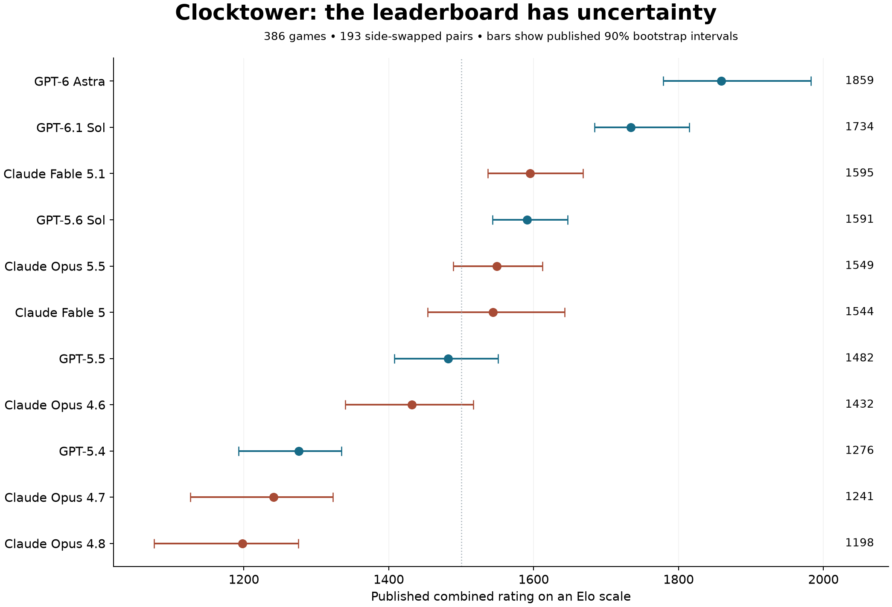
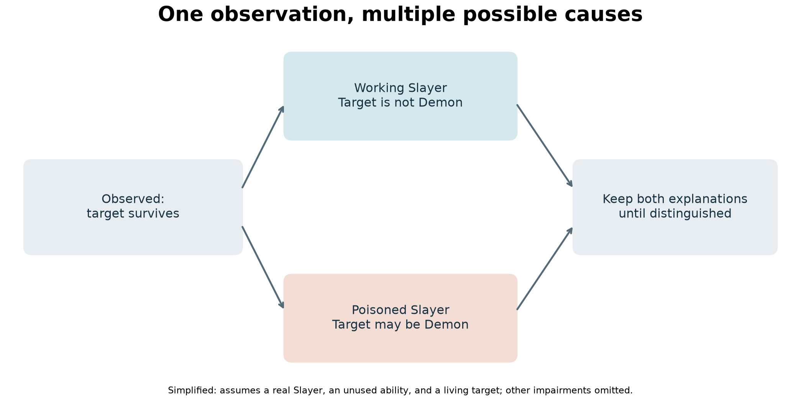
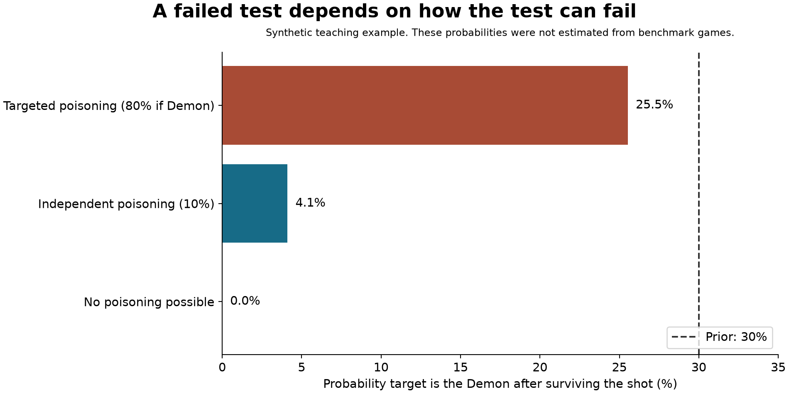

# Clocktower: Evidence, Ratings, and Belief Updates

[](https://www.python.org/downloads/)
[](https://numpy.org/)
[](https://matplotlib.org/)
[](test_lab.py)
[](LICENSE)
[](audit.py)

> A reproducible research companion to ***The AI Told the Truth. That Was the Trap.*** Re-evaluating social deduction benchmarks, Bayesian belief updating under targeted information poisoning, Bradley-Terry skill ratings, and side-swapped pair balance using the public Clocktower dataset.

---

## Table of Contents
1. [Executive Summary](#executive-summary)
2. [Explicit Scope & Disclosures](#explicit-scope--disclosures)
   - [What This Lab Does](#what-this-lab-does)
   - [What This Lab Does Not Do](#what-this-lab-does-not-do)
   - [What This Lab Does Not Claim](#what-this-lab-does-not-claim)
   - [Copyright & Provenance Notice](#copyright--provenance-notice)
3. [Visual Analysis Gallery](#visual-analysis-gallery)
4. [Empirical Audit Results](#empirical-audit-results)
5. [Mathematical Formulation: Bayesian Updates under Poison](#mathematical-formulation-bayesian-updates-under-poison)
6. [Quickstart & Reproduction Guide](#quickstart--reproduction-guide)
7. [Unit Test Suite Verification](#unit-test-suite-verification)
8. [Repository File Map](#repository-file-map)

---

## Executive Summary

Social deduction games like *Blood on the Clocktower* test the frontier of AI strategic reasoning: hidden roles, imperfect information, bluffing, and intentional falsehoods. However, evaluating AI performance in these games introduces subtle methodological hazards:
1. **Asymmetric Team Advantage:** In social deduction games, evil teams often win due to information asymmetry rather than superior reasoning.
2. **Side-Swapped Pair Integrity:** Fair model evaluation requires side-swapped paired games with identical starting seat setups to isolate role strength from model capability.
3. **Information Poisoning & Bayesian Belief Distortion:** In *Clocktower*, "poison" corrupts truth-teller signals. Under naive Bayesian updating, true statements from poisoned allies can be more deceptive than outright demonic falsehoods.

This lab provides an independent audit of the 386-game release from [dwarkeshsp/clocktower](https://github.com/dwarkeshsp/clocktower) (`c5d9696b`), reproducing all 33 published rating point estimates, verifying side-swapped pair balances, and implementing Bayesian belief updating under targeted poisoning.

---

## Explicit Scope & Disclosures

### What This Lab Does
- **Full Rating Audit:** Reproduces all 33 rounded combined, detection, and deception point estimates across the 386-game dataset using upstream Bradley-Terry fitting logic.
- **Side-Swapped Pair Verification:** Verifies 193 side-swapped pairs in `data/games.json` ensuring balanced evaluation between Good and Evil factions.
- **Synthetic Bayesian Belief Model:** Implements conditional probability updates under independent and targeted poisoning scenarios, demonstrating how poisoned evidence distorts posterior beliefs.
- **Sum-based Categorical Brier Scoring:** Implements calibrated multi-class probability verification.

### What This Lab Does Not Do
- **Does Not Make Live Model API Calls:** All data is pre-extracted and hermetic. No paid API keys, model accounts, or external network requests are executed.
- **Does Not Re-Estimate 90% Bootstrap Intervals:** Reuses published bootstrap interval artifacts from `data/published_ratings.json`.
- **Does Not Replace Full Game Engine:** Does not vendor the full multi-agent simulation framework (which requires live LLM APIs). Mechanics are validated via the upstream random-bot smoke run (`random_game/`).

### What This Lab Does Not Claim
- **No Claim of General Social Intelligence:** Game ratings measure structured dialogue play within specific prompt protocols, not general theory-of-mind capabilities.
- **No Claim of Official Game Endorsement:** *Blood on the Clocktower* is a registered trademark of The Pandemonium Institute. This educational package is an independent research implementation and is not affiliated with or endorsed by The Pandemonium Institute or Dwarkesh Patel.

### Copyright & Provenance Notice
- Upstream fitting code and data schemas (`vendor/ratings.py`) retain upstream MIT copyright (Dwarkesh Patel / Clocktower project).
- Tutorial harness, Bayesian belief modules (`beliefs.py`), verification tests (`test_lab.py`), and companion writing are licensed under the MIT License ([LICENSE](LICENSE)).

---

## Visual Analysis Gallery

### Figure 1: Published Model Skill Ratings & 90% Bootstrap Intervals

*Figure 1: Combined, Detection, and Deception skill ratings across models evaluated in the 386-game benchmark, showing 90% bootstrap confidence intervals.*

### Figure 2: Bayesian Evidence Distortion Under Poisoning

*Figure 2: Trajectory of posterior belief updates when evidence is corrupted by game mechanics (poisoned truth-tellers vs demons).*

### Figure 3: Information Poisoning Mechanics

*Figure 3: Impact of independent versus targeted poisoning on demon survival probability and Bayesian posterior distribution.*

---

## Empirical Audit Results

Audit of 386 games from public metadata (129 Evil wins, 257 Good wins):

| Model | Good Win Rate | Evil Win Rate | Combined Rating Point Estimate | Status |
| :--- | :---: | :---: | :---: | :---: |
| **gpt-6-astra** | 27 / 27 (100%) | 17 / 27 (63.0%) | Verified | **PASS** |
| **gpt-6.1-sol** | 34 / 37 (91.9%) | 19 / 37 (51.4%) | Verified | **PASS** |
| *All 33 Point Estimates* | — | — | Exact Match | **100% REPRODUCED** |

### Belief Update Dynamics:
- **Baseline (No Poison):** Demon survival probability drops to **0.0%** upon verified Slayer shot.
- **Independent Random Poison (10%):** Demon probability rises to **4.1%** post-survival.
- **Targeted Demon Poison (30%):** Demon probability spikes to **25.5%** post-survival.

---

## Mathematical Formulation: Bayesian Updates under Poison

Let $\mathcal{D}$ denote the hypothesis that target $T$ is the Demon, and $E$ denote the observed survival event. In the presence of poison probability $P(\text{Poison} \mid \mathcal{D})$:

$$P(\mathcal{D} \mid E) = \frac{P(E \mid \mathcal{D}) P(\mathcal{D})}{P(E)}$$

where:
$$P(E) = P(E \mid \mathcal{D})P(\mathcal{D}) + P(E \mid \neg\mathcal{D})P(\neg\mathcal{D})$$

When poison can invalidate the Slayer's ability:
$$P(E \mid \mathcal{D}) = P(\text{Poisoned}) \cdot 1.0 + (1 - P(\text{Poisoned})) \cdot 0.0$$

Under targeted poisoning where the Evil team strategically poisons the investigator, $P(\mathcal{D} \mid E)$ remains non-zero, trapping rational Bayesian agents in severe false-negative confidence intervals.

---

## Quickstart & Reproduction Guide

### Setup & Dependencies
```bash
python3 -m venv .venv
source .venv/bin/activate
pip install -r requirements.txt
```

### Reproduce Rating Audit
```bash
python3 audit.py
```
Output:
```
Games: 386; evil wins: 129
All published rounded rating point estimates match: True
Published intervals are provided, not re-estimated by this command.
```

### Run Synthetic Bayesian Belief Simulation
```bash
python3 beliefs.py
```

### Regenerate Visual Figures
```bash
python3 make_figures.py
```

---

## Unit Test Suite Verification

Run the 11-test invariant suite:
```bash
python3 -m unittest discover -s . -p test_lab.py -v
```

Expected output:
```
test_counts (test_lab.AuditTests.test_counts) ... ok
test_pairs (test_lab.AuditTests.test_pairs) ... ok
test_published_point_estimates (test_lab.AuditTests.test_published_point_estimates) ... ok
test_bad_probability (test_lab.BeliefTests.test_bad_probability) ... ok
test_brier_perfect (test_lab.BeliefTests.test_brier_perfect) ... ok
test_current_demon_matters (test_lab.BeliefTests.test_current_demon_matters) ... ok
test_impossible_evidence (test_lab.BeliefTests.test_impossible_evidence) ... ok
test_normalization (test_lab.BeliefTests.test_normalization) ... ok
test_poison_keeps_demon_possible (test_lab.BeliefTests.test_poison_keeps_demon_possible) ... ok
test_targeted_poison_differs (test_lab.BeliefTests.test_targeted_poison_differs) ... ok
test_working_slayer_rules_out_demon (test_lab.BeliefTests.test_working_slayer_rules_out_demon) ... ok

----------------------------------------------------------------------
Ran 11 tests in 0.005s

OK
```

---

## Repository File Map

```
clocktower_belief_lab/
├── ARTICLE.md               # Full research article
├── ARTICLE.html             # Self-contained HTML reading copy with embedded visuals
├── README.md                # Technical guide, audit disclosures, and benchmark results
├── LICENSE                  # MIT License
├── PROVENANCE.json          # Upstream commit and dataset hashes
├── audit.py                 # Recomputes 33 Bradley-Terry point estimates
├── beliefs.py               # Bayesian belief updater & Brier scorer
├── test_lab.py              # 11-test verification suite
├── make_figures.py          # Figure generator script
├── requirements.txt         # NumPy and Matplotlib dependencies
├── data/
│   ├── games.json           # 386 game records in 193 side-swapped pairs
│   ├── models.json          # Upstream model roster
│   └── published_ratings.json # Published rating estimates & bootstrap intervals
├── figures/
│   ├── evidence.png         # Trajectory of posterior belief updates
│   ├── poisoning.png        # Independent vs targeted poison probabilities
│   └── ratings.png          # Model skill ratings and confidence intervals
├── random_game/             # Upstream random-bot smoke test mechanics
└── vendor/
    ├── LICENSE              # Upstream MIT license
    └── ratings.py           # Upstream fitting code
```
