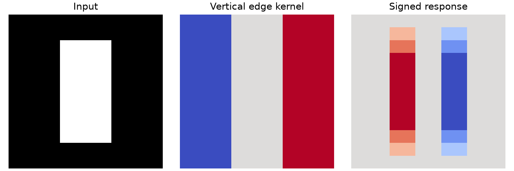
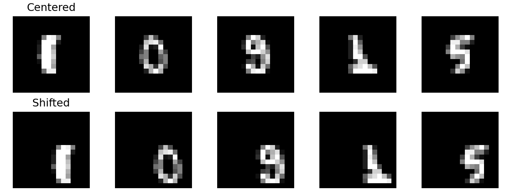
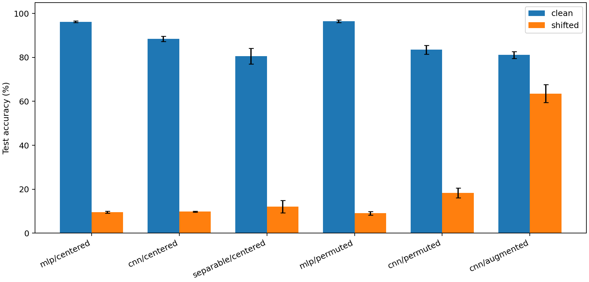
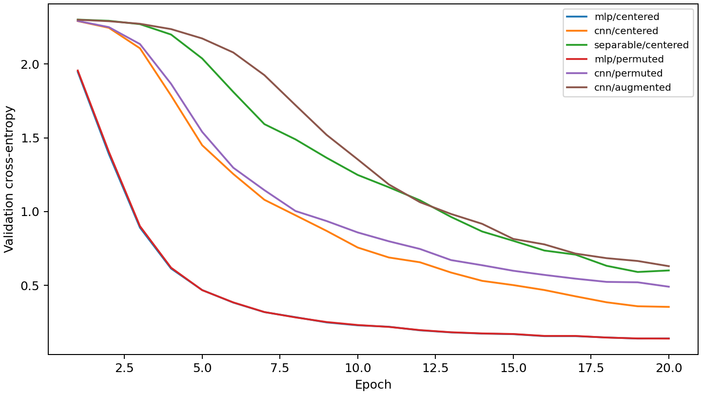
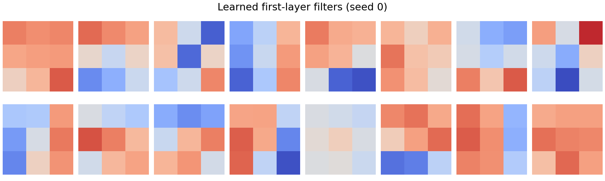

# Convolutional Networks: Mechanics, Equivariance & 18-Run Ablation Lab

[](https://www.python.org/downloads/)
[](https://pytorch.org/)
[](#recorded-results)
[](#test-suite)
[](https://opensource.org/licenses/MIT)

A CPU-only reproducible research companion to Chapter 9 of *Deep Learning* (Goodfellow, Bengio, & Courville, 2016) and [`article.md`](./article.md). It pairs **exact numerical verification of convolution lowering (`F.unfold` GEMM), backward gradients, transposed convolution, and circular equivariance vs. max-pooling aliasing** with an **18-run study** contrasting MLP, standard CNN, and depthwise-separable CNN under centered, pixel-permuted, and shift-augmented regimes.

---

## Recorded Results (`results.json` & `run.log`)

### 1. Exact Convolution & Equivariance Checks (`mechanics()`)
| Check (`float64`, `stride=2, padding=1, dilation=2`) | Max Error / Value |
|:---|---:|
| `F.conv2d` vs. `F.unfold` GEMM Forward | `1.78e-15` |
| Input / Kernel / Bias Backward Gradients | `1.78e-15`, `5.33e-15`, `0.0` |
| Circular-Padded Shift Equivariance | `0.0` *(exact)* |
| Stride-2 `max_pool2d` 1-Pixel Shift Change | `0.5146` *(breaks equivariance)* |

### 2. 18-Run Inductive-Bias & Shift Study (3 Seeds, Padded 16×16 Digits)
| Configuration | Parameters | Clean Test Acc | Shifted (+3,+3) Test Acc |
|:---|---:|---:|---:|
| `mlp/centered` | `17,098` | `96.22% ± 0.36%` | `9.56% ± 0.48%` |
| `cnn/centered` | `6,090` | `88.44% ± 1.19%` | `9.85% ± 0.21%` |
| `separable/centered` | `2,154` | `80.52% ± 3.56%` | `12.07% ± 2.78%` |
| `mlp/permuted` | `17,098` | `96.44% ± 0.54%` | `9.11% ± 0.83%` |
| `cnn/permuted` | `6,090` | `83.48% ± 2.02%` | `18.30% ± 2.24%` |
| **`cnn/augmented`** | `6,090` | `81.11% ± 1.55%` | **`63.56% ± 4.04%`** |

### Key Takeaways
- **CNNs Are Not Automatically Shift-Invariant**: On centered training digits, `cnn/centered` collapses to `9.85%` under a `(3, 3)` pixel shift—nearly identical to an MLP—until shift augmentation (`cnn/augmented`) lifts shifted accuracy to `63.56%`.
- **Spatial Inductive Bias Under Permutation**: Permuting pixels leaves the MLP untouched (`96.2% -> 96.4%`) while degrading the CNN (`88.4% -> 83.5%`).

---

## Generated Visualizations (`figures/`)

| Signed Edge Detection (`corr2d`) | Centered vs. Shifted (+3,+3) Digits |
| :---: | :---: |
|  |  |

| Clean vs. Shifted Accuracy (3 Seeds) | Validation Cross-Entropy Curves |
| :---: | :---: |
|  |  |

### Learned First-Layer 3×3 Filters (Seed 0)


---

## Quickstart

### 1. Setup & Run

```bash
# Clone the repository
git clone https://github.com/AdityaInamdar334/Deep-Learning-Implementations.git
cd Deep-Learning-Implementations/cnn-lab

# Create virtual environment and install dependencies
python3 -m venv .venv
source .venv/bin/activate
pip install -r requirements.txt

# Run mechanics checks + 18-run study (writes figures/ and results.json)
python3 lab.py
```

### 2. Test Suite

```bash
python3 -m unittest discover -s tests -v
```

The 4 automated unit tests verify:
- **`test_convolution_mechanics_and_equivariance`**: Exact `im2col`/unfold forward & backward parity ($<10^{-12}$), zero circular shift error, and non-zero max-pool aliasing.
- **`test_architectures_and_parameter_counts`**: Forward shape `(4, 10)` and `separable < cnn < mlp` parameter ordering.
- **`test_shift_helper`**: Exact spatial translation without energy loss.
- **`test_artifacts_present`**: Confirms `article.md`, `results.json`, `run.log`, and all 5 PNG figures exist.

---

## File Structure

```
cnn-lab/
├── README.md                  # Mechanics, ablation tables, figures, and quickstart
├── article.md                 # Full companion technical article
├── requirements.txt           # torch, numpy, matplotlib, scikit-learn
├── .gitignore                 # Ignores __pycache__ and bytecode
├── lab.py                     # corr2d, unfold lowering, equivariance, and 18-run study
├── results.json               # Mechanics checks, run records, and histories
├── run.log                    # Recorded execution stdout
├── figures/                   # 5 generated PNG figures
└── tests/
    └── test_cnn.py            # 4 automated unit tests
```

---

## References

- Ian Goodfellow, Yoshua Bengio, & Aaron Courville (2016), *Deep Learning*, Chapter 9: Convolutional Networks. [deeplearningbook.org](https://www.deeplearningbook.org/contents/convnets.html)
- Richard Zhang (2019), *Making Convolutional Networks Shift-Invariant Again* (ICML). [arXiv:1904.11486](https://arxiv.org/abs/1904.11486)
- François Chollet (2017), *Xception: Deep Learning with Depthwise Separable Convolutions* (CVPR). [arXiv:1610.02357](https://arxiv.org/abs/1610.02357)
