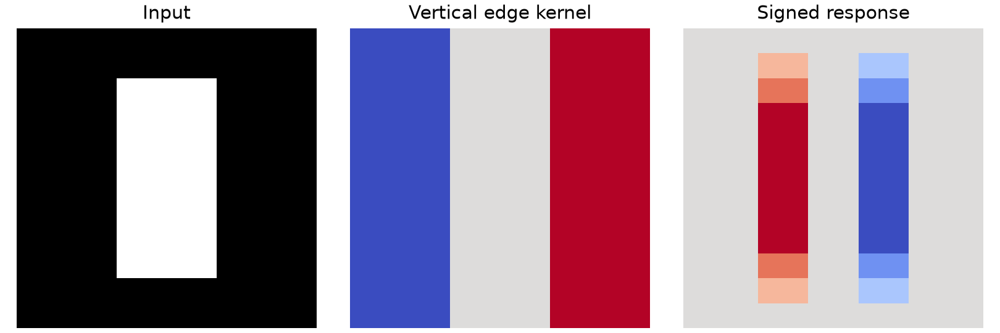
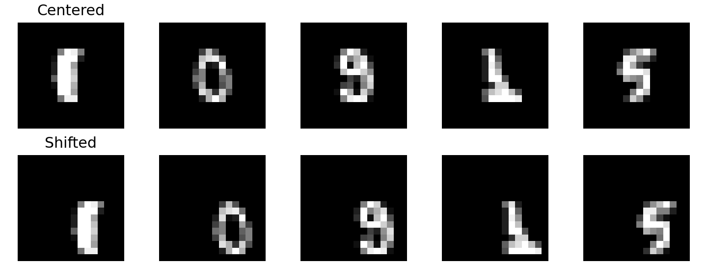
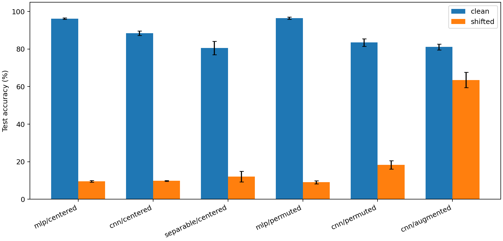
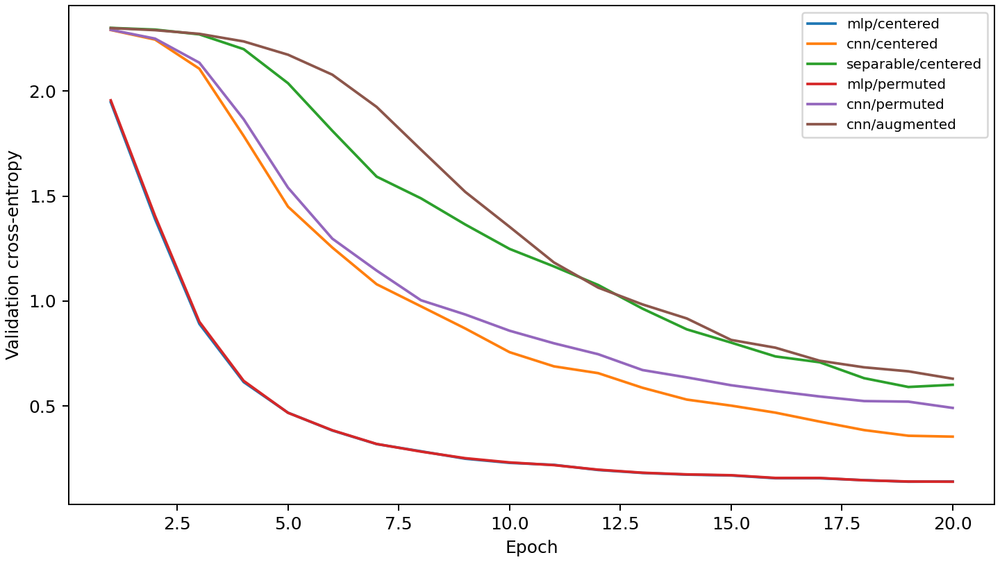
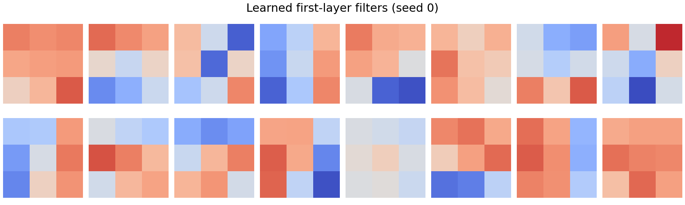

# Your CNN Knows What a Digit Looks Like. Does It Know Where to Look?

*Build convolution from scratch, follow the research from LeNet to ConvNeXt and modern vision transformers, and discover what happens when the spatial assumptions behind computer vision break.*

You have probably written a line like `nn.Conv2d(3, 64, kernel_size=3, padding=1)` in PyTorch. It works. The model trains, the loss decreases, and eventually you move on to the next layer.

But imagine deploying an image classifier that recognizes a handwritten digit perfectly well when it is centered on a screen. Move the same digit three pixels to the right and three pixels down. No change to its shape, no new class, no adversarial noise. Just a different location. Suddenly the classifier is unreliable.

Isn't a convolutional neural network supposed to handle precisely this problem?

That question is the thread running through this article. Instead of treating convolution as a black box, we will implement it, inspect its gradients, break its assumptions and train models that expose the difference between detecting a feature and recognizing an object regardless of its location. Along the way, we will see why decades of research into CNNs still matter in a world of vision transformers.

## Abstract

This tutorial and narrative literature review investigates convolution as a structured linear operator, architectural inductive bias and hardware computation. We derive discrete cross-correlation, output geometry, receptive fields, parameter sharing, and the adjoint used in backpropagation. A CPU-only implementation verifies numerical equivalence against PyTorch, and a controlled classification study compares dense, standard convolutional, and depthwise-separable networks under spatial permutation and translation augmentation. We connect these experiments to research on equivariance, efficient convolution, segmentation, residual learning, large kernels and hybrid vision architectures, including selected 2025–2026 advances. Our experiments are educational, not a claim of novel state-of-the-art performance.

**Keywords:** convolutional neural networks, inductive bias, translation equivariance, receptive fields, computer vision, PyTorch, efficient inference.

## Contents

1. What a convolution actually computes
2. Turning a sliding window into matrix multiplication
3. Why images need a different inductive bias
4. Stride, padding, dilation, and receptive fields
5. Pooling and the translation-invariance misconception
6. Channels, groups, and efficient convolution
7. Backpropagation and transposed convolution
8. The experiment: moving and scrambling handwritten digits
9. From classification to structured prediction
10. Convolution beyond images and biological inspiration
11. The architectural research timeline
12. Why modern CNNs and transformers borrow from each other
13. Hardware, deployment, and practical debugging
14. Discussion, limitations, and exercises
15. References

## 1. What a convolution actually computes

Start with the problem of finding a vertical edge. Imagine that you have a photograph containing a dark wall next to a bright window. You could compare every pixel with its neighbor. Large differences indicate a potential boundary. The same rule is useful anywhere in the photograph. You do not need to learn a new edge detector for every coordinate.

This is the motivation behind convolution: apply a local operation repeatedly across a structured input. Chapter 9 of Goodfellow et al. (2016) distinguishes three benefits: local connectivity, shared parameters and translation equivariance. We will test each rather than merely list them.

In signal processing, discrete convolution is `s[t] = Σa x[a] w[t − a]`. For a finite image and kernel, the two-dimensional version sums over two spatial axes. The negative offset flips the kernel. Most deep learning libraries instead use cross-correlation, where the kernel is not flipped:

`Y[i,j] = Σu Σv X[i+u,j+v] K[u,v]`

The distinction matters if you are implementing a known filter such as a Sobel operator. For a learned kernel, either convention can represent the same family of filters by reversing the learned weights. PyTorch calls its cross-correlation operation convolution (Dumoulin & Visin, 2016; PyTorch documentation).

Try it by hand. An image patch and a kernel:

```text
Patch         Kernel
1 2 3         -1 0 1
4 5 6         -1 0 1
7 8 9         -1 0 1
```

The output at that location is `(3−1) + (6−4) + (9−7) = 6`. Slide the kernel one column right and repeat. The entire output is a feature map indicating where the pattern appears. Negative responses distinguish the opposite edge orientation; taking absolute values discards that sign information.

### Implement it in NumPy

Install the dependencies from the companion repository first:

```bash
python -m venv .venv
source .venv/bin/activate
pip install -r requirements.txt
```

On Windows PowerShell activate with `.venv\Scripts\Activate.ps1`. All code runs on CPU, and the digits dataset is included in scikit-learn.

```python
import numpy as np

def corr2d(x, k, stride=1, padding=0, dilation=1):
    x = np.pad(x, padding)
    kh, kw = k.shape
    eh = dilation * (kh - 1) + 1
    ew = dilation * (kw - 1) + 1
    oh = (x.shape[0] - eh) // stride + 1
    ow = (x.shape[1] - ew) // stride + 1
    out = np.zeros((oh, ow))
    for i, j in np.ndindex(out.shape):
        patch = x[i*stride:i*stride+eh:dilation,
                  j*stride:j*stride+ew:dilation]
        out[i, j] = (patch * k).sum()
    return out

x = np.arange(1, 10).reshape(3, 3)
k = np.array([[-1, 0, 1]] * 3)
assert corr2d(x, k)[0, 0] == 6
```

This educational implementation accepts one two-dimensional input, one kernel and scalar geometry parameters. It deliberately omits groups, batches and bias. It is not a performance implementation. The companion lab checks it against PyTorch for a strided, padded, dilated case.



*Figure 1. Original generated visualization: a rectangular object, a fixed vertical-edge filter, and its signed response. The filter responds to the two vertical boundaries with opposite signs.*

A learned convolution differs from this filter in only one respect: instead of choosing the nine numbers by hand, we optimize them using backpropagation. Stack several filters and nonlinearities and the model can build increasingly complex patterns.

## 2. Turning a sliding window into matrix multiplication

If you work on compilers or inference runtimes, the following question is familiar: how do we map a high-level operator to operations the hardware executes efficiently?

A convolution is a linear transformation when the kernel is fixed. Flatten the input and output and you can write `y = A x`. Matrix A contains copies of the kernel weights in a sparse, structured arrangement. In one dimension the structure is Toeplitz for the usual linear convolution; in two dimensions zero-boundary convolution gives a block Toeplitz structure, while circular convolution yields a block-circulant structure. There is no reason to materialize this enormous matrix.

Instead, rearrange local patches into columns, flatten the kernels into rows and multiply. This method is commonly called im2col or lowering to GEMM. If X has shape `[N,Cin,H,W]`, then the patch tensor has shape `[N,Cin*Kh*Kw,Hout*Wout]`. The flattened kernel has shape `[Cout,Cin*Kh*Kw]`. The result contains one dot product for every output channel and spatial location.

```python
import torch
from torch.nn import functional as F

def lower_conv(x, w, b, stride=1, padding=0, dilation=1):
    patches = F.unfold(x, w.shape[-2:],
                       dilation=dilation, padding=padding,
                       stride=stride)
    y = w.flatten(1) @ patches + b[None, :, None]
    h = (x.shape[-2] + 2*padding
         - dilation*(w.shape[-2]-1) - 1)//stride + 1
    return y.reshape(x.shape[0], w.shape[0], h, -1)

x = torch.randn(2, 3, 9, 10, dtype=torch.float64)
w = torch.randn(4, 3, 3, 2, dtype=torch.float64)
b = torch.randn(4, dtype=torch.float64)
a = F.conv2d(x, w, b, stride=2, padding=1, dilation=2)
c = lower_conv(x, w, b, stride=2, padding=1, dilation=2)
torch.testing.assert_close(a, c)
print(a.shape)  # [2, 4, 4, 5]
```

This is not simply a convenient trick for understanding convolution. It illustrates why operator lowering matters: a computation expressed as a grid of small dot products becomes a batched matrix multiplication. A production implementation may compute patches implicitly to avoid storing a large redundant intermediate. We return to that distinction in Section 13.

## 3. Why images need a different inductive bias

Think of an RGB image as 224 × 224 × 3 numbers. Flatten it and feed it into a dense layer with 64 outputs. That requires 9,633,792 weights before biases. But that dense layer produces only 64 numbers, not a spatial map; it is not a shape-matched comparison to convolution.

For a fairer operator-level comparison, consider mapping a 224 × 224 RGB image to a 224 × 224 map with 64 channels. A fully dense linear transformation needs `(224*224*3)*(224*224*64)` weights. A locally connected 3 × 3 operator without sharing needs `224*224*64*3*3*3` weights. A shared convolution needs just `64*3*3*3 = 1,728` weights, plus 64 biases if enabled. Boundary handling can affect the number of meaningful connections, but the basic contrast holds.

The savings come from two separate design choices:

- **Locality:** each output depends directly on a small neighborhood.
- **Sharing:** the same weights are reused at every location.

A locally connected layer has the first property but not the second. Tiled convolution uses a periodically repeating set of kernels, a compromise discussed by Goodfellow et al. (2016). Both illustrate that ordinary convolution is a particular choice of prior, not the only way to process a grid.

Why would we willingly restrict our hypothesis space? Because a diagonal stroke in the top-left of an image resembles a diagonal stroke in the bottom-right. Learning separate detectors for both is wasteful if the task treats those patterns similarly. In the language of statistical learning, we encode a useful inductive bias.

The third property is **equivariance**. If T shifts a grid and C is a stride-one convolution, then under compatible boundary conditions `C(T(x)) = T(C(x))`. Invariance is different: `f(T(x)) = f(x)`. An edge detector should be equivariant, while an image classifier often should be invariant. These are not interchangeable requirements.

To make this precise, the lab uses circular padding and integer shifts; those boundary conditions guarantee exact translation symmetry mathematically. Ordinary zero padding breaks the symmetry near borders. Group equivariant CNNs extend this principle to other discrete symmetry groups such as rotations and reflections (Cohen & Welling, 2016). Note that the term group convolution in that paper is mathematical group symmetry, not PyTorch's channel `groups` argument.

## 4. Stride, padding, dilation, and receptive fields

A surprisingly large fraction of CNN debugging is shape debugging. Before we add another layer, ask what each spatial dimension becomes.

For input size H, kernel size K, padding P on both sides, stride S, and dilation D:

`Hout = floor((H + 2P − D(K−1) − 1)/S) + 1`

Apply the same equation independently to width. Dilation inserts spacing between sampled kernel positions, giving an effective kernel size `D(K−1)+1`.

For a 32 × 32 input and a 3 × 3 filter:

- No padding, stride 1: 30 × 30.
- Padding 1, stride 1: 32 × 32.
- Padding 1, stride 2: 16 × 16.
- Dilation 2, padding 2, stride 1: 32 × 32 with a 5 × 5 effective span.

Valid convolution has no padding. Same padding conventionally preserves the size at stride one, though frameworks differ for even kernels and stride greater than one. Full convolution pads by K−1 on each side at stride one and produces H+K−1 outputs. Read the framework's convention rather than assuming a name defines the exact shape.

```python
from torch import nn
x = torch.randn(1, 3, 32, 32)
for s, p, d in [(1,0,1),(1,1,1),(2,1,1),(1,2,2)]:
    layer = nn.Conv2d(3, 16, 3, stride=s, padding=p, dilation=d)
    print(layer(x).shape)
```

### How much of an image can a neuron see?

A receptive field is the input region that can affect an output. A single 3 × 3 convolution sees a 3 × 3 patch. Two stride-one layers see a 5 × 5 patch. Three see 7 × 7. With stride or dilation the growth changes.

Track two quantities: receptive field r and jump j, initially both 1. For layer l with kernel k, dilation d and stride s:

`r_new = r_old + (k−1)*d*j_old`

`j_new = j_old*s`

For a sequence of Conv3, Pool2 with stride 2, Conv3, the receptive fields are 3, 4, 8 and the final jump is 2. This is the theoretical support for an interior output, not a guarantee that all pixels influence it equally. Luo et al. (2016) found that effective receptive fields can concentrate strongly near the center. Dilated convolutions expand spatial coverage without reducing resolution, useful for dense prediction (Yu & Koltun, 2016). Gridding artifacts and boundary effects still need attention.

## 5. Pooling and the translation-invariance misconception

Max pooling selects the largest activation in a local window. Average pooling computes its mean. Both can reduce spatial resolution, which makes later computation cheaper.

```python
z = torch.tensor([[[[1., 3., 2., 0.],
                    [0., 2., 1., 4.],
                    [5., 1., 0., 2.],
                    [2., 0., 3., 1.]]]])
print(F.max_pool2d(z, 2))
print(F.avg_pool2d(z, 2))
```

Max pooling returns `[[3,4],[5,3]]`; average pooling returns `[[1.5,1.75],[2,1.5]]`. If a maximum moves inside the same pooling window, the pooled value may stay unchanged. If it crosses a window boundary, the output can change dramatically.

This is why the statement that CNNs are translation invariant is too strong. Strided operations select a sampling grid; one-pixel shifts can change which phase of the signal is sampled. Even average pooling does not guarantee adequate anti-aliasing for every input. Zhang (2019) demonstrated that inserting appropriate low-pass filtering before downsampling can improve shift consistency in several CNN architectures. Azulay and Weiss (2019) documented sensitivity to small transformations in trained image classifiers.

Adaptive pooling has a different purpose. `nn.AdaptiveAvgPool2d((2,2))` produces a 2 × 2 spatial grid regardless of the input size (within valid framework constraints). Global average pooling collapses all spatial positions to one value per channel. Global pooling over an exactly equivariant map makes the result invariant to permutations of its positions induced by translation. It cannot magically undo aliasing, cropping or padding artifacts that occurred earlier.

The original chapter frames pooling as a strong prior. That is useful intuition but should not be read as a mathematical guarantee of exact invariance for every architecture. If the task requires precise coordinates, such as a defect mask, aggressive pooling may destroy exactly the information we need.

## 6. Channels, groups, and efficient convolution

A grayscale kernel sees a single channel. For an RGB image, a standard filter sees all three channels. Its response sums over spatial offsets and input channels; each output channel has its own filter bank.

In PyTorch the standard weight shape is `[Cout,Cin,Kh,Kw]`. For groups G, it becomes `[Cout,Cin/G,Kh,Kw]`. Both channel counts must be divisible by G. The parameter count without bias is `Cout*Cin*Kh*Kw/G`. The multiply-accumulate count for one image is this count times Hout*Wout. A MAC is not necessarily the same as a FLOP; many conventions count a multiply and add as two FLOPs.

A 1 × 1 convolution mixes channels without directly mixing neighboring spatial locations. This is a useful building block in Network in Network, Inception, residual bottlenecks and modern mobile architectures (Lin et al., 2014; Szegedy et al., 2015).

Depthwise convolution uses `groups=Cin` and, for depth multiplier 1, Cout=Cin. It performs spatial filtering independently for each input channel. A pointwise convolution then mixes channels. With Cin=64, Cout=128 and a 3 × 3 kernel, standard convolution uses 73,728 weights; depthwise plus pointwise uses 8,768, an approximately 8.41-fold reduction. This factorization restricts the class of linear operators representable by one block. It is not an exact replacement for every arbitrary dense kernel.

```python
standard = nn.Conv2d(64, 128, 3, padding=1, bias=False)
separable = nn.Sequential(
    nn.Conv2d(64, 64, 3, padding=1, groups=64, bias=False),
    nn.Conv2d(64, 128, 1, bias=False),
)
for model in [standard, separable]:
    print(sum(p.numel() for p in model.parameters()))
```

Xception and MobileNet popularized depthwise-separable architectures (Chollet, 2017; Howard et al., 2017). MobileNetV2 adds inverted residual blocks and linear bottlenecks (Sandler et al., 2018). ResNeXt explores cardinality through grouped transformations (Xie et al., 2017). These are different ways of deciding which channels and spatial locations should interact.

Do not confuse channel separability with spatial separability. A rank-one spatial kernel `K = a bᵀ` can be computed by a vertical and horizontal one-dimensional convolution. That is a different mathematical factorization. For a single-channel w × w filter it reduces kernel arithmetic from w² to roughly 2w per interior output, subject to implementation overhead. A general kernel may require multiple rank-one components.

## 7. Backpropagation and transposed convolution

When building a differentiable operator, implementing the forward pass is only half the problem. Let `y = A(w)x`, ignoring bias, and let `g = ∂L/∂y`. The chain rule gives `∂L/∂x = A(w)ᵀg`. Each weight gradient sums the products between upstream gradients and all input patches that used that weight. In index notation for one channel with stride one and no padding:

`dK[u,v] = Σi Σj G[i,j] X[i+u,j+v]`

Each input gradient accumulates contributions from every output whose receptive field includes it. Parameter sharing means we sum contributions from many spatial locations, not update a different kernel at each location. With batches and channels the summations extend naturally.

Using im2col notation `Y = W P`, the matrix gradients are `dW = G Pᵀ` (summed over batches) and `dP = WᵀG`. Mapping dP back to the input sums overlapping patches, not merely reshapes them. `F.fold` implements that overlap accumulation for compatible geometry.

```python
x = torch.randn(2, 3, 9, 10, dtype=torch.float64,
                requires_grad=True)
w = torch.randn(4, 3, 3, 2, dtype=torch.float64,
                requires_grad=True)
b = torch.randn(4, dtype=torch.float64, requires_grad=True)
y = F.conv2d(x, w, b, stride=2, padding=1, dilation=2)
z = lower_conv(x, w, b, stride=2, padding=1, dilation=2)
g = torch.randn_like(y)
a = torch.autograd.grad(y, (x,w,b), g, retain_graph=True)
c = torch.autograd.grad(z, (x,w,b), g)
for u, v in zip(a,c):
    torch.testing.assert_close(u,v)
```

The lab also checks the adjoint explicitly:

```python
t = F.conv_transpose2d(g, w.detach(), stride=2,
                       padding=1, dilation=2,
                       output_padding=(0,1))
torch.testing.assert_close(t, a[0])
```

The output-size formula is `(Hin−1)*S − 2P + D*(K−1) + output_padding + 1`. Output padding selects the appropriate output shape when stride maps several input sizes to the same output size. It does not add a literal border of zero-valued output pixels. Transposed convolution is the adjoint, not generally the inverse; downsampling may have irreversibly discarded information. Dumoulin and Visin (2016) provide a particularly useful visual reference for the arithmetic.

A common decoder problem is checkerboard artifacts due to uneven overlap in transposed convolutions. Resize followed by convolution is one alternative (Odena et al., 2016). It is not a universal cure for all image artifacts.

## 8. The experiment: moving and scrambling handwritten digits

Now we can ask the question that matters to an engineer: how much of the behavior we want actually follows from this architecture?

### Methodology

We use the scikit-learn digits dataset: 1,797 grayscale 8 × 8 images with ten labels. Divide pixel intensities by 16 and pad each image by four pixels on every side to create a 16 × 16 canvas. The padding leaves room for translations of up to three pixels without cropping the original digit. Split the dataset into train, validation and test sets using stratification and random state 42. All runs share this split.

```python
from sklearn.datasets import load_digits
from sklearn.model_selection import train_test_split
import numpy as np

d = load_digits()
x = torch.tensor(d.images[:, None] / 16, dtype=torch.float32)
y = torch.tensor(d.target)
x = F.pad(x, (4,4,4,4))
idx = np.arange(len(y))
tr, te = train_test_split(idx, test_size=.25,
                          stratify=y.numpy(), random_state=42)
tr, va = train_test_split(tr, test_size=.2,
                          stratify=y[tr].numpy(), random_state=42)
```

We train six configurations with three initialization seeds each, for 18 runs. The dense MLP and ordinary CNN are trained on centered data and on a fixed randomly permuted pixel layout; a separable CNN is trained on centered data; another ordinary CNN is trained on randomly translated images. The permutation is fixed across all relevant splits and runs, not sampled afresh for every example. It is invertible and preserves pixel values but destroys the usual neighborhood relationships. It does not remove all statistical structure. The augmented configuration independently samples integer translations from −3 to +3 on each axis during training.

Each model uses AdamW (learning rate 0.003, weight decay 0.001), batches of 64 and 20 epochs. The lowest clean validation cross-entropy selects the checkpoint. The test set is evaluated on both its original centered images and a predefined translation of three pixels down and right. The test set is not used to select checkpoints or hyperparameters. For permuted runs, translation happens before permutation, corresponding to the same physical change in the original image. This is a controlled stress test, not a comprehensive distribution-shift benchmark.



*Figure 2. Five held-out digit images, before and after translation. Their semantic labels remain unchanged.*

### Build the architecture

```python
from lab import Net, shift, evaluate
model = Net('cnn')
print(model)
print(sum(p.numel() for p in model.parameters()))  # 6090
```

The CNN uses Conv(1→16,3×3), ReLU, MaxPool2, Conv(16→32,3×3), ReLU, AdaptiveAvgPool(2×2), flatten and a 128→10 classifier. The separable variant changes only the second convolution into a depthwise and pointwise pair. The MLP uses a 256→64→10 dense architecture with ReLU. These models do not have equal parameter counts, nor are they optimized separately. This is deliberate: the comparison illustrates an engineering trade-off, not a rigorous ranking of architectures.

A training step is ordinary PyTorch:

```python
optimizer = torch.optim.AdamW(model.parameters(), lr=.003,
                              weight_decay=.001)
model.train()
optimizer.zero_grad()
logits = model(x[tr[:64]])
loss = F.cross_entropy(logits, y[tr[:64]])
loss.backward()
optimizer.step()
```

Cross-entropy takes unnormalized logits, so do not insert a softmax before it. During validation, switch to evaluation mode and disable autograd. The full lab includes seeded shuffling, separate augmentation randomness, validation checkpoint selection, and metric export. Execute:

```bash
python lab.py
```

### Results

The split contains 1077, 270, 450 training, validation and test examples, respectively. The following are measured mean accuracies (population standard deviations in parentheses), not literature benchmarks.

- **mlp/centered** (17,098 parameters): centered 96.22% (±0.36 percentage points); shifted 9.56% (±0.48).
- **cnn/centered** (6,090 parameters): centered 88.44% (±1.19 percentage points); shifted 9.85% (±0.21).
- **separable/centered** (2,154 parameters): centered 80.52% (±3.56 percentage points); shifted 12.07% (±2.78).
- **mlp/permuted** (17,098 parameters): centered 96.44% (±0.54 percentage points); shifted 9.11% (±0.83).
- **cnn/permuted** (6,090 parameters): centered 83.48% (±2.02 percentage points); shifted 18.30% (±2.24).
- **cnn/augmented** (6,090 parameters): centered 81.11% (±1.55 percentage points); shifted 63.56% (±4.04).

The dense baseline wins on centered digits in this fixed training budget. The standard CNN uses fewer parameters, but its centered-trained checkpoint falls to nearly chance accuracy under translation. The exact operator-level equivariance property does not carry through the entire architecture: the strided pooling, finite canvas and spatially sensitive 2×2 head matter. Adding translation augmentation to the same CNN increases mean shifted accuracy from 9.85% to 63.56%, while clean accuracy falls from 88.44% to 81.11%. This is a trade-off, not a free improvement. The CNN also loses about five percentage points on fixed scrambled pixels while the MLP remains near its centered performance, consistent with the locality prior becoming less useful. The separable model reduces the parameter budget further but also loses accuracy here. None of these comparisons establishes a universal ranking.

The operator checks passed: maximum forward error 1.78e-15, maximum gradient discrepancies (input, weight, bias) 1.78e-15, 5.33e-15, 0, and circular integer shift equivariance error 0. These are floating-point checks, not proofs for all inputs.




*Figure 3. Original measured clean and translated test accuracy, averaged over three seeds. Error bars show population standard deviation across those seeds, not confidence intervals.*



*Figure 4. Mean clean validation cross-entropy over 20 epochs. Each curve averages three runs; the checkpoints used for test evaluation are selected separately within each run.*



*Figure 5. First-layer kernels from the ordinary centered CNN, seed 0. All 16 filters use the same signed color scale. These small digit filters need not resemble idealized natural-image Gabor filters.*

## 9. From classification to structured prediction

Our classifier returns ten numbers per image. What if we need one prediction per pixel? In medical segmentation, road mapping or industrial inspection, we need output geometry to survive the network.

Fully Convolutional Networks replaced classification-oriented dense heads with spatial prediction and upsampling (Long et al., 2015). U-Net combines an encoder with a decoder and skip connections that preserve fine-grained spatial information (Ronneberger et al., 2015). DeepLab uses atrous convolution and multiscale context (Chen et al., 2018). Feature Pyramid Networks build a multiresolution feature hierarchy for detection (Lin et al., 2017).

Here is a minimal shape-preserving segmentation head, not a trained U-Net:

```python
segmenter = nn.Sequential(nn.Conv2d(3,32,3,padding=1),
                          nn.ReLU(), nn.Conv2d(32,4,1))
image = torch.randn(2,3,64,64)
mask = torch.randint(0,4,(2,64,64))
logits = segmenter(image)
loss = F.cross_entropy(logits, mask)
```

The logits have shape `[2,4,64,64]`; targets have shape `[2,64,64]` with integer class labels. A per-pixel accuracy can be misleading for imbalanced foreground/background data; use per-class IoU or Dice as appropriate. Never evaluate a medical system's clinical performance from this toy example.

The source chapter also describes recurrent convolutional refinement: predict a mask, feed the prediction back into a shared convolutional computation, and refine it over several steps (Goodfellow et al., 2016). This early idea of repeated spatial reasoning remains relevant in iterative segmentation and generative systems. It comes with a latency cost and no automatic guarantee of convergence.

## 10. Convolution beyond images and biological inspiration

Convolution is appropriate when the input has meaningful local structure and repeated patterns. That can mean time, two spatial axes or three spatial axes. `Conv1d` consumes `[N,C,L]`, `Conv2d` consumes `[N,C,H,W]`, and `Conv3d` consumes `[N,C,D,H,W]`. Channels are not additional sliding axes in ordinary convolution.

For audio, temporal convolution can detect short patterns in a waveform. Causal convolution pads only the past, preventing future information leakage. WaveNet uses dilated causal convolutions for audio generation (van den Oord et al., 2016). Temporal convolutional networks use similar principles for sequence modeling (Bai et al., 2018). For spectrograms, frequency shifts do not always preserve labels, so frequency-axis sharing is a task-dependent assumption. For CT volumes, voxel spacing can be anisotropic; a 3 × 3 × 3 kernel does not necessarily cover equal physical distances along each axis. Video models such as C3D extend convolution across space and time (Tran et al., 2015).

Variable-sized inputs are possible because filters do not depend on absolute spatial dimensions; a fixed-size flattening head may still require adaptive pooling or resizing. Arbitrarily ordered tabular columns, on the other hand, rarely justify translation equivariance.

### Before CNNs were software

Hubel and Wiesel's work on the visual cortex identified localized, orientation-selective receptive fields (Hubel & Wiesel, 1962). Fukushima's Neocognitron organized pattern detection and tolerance to shifts hierarchically (Fukushima, 1980). LeCun and colleagues subsequently trained convolutional systems with backpropagation, leading to practical document recognition (LeCun et al., 1989, 1998).

Gabor filters combine an oriented sinusoid with a spatial Gaussian envelope. They capture orientation and frequency while remaining local. Sparse coding of natural image patches can learn Gabor-like features (Olshausen & Field, 1996). That does not establish that CNNs are faithful brain models. Biological vision includes recurrent feedback, active sensing, eye movements and many other mechanisms missing from a simple feedforward network.

Another lesson from Chapter 9 is that not every useful feature requires supervised learning. Coates et al. (2011) investigated unsupervised patch-based feature learning, including k-means. Random convolutional filters can also produce useful features in some architectures (Saxe et al., 2011). A natural exercise is to freeze the randomly initialized CNN backbone and train only its classifier, then compare with the fully trained network under the same split. Modern self-supervised learning generalizes the idea of learning representations without explicit labels; SimCLR and ConvNeXt V2 are examples of different approaches (Chen et al., 2020; Woo et al., 2023).

## 11. The architectural research timeline: every improvement solved a different problem

The history of CNNs makes more sense if we read each architecture as a response to an engineering bottleneck, rather than memorize dates and model names.

**1989–1998: LeNet and the practical value of weight sharing.** Document recognition needed robust features learned from images rather than handcrafted rules for every character. Convolution, subsampling and gradient-based training made the approach practical (LeCun et al., 1989, 1998).

**2012: AlexNet and scale.** GPU training, ReLU, augmentation and dropout made a large supervised CNN successful on ImageNet. Krizhevsky et al. (2012) reported a 15.3% top-five test error for their winning ensemble versus 26.2% for the second-best entry. This is an historical competition result, not a modern baseline comparison.

**2014–2015: VGG and Inception.** VGG showed that repeated small 3 × 3 filters could form deep feature hierarchies (Simonyan & Zisserman, 2015). Two 3 × 3 layers with equal channel widths use 18C² weights versus 25C² for one 5 × 5 layer, while introducing another nonlinearity. The two forms are not functionally identical in general. Inception used parallel branches and 1 × 1 bottlenecks to combine multiscale computation with a controlled compute budget (Szegedy et al., 2015).

**2015–2017: Residual and dense connections.** As depth grew, optimization became difficult. ResNet learns `y=x+F(x)` where dimensions match, providing a direct identity path for gradients (He et al., 2016). When shapes differ a projection may be used. DenseNet concatenates earlier feature maps, promoting reuse at the expense of growing activation channels (Huang et al., 2017). Batch normalization also helped train deep models (Ioffe & Szegedy, 2015).

```python
class ResidualBlock(nn.Module):
    def __init__(self, c):
        super().__init__()
        self.f = nn.Sequential(nn.Conv2d(c,c,3,padding=1,bias=False),
                               nn.BatchNorm2d(c), nn.ReLU(),
                               nn.Conv2d(c,c,3,padding=1,bias=False),
                               nn.BatchNorm2d(c))
    def forward(self,x):
        return F.relu(x+self.f(x))
```

This is an illustrative residual block, not a complete ResNet. The identity term gives an additive gradient route but does not guarantee stable training at arbitrary depth.

**2017–2019: Efficiency and scaling.** Xception, MobileNet, ResNeXt and ShuffleNet rethink channel mixing and computation (Chollet, 2017; Howard et al., 2017; Xie et al., 2017; Zhang et al., 2018). Squeeze-and-excitation learns input-dependent channel gating (Hu et al., 2018). EfficientNet coordinates depth, width and resolution using compound scaling (Tan & Le, 2019). These techniques emphasize that a good network is not just a large network; it must allocate computation where it matters.

## 12. Why modern CNNs and transformers borrow from each other

A standard convolution uses the same spatial weights for every input. Attention can compute weights based on the content of the input and link distant positions directly. This is a major distinction, not an absolute opposition: dynamic convolution can also be input dependent, and attention can be local or structured.

Vision Transformer (ViT) processes image patches as tokens and uses self-attention (Dosovitskiy et al., 2021). Its original results highlighted the importance of large-scale pretraining. Swin Transformer introduces hierarchical features and shifted local windows to reduce computation and support dense prediction (Liu et al., 2021). For N tokens, ordinary global attention has quadratic pairwise arithmetic in N; optimized attention kernels reduce memory traffic and intermediate storage but do not generally eliminate this arithmetic. Convolution with fixed kernel size is linear in spatial area for fixed channels.

ConvNeXt asked a more useful question than which family should win: how much of transformer-era performance comes from training recipes and architectural choices that could also work in a CNN? Liu et al. (2022) modernized a ResNet-like backbone with depthwise spatial mixing, inverted bottlenecks, larger kernels, LayerNorm and GELU. ConvNeXt V2 introduced fully convolutional masked autoencoding and Global Response Normalization (Woo et al., 2023).

### Large kernels and flexible sampling

The earlier VGG design favored small kernels. But small kernels need depth to connect distant positions, and theoretical receptive field is not the same as effective coverage. RepLKNet explores kernels as large as 31 × 31 with structural reparameterization (Ding et al., 2022). UniRepLKNet extends large-kernel designs to several input modalities (Ding et al., 2024). PeLK uses parameter sharing inspired by peripheral vision to make larger filters economical (Chen et al., 2024). InceptionNeXt decomposes large depthwise operations into smaller directional branches and an identity branch (Yu et al., 2024). These papers investigate different answers to the same question: how do we see farther without making the model too expensive?

Dilation uses fixed spaced offsets. Deformable convolution learns offsets conditioned on the input and samples at fractional positions using interpolation (Dai et al., 2017). Dynamic convolution instead adapts the weights, for example combining several kernels with input-dependent coefficients (Chen et al., 2020b). These techniques relax different constraints of ordinary convolution. They introduce extra complexity, and their speed depends on backend support.

### Selected advances from 2025 and 2026

ShiftwiseConv uses small convolution kernels and long-distance sparse pathways to approximate some benefits of a large spatial field (Li et al., 2025). Frequency Dynamic Convolution investigates frequency-aware adaptive filtering for dense prediction (Chen et al., 2025). Emulating Self-attention with Convolution uses shared large kernels and dynamic kernels for image super-resolution (Lee et al., 2025). These are task-specific research results, not proof that attention is universally unnecessary.

In 2026, UCAN combines convolutional and attention mechanisms for lightweight super-resolution (Tan et al., 2026). PFGNet investigates frequency-guided spatially adaptive processing for spatiotemporal prediction (Cai et al., 2026). ECKConv studies coordinate-based kernels with continuous SE(3) equivariance for point clouds (Kim et al., 2026). The latter extends the symmetry principle beyond regular two-dimensional image grids and requires a different formulation from ordinary Conv2d.

The pattern is clear: researchers are designing the spatial mixing operation for the task, rather than insisting that every vision problem should use exactly the same architectural primitive. These recent works were selected from publication records and abstracts; this is not a systematic survey of all 2026 work.

## 13. Hardware, deployment, and practical debugging

The same convolution can be evaluated with direct loops, explicit or implicit GEMM, Fourier transforms or Winograd minimal filtering. The FFT approach uses the convolution theorem, multiplies spectra and transforms back; padding avoids unintended circular convolution, and correlation requires appropriate reversal or conjugation. It can be attractive for large filters. Winograd algorithms reduce multiplications for small filters, with transformation overhead and numerical trade-offs (Lavin & Gray, 2016). Production libraries select implementations based on dimensions, datatype, layout, available workspace and device (oneDNN documentation).

Explicit unfolding can be expensive in memory. For a batch of 32 images with 64 input channels, 56 × 56 spatial size, and a 3 × 3 same-padded filter, the patch tensor contains `32*64*9*56*56 = 57,802,752` values. In float32 that is about 231 MB in decimal units, before output, gradients or other buffers. Implicit GEMM avoids materializing this entire intermediate. Depthwise convolution can have fewer MACs yet perform poorly on hardware with inefficient memory access or limited kernel support.

When deploying, benchmark the actual operator shape and batch size on your target hardware. Warm up the model, use evaluation mode, disable gradients and synchronize asynchronous accelerators before reading wall-clock timings. Report dtype, thread counts, device, software versions and latency distribution. Do not infer speed directly from parameters or MACs. Channels-last layouts, operator fusion, mixed precision and quantization can help, but their effects depend on the backend. BatchNorm can be folded into an adjacent convolution at inference using frozen statistics; this is an exact affine transformation up to rounding when the assumptions hold.

### Debugging a real model

If a model refuses to learn, first overfit a tiny clean subset to test the pipeline. Verify channel order (PyTorch convention NCHW), label dtype, input scaling and the expected shapes after every spatial operation. If the model is highly accurate on clean images but fails on shifted images, investigate padding, stride, pooling, spatial heads and training augmentation. If it misses small objects, inspect downsampling and effective receptive field. If the model meets its FLOP budget but is slow, profile the target device rather than changing architecture blindly.

One useful workflow is to record intermediate feature maps with forward hooks. Compare responses for a clean image and a transformed image after aligning their expected spatial positions. A feature map is not itself an explanation of the classifier's decision; for that, techniques such as Grad-CAM provide a gradient-based localization signal (Selvaraju et al., 2017), with known interpretability limitations.

## 14. Discussion, limitations, and exercises

The theoretical lesson from this study is that local feature detection, equivariance, and whole-image invariance are different properties. Architectural assumptions can improve statistical efficiency when they match the data, but become restrictions when they do not. No architecture is guaranteed to generalize to every transformation.

Our study uses one small dataset, one fixed split, three seeds, fixed optimizer settings and a limited training budget. The MLP and CNN have different parameter counts and spatial heads. We did not independently optimize hyperparameters or run a parameter-matched comparison. The shifted test is a single predetermined displacement. Validation uses centered images even for the augmented model, so the selection criterion may not favor the best shifted-domain checkpoint. The fixed permutation retains global pixel statistics and may contain accidental local relationships. Results do not generalize automatically to ImageNet, medical images or video. We do not benchmark ConvNeXt, ViT or the recent architectures at their published scale. Recent research claims are attributed to their papers rather than represented as our measurements.

### Try these next

- Replace adaptive 2 × 2 pooling with global average pooling. Compare clean and shifted performance using a new validation split or a fresh test set for the final decision.
- Train on a range of translations but evaluate on held-out displacements and rotations. Some digit rotations alter the semantic label, so define the transform carefully.
- Compare standard and separable convolutions with matched widths or a matched parameter budget. Record accuracy and real device latency separately.
- Freeze the convolutional backbone and train the head to quantify what the architecture itself provides before learned features.
- Build a one-dimensional causal convolution for a synthetic time series and test that changing a future input cannot affect earlier outputs.
- Implement manual backward scatter-add for the NumPy convolution and use finite differences to verify it before building your own autograd operator.

## Conclusion

The next time you call `nn.Conv2d`, remember that you are not simply choosing a layer that happens to work well on images. You are committing to a model of the world: local patterns matter, useful features repeat across locations, and complex structure can emerge through composition. Those assumptions made CNNs extraordinarily useful. Understanding where they fail is equally important.

A fellow engineer does not need another list of layers to memorize. They need to know why the layers exist, what guarantees they offer, what they cost and how to test them. Convolution is a particularly beautiful example of how mathematical structure, statistical assumptions and hardware efficiency come together in one operation.

## References

The following bibliography links foundational papers, selected subsequent advances, and engineering references. Conference publication years are used where appropriate; preprint years may differ.


- Azulay, A., & Weiss, Y. (2019). Why do deep convolutional networks generalize so poorly to small image transformations? *JMLR, 20*. https://jmlr.org/papers/v20/19-519.html
- Bai, S., Kolter, J. Z., & Koltun, V. (2018). An empirical evaluation of generic convolutional and recurrent networks for sequence modeling. *arXiv*. https://arxiv.org/abs/1803.01271
- Cai, X., et al. (2026). PFGNet: A fully convolutional frequency-guided peripheral gating network for efficient spatiotemporal predictive learning. *CVPR*. https://openaccess.thecvf.com/content/CVPR2026/html/Cai_PFGNet_A_Fully_Convolutional_Frequency-Guided_Peripheral_Gating_Network_for_Efficient_Spatiotemporal_CVPR_2026_paper.html
- Chen, H., Chu, X., Ren, Y., Zhao, X., & Huang, K. (2024). PeLK: Parameter-efficient large kernel ConvNets with peripheral convolution. *CVPR*. https://openaccess.thecvf.com/content/CVPR2024/html/Chen_PeLK_Parameter-efficient_Large_Kernel_ConvNets_with_Peripheral_Convolution_CVPR_2024_paper.html
- Chen, L., Gu, L., Li, L., Yan, C., & Fu, Y. (2025). Frequency dynamic convolution for dense image prediction. *CVPR*. https://openaccess.thecvf.com/content/CVPR2025/html/Chen_Frequency_Dynamic_Convolution_for_Dense_Image_Prediction_CVPR_2025_paper.html
- Chen, L.-C., Zhu, Y., Papandreou, G., Schroff, F., & Adam, H. (2018). Encoder-decoder with atrous separable convolution for semantic image segmentation. *ECCV*. https://arxiv.org/abs/1802.02611
- Chen, T., Kornblith, S., Norouzi, M., & Hinton, G. (2020). A simple framework for contrastive learning of visual representations. *ICML*. https://proceedings.mlr.press/v119/chen20j.html
- Chen, Y., Dai, X., Liu, M., Chen, D., Yuan, L., & Liu, Z. (2020b). Dynamic convolution: Attention over convolution kernels. *CVPR*. https://arxiv.org/abs/1912.03458
- Chollet, F. (2017). Xception: Deep learning with depthwise separable convolutions. *CVPR*. https://arxiv.org/abs/1610.02357
- Coates, A., Ng, A., & Lee, H. (2011). An analysis of single-layer networks in unsupervised feature learning. *AISTATS*. https://proceedings.mlr.press/v15/coates11a.html
- Cohen, T. S., & Welling, M. (2016). Group equivariant convolutional networks. *ICML*. https://arxiv.org/abs/1602.07576
- Dai, J., et al. (2017). Deformable convolutional networks. *ICCV*. https://arxiv.org/abs/1703.06211
- Ding, X., Zhang, X., Han, J., & Ding, G. (2022). Scaling up your kernels to 31×31: Revisiting large kernel design in CNNs. *CVPR*. https://openaccess.thecvf.com/content/CVPR2022/html/Ding_Scaling_Up_Your_Kernels_to_31x31_Revisiting_Large_Kernel_Design_CVPR_2022_paper.html
- Ding, X., et al. (2024). UniRepLKNet: A universal perception large-kernel ConvNet for audio, video, point cloud, time-series and image recognition. *CVPR*. https://openaccess.thecvf.com/content/CVPR2024/html/Ding_UniRepLKNet_A_Universal_Perception_Large-Kernel_ConvNet_for_Audio_Video_Point_CVPR_2024_paper.html
- Dosovitskiy, A., et al. (2021). An image is worth 16×16 words: Transformers for image recognition at scale. *ICLR*. https://arxiv.org/abs/2010.11929
- Dumoulin, V., & Visin, F. (2016). A guide to convolution arithmetic for deep learning. *arXiv*. https://arxiv.org/abs/1603.07285
- Fukushima, K. (1980). Neocognitron: A self-organizing neural network model for a mechanism of pattern recognition unaffected by shift in position. *Biological Cybernetics, 36*, 193–202. https://doi.org/10.1007/BF00344251
- Goodfellow, I., Bengio, Y., & Courville, A. (2016). *Deep Learning*, Chapter 9. MIT Press. https://www.deeplearningbook.org/contents/convnets.html
- He, K., Zhang, X., Ren, S., & Sun, J. (2016). Deep residual learning for image recognition. *CVPR*. https://arxiv.org/abs/1512.03385
- Howard, A. G., et al. (2017). MobileNets: Efficient convolutional neural networks for mobile vision applications. *arXiv*. https://arxiv.org/abs/1704.04861
- Hu, J., Shen, L., & Sun, G. (2018). Squeeze-and-excitation networks. *CVPR*. https://arxiv.org/abs/1709.01507
- Huang, G., Liu, Z., van der Maaten, L., & Weinberger, K. Q. (2017). Densely connected convolutional networks. *CVPR*. https://arxiv.org/abs/1608.06993
- Hubel, D. H., & Wiesel, T. N. (1962). Receptive fields, binocular interaction and functional architecture in the cat's visual cortex. *Journal of Physiology, 160*, 106–154. https://doi.org/10.1113/jphysiol.1962.sp006837
- Ioffe, S., & Szegedy, C. (2015). Batch normalization: Accelerating deep network training by reducing internal covariate shift. *ICML*. https://arxiv.org/abs/1502.03167
- Kim, J., et al. (2026). Learning coordinate-based convolutional kernels for continuous SE(3) equivariant and efficient point cloud analysis. *CVPR*. https://openaccess.thecvf.com/content/CVPR2026/html/Kim_Learning_Coordinate-based_Convolutional_Kernels_for_Continuous_SE3_Equivariant_and_Efficient_CVPR_2026_paper.html
- Krizhevsky, A., Sutskever, I., & Hinton, G. E. (2012). ImageNet classification with deep convolutional neural networks. *NeurIPS*. https://papers.nips.cc/paper/2012/hash/c399862d3b9d6b76c8436e924a68c45b-Abstract.html
- Lavin, A., & Gray, S. (2016). Fast algorithms for convolutional neural networks. *CVPR*. https://arxiv.org/abs/1509.09308
- LeCun, Y., et al. (1989). Backpropagation applied to handwritten zip code recognition. *Neural Computation, 1*, 541–551. https://doi.org/10.1162/neco.1989.1.4.541
- LeCun, Y., Bottou, L., Bengio, Y., & Haffner, P. (1998). Gradient-based learning applied to document recognition. *Proceedings of the IEEE, 86*, 2278–2324. https://doi.org/10.1109/5.726791
- Lee, D., Yun, S., & Ro, Y. M. (2025). Emulating self-attention with convolution for efficient image super-resolution. *ICCV*. https://openaccess.thecvf.com/content/ICCV2025/html/Lee_Emulating_Self-attention_with_Convolution_for_Efficient_Image_Super-Resolution_ICCV_2025_paper.html
- Li, D., Li, L., Chen, Z., & Li, J. (2025). ShiftwiseConv: Small convolutional kernel with large kernel effect. *CVPR*. https://openaccess.thecvf.com/content/CVPR2025/html/Li_ShiftwiseConv_Small_Convolutional_Kernel_with_Large_Kernel_Effect_CVPR_2025_paper.html
- Lin, M., Chen, Q., & Yan, S. (2014). Network in network. *ICLR*. https://arxiv.org/abs/1312.4400
- Lin, T.-Y., et al. (2017). Feature pyramid networks for object detection. *CVPR*. https://arxiv.org/abs/1612.03144
- Liu, Z., et al. (2021). Swin Transformer: Hierarchical vision transformer using shifted windows. *ICCV*. https://arxiv.org/abs/2103.14030
- Liu, Z., et al. (2022). A ConvNet for the 2020s. *CVPR*. https://arxiv.org/abs/2201.03545
- Long, J., Shelhamer, E., & Darrell, T. (2015). Fully convolutional networks for semantic segmentation. *CVPR*. https://arxiv.org/abs/1411.4038
- Luo, W., Li, Y., Urtasun, R., & Zemel, R. (2016). Understanding the effective receptive field in deep convolutional neural networks. *NeurIPS*. https://arxiv.org/abs/1701.04128
- Odena, A., Dumoulin, V., & Olah, C. (2016). Deconvolution and checkerboard artifacts. *Distill*. https://distill.pub/2016/deconv-checkerboard/
- Olshausen, B. A., & Field, D. J. (1996). Emergence of simple-cell receptive field properties by learning a sparse code for natural images. *Nature, 381*, 607–609. https://doi.org/10.1038/381607a0
- Ronneberger, O., Fischer, P., & Brox, T. (2015). U-Net: Convolutional networks for biomedical image segmentation. *MICCAI*. https://arxiv.org/abs/1505.04597
- Sandler, M., Howard, A., Zhu, M., Zhmoginov, A., & Chen, L.-C. (2018). MobileNetV2: Inverted residuals and linear bottlenecks. *CVPR*. https://arxiv.org/abs/1801.04381
- Saxe, A., et al. (2011). On random weights and unsupervised feature learning. *ICML*. https://icml.cc/2011/papers/551_icmlpaper.pdf
- Selvaraju, R. R., et al. (2017). Grad-CAM: Visual explanations from deep networks via gradient-based localization. *ICCV*. https://arxiv.org/abs/1610.02391
- Simonyan, K., & Zisserman, A. (2015). Very deep convolutional networks for large-scale image recognition. *ICLR*. https://arxiv.org/abs/1409.1556
- Szegedy, C., et al. (2015). Going deeper with convolutions. *CVPR*. https://arxiv.org/abs/1409.4842
- Tan, C. T., et al. (2026). UCAN: Unified convolutional attention network for expansive receptive fields in lightweight super-resolution. *CVPR*. https://openaccess.thecvf.com/content/CVPR2026/html/Tan_UCAN_Unified_Convolutional_Attention_Network_for_Expansive_Receptive_Fields_in_CVPR_2026_paper.html
- Tan, M., & Le, Q. (2019). EfficientNet: Rethinking model scaling for convolutional neural networks. *ICML*. https://arxiv.org/abs/1905.11946
- Tran, D., Bourdev, L., Fergus, R., Torresani, L., & Paluri, M. (2015). Learning spatiotemporal features with 3D convolutional networks. *ICCV*. https://arxiv.org/abs/1412.0767
- van den Oord, A., et al. (2016). WaveNet: A generative model for raw audio. *arXiv*. https://arxiv.org/abs/1609.03499
- Woo, S., et al. (2023). ConvNeXt V2: Co-designing and scaling ConvNets with masked autoencoders. *CVPR*. https://arxiv.org/abs/2301.00808
- Xie, S., Girshick, R., Dollár, P., Tu, Z., & He, K. (2017). Aggregated residual transformations for deep neural networks. *CVPR*. https://arxiv.org/abs/1611.05431
- Yu, F., & Koltun, V. (2016). Multi-scale context aggregation by dilated convolutions. *ICLR*. https://arxiv.org/abs/1511.07122
- Yu, W., Zhou, P., Yan, S., & Wang, X. (2024). InceptionNeXt: When Inception meets ConvNeXt. *CVPR*. https://openaccess.thecvf.com/content/CVPR2024/html/Yu_InceptionNeXt_When_Inception_Meets_ConvNeXt_CVPR_2024_paper.html
- Zhang, R. (2019). Making convolutional networks shift-invariant again. *ICML*. https://arxiv.org/abs/1904.11486
- Zhang, X., Zhou, X., Lin, M., & Sun, J. (2018). ShuffleNet: An extremely efficient convolutional neural network for mobile devices. *CVPR*. https://arxiv.org/abs/1707.01083

### Engineering references

- PyTorch. Conv2d. https://docs.pytorch.org/docs/stable/generated/torch.nn.Conv2d.html
- PyTorch. ConvTranspose2d. https://docs.pytorch.org/docs/stable/generated/torch.nn.ConvTranspose2d.html
- PyTorch. Unfold. https://docs.pytorch.org/docs/stable/generated/torch.nn.Unfold.html
- oneDNN. Convolution primitive. https://uxlfoundation.github.io/oneDNN/v3.12/dev_guide_convolution.html
- scikit-learn. load_digits. https://scikit-learn.org/stable/modules/generated/sklearn.datasets.load_digits.html

