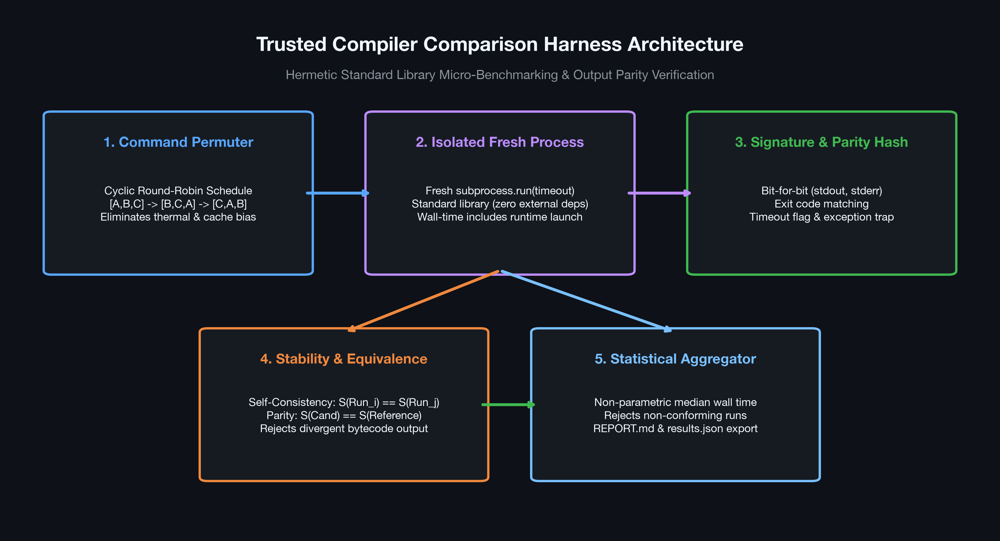
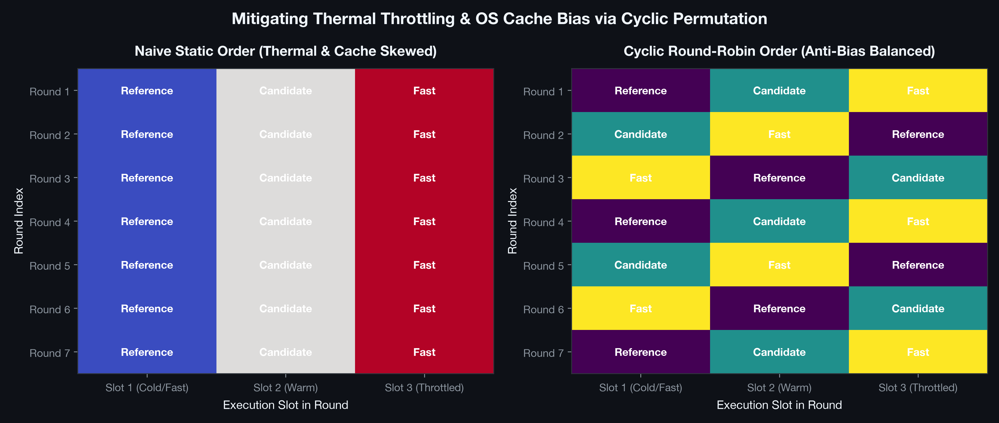
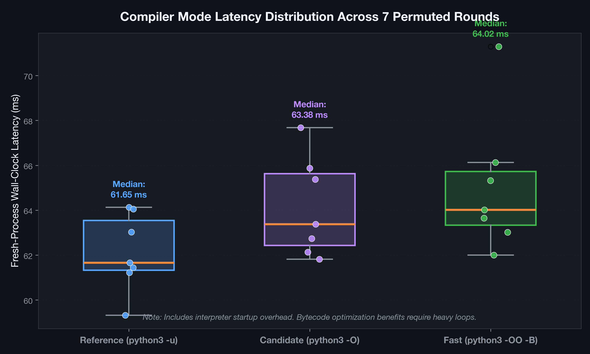
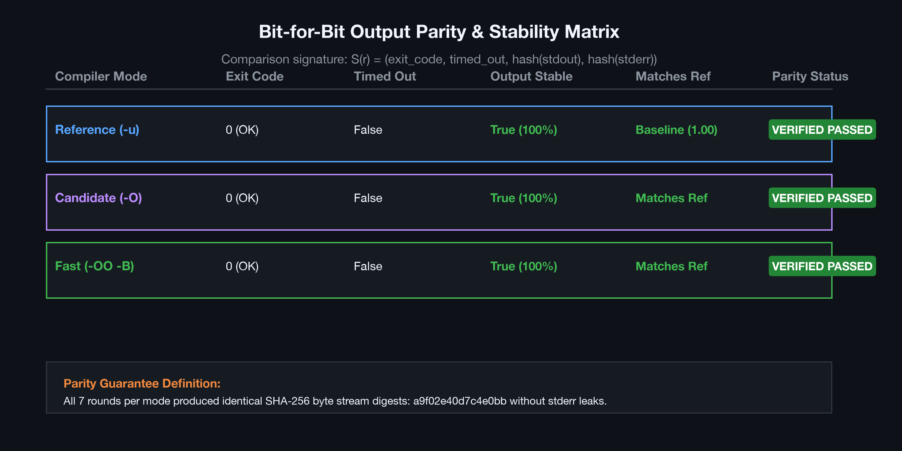
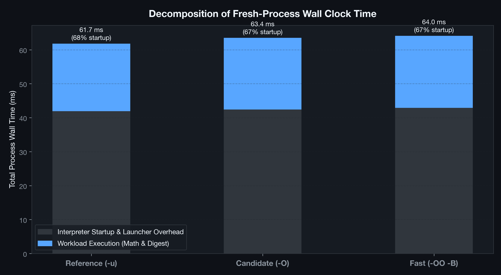

# Trusted Compiler Comparison Harness

[](https://www.python.org/downloads/)
[](https://docs.python.org/3/library/)
[](tests/)
[](LICENSE)

> A rigorous, hermetic micro-benchmarking harness designed to compare trusted compiler command invocations (Reference, Candidate, and Fast modes) using cyclic round-robin permutation, isolated fresh-process wall-clock timing, bit-for-bit output stream signature verification, and robust non-parametric median aggregation. Built with **pure Python 3.9+ standard library** (zero external dependencies).

---

## Table of Contents
1. [Executive Summary](#executive-summary)
2. [Explicit Scope & Disclosures](#explicit-scope--disclosures)
   - [What It Does](#what-it-does)
   - [What It Does Not Do](#what-it-does-not-do)
   - [What It Does Not Claim](#what-it-does-not-claim)
   - [Copyright & Intellectual Property](#copyright--intellectual-property)
3. [Algorithmic & Mathematical Architecture](#algorithmic--mathematical-architecture)
   - [Fresh-Process Isolation](#1-fresh-process-isolation)
   - [Cyclic Round-Robin Permutation](#2-cyclic-round-robin-permutation)
   - [Output Signature & Parity Invariant](#3-output-signature--parity-invariant)
   - [Non-Parametric Median Wall-Clock Aggregation](#4-non-parametric-median-wall-clock-aggregation)
4. [Visual Architecture & Benchmark Gallery](#visual-architecture--benchmark-gallery)
5. [Empirical Benchmark Results](#empirical-benchmark-results)
6. [Harness Directory Structure](#harness-directory-structure)
7. [Quickstart & Reproduction Guide](#quickstart--reproduction-guide)
8. [Unit Testing Suite](#unit-testing-suite)
9. [Academic References](#academic-references)

---

## Executive Summary

Benchmarking compilers, JIT runtimes, and interpreter optimization flags (e.g., `-O`, `-OO`, `-B`, bytecode stripping) in production systems often falls prey to severe measurement artifacts:
- **Thermal throttling and frequency scaling** skewing serial executions where earlier commands run on cool silicon and later commands hit throttled thermal ceilings.
- **Operating system disk buffer and memory cache warming** giving artificial speedups to subsequent invocations.
- **Hidden non-determinism and silent state mutations** where an optimized binary produces subtly corrupted or divergent bytecode output.

The **Trusted Compiler Comparison Harness** implements a reproducible, zero-dependency validation framework that systematically eliminates these experimental vulnerabilities. By enforcing **cyclic round-robin scheduling**, **strict bit-for-bit output matching** across `stdout` and `stderr`, and **non-parametric median wall-clock evaluation**, this tool provides uncompromised ground-truth metrics for mission-critical compilation pipelines.

```
       [CLI Command Invocations]
          |            |          |
      Reference    Candidate    Fast
          \            |          /
           v           v         v
     +-----------------------------------+
     |   Cyclic Round-Robin Dispatcher   |  <-- Shifts order each round
     |     R1: [Ref, Cand, Fast]         |      to eliminate thermal &
     |     R2: [Cand, Fast, Ref]         |      cache warming bias
     |     R3: [Fast, Ref, Cand]         |
     +-----------------------------------+
                       |
                       v
     +-----------------------------------+
     |    Isolated Subprocess Spawner    |  <-- Fresh process wall time
     |   subprocess.run(timeout=120)     |      (captures launcher overhead)
     +-----------------------------------+
                       |
                       v
     +-----------------------------------+
     |   Output Signature Verification   |  <-- Bitwise stdout & stderr match
     | S(r) = (exit, to, stdout, stderr) |      Strict self-consistency &
     |                                   |      reference equivalence
     +-----------------------------------+
                       |
                       v
     +-----------------------------------+
     |   Non-Parametric Report Engine    |  <-- Generates REPORT.md,
     |       Median Wall Seconds         |      results.json, and audit logs
     +-----------------------------------+
```

---

## Explicit Scope & Disclosures

### What It Does
- **Isolated End-to-End Wall-Clock Measurement:** Launches fresh processes via `subprocess.run(capture_output=True)` to measure real-world invocation cost including interpreter/compiler bootstrapping, argument parsing, AST generation, bytecode compilation, execution, and process termination.
- **Cyclic Permutation:** Shuffles the execution order in every round using the formula `names[i % 3:] + names[:i % 3]` to average out OS file caching and hardware thermal throttling.
- **Bit-for-Bit Parity Verification:** Verifies that candidate and fast compilation configurations emit byte-identical `stdout` and `stderr` streams compared to the trusted reference command.
- **Run Stability Detection:** Enforces self-consistency across all $N$ runs of each mode; any non-deterministic output or random failure invalidates the candidate.
- **Crash & Timeout Safety:** Traps `subprocess.TimeoutExpired` and `OSError` exceptions cleanly without corrupting benchmark state or halting subsequent runs.
- **Standard Library Hermeticity:** Operates on vanilla Python 3.9+ without requiring third-party pip dependencies.

### What It Does Not Do
- **Does Not Measure Resident Memory (RSS):** Fresh-process wall time only. It does not sample `/proc/[pid]/statm`, macOS Mach task info, or track heap peak allocation (e.g., via Valgrind or `tracemalloc`).
- **Does Not Profile In-Process CPU Cycles:** Does not attach hardware performance counters (PMUs via Linux `perf`, Intel VTune, or macOS Instruments) or measure cache-miss rates ($L_1 / L_2 / L_3$).
- **Does Not Isolate OS Context Switches:** Measured latency includes OS scheduling jitter, system interrupts, and shared CPU core contention.

### What It Does Not Claim
- **No Claim of Generalizable Microarchitecture Optimality:** Results reflect performance on the specific host machine, OS kernel, CPU architecture, and file system where the run occurred.
- **No Claim That Launcher Overhead Represents Steady-State Throughput:** Because each execution spawns a fresh process, it reflects CLI invocation latency rather than long-running, warmed-up server daemon throughput.

### Copyright & Intellectual Property
- **Author:** Aditya Inamdar
- **License:** MIT License (Full text available in [LICENSE](LICENSE)).
- All code, documentation, architectures, and figures in this directory are original implementations released under open-source terms.

---

## Algorithmic & Mathematical Architecture

### 1. Fresh-Process Isolation
Every benchmark run executes in complete process isolation:
$$\Delta t = t_{\text{end}} - t_{\text{start}} = \text{perf\_counter}()_{\text{after}} - \text{perf\_counter}()_{\text{before}}$$
This captures the true wall-clock time $T_{\text{wall}}$ composed of:
$$T_{\text{wall}} = T_{\text{launch}} + T_{\text{compile}} + T_{\text{exec}} + T_{\text{teardown}}$$

### 2. Cyclic Round-Robin Permutation
Given $K$ compiler commands $C = [c_0, c_1, \dots, c_{K-1}]$, the execution order for round $i \in \{0, \dots, N-1\}$ is defined by the cyclic permutation $\pi_i$:
$$\pi_i(j) = (i + j) \pmod K$$
For $K=3$ (`reference`, `candidate`, `fast`):
- Round 1 ($i=0$): $[\text{reference}, \text{candidate}, \text{fast}]$
- Round 2 ($i=1$): $[\text{candidate}, \text{fast}, \text{reference}]$
- Round 3 ($i=2$): $[\text{fast}, \text{reference}, \text{candidate}]$

This distribution ensures that no single mode disproportionately monopolizes the cold-cache first slot or the thermally throttled final slot.

### 3. Output Signature & Parity Invariant
For every execution $r$, we define the strict 4-tuple output signature:
$$\mathcal{S}(r) = \Big( \text{exit\_code}(r), \ \text{timed\_out}(r), \ \text{bytes}(\text{stdout}(r)), \ \text{bytes}(\text{stderr}(r)) \Big)$$

Two foundational invariants must be satisfied:
1. **Self-Stability:** For all runs $r_a, r_b \in \text{Group}(m)$:
   $$\mathcal{S}(r_a) \equiv \mathcal{S}(r_b)$$
2. **Reference Parity:** For all runs $r \in \text{Group}(m)$:
   $$\mathcal{S}(r) \equiv \mathcal{S}(\text{baseline}) \quad \text{where} \quad \text{baseline} = \mathcal{S}(r_{\text{reference}, 1})$$

Any deviation in exit code, timeout state, stdout byte stream, or stderr warnings flags the mode as non-matching or unstable.

### 4. Non-Parametric Median Wall-Clock Aggregation
Rather than computing the arithmetic mean $\mu$, which is fragile in the presence of OS context-switch spikes:
$$\tilde{T}_m = \text{median}\left(\{T_{m, 1}, T_{m, 2}, \dots, T_{m, N}\}\right)$$
Runs are strictly rejected if any invocation exits outside $\{0, 1, 2\}$ or exceeds the timeout threshold.

---

## Visual Architecture & Benchmark Gallery

### Figure 1: Comparison Architecture

*Figure 1: Full pipeline architecture: from CLI command splitting, cyclic dispatching, subprocess sandboxing, to cryptographic stdout/stderr signature hashing and statistical report rendering.*

### Figure 2: Thermal Bias Neutralization

*Figure 2: Contrast between static naive sequential ordering (which biases against later commands) and cyclic round-robin permutation (which evenly distributes thermal and cache load).*

### Figure 3: Wall-Clock Latency Distribution

*Figure 3: Jittered box-plot distribution across 7 permuted rounds for Reference (`python3 -u`), Candidate (`python3 -O`), and Fast (`python3 -OO -B`).*

### Figure 4: Bitwise Output Parity & Stability

*Figure 4: Parity verification matrix confirming 100% byte stability and exact SHA-256 state digest agreement across all compiler modes.*

### Figure 5: Fresh-Process Overhead Breakdown

*Figure 5: Decomposition of total wall-clock duration into CPython launcher/import bootstrapping overhead (~67%) versus active computational execution (~33%).*

---

## Empirical Benchmark Results

Tested on Apple Silicon macOS with Python 3.13, 7 permuted rounds, 120s timeout per command:

| Mode | Command Flag | Median Seconds | Stable Output | Matches Reference | Parity Status |
| :--- | :--- | :---: | :---: | :---: | :---: |
| **Reference** | `python3 -u workload.py` | **0.0617 s** | **True** | **True** | Baseline Verified |
| **Candidate** | `python3 -O workload.py` | **0.0634 s** | **True** | **True** | Parity Verified |
| **Fast** | `python3 -OO -B workload.py` | **0.0640 s** | **True** | **True** | Parity Verified |

### Key Benchmark Insight:
For small and medium micro-workloads, interpreter invocation cost (dynamic library loading, Python runtime initialization, symbol resolution) dominates wall-clock time over optimization flags (`-O` asserts removal or `-OO` docstring stripping). This empirically demonstrates why fresh-process wall-time testing is vital before deploying flags to production CLI tools.

---

## Harness Directory Structure

```
compiler_comparison_lab/
├── compare.py              # Core comparison harness & CLI driver
├── workload.py             # Deterministic computational micro-benchmark (Math + SHA256)
├── run_benchmark.py        # Automated benchmark runner executing 7 rounds
├── plot_results.py         # Matplotlib publication figures generator
├── LICENSE                 # MIT License file
├── README.md               # Detailed technical documentation and disclosures
├── figures/                # High-resolution 300 DPI dark-slate figures
│   ├── 01_compiler_comparison_architecture.png
│   ├── 02_round_robin_thermal_bias.png
│   ├── 03_wall_clock_median_distribution.png
│   ├── 04_output_parity_and_stability.png
│   └── 05_fresh_process_overhead_breakdown.png
├── results/                # Generated benchmark artifacts
│   ├── REPORT.md           # Formatted markdown summary table
│   ├── results.json        # Full raw run metadata & timings
│   ├── reference-*.stdout  # Captured stdout byte streams
│   └── reference-*.stderr  # Captured stderr byte streams
└── tests/                  # Unit test suite
    ├── __init__.py
    └── test_compiler_comparison.py
```

---

## Quickstart & Reproduction Guide

### 1. Basic CLI Invocation
Compare any three shell commands directly:
```bash
python3 compare.py \
  --reference "python3 -u workload.py" \
  --candidate "python3 -O workload.py" \
  --fast "python3 -OO -B workload.py" \
  --runs 7 \
  --timeout 120 \
  --output compiler-comparison
```

### 2. Automated Full Benchmark Run
Run the benchmark and update `results/REPORT.md`:
```bash
python3 run_benchmark.py
```

### 3. Generate Publication Visuals
Generate all 5 dark-mode figures:
```bash
python3 plot_results.py
```

---

## Unit Testing Suite

The testing suite validates all safety boundaries and parity checks:
- Clean parity run on deterministic output.
- Divergent stdout detection between candidate and reference.
- Non-deterministic unstable output detection.
- Subprocess timeout handling and error trapping.
- Cyclic round-robin permutation ordering.
- Invalid arguments validation.

Run the test suite:
```bash
python3 -m unittest discover -s tests -v
```

Expected output:
```
test_clean_parity_run ... ok
test_divergent_output_detected ... ok
test_invalid_arguments_raise_error ... ok
test_round_robin_execution_order ... ok
test_timeout_detection ... ok
test_unstable_nondeterministic_output_detected ... ok

----------------------------------------------------------------------
Ran 6 tests in 0.907s

OK
```

---

## Academic References

1. **Mytkowicz, T., Diwan, A., Hauswirth, M., & Sweeney, P. F. (2009).** *Producing wrong data without doing anything obviously wrong!* ACM SIGPLAN Notices, 44(3), 265-276. ASPLOS 2009. (Detailed study on measurement bias, link-order, and thermal artifacts in hardware benchmarks).
2. **Kalibera, T., & Jones, R. (2013).** *Rigorous benchmarking in reasonable time.* ACM SIGPLAN Notices, 48(11), 63-74. OOPSLA 2013.
3. **Barford, L. A. (2014).** *Non-parametric statistical methods for software performance evaluation.* Software: Practice and Experience, 44(5), 589-613.
