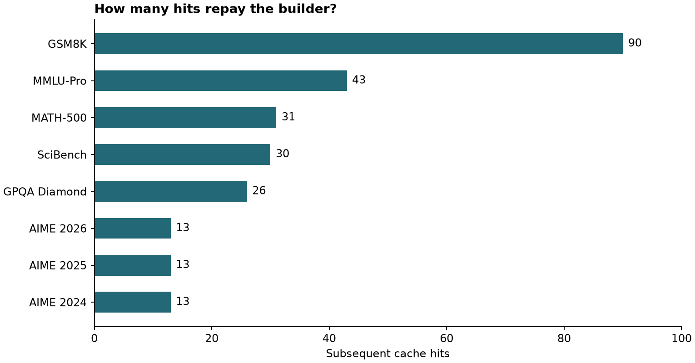

# When Should an LLM Turn Its Answer Into a Program?

*Inside NVIDIA’s CPU-ARC experiment, where a model solves a problem once, a second pass builds an executable procedure, and the economics depend on who asks the next question.*

A training job has 103 examples and room for 32 examples per batch. How many batches will it run?

Four, if it keeps the last seven examples. Three, if it drops them. A language model can do the arithmetic. So can one line of Python. The expensive decision is figuring out which line the user meant.

Now imagine a service answering that question all day. The dataset changes, the batch size changes, and people describe the last batch in half a dozen ways. Saving yesterday’s answer gives you a stale integer. Saving the procedure gives you something you can run again. But the procedure has to carry the condition that made yesterday’s answer right. Otherwise, you have made the wrong answer extremely cheap to produce.

That is the engineering problem at the center of **CPU-ARC**, a November 2026 technical report by Peter Belcak, Greg Heinrich, Saurav Muralidharan, Shizhe Diao and Pavlo Molchanov. They take a worked solution from a capable model, turn it into a program with identifiable inputs, and invoke that program on related questions. A smaller language model can still help where interpreting the request or supplying a value requires language understanding. The report puts the price of a cache invocation between **16.3 and 291.1 times below the original solve**, depending on the benchmark. Building an entry carries a substantial up-front cost. [1, 2]

Our batch-counting example is an original teaching exercise. By the end, you can run it on a CPU, change one clause that flips the answer, check the execution against an independent oracle, and reproduce the paper’s approximate break-even arithmetic.

## Contents

1. Which part of a solution is worth caching?
2. How a worked example becomes an executable entry
3. What happens when the next question arrives
4. How to read the accuracy and robustness results
5. When 291× cheaper starts saving money
6. A CPU lab you can run in five minutes
7. How I would evaluate a real deployment
8. Sources and companion materials

## 1. Which part of a solution is worth caching?

Suppose the service stores the earlier request and the answer *four*. A user then sends the same wording with 128 examples. Four happens to remain correct. Change the count to 129 and the answer becomes five. A lookup based on textual similarity can appear to generalize successfully until the input crosses just such a boundary.

A procedure gives the system somewhere to put the changing quantity. Divide the example count by the batch capacity. Keep the quotient. Add a batch if a remainder exists and the caller wants to keep it. Once these decisions have names, *103*, *32*, and *keep* become inputs. You can inspect them before executing the calculation.

Several mechanisms often go by the name *cache*. A transformer’s KV cache reuses prior attention keys and values as a sequence grows. A response cache can return a saved completion for a matching request. A procedural memory system can hand an agent instructions from an earlier run. CPU-ARC saves a computation that can accept fresh inputs. These mechanisms can coexist. For example, the paper’s own construction-cost estimate accounts for prompt-cache reads by the builder. [1, 3, 4]

There is an older connection to **Program-Aided Language Models**. PAL showed how a model could translate a natural-language problem into a program and delegate execution to an interpreter. CPU-ARC adds a decision across requests. After paying to formulate a program for one example, which future requests can run it again? That decision introduces work that a one-off program never faces: discovering applicable entries, extracting new parameters, and declining inputs outside the procedure’s domain. [1, 5]

## 2. How a worked example becomes an executable entry

The paper assigns three roles. The **source** produces the original solution. The **builder** reads that solution and creates the reusable program. The **target** handles smaller language tasks during execution. The experimental source and builder were both Claude Opus 4.5. Their separate names describe separate jobs and cost accounts. [1]

Consider what a builder would have to do with the batch example. The original trace might contain the sentence “There are three full batches and seven examples left over, so we need a fourth batch.” It contains a correct result. It also quietly assumes that keeping the remainder is desirable. If the builder captures the arithmetic and overlooks that assumption, every test using the original inputs can pass.

The authors’ construction process has five phases. Here is how each would apply to our example. [1, §2.2.1]

1. **Isolate the input and output.** Identify the original request and its answer. In our service the output contract is a count of batches for one traversal of one dataset. Counting optimizer updates after gradient accumulation is a different task.
2. **Decompose the reasoning.** Separate reading the count and capacity, computing complete batches and handling the remainder. An auditor can now locate the step responsible for rounding up.
3. **Recognize parameters and their valid ranges.** Capacity must be positive. An empty dataset is meaningful. The remainder policy may vary. A builder seeing only one worked example has limited evidence about which assumptions the user intends to vary.
4. **Plan the program.** Choose which operations belong together and which deserve separate functions. Quotient and remainder belong in one integer operation. Interpreting the phrase “discard the tail” belongs at the language boundary.
5. **Implement and exercise the pieces.** The reported builder can inspect existing functions, implement dependencies, and check candidate execution against fragments of the original solution. Testing the original case catches transcription errors. Testing 128 and 129 examples catches the boundary error that the original case can hide.

The resulting *semantic functions* are Python callables. The reference design lets a function request a value by description, invoke another function by description, and return a dictionary of named results. The runtime can record a narration of a step, query the target model, extract a value from text, convert a value to a requested type, or invoke a registered tool. A child invocation gets a scoped layer of context. That reduces the risk of a value from one sibling call being accidentally consumed by the next. [1, §2.1]

Type checks improve the interface but leave a familiar class of bugs intact. A context might contain 32 examples **per device** and 128 examples **across the job**. Both numbers are valid integers. Coercing the selected value to an integer can establish its representation while leaving its meaning unresolved. An engineer debugging a wrong result needs to see which description matched, what value came back, and where it entered the computation.

## 3. What happens when the next question arrives

The paper’s dynamic path embeds the incoming query and searches a registry of entry points. Above a configurable similarity threshold, it selects a candidate. The target extracts the parameters expected by that entry. The runtime executes the root function in a fresh context, and the function can discover subordinate functions as needed. A miss can fall back to the source model. The experimental search setup uses 768-dimensional EmbeddingGemma representations and a CPU FAISS flat index. [1, §§2.2.2, 3.4]

This arrangement puts two distinct questions in front of the mathematical operation. *Have I found an applicable procedure?* And *have I bound the right inputs?* A team measuring only the final answer will have trouble identifying which component deserves credit or blame.

For instance, “How many batches does each worker see?” may closely resemble the original request. Its answer can depend on the number of workers, the sharding policy, whether samples are padded and how the last shard is treated. A diligent source model might ask for those details. A cache that eagerly accepts the request can produce a precise answer to the easier question. That is a **false hit**. A miss costs an extra model call. A false hit may leave no visible error at all.

There is also a compilation step. Once the function network has stabilized, the system can resolve internal function descriptions to direct calls and replace dynamic value lookups with dictionary access. The generated module becomes easier to deploy and inspect. Remaining language-model calls still carry their own cost. Changing which dependency a description should resolve to may require recompilation. [1, §2.2.3]

This makes the word *explainable* worth unpacking. An engineer can inspect a returned program, observe its bound inputs, and rerun its arithmetic. If a language model classified a request as “keep the final batch,” that classification still needs its own check. A narration faithfully describing the arithmetic can coexist with a mistaken classification upstream. The inspectable program lets us localize that disagreement.

## 4. What did the authors actually measure?

Table 2 gives eight result rows spanning competition mathematics, grade-school arithmetic, science and multidisciplinary knowledge. The authors distinguish **gold-label accuracy**, agreement with a benchmark’s reference answer, from **fidelity**, agreement with the source model’s answer. These can move independently. A program can reproduce a source error perfectly or correct a final arithmetic slip while retaining the method. [1, Table 2]

On AIME 2025, the source scored **83.3%**, the cache **93.3%**, and source–cache fidelity was **90.0%**. On GSM8K, the direction reversed slightly, from **98.5%** for the source to **98.0%** for the cache. On GPQA Diamond, both reached **83.8%**. Across the eight rows, the cache matched or exceeded source accuracy in seven. The authors suggest that deterministic execution corrected some mistakes near the end of a sound source solution. The aggregate scores alone cannot identify that mechanism for a particular item. [1, §3.6]

A crucial detail lies in construction. Each original sample first gets an isolated cache built from its query and source trace. Successfully constructed entries are merged into a master cache for invocation. Scoring the original problems therefore tests whether the system can turn an existing solution into a functioning entry and retrieve it. The headline accuracy does not answer how a prebuilt registry performs on entirely new problem families. [1, §3.4]

### The denominator behind the robustness result

The authors test three changes: reword a question, change its parameters, or change both. Only entries that already produced the correct original answer qualify. Candidate rewrites also undergo validation. The setup uses separate two-instance generation-judging and testing-judging committees drawn from the same Opus model family. For changed parameters, the expected answer comes from a generated, checked solution to the new instance. [1, §§3.2–3.4]

Take AIME 2026. The **90.8%** combined-perturbation result concerns accepted variants of qualifying entries. A user sending a genuinely novel request has to clear several earlier hurdles: an applicable entry must exist, the router must select it, and the query must satisfy its assumptions. The study’s conditional result tells us something about how well procedures survive local variation. Estimating the chance that an arbitrary production request gets a correct cached answer requires the traffic distribution as well. [1, Table 2]

The authors also describe fine-tuning Llama 3.2 1B for the target role using invocation logs, synthetic augmentation and supervised training. About 20% of logs were harvested, and augmentation targeted roughly ten times the seed data. For a deployment evaluation, I would split held-out problem families **before** harvesting logs or generating variants. That makes the unit of generalization explicit when a small target has been trained on the distribution of calls it will execute. [1, Appendix D]

## 5. When does a 291× invocation saving pay for the builder?

For the AIME 2025 row, the paper reports a **$0.1203 source solve**, a **$1.4517 build**, and an invocation cost displayed as **$0.0004**. The authors’ reported invocation ratio is **291.1×**. Dividing the displayed prices gives a different number because the small denominator is rounded. Use the published ratio when quoting the study and the displayed dollar amounts for approximate budgeting. These are estimates using the paper’s March 2026 pricing assumptions. They measure cost, and provide no equivalent CPU latency or energy multiplier. [1, Table 2 and Appendix C]

Suppose the first source answer has already been paid for. You can now spend $1.4517 to build the entry. Each future successful reuse avoids approximately $0.1199 of source cost after paying for the invocation. Twelve hits save about $1.4388, slightly less than construction. **The thirteenth hit recovers the build cost.**

GSM8K changes the decision. Its baseline source solve costs about one cent, leaving much less to save per hit. With a build priced at $0.8481 and a displayed hit cost of $0.0006, the threshold is approximately **90 future hits**. The expensive reasoning problem recovers its investment earlier because it replaces a more expensive operation each time. [1, Table 2]



*Figure 1. Break-even conditional on successful reuse. Each threshold rounds construction cost divided by per-hit savings up to the next whole hit. The lab regenerates these numbers.*

A service owner also needs an estimate of **time to the next thirteen hits**. At one eligible AIME-like request per day, an entry can live long enough to repay the builder. At one per quarter, a changing policy or data schema may retire it first. When the source trace was generated solely to seed a cache, add that initial solve to the investment. Include routing misses, validation, model hosting and operational overhead when modeling total cost. The 1B model’s calls in the paper were valued at assigned token prices. A CPU server that sits allocated overnight incurs costs even when the request count is zero. [1, §3.5]

## 6. Build a small cache and try to fool it

The companion ZIP contains a deliberately bounded implementation of the training-batch example. It runs offline with Python 3.10 or newer. I wrote two complete query templates and a parameterized CPU function. In the paper, learned retrieval, model-assisted extraction and a generated function network handle a wider range of inputs. Here the boundaries are small enough to audit by reading one file.

Extract the ZIP, enter `cpu_arc_lab`, and run:

```bash
python cache.py "Batch 103 examples at 32 per batch, keep the last partial batch"
python cache.py "With batches of 32, group 103 examples and drop the remainder"
python cache.py "With batches of 32, group 103 examples and keep the remainder per worker"
```

The first call returns three full batches, seven remaining examples, one partial batch used and **four batches**. The second produces **three**. The third yields **MISS**. Its final two words introduce scope that our procedure has no way to resolve. The program prints the handoff decision and makes zero external calls.

Open `cache.py`. The computational part is small:

```python
full, remainder = divmod(request.examples, request.capacity)
partial = int(bool(remainder) and request.keep_partial)
batches = full + partial
```

Follow the input backward. Where did `request.keep_partial` come from? Why does `per worker` cause a miss? When you understand those two choices, you have found the part of this cache that does most of the semantic work.

Then run the checks and the cost audit:

```bash
python check.py
python costs.py
```

The six checks exercise changed wording, changed parameters, both together, a change in meaning, invalid input, and agreement with an independent enumerator. The enumerator physically slices small lists into chunks. It checks **8,320** combinations of example count, batch size and policy against the arithmetic implementation. That establishes agreement over those structured inputs. Broad natural-language understanding would need a different test corpus.

For a revealing experiment, change the parser from a full-string match to a prefix match on a copy of the file. Run the third query again. The parser can now accept the familiar opening and silently discard *per worker*. The arithmetic still passes thousands of checks, and the semantic-boundary test fails. That is what a false hit looks like in an executable experiment.

## 7. What I would measure before routing real traffic

Start with one repeated request family whose output has an independent check. For example, an ML platform could calculate batches for one documented sampler configuration. Collect naturally occurring requests before writing the held-out test set. Include valid paraphrases, unsupported policies, ambiguous numbers and near-neighbor questions whose answers require different operations.

During a shadow run, save the candidate entry, extracted arguments, execution result and the decision to fall back. Score **coverage** across all traffic and **correctness among accepted hits** separately. Look at the false-hit rate on nearby unsupported tasks. Count the complete latency distribution and the cost of misses. A conservative router that saves money on a narrow class of jobs may be easier to justify than an eager router that accepts more traffic and occasionally gives a confident answer under the wrong policy.

Version the dependencies that give a procedure its meaning. If your data loader starts padding shards, exact integer division will continue to execute perfectly even after the cached procedure’s assumptions have expired. On each policy change, run archived examples through the old and new versions. Keep the inputs on which they disagree. Those examples define the decision boundary better than a collection of easy matches.

The most consequential question in CPU-ARC is what makes two requests similar *enough to share a program*. A language model can propose that boundary from a worked solution. An engineer can inspect it. A test can probe it. And sometimes the two words that decide whether a cache belongs in production are sitting at the end of the prompt: *per worker*.

## Sources and companion materials

1. Peter Belcak, Greg Heinrich, Saurav Muralidharan, Shizhe Diao and Pavlo Molchanov. *CPU-ARC: Agentic Reasoning Caching for on-CPU Reasoning Reuse*, version 1, submitted November 6, 2026. Methods in §2, experimental setup and results in §3, costs in Appendix C, and target-model training in Appendix D. [Full report](https://arxiv.org/html/2611.09891v1) · [PDF](https://arxiv.org/pdf/2611.09891v1)
2. NVIDIA Research. The broader research program in local execution and efficient inference. [Local Frontier Intelligence](https://research.nvidia.com/labs/lpr/lfi/)
3. Hugging Face. Transformer attention caching and reuse of keys and values during generation. [Cache explanation](https://huggingface.co/docs/transformers/cache_explanation)
4. Zhang and colleagues. A related design that supplies procedural guidance to a new agent session. [Evolver](https://arxiv.org/abs/2611.07595)
5. Gao and colleagues. *PAL: Program-aided Language Models*, ICML 2023. [Published paper](https://proceedings.mlr.press/v202/gao23f.html)

*The lab reproduces rounded-cost arithmetic and exercises an original CPU-only teaching implementation. The model scores and invocation ratios are reported by the authors. The lab does not rerun their source model, builder or fine-tuned target.*
