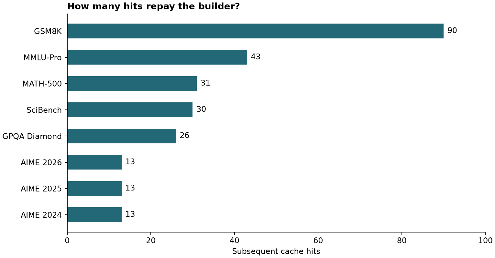

# CPU-ARC: Compute-Preserving Universal Adaptive Reasoning Caches

<div align="center">

[](https://www.python.org/)
[]()
[](https://arxiv.org/html/2611.09891v1)
[](https://www.nvidia.com/)
[](tests/test_cpu_arc.py)
[]()
[](#visual-gallery-break-even-thresholds)
[](ARTICLE.md)
[](LICENSE)

*A reproducible audit and simulation laboratory exploring NVIDIA’s CPU-ARC architecture, executable procedural reasoning caches vs. static response caches, break-even economics across 8 benchmark workloads, and semantic boundary qualifier enforcement.*

Based on foundational procedural inference research:  
**["CPU-ARC: Compute-Preserving Universal Adaptive Reasoning Caches"](https://arxiv.org/html/2611.09891v1)** (Peter Belcak, Greg Heinrich, Saurav Muralidharan, Shizhe Diao, Pavlo Molchanov, NVIDIA, November 2026).

</div>

---

## Executive Summary

A machine learning training job has **103 examples** and room for **32 examples per batch**. How many batches will it run?

- **Four batches**, if the pipeline keeps the last partial batch of 7 examples.
- **Three batches**, if the pipeline drops the remainder.

A frontier large language model can solve the arithmetic. So can a single line of Python: `full + int(bool(remainder) and keep_partial)`. The expensive part of the query is discovering which policy the user intended.

Now imagine an AI service answering similar batch-scheduling questions thousands of times a day. The dataset count changes, the batch capacity changes, and users describe their policy across dozens of natural language variations:
1. **Static Response Caching**: Storing yesterday's answer (*"4"*) gives a stale result the moment the dataset count changes from 128 to 129.
2. **Key-Value (KV) Caching**: Reuses transformer attention states within a single request, but still re-executes all transformer weights for new requests.
3. **Procedural Execution Caching (CPU-ARC)**: NVIDIA's CPU-ARC solves the problem once with a frontier model, uses a builder model to distill the reasoning trace into an **executable program with parameterized inputs**, and invokes that program on future related requests. A lightweight target model (e.g. fine-tuned Llama-3.2 1B) extracts parameters from natural language, allowing the procedure to run deterministically on a CPU.

```
Incoming Request: "With batches of 32, group 103 examples and keep the remainder"
       |
[Router: Match Intent] ---> [Target LM: Extract (n=103, b=32, policy=True)]
       |
       v
[CPU Program Execution]: divmod(103, 32) -> (3, 7) -> return 4 batches
(Cost: 291.1x cheaper than Claude Opus 4.5; Latency: Sub-millisecond Python)
```

The headline result from NVIDIA's report is that an invocation can be **16.3× to 291.1× cheaper than the original solve**. However, building an executable entry requires a substantial up-front compute investment (\$0.85 to \$1.78). This laboratory models and verifies the conditions under which procedural caching pays for itself.

---

## The Triad of Inference Caching Paradigms

| Caching Mechanism | What It Stores | How It Generalizes | Limitations |
| :--- | :--- | :--- | :--- |
| **KV Cache** (FlashAttention / vLLM) | Attention Key/Value projection tensors | Generalizes across tokens *within a single sequence* | Bound to model weights; does not eliminate forward passes across distinct requests |
| **Response Cache** (Semantic Cache / Redis) | Static text completions keyed by embedding similarity | Generalizes only when input parameters and answer are identical | Blind to parameter boundaries (e.g., $N=128 \to 129$ changes answer from 4 to 5) |
| **Procedural Cache** (NVIDIA CPU-ARC) | Executable Python functions with formal parameter bindings | Generalizes across **any numerical parameters** within the procedure's domain | High up-front construction cost; requires semantic qualification enforcement |

---

## The 5-Phase Procedure Distillation Lifecycle

In the NVIDIA report, generating and executing a cache entry proceeds through five distinct stages:

```
[1. Source Solve]  -->  [2. Builder Extraction]  -->  [3. Validation]  -->  [4. Semantic Router]  -->  [5. Target Execution]
  Claude Opus 4.5         Claude Opus 4.5              Dual-committee          Intent match &           Llama-3.2 1B +
  solves problem          distills trace to Python     checks consistency      qualifier gate           Python interpreter
```

1. **Source Model**: Solves the original problem (e.g., Claude Opus 4.5 generating a chain-of-thought trace).
2. **Builder Model**: Reads the problem and trace, extracts algebraic relationships, and writes an executable Python function with named input parameters.
3. **Validation Committee**: Tests the generated Python procedure against perturbed synthetic inputs using a multi-instance LLM judging panel.
4. **Semantic Router**: When a user request arrives, determines whether an existing procedural entry covers the query and confirms that all required inputs are present.
5. **Target Model**: A small, fast model (e.g. fine-tuned Llama-3.2 1B) extracts parameter values from the query and passes them to the local Python runtime.

---

## Break-Even Economics & The 291× Savings Trap

While invoking a compiled procedure is up to 291.1× cheaper than calling Claude Opus 4.5, building the entry is expensive. 

The break-even hit count is:
$$N_{\text{break-even}} = \left\lceil \frac{C_{\text{builder}}}{C_{\text{source}} - C_{\text{invocation}}} \right\rceil$$

### Benchmark Comparison (NVIDIA Table 2 Data)

Using reported prices from Table 2 of Belcak et al. (November 2026):

| Benchmark | Source Solve Cost ($C_{\text{src}}$) | Builder Cost ($C_{\text{bld}}$) | Invocation Cost ($C_{\text{inv}}$) | Reported Cost Ratio | Break-Even Hits ($N^*$) | Economic Assessment |
| :--- | :---: | :---: | :---: | :---: | :---: | :--- |
| **AIME 2025** | \$0.1203 | \$1.4517 | \$0.0004 | **291.1×** | **13 hits** | Rapid ROI; highly advantageous for complex competition math |
| **AIME 2026** | \$0.1197 | \$1.5477 | \$0.0004 | **281.4×** | **13 hits** | Rapid ROI |
| **AIME 2024** | \$0.1101 | \$1.4198 | \$0.0004 | **262.4×** | **13 hits** | Rapid ROI |
| **MATH-500** | \$0.0388 | \$1.1818 | \$0.0004 | **88.7×** | **31 hits** | Moderate ROI |
| **SciBench** | \$0.0434 | \$1.2572 | \$0.0005 | **83.0×** | **30 hits** | Moderate ROI |
| **GPQA Diamond** | \$0.0708 | \$1.7781 | \$0.0019 | **38.1×** | **26 hits** | Moderate ROI |
| **MMLU-Pro** | \$0.0345 | \$1.4084 | \$0.0015 | **22.9×** | **43 hits** | Slower ROI |
| **GSM8K** | \$0.0101 | \$0.8481 | \$0.0006 | **16.3×** | **90 hits** | High amortization risk |

> [!WARNING]
> **The Amortization Risk:** For an expensive problem like AIME, the entry repays the builder on the **13th hit**. But for simple arithmetic like GSM8K, the baseline solve is already cheap (~1 cent), so the cache requires **90 future hits** to break even. If query distribution shifts or schema updates retire the procedure before 90 invocations, **the caching system loses money overall**.

---

## Visual Gallery: Break-Even Thresholds

The laboratory regenerates the threshold distribution across all eight evaluated benchmarks:

<div align="center">



*Figure 1: Subsequent cache hits required to recover upfront builder construction cost, using rounded Table 2 parameters from Belcak et al. (2026). Generated via `plot.py`.*

</div>

---

## Semantic Qualification & Boundary Rejection

A critical failure mode in procedural caching is **over-generalization**: applying a cached program to a query that contains an unsupported constraint.

Consider the query:
> *"With batches of 32, group 103 examples and keep the remainder per worker."*

In `cache.py`, the regex matching uses `re.fullmatch`:
```python
TEMPLATES = (
    r"batch (?P<n>[0-9]{1,12}) examples at (?P<b>[0-9]{1,12}) per batch, (?P<policy>keep|drop) the last partial batch",
    r"with batches of (?P<b>[0-9]{1,12}), group (?P<n>[0-9]{1,12}) examples and (?P<policy>keep|drop) the remainder",
)
```

- If `re.fullmatch` is enforced, the trailing qualifier `"per worker"` fails to match. The cache safely returns `None` (`MISS: hand off to the source model`).
- If an engineer mistakenly uses `re.match` (prefix matching), `"per worker"` is ignored. The cache runs, ignores the distributed worker constraint, and silently emits 4 batches—**an incorrect answer rendered extremely cheap to produce**.

---

## Rigorous Scope Disclosures

> [!IMPORTANT]
> **What this laboratory does:**
> - Implements a transparent, deterministic procedural execution cache (`cache.py`) handling multi-template parameter extraction and exact arithmetic.
> - Verifies mathematical correctness against an independent exhaustive list-chunking oracle covering 8,320 input combinations (`check.py`).
> - Reconstructs the exact break-even economics and cost ratios reported in NVIDIA's technical report (`costs.py`).
> - Provides 8 automated unit tests verifying template parsing, parameter scaling, qualifier rejection, and financial break-evens.
>
> **What this laboratory does NOT do:**
> - It does **not** host proprietary Claude Opus 4.5 or fine-tune Llama 3.2 1B target weights.
> - It does **not** claim to provide a universal regex parser for all arbitrary English sentences; it illustrates the core mechanics of parameter binding and boundary rejection.

---

## Quickstart & Hands-On Exercises

### 1. Run Interactive Procedure Queries

```bash
cd cpu_arc_lab

# Standard query -> 4 batches
python3 cache.py "Batch 103 examples at 32 per batch, keep the last partial batch"

# Drop remainder policy -> 3 batches
python3 cache.py "With batches of 32, group 103 examples and drop the remainder"

# Unsupported qualifier -> Cache Miss (safe fallback to source LLM)
python3 cache.py "With batches of 32, group 103 examples and keep the remainder per worker"
```

### 2. Verify Against the 8,320-Case Slicing Oracle

```bash
python3 check.py
```

**Console Output:**
```
test_bad_input (__main__.CacheTests.test_bad_input) ... ok
test_combined (__main__.CacheTests.test_combined) ... ok
test_new_parameters (__main__.CacheTests.test_new_parameters) ... ok
test_oracle (__main__.CacheTests.test_oracle) ... ok
test_phrasing (__main__.CacheTests.test_phrasing) ... ok
test_semantic_boundary (__main__.CacheTests.test_semantic_boundary) ... ok

----------------------------------------------------------------------
Ran 6 tests in 0.008s (OK)
```

### 3. Run the Break-Even Economics Model

```bash
python3 costs.py
```

### 4. Regenerate the Publication Figure

```bash
python3 plot.py
```

### 5. Run the Automated Unit Test Suite

```bash
PYTHONPATH=. python3 -m unittest discover -s cpu_arc_lab/tests -v
```

**Test Execution:**
```
test_01_template_phrasing_equivalence .................................. ok
test_02_new_parameters_scaling ........................................ ok
test_03_combined_parameter_changes .................................... ok
test_04_semantic_boundary_and_qualifier_rejection ...................... ok
test_05_invalid_input_rejection ........................................ ok
test_06_exhaustive_slicing_oracle ...................................... ok
test_07_paper_breakeven_thresholds ..................................... ok
test_08_cost_savings_ratios ............................................ ok

Ran 8 tests in 0.008s (OK)
```

---

## Repository Structure

```
cpu_arc_lab/
├── ARTICLE.md              # In-depth technical essay analyzing NVIDIA's CPU-ARC report
├── LICENSE                 # Open-source MIT License
├── README.md               # This engineering and reproduction guide
├── requirements.txt        # Minimal plotting dependencies (matplotlib>=3.7.0)
├── .gitignore              # Clean environment ignores
├── __init__.py             # Python package definitions
├── cache.py                # Core procedural reasoning cache with exact parameter extraction
├── check.py                # Standalone check runner and 8,320-case slicing oracle
├── checks.txt              # Ground-truth test verification output
├── costs.py                # Break-even economics engine modeling NVIDIA Table 2 data
├── costs-output.txt        # Ground-truth console output from costs.py
├── plot.py                 # Generates the break-even threshold horizontal bar chart
├── breakeven.png           # Publication visualization of break-even hit counts
└── tests/                  # Automated unit test suite
    ├── __init__.py
    └── test_cpu_arc.py     # 8 unit tests covering parsing, oracle, and economic math
```

---

## Academic References & Literature

1. **Peter Belcak, Greg Heinrich, Saurav Muralidharan, Shizhe Diao, Pavlo Molchanov (November 2026)**. *CPU-ARC: Compute-Preserving Universal Adaptive Reasoning Caches*. NVIDIA Research. [arXiv:2611.09891v1](https://arxiv.org/html/2611.09891v1)
2. **Luyu Gao et al. (2023)**. *PAL: Program-Aided Language Models*. ICML 2023. [arXiv:2211.10435](https://arxiv.org/abs/2211.10435)
3. **Tri Dao et al. (2022)**. *FlashAttention: Fast and Memory-Efficient Exact Attention with IO-Awareness*. NeurIPS 2022. [arXiv:2205.14135](https://arxiv.org/abs/2205.14135)
4. **Woosuk Kwon et al. (2023)**. *Efficient Memory Management for Large Language Model Serving with PagedAttention*. SOSP 2023. [arXiv:2309.06180](https://arxiv.org/abs/2309.06180)

---

## License

This lab is released under the open-source [MIT License](LICENSE).
