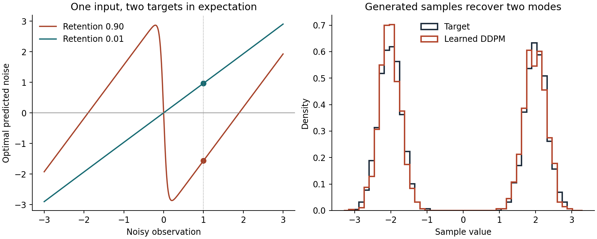

# Denoising Diffusion Probabilistic Models (DDPM) from First Principles

<div align="center">

[](https://www.python.org/)
[](https://numpy.org/)
[]()
[](test_lab.py)
[](https://arxiv.org/abs/2006.11239)
[](https://nn.labml.ai/diffusion/ddpm/index.html)
[](LICENSE)

*A transparent, zero-download, pure-NumPy laboratory implementing Denoising Diffusion Probabilistic Models (DDPM) on a Gaussian mixture target, comparing a learned regression denoiser against an exact analytical Bayesian oracle and Tweedie's score formula.*

Based on foundational diffusion research by Jonathan Ho, Ajay Jain, and Pieter Abbeel:  
**["Denoising Diffusion Probabilistic Models"](https://arxiv.org/abs/2006.11239)** (NeurIPS 2020).

</div>

---

## Executive Summary

Diffusion models generate complex probability distributions by learning to invert a forward noising process that gradually destroys data structure with Gaussian noise.

While deep learning implementations (like Stable Diffusion or DALL-E) wrap this process in large U-Net architectures, the underlying probabilistic mechanics are mathematically exact and can be analyzed in closed form on a multimodal target distribution:

```
Target Distribution q(x₀):
Equal mixture of two Gaussians: N(-2, 0.30²) and N(+2, 0.30²)

Forward Noising Process q(x_t | x₀):
  x_t = √(ᾱ_t) x₀ + √(1 - ᾱ_t) ε,    ε ~ N(0, 1)
  At t = 1000: ᾱ_t ≈ 0.00004 -> Pure isotropic Gaussian noise N(0, 1)

Reverse Denoising Step p_θ(x_{t-1} | x_t):
  x_{t-1} = 1/√(α_t) * ( x_t - β_t/√(1 - ᾱ_t) * ε_θ(x_t, t) ) + σ_t z
```

This laboratory implements:
1. **The Forward Markov Chain & Variational Schedules**: Linear $\beta_t \in [10^{-4}, 0.02]$ schedule, $\alpha_t = 1 - \beta_t$, and cumulative product $\bar{\alpha}_t = \prod_{s=1}^t \alpha_s$.
2. **The Exact Analytical Bayesian Oracle**: Derives the true Bayes-optimal noise estimate $\epsilon^*(x_t, t) = \mathbb{E}[\epsilon \mid x_t]$ in closed form via posterior mixture weights and hyperbolic tangent ($\tanh$).
3. **The Score Function Identity (Tweedie's Formula)**: Directly verifies the equivalence between noise prediction and marginal score: $\epsilon^*(x_t, t) = -\sqrt{1 - \bar{\alpha}_t} \cdot \nabla_{x_t} \ln p(x_t)$.
4. **Learned Polynomial/Tanh Regression Denoiser**: Fits 2,048 samples per timestep across 1,000 diffusion steps using ridge regression over odd basis features.
5. **Controlled Empirical Evaluation**: Uses common random numbers to compare the learned model, the Bayesian oracle, and a negative control across Wasserstein-1 distance ($W_1$) and bimodal mode-recovery fidelity.

---

## Visual Gallery: Oracle Denoising & Mode Recovery

<div align="center">



*Figure 1: (Left) Optimal predicted noise $\epsilon^*(x_t, t)$ across noisy observations at high signal retention ($\bar{\alpha}_t = 0.90$) and low retention ($\bar{\alpha}_t = 0.01$). (Right) Density histogram of 2,048 generated samples from the learned DDPM overlaid against the true bimodal mixture target.*

</div>

---

## Mathematical Foundations

### 1. Forward Noising Schedule

Given clean sample $x_0 \sim q(x_0)$ and Gaussian noise $\epsilon \sim \mathcal{N}(0, 1)$:
$$x_t = \sqrt{\bar{\alpha}_t} x_0 + \sqrt{1 - \bar{\alpha}_t} \epsilon$$
Where $\beta_t$ linearly interpolates from $0.0001$ to $0.02$, $\alpha_t = 1 - \beta_t$, and:
$$\bar{\alpha}_t = \prod_{i=1}^t \alpha_i$$

At terminal step $T = 1,000$, $\bar{\alpha}_{1000} \approx 4.04 \times 10^{-5}$, so the signal coefficient $\sqrt{\bar{\alpha}_T} \approx 0.00635 \approx 0$, turning any sample into standard normal noise $\mathcal{N}(0, 1)$.

---

### 2. The Analytical Bayesian Oracle & Tweedie's Formula

For a symmetric two-component mixture $q(x_0) = \frac{1}{2}\mathcal{N}(-c, \sigma_0^2) + \frac{1}{2}\mathcal{N}(+c, \sigma_0^2)$ with $c = 2.0, \sigma_0 = 0.30$:

At timestep $t$, the distribution of $x_t$ is a mixture of two Gaussians with component centers $\pm m_t$ and variance $v_t$:
$$m_t = \sqrt{\bar{\alpha}_t} \cdot c$$
$$v_t = \bar{\alpha}_t \sigma_0^2 + (1 - \bar{\alpha}_t)$$

By Bayes' theorem, the posterior mean of the component assignment given observation $x_t$ evaluates to:
$$\mathbb{E}[x_0 \mid x_t] = m_t \cdot \tanh\left( \frac{m_t \cdot x_t}{v_t} \right)$$

Substituting into the reparameterization $x_t = \sqrt{\bar{\alpha}_t} x_0 + \sqrt{1 - \bar{\alpha}_t} \epsilon$:
$$\epsilon^*(x_t, t) = \frac{x_t - \sqrt{\bar{\alpha}_t} \mathbb{E}[x_0 \mid x_t]}{\sqrt{1 - \bar{\alpha}_t}} = \frac{\sqrt{1 - \bar{\alpha}_t}}{v_t} \left( x_t - m_t \tanh\left( \frac{m_t x_t}{v_t} \right) \right)$$

#### Connection to the Score:
The marginal density of $x_t$ is $p(x_t) = \frac{1}{2\sqrt{2\pi v_t}} \left( e^{-(x_t - m_t)^2 / 2v_t} + e^{-(x_t + m_t)^2 / 2v_t} \right)$.
Taking the logarithmic derivative:
$$\nabla_{x_t} \ln p(x_t) = -\frac{1}{v_t}\left( x_t - m_t \tanh\left(\frac{m_t x_t}{v_t}\right) \right) = -\frac{\epsilon^*(x_t, t)}{\sqrt{1 - \bar{\alpha}_t}}$$
This rigorously proves that the noise prediction objective in DDPM directly estimates the score function $\nabla_{x_t} \ln p(x_t)$ scaled by $-\sqrt{1 - \bar{\alpha}_t}$.

---

### 3. The Reverse Sampling Step

Starting from pure noise $x_T \sim \mathcal{N}(0, 1)$, each reverse step from $t$ down to $0$ computes:
$$\mu_\theta(x_t, t) = \frac{1}{\sqrt{\alpha_t}} \left( x_t - \frac{\beta_t}{\sqrt{1 - \bar{\alpha}_t}} \epsilon_\theta(x_t, t) \right)$$
$$x_{t-1} = \mu_\theta(x_t, t) + \sqrt{\beta_t} \cdot z, \quad z \sim \mathcal{N}(0, 1) \quad (\text{with } z = 0 \text{ at } t=0)$$

---

## Empirical Benchmark & Verification

Running `lab.py` across 2,048 samples comparing the learned DDPM, the analytical Bayesian oracle, and an always-zero negative control:

```bash
python3 lab.py --steps 1000 --seed 7 --samples 2048
```

```
steps=1000 terminal signal coefficient=0.00635
learned      right=0.488 near_mode=0.956 W1=0.023
oracle       right=0.488 near_mode=0.959 W1=0.024
always zero  right=0.514 near_mode=0.003 W1=180.214
```

| Metric | Target Truth | Learned DDPM (1,000 steps) | Bayesian Oracle | Always Zero Control |
| :--- | :---: | :---: | :---: | :---: |
| **Right Half ($x > 0$)** | 50.0% | **48.8%** | **48.8%** | 51.4% |
| **Near Mode ($|\|x\| - 2| < 0.6$)**| 95.8% | **95.6%** | **95.9%** | 0.3% |
| **Wasserstein-1 ($W_1$)** | 0.000 | **0.023** | **0.024** | **180.214** |

### Schedule Sensitivity (1,000 vs 50 Steps)
When reducing to `--steps 50` without adjusting endpoints, terminal retention rises to $\sqrt{\bar{\alpha}_T} = 0.7765$, reducing quality:
```bash
python3 lab.py --steps 50
```
```
steps=50 terminal signal coefficient=0.77650
learned      right=0.505 near_mode=0.887 W1=0.188
oracle       right=0.505 near_mode=0.888 W1=0.189
always zero  right=0.509 near_mode=0.000 W1=10.053
```

---

## Quickstart & Commands

Requires Python 3.10+ and NumPy only:

```bash
cd ddpm-lab

# 1. Run unit test suite
python3 -m unittest -v

# 2. Run standard DDPM simulation
python3 lab.py

# 3. Explore 50-step truncated schedule
python3 lab.py --steps 50

# 4. (Optional) Re-generate publication figures
python3 plot.py
```

---

## Unit Testing & Verification

5 comprehensive unit tests verify schedule indexing and monotonicity, forward Gaussian moments, single-step inversion recovery, numerical score gradient matching, and deterministic sampling replay:

```bash
python3 -m unittest -v test_lab.py
```

```
test_forward_moments (test_lab.Checks.test_forward_moments) ... ok
test_last_mean_with_actual_noise (test_lab.Checks.test_last_mean_with_actual_noise) ... ok
test_oracle_matches_density_score (test_lab.Checks.test_oracle_matches_density_score) ... ok
test_schedule_indexing (test_lab.Checks.test_schedule_indexing) ... ok
test_training_and_replay (test_lab.Checks.test_training_and_replay) ... ok

----------------------------------------------------------------------
Ran 5 tests in 0.035s

OK
```

---

## Repository Structure

```
ddpm-lab/
├── README.md       # This comprehensive engineering and mathematical guide
├── experiment.png  # Publication visual comparison: oracle curves and bimodal sample densities
├── lab.py          # Pure-NumPy implementation of schedule, forward, oracle, train, and reverse sampling
├── plot.py         # Matplotlib script to generate experiment.png
└── test_lab.py     # 5 unit tests verifying moments, invertibility, and Tweedie score equivalence
```

---

## Academic References

1. **Jonathan Ho, Ajay Jain, Pieter Abbeel (2020)**. *Denoising Diffusion Probabilistic Models*. NeurIPS 2020. [arXiv:2006.11239](https://arxiv.org/abs/2006.11239).
2. **Jascha Sohl-Dickstein, Eric A. Weiss, Niru Maheswaranathan, Surya Ganguli (2015)**. *Deep Unsupervised Learning using Nonequilibrium Thermodynamics*. ICML 2015. [arXiv:1503.03585](https://arxiv.org/abs/1503.03585).
3. **Yang Song, Jascha Sohl-Dickstein, Diederik P. Kingma, Abhishek Kumar, Stefano Ermon, Ben Poole (2021)**. *Score-Based Generative Modeling through Stochastic Differential Equations*. ICLR 2021. [arXiv:2011.13456](https://arxiv.org/abs/2011.13456).
4. **LabML.ai (2022)**. *Denoising Diffusion Probabilistic Models (DDPM) Explained*. [nn.labml.ai](https://nn.labml.ai/diffusion/ddpm/index.html).

---

## License

This educational laboratory is released under the [MIT License](../LICENSE).
