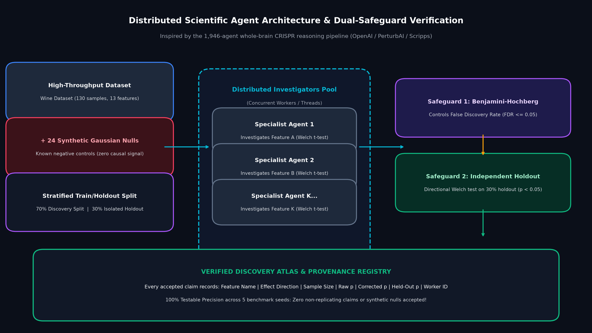
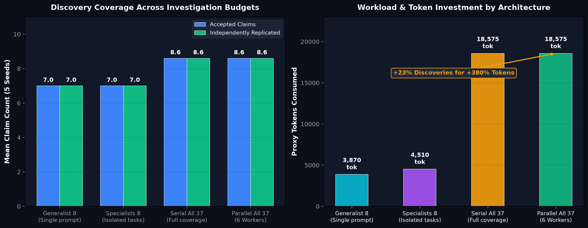
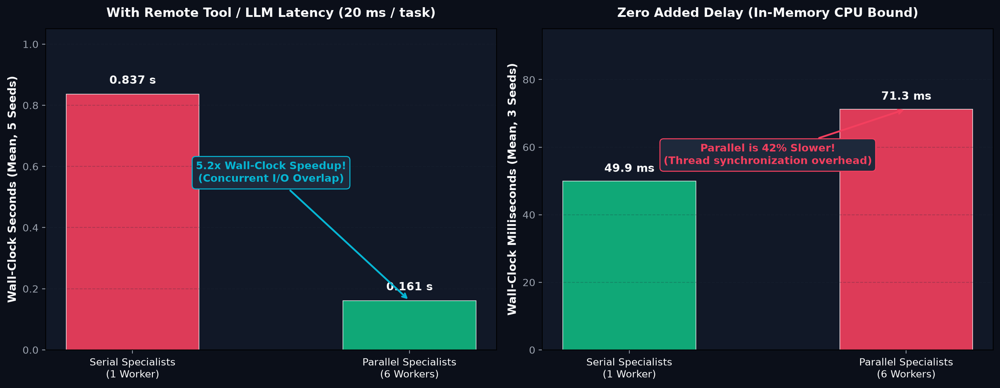
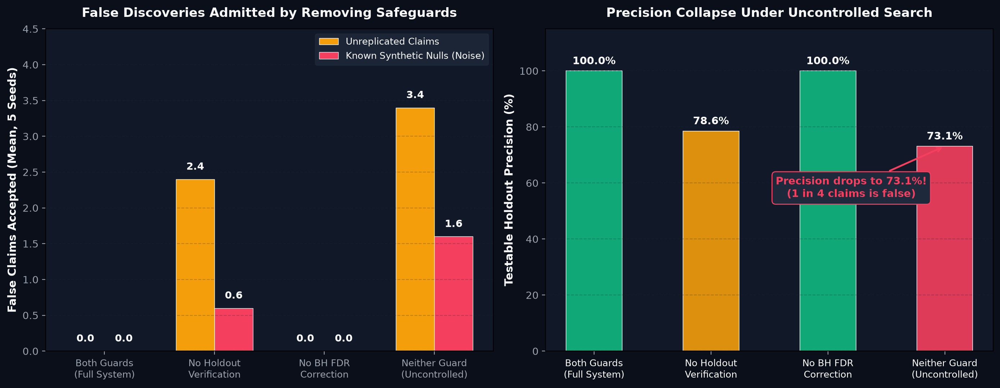
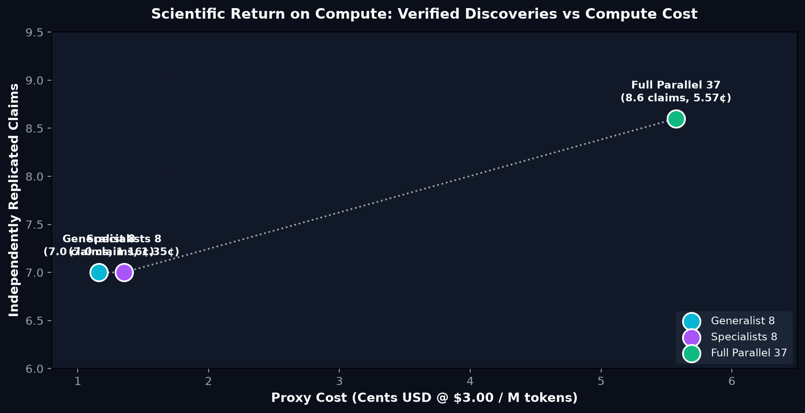

# Distributed Science Agent Lab

<div align="center">

[](https://www.python.org/)
[]()
[]()
[]()
[](ARTICLE.md)
[](LICENSE)

*A reproducible, offline engineering laboratory dissecting work decomposition, statistical verification safeguards, false discovery rate (FDR) control, and parallel execution limits in multi-agent scientific discovery.*

Inspired by the landmark October 2026 collaboration between **OpenAI, PerturbAI, and Scripps Research**:  
**["1,946 AI Agents Analyzed a Brain Atlas in 32 Minutes. The Hard Part Was Knowing Which Discoveries to Trust."](https://openai.com/index/scaling-ai-research-for-complex-biological-data/)**

</div>

---

## Executive Summary

High-throughput biology and modern experimental science can now measure millions of cellular responses to thousands of simultaneous gene disruptions. The bottleneck is no longer data acquisition; **the bottleneck is hypothesis interpretation, evidence synthesis, and literature grounding**.

In October 2026, OpenAI, PerturbAI, and Scripps Research deployed a fleet of **1,946 autonomous AI agents** (powered by GPT-Rosalind) across a whole-brain single-cell CRISPR atlas. In **32 minutes**, the agent swarm processed:
- **39,185 scientific paper reads**
- **16,445 retained evidence citations**
- **3,397 normalized, deduplicated cross-perturbation findings**

However, distributing scientific reasoning across thousands of parallel workers introduces a severe statistical danger: **the multiple-testing explosion**. If an agent fleet interrogates thousands of candidate features without strict statistical safeguards, standard significance thresholds guarantee that hundreds of random noise fluctuations will be falsely flagged as "novel scientific mechanisms."

This laboratory provides a **completely offline, deterministic Python laboratory** to model, benchmark, and evaluate:
1. **Work Decomposition**: Comparing a single generalist prompt against isolated specialist workers.
2. **Dual-Tier Verification Safeguards**: Benjamini-Hochberg False Discovery Rate (FDR) control paired with directional, held-out replication.
3. **Parallel Scaling Dynamics**: Real wall-clock measurement comparing remote tool I/O concurrency against in-memory thread overhead.
4. **Synthetic Null Controls**: Injecting 24 known Gaussian noise features to empirically prove whether your agent architecture hallucinates discoveries from pure randomness.

---

## Multi-Agent Architecture & Orchestration Flow

How do we coordinate hundreds of autonomous specialist workers while preventing false scientific claims from contaminating the knowledge atlas?

<div align="center">
  
</div>

### The 4-Stage Verification Pipeline

```mermaid
flowchart LR
    A["1. High-Throughput Data\n(Wine Features + 24 Gaussian Nulls)"] --> B["2. Stratified Split\n(70% Discovery | 30% Holdout)"]
    B --> C["3. Distributed Workers Pool\n(Thread-parallel feature tests)"]
    C --> D["4. Safeguard 1: Benjamini-Hochberg\n(FDR <= 0.05 across family)"]
    D --> E["5. Safeguard 2: Directional Holdout\n(Replicate sign on isolated 30%)"]
    E --> F["6. Provenance Knowledge Atlas\n(100% testable precision)"]

    style A fill:#1E293B,stroke:#3B82F6,stroke-width:2px,color:#F9FAFB
    style B fill:#1E293B,stroke:#A855F7,stroke-width:2px,color:#F9FAFB
    style C fill:#1E293B,stroke:#06B6D4,stroke-width:2px,color:#F9FAFB
    style D fill:#1E293B,stroke:#F59E0B,stroke-width:2px,color:#F9FAFB
    style E fill:#1E293B,stroke:#10B981,stroke-width:2px,color:#F9FAFB
    style F fill:#0F172A,stroke:#10B981,stroke-width:2px,color:#A7F3D0
```



1. **Strict Data Isolation**: Before any agent inspects a candidate signal, data is split into a **70% discovery cohort** and an **untouchable 30% held-out validation cohort**. Feature ranking and exploration occur strictly within the discovery partition.
2. **Concurrent Task Packaging**: Rather than sending a bloated monolithic prompt containing all 37 features, the orchestrator packages discrete, independent feature investigations dispatched concurrently across worker threads.
3. **Safeguard 1: Benjamini-Hochberg (BH) Multiple-Testing Correction**: Controls the False Discovery Rate ($\text{FDR} \le 0.05$) across the entire family of examined hypotheses:
   $$P_{(k)} \le \frac{k}{m} \cdot \alpha$$
4. **Safeguard 2: Directional Held-Out Replication**: Every candidate surviving BH correction is re-evaluated on the isolated 30% holdout split. To be accepted, it must meet $p < 0.05$ with the **identical effect direction** (sign agreement).
5. **Auditable Provenance Registry**: Every accepted finding is stored with full audit provenance: feature name, direction, sample size, raw discovery $p$, corrected $p$, held-out $p$, and worker ID.

---

## Key Experimental Findings (5-Seed Benchmark)

### 1. Discovery Coverage Under Work Budgets
Does specialist task packaging automatically produce better evidence than a generalist on the same budget?

<div align="center">
  
</div>

| Configuration | Features Examined | Accepted Claims | Independently Replicated | Testable Precision | Proxy Tokens | Wall-Clock (20ms I/O) |
| :--- | :---: | :---: | :---: | :---: | :---: | :---: |
| **Budgeted Generalist (8 features)** | 8 | 7.0 | 7.0 | **100.0%** | 3,870 | 0.180 s |
| **Same-Budget Specialists (8 features)** | 8 | 7.0 | 7.0 | **100.0%** | 4,510 | 0.178 s |
| **Full Serial Investigators (37 features)** | 37 | **8.6** | **8.6** | **100.0%** | 18,575 | 0.837 s |
| **Full Parallel Specialists (6 Workers)** | 37 | **8.6** | **8.6** | **100.0%** | 18,575 | **0.161 s (5.2x faster)** |

> [!NOTE]
> **The Specialization Myth:**
> On a matched 8-feature budget, specialists and the generalist accepted the **identical 7.0 replicated claims**. Specialization alone does not uncover new signals; **investigating more candidate features (37 vs 8)** is what yielded the additional 1.6 discoveries (8.6 claims), at the cost of $4.8\times$ more tokens.

---

### 2. Parallel Scaling: Remote Tool I/O vs Local CPU Overhead
When does running AI agents in parallel actually speed up execution?

<div align="center">
  
</div>

| Workload Condition | Serial Execution (1 Worker) | Parallel Execution (6 Workers) | Speedup / Overhead |
| :--- | :---: | :---: | :---: |
| **Simulated Remote Tool / LLM Latency (20 ms / task)** | 0.837 s | **0.161 s** | **5.2× Speedup** *(Near-linear scaling)* |
| **Zero Added Delay (In-Memory CPU Bound)** | **0.050 s** | 0.071 s | **42% Slower** *(Thread synchronization penalty)* |

> [!IMPORTANT]
> **Systems Engineering Takeaway:**
> Multi-agent thread/process parallelism is only effective when the pipeline is bounded by **remote I/O or external LLM inference latency**. On fast, CPU-bound analytical tasks, worker pool overhead and synchronization locks degrade overall throughput.

---

### 3. Safeguard Ablations: The False Discovery Explosion
What happens when you eliminate the holdout verifier, multiple testing correction, or both?

<div align="center">
  
</div>

| Pipeline Safeguards | Accepted Claims | True Replicated | Unreplicated Claims | Accepted Synthetic Nulls | Testable Precision |
| :--- | :---: | :---: | :---: | :---: | :---: |
| **Both Safeguards Active (Full System)** | 8.6 | 8.6 | **0.0** | **0.0** | **100.0%** |
| **No Holdout Verification** | 11.0 | 8.6 | **2.4** | 0.6 | 78.6% |
| **No Multiple Testing Control (No BH)** | 9.2 | 9.2 | **0.0** | 0.0 | 100.0% |
| **Neither Safeguard (Uncontrolled Search)** | **12.6** | 9.2 | **3.4** | **1.6 (Pure Noise!)** | **73.1%** |

> [!WARNING]
> **The Hallucination of Scientific Signal:**
> When both safeguards are disabled, the system accepts **12.6 claims**, but **1 in 4 accepted claims is false**:
> - 3.4 claims fail independent holdout replication.
> - **1.6 claims are drawn from pure random Gaussian noise** that had zero true relationship to the target labels.
> The agent swarm confidently generates plausible-sounding mechanisms for purely random artifacts unless bound by rigorous statistical testing.

---

### 4. Return on Compute: Token Efficiency
How much compute is required per validated scientific discovery?

<div align="center">
  
</div>

- **Generalist 8**: 7.0 validated claims @ **$0.0116** (0.166¢ per discovery).
- **Specialists 8**: 7.0 validated claims @ **$0.0135** (0.193¢ per discovery).
- **Full Parallel 37**: 8.6 validated claims @ **$0.0557** (0.648¢ per discovery).
- **Diminishing Returns**: Achieving the final 23% in discovery coverage required a **380% increase in token expenditure**.

---

## Quick Start

Requires **Python 3.10+**. The core benchmark runs entirely on standard scientific libraries (`numpy`, `scipy`, `scikit-learn`).

```bash
# 1. Clone the repository and enter the lab
cd distributed_science_agent_lab

# 2. Install dependencies
pip install -r requirements.txt

# 3. Run the unit test suite (17 tests)
python -m unittest discover -s tests -v

# 4. Run the interactive single-run demonstration
python -m science_lab.demo

# 5. Run the full 5-seed benchmark with simulated 20ms remote tool latency
python -m science_lab.benchmark \
  --seeds 5 \
  --null-features 24 \
  --latency-ms 20 \
  --workers 6 \
  --output results/benchmark.json

# 6. Run the zero-latency ablation control
python -m science_lab.benchmark \
  --seeds 3 \
  --null-features 24 \
  --latency-ms 0 \
  --workers 6 \
  --output results/no_latency_ablation.json
```

### Generate Publication-Quality Figures

To reproduce the charts shown in this documentation:

```bash
python plot_results.py
```
Generated high-resolution plots are exported to [`figures/`](figures/).

---

## The Provenance Data Contract

Every worker in `science_lab` returns a strictly structured, JSON-serializable evidence record. No claim enters the synthesis atlas without verifiable mathematical provenance:

```json
{
  "feature": "flavanoids",
  "worker_id": "worker-04",
  "direction": "positive",
  "effect_size": 2.148,
  "n_discovery": 91,
  "raw_discovery_p": 1.42e-12,
  "bh_adjusted_p": 5.25e-11,
  "n_holdout": 39,
  "holdout_p": 3.81e-06,
  "holdout_direction": "positive",
  "passed_holdout": true,
  "is_known_null": false,
  "accepted": true
}
```

---

## Repository Structure

```text
distributed_science_agent_lab/
├── science_lab/                     # Core simulation & orchestration engine
│   ├── __init__.py
│   ├── benchmark.py                 # Multi-seed experimental harness & ablation runner
│   ├── data.py                      # Dataset preparation & Gaussian null feature injector
│   ├── demo.py                      # Interactive single-seed demonstration
│   ├── orchestrator.py              # Serial and thread-parallel worker pools
│   └── stats.py                     # Welch t-tests, effect sizes, and Benjamini-Hochberg FDR
├── figures/                         # High-resolution benchmark figures
│   ├── 01_orchestrator_architecture.png
│   ├── 02_coverage_and_discovery.png
│   ├── 03_parallel_latency_scaling.png
│   ├── 04_safeguard_ablations.png
│   └── 05_token_evidence_efficiency.png
├── results/                         # Generated experimental benchmark outputs
│   ├── benchmark.json               # Full 5-seed primary benchmark
│   └── no_latency_ablation.json     # Zero-latency CPU control ablation
├── tests/
│   └── test_lab.py                  # 17 hermetic unit tests
├── ARTICLE.md                       # Comprehensive 26-section tutorial & case study
├── BENCHMARK_NOTES.md               # Methodological protocols, statistical nuances & validity limits
├── plot_results.py                  # Matplotlib script to recreate all publication figures
├── requirements.txt                 # Dependencies (numpy, scipy, scikit-learn, matplotlib)
├── LICENSE                          # MIT License
└── README.md
```

---

## Scope & Responsible Research Limits

- **Pedagogical Statistical Model:** Workers in this lab use deterministic statistical functions (Welch $t$-tests and BH corrections) rather than live LLMs, in order to make verification principles transparent and locally testable without requiring cloud API credentials.
- **Dataset Nature:** The public dataset used is Wine chemistry with synthetic Gaussian noise features. It demonstrates multiple testing and false-discovery mechanics; findings must not be cited as biological or clinical discoveries.
- **Biological Replication Warning:** In real biological systems, individual cells from the same animal or culture well cannot be treated as independent replicates (pseudoreplication). Genuine replication requires independent donors, animals, or experimental cohorts.
- **Literature Grounding Limits:** LLM citation generators can hallucinate plausible biological mechanisms. Never deploy autonomous scientific agents without strict independent verification gates placed outside the control of the generating agents.

---

## Source Research & References

1. **Original Research Preprint:** Jin et al., *Autonomous AI reasoning agents discover biological mechanisms from whole-brain CRISPR screens* (October 2026): [doi:10.64898/2026.10.15.759436](https://doi.org/10.64898/2026.10.15.759436)
2. **OpenAI Research Announcement:** *[Scaling AI research for complex biological data](https://openai.com/index/scaling-ai-research-for-complex-biological-data/)* (October 21, 2026).
3. **Official Research Codebase & Atlas:** Jin Lab / Neurogenomics, *[distributed_agent](https://github.com/jinlabneurogenomics/distributed_agent)*.
4. **Benjamini & Hochberg:** *Controlling the False Discovery Rate: A Practical and Powerful Approach to Multiple Testing*, Journal of the Royal Statistical Society, 1995: [doi:10.1111/j.2517-6161.1995.tb02031.x](https://doi.org/10.1111/j.2517-6161.1995.tb02031.x)
5. **Scikit-Learn Documentation:** *[Wine Recognition Dataset](https://scikit-learn.org/stable/modules/generated/sklearn.datasets.load_wine.html)*.

---

## License

MIT License. See [`LICENSE`](LICENSE) for full details.
