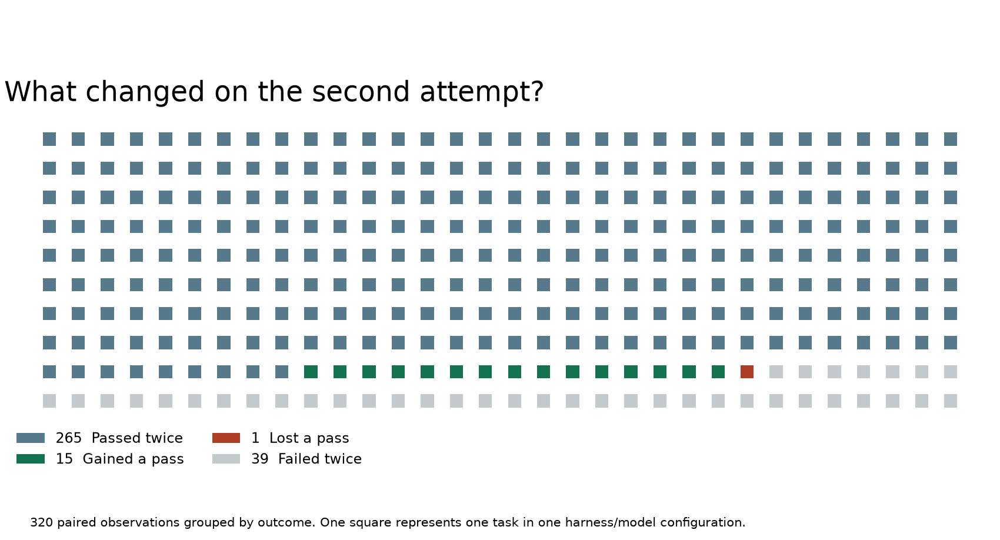

# The Agent Got the Answer Right Twice. The Second Time Took 95 Fewer Model Calls.

*Inside Evolver, a system that lets a coding agent leave procedures for its next session. Its most revealing experiment asks what a fresh agent can do with the notes from an earlier attempt.*

The requested output was a single integer. Count the tokens in a specified slice of a dataset using a designated tokenizer. The first agent got it right in 112 model calls. A fresh session, given procedural guidance from earlier work, also got it right. This time it took 17 calls. On a benchmark that scores the final answer, those two runs look identical. On the invoice and in the execution trace, they are very different. [1]

If you have ever fixed a build by finding the one test target that exercises the failing component, you know what the first run can buy. The patch might be three lines. The expensive part was discovering which experiment would tell you whether those three lines worked. An agent can leave the patch in a repository and lose that discovery when its session ends.

Haoyang Zhang and colleagues at Infinite Evolution Lab, EvoMap, built **Evolver** to preserve discoveries of this kind. A later agent can retrieve a procedure, examine when it applies, and use it with its existing tools. The foundation model’s weights stay fixed. The change between sessions lives in an external collection of strategies and records. [1, 2]

The distinction that matters most for interpreting their November 2026 preprint is easy to miss. In the published experiment, a second attempt could receive advice distilled from the **same task’s** first attempt. That makes Evolver an interesting study of what exploratory work leaves behind. It also gives us a precise question to ask of the evidence. How much of that value survives when tomorrow’s problem looks familiar but has a different answer? [1]

## Contents

1. What an agent should leave for the next shift
2. How a procedure gets from a trace into a prompt
3. What happened in the 320 paired evaluations
4. The cost hidden inside a token-saving claim
5. A small experiment with the released code
6. How to test whether a strategy transfers
7. Where Evolver fits in agent-memory research
8. Sources and companion files

## 1. What an agent should leave for the next shift

Imagine inheriting the dataset-counting job from the opening. Your predecessor could hand you the final integer, the entire conversation, or a short note explaining how to reproduce the count. Each artifact answers a different question.

The integer helps if you need yesterday’s answer. The conversation lets you investigate how your predecessor reached it, including dead ends. A procedure helps you count again after the dataset changes. To be reusable, it has to retain enough of the circumstances that made the original method work.

Consider this **illustrative handoff**, written for this article. The paper gives the task and measurements. The following steps are an example of the kind of guidance one could extract.

> Before scanning the dataset, identify the requested partition and tokenizer revision. Inspect two records to confirm which field contains the text. Decide whether each record is encoded separately and whether special tokens count. Stream the selected records through the tokenizer. Check a hand-counted fixture before reporting the total.

There are two decisions here that a note saying “use the tokenizer” loses. Encoding records separately can add a special token per record. Joining records first can change token boundaries. Both implementations can produce a plausible integer. A previous agent’s most valuable contribution may be remembering to resolve that ambiguity before an hour-long scan.

Evolver calls its reusable strategy object a **Gene**. In the public release, Gene records have fields for matching signals, preconditions, ordered strategy steps and validation. A **Capsule** can associate a strategy with a particular execution case. **AntiGenes** capture negative guidance. A useful negative instruction in our hypothetical example would be to avoid using the dataset’s byte length as a proxy for tokenizer output. [1, 3]

A concrete seed Gene in the released repository concerns publishing Markdown to Feishu or Lark. Its preconditions mention a working CLI and an authenticated identity. Its strategy calls for a diagnostic check, the appropriate document API, and file-backed input for long Markdown. Its listed validation command checks the Node version. That command can establish a fact about the runtime. Confirming that the intended document was created would require evidence from the publication operation. A field named `validation` tells you where to look for a check. Reading the check tells you what it can establish. [3]

This is an important representation choice. For a researcher, the unit being retrieved has an identifiable scope that can be varied experimentally. For an engineer, the same structure gives a reviewer somewhere to record a prerequisite that would otherwise be buried halfway through a transcript.

## 2. How a procedure gets from a trace into a prompt

Picture an agent that has just finished a repair. Its trace contains tool calls, errors, retries, guesses, successful checks and a final explanation. Some of that explanation may be wrong even when the patch passes. A test can start passing after two edits, while the agent attributes the fix to the wrong one. Capturing the session is straightforward. Deciding what deserves to become advice is harder.

Evolver supports lightweight drafting from session material and optional model-based distillation. Drafted candidates can enter quarantine for review. Its asset store keeps content identity separate from review and provenance records, so the system can change an asset’s eligibility while preserving the content a previous agent saw. That matters when someone asks which version of a procedure influenced a failed run. [1, 4]

Think through three moments in a strategy’s life.

**When it is written**, capture the conditions under which the procedure worked. For a concurrency bug, that might include the affected library version, the observable race, and the test that exposed it. “Add a null check” travels badly because it preserves a patch-shaped conclusion while discarding the conditions that justified it.

**When it is retrieved**, the host has to decide what to spend context on. Evolver offers several routes, including session-start hooks, prompt-time matching and on-demand retrieval through MCP. Autonomous selection has its own heuristics. The paper describes differences in ranking, context budgets and eligibility checks across routes. When evaluating a deployment, identify the route that actually supplied the advice. A review policy on a local import path tells you little about an integration that retrieves an external asset directly. [1, 2]

**After it is read**, a worker still has to interpret the advice and perform the task. An outdated procedure can match the right error message. A valid procedure can be read and ignored. A correct action can be performed for an independent reason. Those distinctions become important if future rankings depend on evidence that a strategy “worked.”

For the dataset example, I would keep three records with different evidentiary roles. The retrieval record would say which procedure was delivered. A tool record would show which partition and tokenizer were actually used. A grader would judge the returned integer. Together they let someone investigate an execution. Any one of the three, on its own, leaves a substantial question unanswered.

## 3. What happened in the 320 paired evaluations

The experiment used Evolver v2.0.33 with two harnesses, Claude Code and Codex, and two model configurations, DeepSeek V4.1 Flash and GPT-5.6 Sol. The four benchmarks were Terminal-Bench 2.1, SWE-bench Multilingual, SWE-rebench and GAIA. Each of the 16 combinations contributed 20 paired observations. The same 20 tasks per benchmark were used across configurations. The 320 pairs therefore represent **80 benchmark tasks exercised in four configurations**. [1]

Each pair has a history. First the agent attempts the task with its ordinary tools and built-in skills. Next, experience is extracted from valid baseline traces, including failures. Finally, the environment is restored and the agent takes another run in a fresh session. The strategy pool is frozen before this augmented run. Retrieval prioritizes same-task experience, with a 12,000-byte injection budget. This is a byte budget, so the actual token count depends on the encoding and text. [1]

The selection process matters as much as the prompt change. The authors began with tasks in benchmark order, replaced certain empty or failed executions, and required valid outcomes and complete usage records in both conditions. They also say that observed improvements and token usage informed the final selection. Consequently, the numbers describe a diagnostic sample whose construction had access to outcomes. An estimate of average benefit on arbitrary new tasks needs a prospectively selected sample. [1]

### Four counts behind the headline

The published rates correspond to **266 baseline successes** and **280 augmented successes**. The authors also give the overlap, **265 tasks that passed in both runs**, counting each task and configuration as a pair. From those three numbers, we can reconstruct every possible transition. [1]

- **265 passed twice.** This is the largest group, and the one in which changes in execution cost are easiest to discuss while holding the final grade constant.
- **15 moved from fail to pass.** These are the candidate recoveries to inspect for a useful procedure.
- **1 moved from pass to fail.** A paired review of this case could show whether guidance introduced interference, whether the second run took a different path, or whether the outcome varied for another reason.
- **39 failed twice.** These cases could help distinguish missing knowledge from failures of execution or verification.



*Figure 1. Each square represents one task under one harness and model combination. The ordering groups outcomes for visibility.*

The arithmetic gives a net gain of 14 passes across 320 pairs, or **4.375 percentage points**. The paper rounds that to 4.38. The single regression is compatible with the authors’ finding that nine configuration-level success rates rose and seven were unchanged. A configuration can keep the same total even when individual tasks swap outcomes.

At the harness level, Claude Code went from 136 to 140 passes out of 160. Codex went from 130 to 140. Both finished at 87.5%, but those equal endpoints conceal different starting points. A comparison between harnesses also includes their prompts, tool interfaces and execution behavior. Attributing the difference to the foundation model alone would require another experiment. [1]

Terminal-Bench contributed seven of the fourteen net gains. SWE-bench Multilingual stayed at 77 passes out of 80 in both conditions. At that baseline, the maximum possible net gain was three passes. Equal success rates in this group leave open a practical question that pass/fail cannot answer. Did the agents reach those passing patches with less investigation? [1]

## 4. What did the saved tokens pay for?

Across the selected runs, the paper reports average recorded usage of about **1.641 million tokens per baseline attempt** and **1.243 million per augmented attempt**. Comparing the totals gives a **24.24% reduction**. In the 265 pairs that passed twice, the corresponding reduction was **17.57%**. Both figures cover recorded execution tokens. The extraction stage and other work outside the final executions sit outside that accounting boundary. [1]

An aggregate reduction gives greater weight to expensive jobs. Imagine two tasks. The first falls from 1,000 tokens to 500. The second stays at 10 tokens. The unweighted mean of the two percentage reductions is 25%. The aggregate token bill falls from 1,010 to 510, a saving of roughly 49.5%. Both summaries are meaningful. If you are budgeting capacity, the total matters. If you are asking what a randomly chosen user might experience, you also want the distribution.

The 265-pair analysis answers another question. It shows that shorter executions occurred even where both runs achieved the same successful grade. It would still be possible for some successful jobs to become more expensive. Publishing the median paired change, an upper percentile, and the largest increases would help an operator decide which requests should receive additional context.

The opening case was an unusually large saving. The paper also reports a successful repair of a concurrency-related null-pointer exception in RxJava’s `ObservableSwitchMap`. The original run used 86 model invocations. The guided run used 52, with a reported 58.2% reduction in execution tokens. A useful follow-up would be to align the two traces at the first successful reproduction of the bug. A saving before that point would suggest help locating or diagnosing the defect. A saving afterward would point toward patch design or verification. The final invocation count alone cannot distinguish those mechanisms. [1]

### A break-even calculation you can change

Suppose a team spends **60,000 tokens** extracting and reviewing a reusable strategy, counting review here only insofar as it consumes tokens. A useful retrieval saves 12,000 execution tokens after accounting for the injected guidance. An irrelevant retrieval consumes an extra 1,000. These are **hypothetical inputs for the companion exercise**.

If half the retrievals are useful, an average attempt saves 5,500 tokens. It takes **11 attempts** to recover the 60,000-token investment in expectation. At a 20% useful-retrieval rate, the expected saving falls to 1,600 per attempt and break-even moves to **38 attempts**. The content of the Gene has stayed exactly the same. The economics changed because the system delivered it to a different population of requests.

For a dollar estimate, price the actual input, cached-input and output usage under the model configuration. Add tool execution, storage and review where material. For a latency estimate, measure wall-clock time. A million tokens accumulated over many cached prompt reads can have a very different cost profile from a million generated output tokens.

There is also a counterfactual hidden in the accounting. If the baseline task was real customer work that had to be completed anyway, much of the original exploration was already paid for. If a team deliberately runs expensive tasks solely to manufacture a strategy collection, those acquisition runs belong on the investment side of the ledger. The same memory system can make financial sense under one operating model and lose money under the other.

## 5. Try the released code on a sentence it can misread

The v2.0.33 release contains a small function called `verifyGeneRecall`. It takes a Gene and a transcript, extracts distinctive terms, and examines overlap with assistant turns. Among its possible verdicts are `used`, `unused`, and `unknown`. Its default threshold is 0.3. The function gives us a way to examine one particular kind of feedback with neither a model account nor a full agent installation. [5]

I gave the function this original teaching instruction: *Inspect partition metadata before counting filtered tokens.* Then I varied the transcript while holding the Gene fixed. Here are two of the assistant replies I tested.

> I plan to inspect partition metadata before counting filtered tokens.

> I did not inspect partition metadata before counting filtered tokens.

The function marked **both replies `used`, with a score of 1.00**. When the strategy appeared only on the user side and there was no assistant turn, it returned `unknown`. When the assistant discussed an unrelated configuration, it returned `unused`. You can reproduce all four results with the companion script. [5]

The second sentence matters because it *denies* performing the procedure while preserving essentially all of its vocabulary. The first offers a promise. Neither contains a tool result. Word overlap is evidence that the procedure appeared in the assistant’s language. Stronger evidence of execution would include, for example, the file read that actually returned the partition metadata.

This is a focused observation about **one release function**. The paper scores tasks with the native benchmark graders. The recall experiment explains a challenge in designing future feedback loops. It does not change any of the published pass counts.

To run the exercise, extract the ZIP and enter its directory. The first command reconstructs the headline arithmetic using the Python standard library. The next commands exercise the tagged implementation using Node.js.

```bash
python audit.py
git clone --depth 1 --branch v2.0.33 https://github.com/EvoMap/evolver.git
node recall.mjs ./evolver
```

Open `recall.mjs` and change the reply while preserving its meaning but replacing the vocabulary. Observe which terms still match. Then ask what evidence you would require before promoting the Gene to a default instruction for every agent. A low-cost recall heuristic and a successful task grader answer different parts of that decision.

## 6. The experiment that would tell us whether a Gene travels

Imagine an engineering team considering Evolver for dependency upgrades. A coding agent spent fifty calls discovering that a repository generates a file during its build. The team wants the next agent to edit the source template and run the generator. That lesson could be valuable across many repositories. It could also send the agent searching for a generator in a project where the file is maintained by hand.

I would test that distinction with four conditions on the same preselected evaluation tasks. This is a proposed follow-up design.

**A fresh attempt** establishes the baseline. Run an independent second baseline attempt as well. Agents can succeed on retry through ordinary variation, and a retry-only comparison estimates some of that background movement.

**A plain handoff** gets the same amount of historical context as the Gene condition. Give it a concise summary from the earlier run, with the same access to tools, the same model and the same budget. This isolates how much the structure of the strategy contributes beyond receiving notes at all.

**A related-task Gene** comes only from training tasks in other issues or repositories. Freeze the pool before evaluating. A meaningful split keeps near-duplicate tickets and cloned patches on the same side of the boundary. This condition tests the scenario that matters for a new user arriving tomorrow.

**A same-task Gene** gets the privileged second-look condition closest to the paper. Comparing related-task and same-task results estimates how much value survives increased distance from the original problem.

Three details would make those runs easier to interpret. First, retain every eligible task, including timeouts and jobs that grew more expensive. Second, repeat runs and account for shared task identity across harness and model combinations. Third, preserve a trace of the selected Gene, the operation it advised, the corresponding tool event, and the grader outcome. That makes it possible to identify a wrong procedure that was retrieved and wisely ignored, or a right procedure that the worker failed to carry out.

A longer experiment could then unfreeze the pool. Introduce a dependency version change halfway through the workload and track whether an old Gene continues to surface. Compare a fixed library with one allowed to revise or retire procedures. The measurement to watch would be how many subsequent requests experience the obsolete advice and how quickly usefulness recovers. That would test the *evolution* in Evolver’s name more directly than a single frozen-pool retry.

## 7. Where Evolver fits in the agent-memory literature

In **Reflexion**, an agent records verbal feedback after an attempt and can use it in a later trial. That makes it a natural comparison for learning from a retry. **Agent Workflow Memory** extracts recurring routines and retrieves them during later tasks. Its web-navigation experiments also examine reuse across tasks, websites and domains, offering a precedent for testing distance from prior experience. [6, 7]

The more direct predecessor is EvoMap’s **From Procedural Skills to Strategy Genes**. That study investigates representation through controlled comparisons of strategy Genes, instructional Skills and alternatives. The November Evolver paper takes on a systems problem that appears once these objects accumulate. An operating agent needs a way to acquire them, locate them, attach evidence, and decide when their use should expire. The earlier representation study and the later paired evaluation supply evidence for different questions. [1, 8]

What I would keep from the token-counting example is its choice of endpoint. The user needed one correct integer. Both agents delivered it. If an organization keeps only the answer and the passing grade, it loses the opportunity to ask why the first run needed 112 calls. If it keeps a procedure, a later worker has something specific to try. If it also keeps the applicability conditions and verification evidence, that worker has a way to discover when the procedure has stopped being good advice.

## Sources and companion files

1. Haoyang Zhang, Qumeng Sun, Xiao Zhang, Xiang Liu, Zhidong Fan and Junjie Wang. *Evolver: Turning Agent Exploration into Evolving Capabilities*. Version 1, November 5, 2026. Sections 3 and 4 describe the asset lifecycle, evaluation protocol, selection procedure, token accounting and case studies. [Full paper](https://arxiv.org/html/2611.07595v1)
2. EvoMap. Public release corresponding to the version identified in the paper. [Evolver v2.0.33 source tree](https://github.com/EvoMap/evolver/tree/2e766905aa9d90d5804d9363c87428e57794618e)
3. EvoMap. Shipped examples of Gene records, applicability conditions and validation fields. [Seed assets](https://github.com/EvoMap/evolver/blob/2e766905aa9d90d5804d9363c87428e57794618e/packages/evolver-core/assets/gep/genes.jsonl)
4. EvoMap. Published implementation of asset storage, provenance and review records. [Asset store](https://github.com/EvoMap/evolver/tree/2e766905aa9d90d5804d9363c87428e57794618e/packages/evolver-core/dist/assetstore)
5. EvoMap. Recall verifier used in the companion experiment. [Implementation](https://github.com/EvoMap/evolver/blob/2e766905aa9d90d5804d9363c87428e57794618e/packages/evolver-core/dist/ops/recall.js)
6. Noah Shinn and colleagues. *Reflexion: Language Agents with Verbal Reinforcement Learning*. [Paper](https://arxiv.org/abs/2303.11366)
7. Zora Zhiruo Wang, Jiayuan Mao, Daniel Fried and Graham Neubig. *Agent Workflow Memory*. [Paper](https://arxiv.org/abs/2409.07429)
8. Junjie Wang, Yiming Ren and Haoyang Zhang. *From Procedural Skills to Strategy Genes: Towards Experience-Driven Test-Time Evolution*. [Paper](https://arxiv.org/abs/2604.15097)

*Companion materials include the arithmetic audit, the recall experiment, expected output and a README. The four recall cases use synthetic sentences. The benchmark analysis uses aggregate values published by the authors.*
