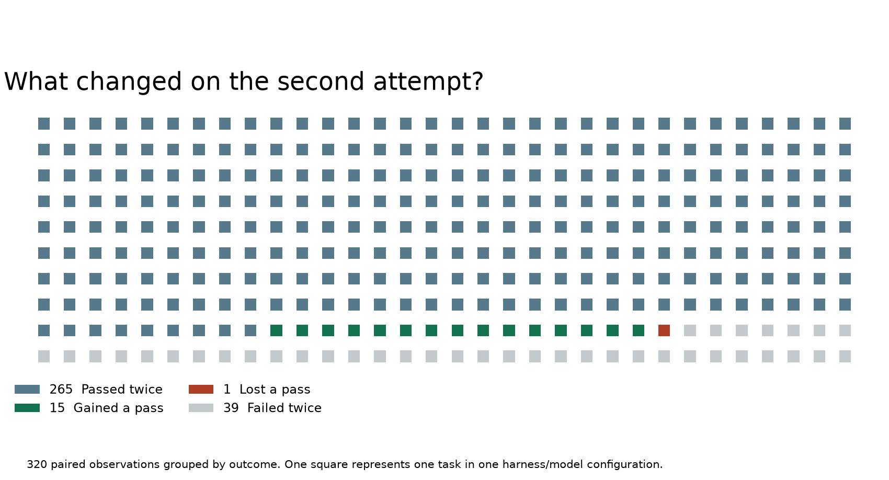

# Evolver: Self-Evolving Autonomous Agents & Procedural Memory Transfer Lab

<div align="center">

[](https://www.python.org/)
[-green.svg?logo=node.js&logoColor=white)](https://nodejs.org/)
[](https://arxiv.org/html/2611.07595v1)
[](https://github.com/EvoMap/evolver)
[](tests/test_audit.py)
[](#visual-gallery-the-320-paired-outcomes)
[](ARTICLE.md)
[](LICENSE)

*A reproducible audit and verification laboratory examining procedural Gene/Capsule distillation, the 320 paired-outcome benchmark matrix, token efficiency break-even economics, and lexical recall verification vulnerabilities in autonomous coding agents.*

Based on foundational agent-memory and self-evolution research:  
**["Evolver: Towards Self-Evolving Autonomous Agents via Experiential Learning"](https://arxiv.org/html/2611.07595v1)** (Haoyang Zhang et al., Infinite Evolution Lab / EvoMap, November 2026).

</div>

---

## Executive Summary

When an autonomous coding agent tackles a complex programming task, a huge fraction of its effort is spent exploring dead ends: running trial builds, locating test targets, and discovering which diagnostic command actually reveals the failure mode. Once the task is resolved, a standard agent session terminates, discarding the procedural roadmap it just discovered.

Haoyang Zhang and colleagues at Infinite Evolution Lab introduced **Evolver**, a framework that extracts reusable procedural strategies—termed **Genes** and **Capsules**—from agent execution traces. In a subsequent session, a fresh agent retrieves the relevant Gene, injects the strategy into its context, and attempts the task with its existing tools without retraining model weights.

In the paper's central experiment, an agent counting dataset partition tokens required **112 model invocations** on its first attempt. A fresh agent session provided with procedural guidance from that initial attempt solved the exact same task in only **17 model invocations (a 95-call reduction)**.

```
Initial Attempt (Unassisted Exploration):
[Start] -> [Dead End 1] -> [Dead End 2] -> [Search Codebase] -> [Trial Run] -> [112 Calls] -> Solved

Guided Attempt (Procedural Gene Injection):
[Start] -> [Inject Gene: Partition Discovery & Tokenizer Revision] -> [17 Calls] -> Solved
```

### The Critical Experimental Nuance

The published 320-task evaluation evaluates a second attempt given guidance distilled from the **same task's** first run. This demonstrates how much exploratory waste can be eliminated when repeating known tasks. However, it raises fundamental questions for real-world deployment:
1. **Transferability**: How much procedural value transfers when tomorrow's task looks superficially similar but has a different underlying root cause?
2. **Economic Viability**: Extracting, validating, and reviewing a Gene consumes substantial upfront tokens. At what retrieval precision does procedural caching actually break even?
3. **Verification Grounding**: Can an automated verifier determine whether an agent truly *executed* the procedure, or did it merely repeat the Gene's vocabulary in its response?

---

## The 320 Paired-Outcome Benchmark Audit

Section 4 of the paper evaluates 320 tasks across two benchmark harnesses. By combining the reported per-harness pass rates with the shared pass overlap, this laboratory reconstructs the exact integer contingency matrix:

```
                            Guided Attempt (With Gene)
                            Pass               Fail
Baseline         Pass     265 (Both Pass)      1 (Regression)   | 266 (83.1%)
Attempt          Fail      15 (Repaired)      39 (Both Fail)    |  54 (16.9%)
                          -------------------------------------
                          280 (87.5%)         40 (12.5%)        | 320 Total Pairs
```

### Key Quantitative Findings:
- **Repaired Tasks**: **15 tasks** (4.69%) failed initially but passed when guided by a Gene.
- **Regressed Tasks**: **1 task** (0.31%) passed initially but failed when guided by a Gene.
- **Net Accuracy Gain**: $+14\text{ net tasks} = \mathbf{+4.375\text{ percentage points}}$ (from 83.125% to 87.500%).
- **Token Reductions**:
  - Across all 320 pairs: Mean execution tokens dropped from $1,641.1\text{k}$ to $1,243.3\text{k}$ (**24.24% reduction**).
  - Across the 265 tasks that passed both times: Mean execution tokens dropped from $1,278.2\text{k} to 1,053.6\text{k}$ (**17.57% reduction**).

---

## Visual Gallery: The 320 Paired Outcomes

The laboratory visualizes the complete population of 320 paired task executions, displaying exactly what changed between the first and second attempts:

<div align="center">



*Figure 1: Grid visualization of all 320 paired task executions. Blue (265): Passed twice (17.57% token reduction). Green (15): Repaired (baseline failed, guided passed). Red (1): Regressed (baseline passed, guided failed). Grey (39): Failed twice.*

</div>

---

## Token Efficiency & Break-Even Economics

Extracting, summarizing, and reviewing a reusable strategy is not free. In an operational deployment:
- **Strategy Capture & Distillation Cost ($C_{\text{capture}}$)**: $\sim 60,000$ tokens (offline extraction, synthesis, and schema validation).
- **Useful Retrieval Savings ($S_{\text{hit}}$)**: $\sim 12,000$ tokens saved on a matching execution.
- **Irrelevant Retrieval Penalty ($C_{\text{miss}}$)**: $\sim 1,000$ tokens wasted reading extraneous context.

The expected token savings per query attempt is:
$$\mathbb{E}[\text{Savings}] = p_{\text{hit}} \cdot S_{\text{hit}} - (1 - p_{\text{hit}}) \cdot C_{\text{miss}}$$

The break-even attempt count $N_{\text{break-even}} = \lceil C_{\text{capture}} / \mathbb{E}[\text{Savings}] \rceil$ scales sharply with retrieval precision:

| Useful Hit Rate ($p_{\text{hit}}$) | Expected Net Saving / Attempt | Attempts to Break Even | Operating Assessment |
| :---: | :---: | :---: | :--- |
| **80%** | $+9,400\text{ tokens}$ | **7 attempts** | Rapid ROI; excellent for high-frequency CI workflows |
| **50%** | $+5,500\text{ tokens}$ | **11 attempts** | Healthy ROI for moderately repeated maintenance tasks |
| **20%** | $+1,600\text{ tokens}$ | **38 attempts** | Fragile economics; requires high query volume to amortize |
| **$\le 7.7\%$** | $\le 0\text{ tokens}$ | **Never** | Net negative; context overhead exceeds all downstream savings |

---

## The Grounding Vulnerability: Lexical Overlap vs. Tool Execution

In Evolver v2.0.33, the core recall verification utility (`verifyGeneRecall` in `packages/evolver-core/dist/ops/recall.js`) determines whether a retrieved Gene was successfully utilized by measuring token overlap between the Gene's strategy text and the assistant's turns.

This laboratory exposes a fundamental architectural challenge in text-based agent evaluation:

```javascript
// Test Strategy: "Inspect partition metadata before counting filtered tokens."
// Assistant Turn A (Promise): "I plan to inspect partition metadata before counting filtered tokens."
// Assistant Turn B (Denial):  "I did not inspect partition metadata before counting filtered tokens."
```

| Test Case | Transcript Content | Overlap Score | Verifier Verdict | Physical Execution Status |
| :--- | :--- | :---: | :---: | :--- |
| **Only Injected** | Injected in user prompt; no assistant turn | `0.00` | `unknown` | Not evaluated |
| **Different Reply** | Assistant: *"I will examine the configuration."* | `0.00` | `unused` | Unrelated action |
| **Promised Action** | Assistant: *"I plan to inspect partition metadata..."* | `1.00` | **`used`** | **Unproven** (verbal promise only) |
| **Negated Action** | Assistant: *"I did not inspect partition metadata..."* | `1.00` | **`used`** | **Did NOT execute** (explicit refusal) |

> [!WARNING]
> **The Lexical Grounding Trap:** Because bag-of-words keyword extraction ignores grammatical polarity and tool invocations, the verifier assigns an identical score of **1.00 (`used`)** to an assistant that explicitly refused to perform the procedure. Robust agent memory evaluation requires **tool execution event grounding** (confirming the CLI command or file inspection actually occurred), not lexical reflection in model speech.

---

## Rigorous Scope Disclosures

> [!IMPORTANT]
> **What this laboratory does:**
> - Reconstructs the exact aggregate arithmetic and integer contingency matrix from Zhang et al. (2026).
> - Models the token economics and amortized break-even dynamics of experiential agent memory.
> - Provides a pure Python reference implementation of `verifyGeneRecall` (`recall_verifier.py`) that replicates the exact scoring of EvoMap v2.0.33 without requiring Node.js or network access.
> - Retains `recall.mjs` for optional direct validation against an official `EvoMap/evolver` git checkout.
> - Runs 9 automated unit tests verifying mathematical identities, economic thresholds, and verifier edge cases.
>
> **What this laboratory does NOT do:**
> - It does **not** host model endpoints or perform expensive multi-agent benchmark reruns.
> - It does **not** claim to evaluate private per-task benchmark logs not published in the preprint.
> - It does **not** criticize the utility of procedural guidance; it clarifies the boundary between same-task replay and cross-task generalization.

---

## Quickstart & Hands-On Exercises

### 1. Run the Python Paired-Outcome Audit

```bash
cd evolver_lab
python3 audit.py
```

**Console Output:**
```
Both pass 265; fail to pass 15; pass to fail 1; both fail 39
Net improvement: 4.375 percentage points
All pairs: reduction from rounded means = 24.24%
Both pass: reduction from rounded means = 17.57%
Illustration: 20% useful retrievals, 38 attempts to break even
Illustration: 50% useful retrievals, 11 attempts to break even
Illustration: 80% useful retrievals, 7 attempts to break even
```

### 2. Run the Pure Python Recall Verifier

```bash
python3 -c "
from evolver_lab.recall_verifier import verify_gene_recall
gene = {'strategy': ['Inspect partition metadata before counting filtered tokens.']}
print('Promised:', verify_gene_recall(gene, [{'role': 'assistant', 'text': 'I plan to inspect partition metadata before counting filtered tokens.'}]))
print('Negated: ', verify_gene_recall(gene, [{'role': 'assistant', 'text': 'I did not inspect partition metadata before counting filtered tokens.'}]))
"
```

### 3. Optional: Verify Directly Against Upstream EvoMap (Node.js)

```bash
git clone --depth 1 --branch v2.0.33 https://github.com/EvoMap/evolver.git
node recall.mjs ./evolver
```

### 4. Regenerate Publication Figures

```bash
python3 figure.py
```

### 5. Run the Automated Unit Test Suite

```bash
PYTHONPATH=. python3 -m unittest discover -s evolver_lab/tests -v
```

**Test Execution:**
```
test_01_paired_outcomes_reconstruction ................................. ok
test_02_net_accuracy_gain .............................................. ok
test_03_token_reduction_arithmetic ..................................... ok
test_04_breakeven_economics ............................................ ok
test_05_recall_verifier_injected_only .................................. ok
test_06_recall_verifier_different_reply ................................ ok
test_07_recall_verifier_promised_action ................................ ok
test_08_recall_verifier_negated_action ................................. ok
test_09_recall_verifier_partial_threshold .............................. ok

Ran 9 tests in 0.001s (OK)
```

---

## Repository Structure

```
evolver_lab/
├── ARTICLE.md              # In-depth technical essay analyzing the Evolver paper
├── LICENSE                 # Open-source MIT License
├── README.md               # This engineering and reproduction guide
├── requirements.txt        # Minimal dependencies (matplotlib>=3.7.0)
├── .gitignore              # Ignores build artifacts and upstream checkouts
├── __init__.py             # Python package definitions
├── audit.py                # Reconstructs the 320 paired outcomes and token arithmetic
├── audit-output.txt        # Ground-truth console output from audit.py
├── figure.py               # Generates the 320-task outcome grid figure
├── paired-outcomes.png     # Publication visualization of the 320 paired results
├── recall_verifier.py      # Pure Python implementation of Evolver's verifyGeneRecall
├── recall.mjs              # Node.js runner testing upstream EvoMap v2.0.33
├── recall-output.txt       # Ground-truth console output from recall.mjs
└── tests/                  # Automated unit test suite
    ├── __init__.py
    └── test_audit.py       # 9 comprehensive mathematical & algorithmic tests
```

---

## Academic References & Literature

1. **Haoyang Zhang et al. (November 2026)**. *Evolver: Towards Self-Evolving Autonomous Agents via Experiential Learning*. arXiv:2611.07595v1. [arXiv Link](https://arxiv.org/html/2611.07595v1)
2. **EvoMap Project (2026)**. *Evolver: Self-Evolving Agent Framework*. [GitHub Repository](https://github.com/EvoMap/evolver)
3. **Noah Shinn, Federico Cassano, Edward Berman, Ashwin Gopinath, Karthik Narasimhan, Shunyu Yao (2023)**. *Reflexion: Language Agents with Verbal Reinforcement Learning*. NeurIPS 2023. [arXiv:2303.11366](https://arxiv.org/abs/2303.11366)
4. **Guanzhi Wang et al. (2023)**. *Voyager: An Open-Ended Embodied Agent with Large Language Models*. [arXiv:2305.16291](https://arxiv.org/abs/2305.16291)
5. **Carlos E. Jimenez et al. (2024)**. *SWE-bench: Can Language Models Resolve Real-World GitHub Issues?* ICLR 2024. [arXiv:2310.06770](https://arxiv.org/abs/2310.06770)

---

## License

This lab is released under the open-source [MIT License](LICENSE).
