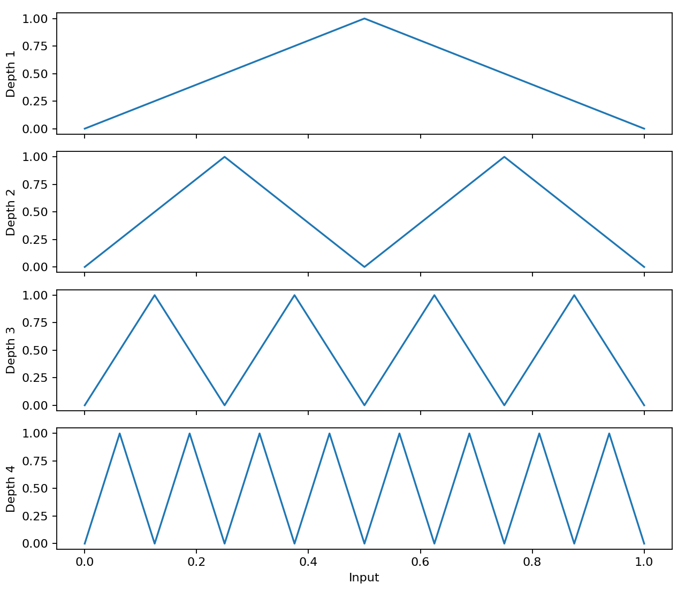
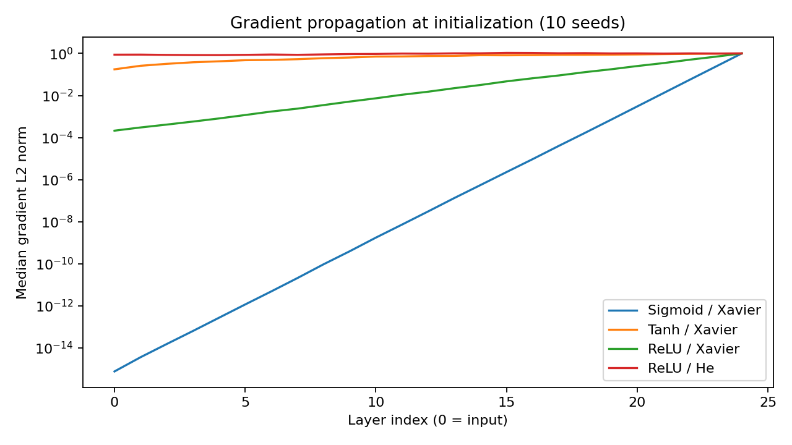
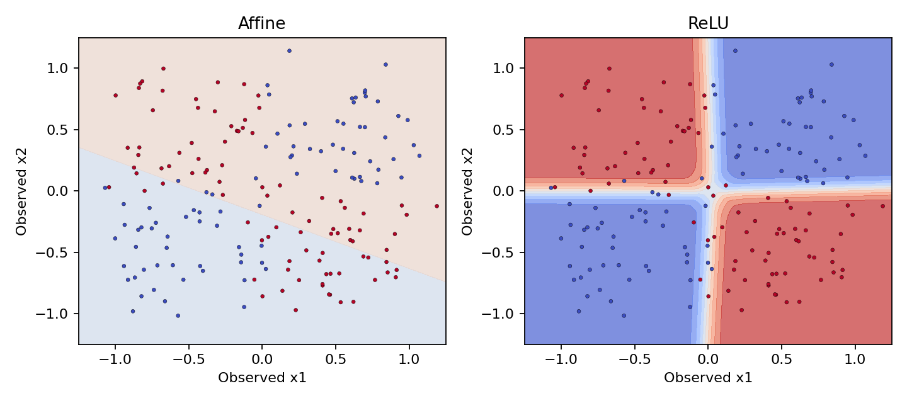

# Deep Feedforward Networks: Depth, Gradients & Generalization Lab

[](https://www.python.org/downloads/)
[](https://pytorch.org/)
[](#recorded-findings)
[](#test-suite)
[](https://opensource.org/licenses/MIT)

A CPU-only reproducible research companion to Chapter 6 of *Deep Learning* (Goodfellow, Bengio, & Courville, 2016) and [`article.md`](./article.md). It pairs exact/manual NumPy backpropagation with PyTorch depth, initialization, and generalization probes: **exact vs. learned XOR**, **BCE vs. MSE logit saturation**, **exponential tent-map folding ($2^k$ pieces)**, **24-layer gradient propagation under Xavier vs. He init**, and **noisy XOR held-out generalization**.

---

## Recorded Findings (`results.txt` & `research_results.txt`)

### 1. Core Backprop & Loss Saturation (`experiment.py`)
| Probe | Measured Result |
|:---|:---|
| Linear Least-Squares XOR MSE | `0.2500` (chance) |
| Manual NumPy Backprop vs. Finite Diff Max Error | `1.12e-10` |
| Trained 2-8-1 NumPy ReLU XOR MSE | `9.00e-28` |
| Wrong Logit ($z = -10$, $y = 1$) Gradient | BCE `-1.000` vs. Sigmoid-MSE `-4.54e-5` (**$22{,}000\times$ stronger**) |

### 2. 24-Layer Untrained Gradient Propagation (10 Seeds, Unit Output Adjoint)
| Activation / Initialization | Median Input Gradient Norm |
|:---|---:|
| Sigmoid / Xavier | `7.71e-16` *(vanished)* |
| ReLU / Xavier | `2.13e-04` |
| Tanh / Xavier | `1.76e-01` |
| **ReLU / He (Kaiming)** | **`8.74e-01`** *(preserved)* |

### 3. Noisy XOR Held-Out Generalization (5 Seeds, Train/Val/Test Splits)
- **Affine Stack**: `58.59% ± 4.82%` test accuracy
- **ReLU MLP (width 32)**: **`93.95% ± 0.13%`** test accuracy

---

## Generated Visualizations (`figures/`)

| Tent-Map Composition ($2^k$ Pieces) | 24-Layer Gradient Propagation | Noisy XOR Decision Boundaries |
| :---: | :---: | :---: |
|  |  |  |

---

## Quickstart

### 1. Setup & Run

```bash
# Clone the repository
git clone https://github.com/AdityaInamdar334/Deep-Learning-Implementations.git
cd Deep-Learning-Implementations/feedforward_research_lab

# Create virtual environment and install dependencies
python3 -m venv .venv
source .venv/bin/activate
pip install -r requirements.txt

# Run core NumPy/PyTorch probes and 24-layer/noisy-XOR research experiments
python3 experiment.py
python3 research_experiments.py
```

### 2. Test Suite

```bash
python3 -m unittest discover -s tests -v
```

The 5 automated unit tests verify:
- **`test_exact_xor_solution`**: Analytic ReLU weights reproduce `[0, 1, 1, 0]` to $10^{-12}$.
- **`test_manual_backprop_matches_finite_diff`**: Manual NumPy gradients match central finite differences to $<10^{-7}$.
- **`test_bce_vs_mse_saturation_gradient`**: Confirms $>10{,}000\times$ stronger BCE gradient on saturated wrong logits.
- **`test_tent_map_folding`**: Exact tent-map vertices and $[0, 1]$ invariance under composition.
- **`test_artifacts_present`**: Confirms `article.md`, `results.txt`, `research_results.txt`, and all 3 PNG figures exist.

---

## File Structure

```
feedforward_research_lab/
├── README.md                  # Findings tables, figures, and quickstart
├── article.md                 # Full companion technical article
├── requirements.txt           # numpy, torch, matplotlib
├── environment.txt            # Recorded environment snapshot
├── .gitignore                 # Ignores __pycache__ and bytecode
├── experiment.py              # XOR, manual backprop, BCE vs MSE saturation
├── research_experiments.py    # Tent depth, 24-layer gradients, noisy XOR
├── results.txt                # Recorded stdout from experiment.py
├── research_results.txt       # Recorded stdout from research_experiments.py
├── figures/
│   ├── depth.png              # 1..4 tent-map compositions
│   ├── gradients.png          # 24-layer median gradient norms (10 seeds)
│   └── noisy_xor.png          # Affine vs ReLU noisy XOR decision surfaces
└── tests/
    └── test_feedforward.py    # 5 automated unit tests
```

---

## References

- Ian Goodfellow, Yoshua Bengio, & Aaron Courville (2016), *Deep Learning*, Chapter 6: Deep Feedforward Networks. [deeplearningbook.org](https://www.deeplearningbook.org/contents/mlp.html)
- Xavier Glorot & Yoshua Bengio (2010), *Understanding the difficulty of training deep feedforward neural networks* (AISTATS).
- Kaiming He et al. (2015), *Delving Deep into Rectifiers: Surpassing Human-Level Performance on ImageNet Classification* (ICCV).
