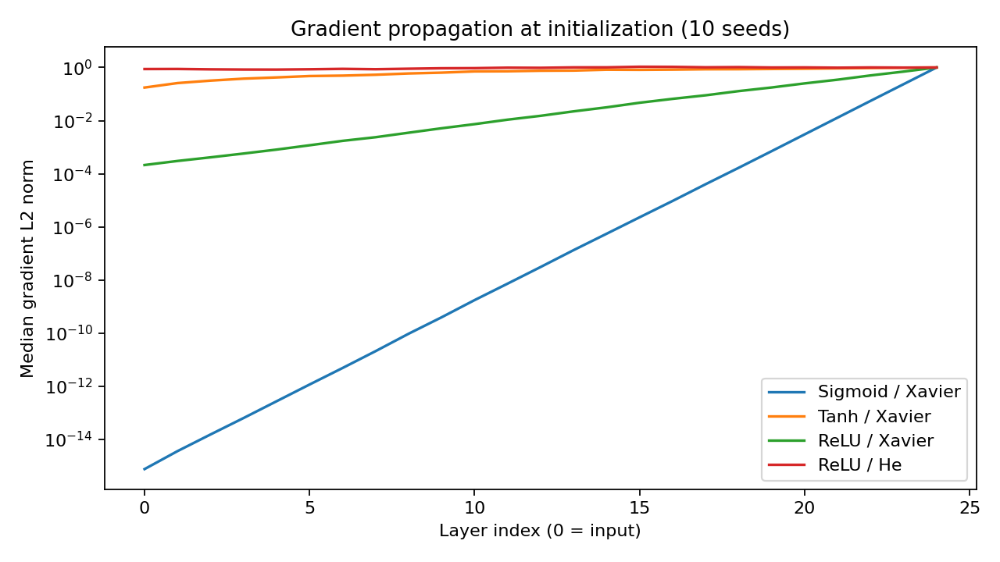
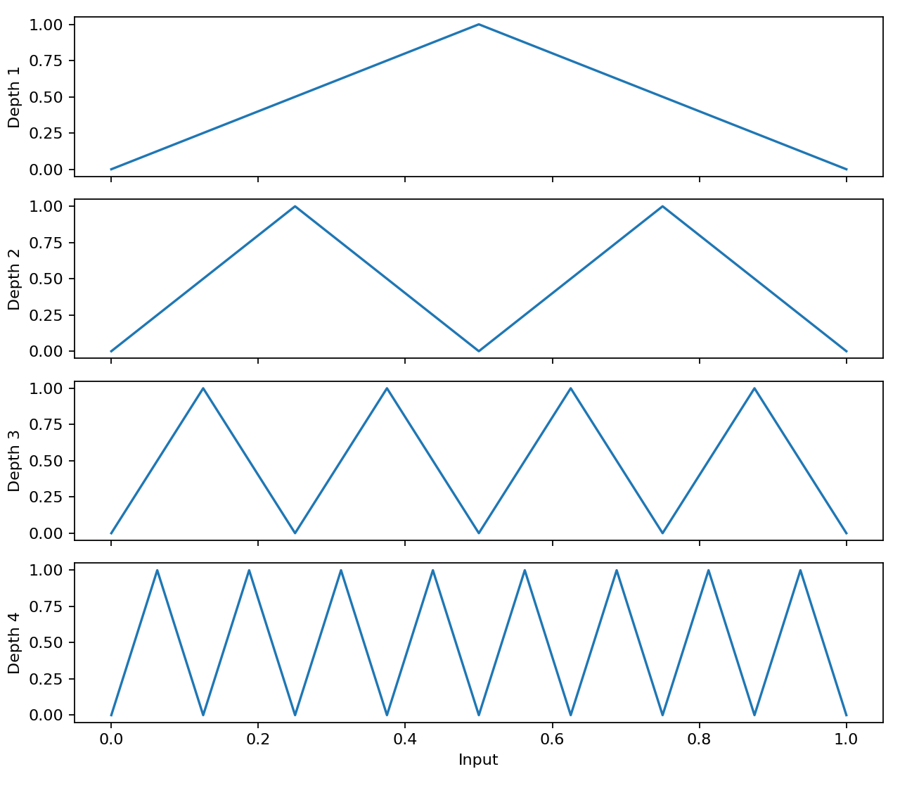
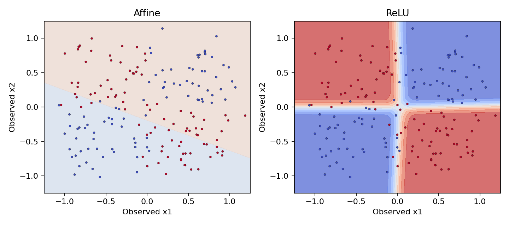

# Four Data Points That Explain Why Deep Learning Works

*From the perceptron and the XOR problem to backpropagation, vanishing gradients and the feedforward layers inside modern language models. A research-backed journey with experiments you can run yourself.*

Imagine building a neural network with 1,000 layers, thousands of neurons and millions of trainable parameters. You give it four data points. Not millions of images or billions of tokens. Just four combinations of zeros and ones. If every layer is affine, it still cannot solve XOR.

Now replace that enormous network with two hidden neurons and a nonlinear activation. Suddenly the problem becomes solvable. What changed? Not the data or the computational budget. What changed was the family of functions the network could represent.

This is the thread we will follow from XOR to the mathematics behind modern neural networks. Along the way we will write a NumPy implementation, check its derivatives against finite differences, and compare affine and nonlinear models in PyTorch.

## Abstract

Deep feedforward networks learn parameterized compositions of functions. This article examines their representational capacity, gradient-based optimization, probabilistic output design, activation functions, architectural trade-offs and reverse-mode automatic differentiation. Following Goodfellow, Bengio and Courville (2016, Chapter 6), we use XOR as a minimal counterexample to affine function approximation. Accompanying CPU experiments demonstrate exact nonlinear representation, numerical gradient verification, differences between classification-loss gradients, depth-dependent expressivity, initialization-dependent gradient propagation, and held-out performance on noisy XOR. The noisy XOR study evaluates a synthetic held-out distribution; none of these experiments establishes generalization on real-world tasks.

**Research scope.** This is a narrative technical review of selected foundational papers and subsequent research, not a systematic review of every neural-network publication. Chapter 6 of Goodfellow et al. (2016) supplies the conceptual starting point; the historical discussions draw on the linked publications and historical accounts. The companion experiments are independent educational demonstrations, not replications of published benchmark claims.

## Contents

1. From linear models to learned representations
2. Four points that expose the limitations of depth
3. How a network learns its parameters
4. Loss functions as statistical assumptions
5. Designing the output layer
6. Activation functions and the journey of a gradient
7. Depth, width and universal approximation
8. Backpropagation from first principles
9. Implementing the experiment
10. Results, limitations and practical design
11. From early networks to Transformers
12. References

Each section connects a historical research question to a mathematical or engineering consequence. The lab includes the original XOR and gradient-check demonstrations, plus three new experiments on depth, gradient propagation and held-out generalization.

## 1. From linear models to learned representations

Imagine a classifier that must decide whether an email is spam. A linear model assigns a fixed coefficient to each feature. That can work surprisingly well when features already encode the relevant distinctions. But a fixed coefficient cannot express arbitrary interactions: the meaning of one feature may depend on another.

One solution is to engineer new features. Another is to use a kernel. Deep learning offers a third: parameterize the feature transformation itself and learn it jointly with the prediction rule (Goodfellow et al., 2016, pp. 168–171).

$$f(x;\theta,w)=w^T\phi(x;\theta)+b$$

Here the representation $\phi$ is no longer fixed. It changes during training. The final predictor can be simple because the preceding network has the responsibility of constructing a useful coordinate system.

A feedforward network extends this idea recursively. Using column vectors throughout the theoretical derivation, define:

$$h_0=x,\qquad a_l=W_l h_{l-1}+b_l,\qquad h_l=g_l(a_l).$$

Each layer consumes the representation produced by the previous layer. The overall mapping is a composition, $f=f_L\circ\cdots\circ f_1$. Depth counts successive transformations; width describes the number of features in a layer. A feedforward computation has no directed cycles. This does not mean training lacks feedback: the loss supplies a gradient, but the inference graph itself need not contain recurrent connections.

```text
Input x -> Affine map -> Activation -> Hidden representation
        -> Affine map -> Activation -> Hidden representation
        -> Output head -> Prediction
```

A hidden layer is hidden in the sense that its desired output is usually not supplied in the training labels. The optimizer must discover internal representations useful for predicting the final target. This is a mathematical learning system, not a faithful model of biological neurons.

### 1943–1958: Can a machine learn a decision rule?

Before there were GPUs or training frameworks, there was a question about the relationship between logic and nervous activity. Warren McCulloch and Walter Pitts (1943) described mathematical networks of threshold-like units that could realize logical relationships. Their abstraction was valuable precisely because it discarded much of the detail of real neurons. A unit could be discussed as an element of a computation, rather than as a complete model of a cell.

Frank Rosenblatt took a different step in his 1958 perceptron paper. Instead of asking only what a designed network could compute, he investigated how a system could acquire useful behavior from experience (Rosenblatt, 1958). The modern simplified perceptron captures a central ingredient of that program: change the weights when a prediction is wrong.

For labels encoded as −1 and +1, a textbook perceptron update on a mistaken example is

$$w\leftarrow w+\eta yx,\qquad b\leftarrow b+\eta y.$$

If the positive example has been placed on the wrong side of the boundary, the update raises its score. A negative example produces the opposite adjustment. This is not backpropagation, and Rosenblatt's original architecture was richer than the simplified single trainable threshold unit, but the example reveals a basic learning mechanism: a prediction error can alter a numerical decision rule.

There is an important distinction between the perceptron and logistic regression. A perceptron produces a threshold decision and uses a mistake-driven update; logistic regression models a probability and commonly minimizes negative log likelihood. Both can produce affine decision boundaries in their original input space. Neither solves the representational problem we encounter next without a suitable change in features.

### A useful research habit: distinguish the model from the learning rule

The function family determines what solutions exist. The training procedure determines which solutions we find. The data and inductive biases determine what evidence is available for predicting unseen examples. Confusing these three questions leads to bad experiments. If a model cannot represent XOR, trying another optimizer is not a principled repair. If a model can represent XOR but training fails, the optimizer or initialization may deserve investigation. If it fits the truth table, we have still learned nothing about performance on noisy measurements.

## 2. Four points that expose the limitations of depth

XOR returns one exactly when its binary inputs differ:

```text
(0,0) -> 0       (0,1) -> 1
(1,0) -> 1       (1,1) -> 0
```

Suppose our model is $f(x)=w_1x_1+w_2x_2+b$. Fitting all four points exactly would require $b=0$, $w_1=w_2=1$, and simultaneously $w_1+w_2+b=0$. These conditions contradict each other. Least squares instead returns the constant 0.5, with mean squared error 0.25.

What if we stack more affine layers? Consider just two:

$$W_2(W_1x+b_1)+b_2=(W_2W_1)x+(W_2b_1+b_2).$$

The result is another affine map. By induction, any number of purely affine layers collapses to one affine map. Factorizing a matrix can change parameterization and optimization, but cannot make the resulting function nonlinear. A sigmoid applied only at the final output still yields a linear decision boundary at probability 0.5.

### Two neurons that change the geometry

Let $s=x_1+x_2$. Define two hidden features:

$$h_1=\max(0,s),\qquad h_2=\max(0,s-1).$$

The output is $f(x)=h_1-2h_2$. If neither input is active, both features are zero. If exactly one is active, the first is one and the second is zero. If both are active, the first is two and the second is one, which cancel at the output.

```python
import numpy as np
X = np.array([[0,0], [0,1], [1,0], [1,1]])
W = np.ones((2, 2))
b = np.array([0, -1])
H = np.maximum(X @ W + b, 0)
y = H @ np.array([1, -2])
print(y)  # [0. 1. 1. 0.]
```

This is the constructive XOR solution in Goodfellow et al. (2016, Section 6.1), expressed in batch-oriented NumPy notation. The hidden layer maps the two positive examples to the same coordinate (1,0); negative examples become (0,0) and (2,1). The final affine readout can now separate them.

The deeper lesson is not that ReLU knows XOR. It is that a nonlinear feature map can change which relationships are easy to express. We chose these weights by hand; learning is the problem of discovering suitable weights without knowing the solution in advance.

### 1969: What Minsky and Papert actually challenged

Marvin Minsky and Seymour Papert's *Perceptrons* examined mathematical limitations of perceptron architectures (Minsky & Papert, 1969). XOR is a small teaching example of the obstacle; their study addressed richer questions about what a restricted class of machines could compute. It is misleading to turn the book into a proof that all neural networks are useless. It is equally misleading to treat a single publication as a complete explanation for the subsequent history of AI funding and research.

The useful result for an engineer is more durable than the mythology: limitations can be proved for a particular architecture. We can then ask what architectural change removes the limitation. For XOR, the answer is a learned nonlinear representation. In fact, if someone gives us the engineered feature $x_1x_2$, the polynomial expression $x_1+x_2-2x_1x_2$ already solves the binary problem. The MLP matters because it can learn feature transformations rather than requiring us to enumerate all relevant interactions by hand.

### The geometry is the computation

The two hidden neurons in our exact construction implement a ramp and a delayed ramp. Adding them with coefficients 1 and −2 creates a triangular response as the sum of the inputs grows from zero to two. For binary inputs, only three values of that sum are possible. The classifier therefore depends on the interaction between the input bits even though each individual affine operation is simple.

This also explains why a hidden unit need not correspond to a named human concept. Many parameterizations can produce the same function: we may permute hidden neurons and compensate in the next layer, or positively rescale a ReLU neuron's incoming weights and inversely rescale its outgoing weights. There is generally no unique decomposition to recover from output labels alone.

## 3. How a network learns its parameters

Let a dataset consist of pairs $(x_i,y_i)$. We choose a model family and an objective:

$$J(\theta)=\frac1N\sum_{i=1}^N \ell(f(x_i;\theta),y_i)+\lambda\Omega(\theta).$$

The first term measures fit; the second optionally penalizes properties of the parameters. Gradient descent updates parameters by $\theta\leftarrow\theta-\eta\nabla_\theta J$. The learning rate $\eta$ controls the step size. Minibatch SGD estimates the gradient from a subset of examples; Adam uses moving estimates of first and second gradient moments (Kingma & Ba, 2015).

Unlike ordinary least squares in its direct parameterization, a nonlinear MLP usually has a nonconvex objective. Even a deep affine factorization can be nonconvex in its individual factors. A low loss is not guaranteed from arbitrary initialization, and a low training loss is not a guarantee of generalization.

### Initialization is part of the algorithm

If hidden neurons begin with identical incoming and outgoing parameters, deterministic gradient updates can preserve their symmetry. Independent random weights help break it. Initializing everything to zero can prevent useful gradients from reaching earlier layers.

Variance-aware initialization tries to keep signal magnitudes reasonable. Xavier initialization uses both fan-in and fan-out (Glorot & Bengio, 2010); He initialization accounts for rectification (He et al., 2015). For a ReLU layer a common He-normal choice is $\operatorname{Var}(W_{ij})=2/n_{in}$ under simplifying independence assumptions. Biases can start at zero; positive biases are sometimes useful but not a universal requirement.

PyTorch's `nn.Linear` default uses bounds proportional to the inverse square root of fan-in. It is not identical to explicitly requesting the usual ReLU He-normal initialization. If that is the desired experiment, call `nn.init.kaiming_normal_(layer.weight, nonlinearity='relu')` explicitly.

### 2006–2015: Why finding a solution became a research problem of its own

By the 2000s, the existence of useful deep representations was not sufficient to make training routine. Hinton, Osindero and Teh (2006) investigated a greedy layerwise training procedure for deep belief networks, which are probabilistic models rather than ordinary deterministic MLPs. Their work exemplifies an important strategy of that period: arrange the learning problem so that individual layers can acquire useful structure before jointly optimizing the whole system. It was not a claim that backpropagation had become obsolete.

Glorot and Bengio (2010) investigated why conventional random initialization and saturating activations made deep feedforward training difficult. Their analysis considered how signals and gradients change across layers. For a linear layer with independent, centered weights and inputs, a rough second-moment calculation gives

$$\mathbb E[z_j^2]\approx n_{in}\operatorname{Var}(W_{ji})\mathbb E[h_i^2].$$

Preserving the forward scale suggests variance $1/n_{in}$; a corresponding backward argument suggests $1/n_{out}$. Xavier initialization balances these demands using $2/(n_{in}+n_{out})$. This is a heuristic derived under simplifying assumptions, not a guarantee that every singular value of a network's Jacobian remains close to one.

A rectifier changes the calculation. If its preactivation is approximately symmetric about zero, it retains about half the second moment. Compensating gives $2/n_{in}$ for the forward variance of weights, the familiar He initialization (He et al., 2015). This makes the initialization dependent on the activation, not merely on the size of the model.

The lesson is surprisingly concrete: a model's first forward and backward passes can reveal important design problems before we spend hours training. Measure activation second moments and gradient norms rather than inferring healthy training from parameter count alone.

## 4. Loss functions as statistical assumptions

A neural network can predict parameters of a distribution rather than just a point estimate. Maximum likelihood chooses parameters that make observations probable (Goodfellow et al., 2016, Section 6.2):

$$J(\theta)=-\frac1N\sum_i\log p_\theta(y_i\mid x_i).$$

For a Gaussian with fixed variance and predicted mean $f(x)$, the negative log likelihood differs from squared error only by scale and an additive constant. For a Bernoulli distribution, it becomes binary cross-entropy. For a categorical distribution, it becomes multiclass cross-entropy.

The choice changes what the network is asked to learn. Squared error minimizes expected risk at the conditional mean, assuming finite second moments. Absolute error minimizes expected risk at a conditional median. Neither necessarily captures multimodality: if a target is equally likely to be -1 or +1, its mean is zero, even if zero is never observed.

### Why confident mistakes need useful gradients

Let a binary classifier output logit $z$, with probability $p=\sigma(z)$. For target $y$, binary cross-entropy has derivative

$$\frac{\partial\ell_{BCE}}{\partial z}=p-y.$$

For half squared error applied to the probability, the derivative is

$$\frac{\partial\ell_{MSE}}{\partial z}=(p-y)p(1-p).$$

If the true label is one and the model produces a logit of -10, it is confidently wrong. BCE still supplies a gradient close to -1; squared error supplies a much smaller gradient because of the extra sigmoid derivative. This is why likelihood-based classification losses are conventional defaults, not because squared error is mathematically forbidden for classification. The Brier score, for instance, is a legitimate probabilistic scoring rule.

## 5. Designing the output layer

The output head should reflect the structure of the target, not just copy the hidden activation.

**Regression.** Use an unconstrained affine output for the mean of a fixed-variance Gaussian, with MSE. A model can also predict input-dependent variance: set $v=\operatorname{softplus}(r)+\epsilon$ and optimize $\ell=\tfrac12[\log v+(y-\mu)^2/v]$, omitting the constant. This models heteroscedastic uncertainty but can be unstable if variance collapses.

**Binary classification.** Use one logit and `BCEWithLogitsLoss`. Convert it to a probability with sigmoid at inference. Do not apply sigmoid before this loss.

**Multiclass classification.** Use one logit per mutually exclusive class. Softmax gives $p_i=e^{z_i}/\sum_j e^{z_j}$. For class $k$, the negative log likelihood is

$$\ell=-z_k+\log\sum_j e^{z_j},\qquad \frac{\partial\ell}{\partial z_i}=p_i-\mathbf1[i=k].$$

Subtracting the largest logit inside the exponentials avoids overflow without altering the distribution. In PyTorch, use `CrossEntropyLoss` directly on logits and integer class indices. Do not apply softmax first.

**Multilabel classification.** Use independent Bernoulli heads rather than softmax when several labels can be true simultaneously. This does not model label dependencies explicitly in the output distribution, though the shared hidden representation may capture useful relationships.

**Multimodal regression.** A mixture density network predicts mixture probabilities, component means and positive variances (Bishop, 1994). Its likelihood is $p(y|x)=\sum_k\pi_k(x)\mathcal N(y;\mu_k(x),\Sigma_k(x))$. Compute its log likelihood with log-sum-exp; constrain covariance, and monitor numerical stability. A single point prediction is not sufficient when several outcomes are plausible.

### Worked example: stable binary cross-entropy without a probability round trip

Writing $\ell=\log(1+e^z)-yz$ makes the Bernoulli negative log likelihood easy to derive but naive exponentiation can overflow. An equivalent stable expression is

$$\ell=\max(z,0)-yz+\log(1+e^{-|z|}).$$

For extreme positive or negative logits, the exponential argument is never positive. The loss can remain finite even when a floating-point implementation of the sigmoid would round its output to zero or one. This is the reason to prefer the fused logits interface, not just a stylistic preference.

```python
import numpy as np

def bce_logits(z, y):
    return np.maximum(z, 0) - z*y + np.log1p(np.exp(-np.abs(z)))

print(bce_logits(np.array([-1000., 1000.]), np.array([1., 0.])))
# [1000. 1000.]
```

The loss is a statement of what we care about. Accuracy treats a barely correct prediction and a confident correct prediction identically; likelihood does not. Conversely, accurate classification does not guarantee well-calibrated probabilities. A serious applied evaluation may need both discrimination metrics and a calibration metric. The optimal choice follows the actual task, not a universal ranking of objectives.

## 6. Activation functions and the journey of a gradient

If the output head defines the prediction, hidden activations define how intermediate representations can transform. The choice also affects the derivatives that carry training information backward.

ReLU is $g(z)=\max(0,z)$, with derivative one on the positive half-line and zero on the negative half-line. At zero the ordinary derivative is undefined; common implementations select zero. Active ReLUs avoid the repeated saturation factor of sigmoid, but gradients can still vanish or explode through weight matrices. A neuron inactive on all examples can stop receiving useful updates.

Leaky ReLU uses a small positive slope on the negative side; PReLU learns that slope (He et al., 2015). Absolute-value rectification folds the input space. Maxout selects the maximum of several affine responses, learning a convex piecewise-linear unit at the cost of more parameters (Goodfellow et al., 2013).

Sigmoid has derivative $\sigma(z)(1-\sigma(z))\leq 1/4$. Tanh has derivative $1-\tanh^2(z)$ and is centered around zero. Both saturate for large-magnitude inputs. They remain useful when bounded values or gating are needed, despite the difficulties of stacking many saturated hidden units.

Softplus is a smooth approximation to ReLU; radial basis units respond to distance from a learned center; hard tanh clips a value between -1 and 1. No single activation is optimal for every task. The design of the architecture and its initialization must be considered together.

Modern Transformers often use GELU or gated variants such as SwiGLU rather than plain ReLU (Hendrycks & Gimpel, 2016; Shazeer, 2020). These are extensions of the same design problem: how to transform features while maintaining useful learning dynamics.

### 2010–2011: Why a function with a corner became a useful building block

A smooth activation may appear mathematically preferable to one with a corner. But differentiability everywhere is not the same as useful gradient propagation. Nair and Hinton (2010) investigated rectified units in restricted Boltzmann machines; Glorot, Bordes and Bengio (2011) studied rectifiers in deep supervised networks. These papers belong to a broader development of rectification, not the invention of every form of the ReLU operation in 2010.

A hidden sigmoid multiplies the incoming adjoint by a derivative bounded above by 1/4. In a simplified scalar chain with unit weights and every preactivation zero, the derivative over 20 sigmoid stages is $(1/4)^{20}$, about $9.1\times10^{-13}$. Real networks additionally multiply by weight matrices, so this is not a general bound on their complete gradients. It nevertheless explains why saturation can be devastating when repeated.

A ReLU avoids this contraction along active paths. But inactive paths have zero derivative, and nothing prevents a weight matrix from stretching or shrinking a gradient. In a deep MLP, the input-output Jacobian is a product of matrices and diagonal derivative operators:

$$J=D_LW_L\cdots D_1W_1,\qquad D_l=\operatorname{diag}(g'_l(a_l)).$$

The norm and singular-value structure of this product govern local sensitivity. Early work on learning long-range dependencies in recurrent networks exposed related problems in repeated Jacobian multiplication (Bengio et al., 1994). A recurrent computation unrolled in time provides a different architecture but an instructive parallel.

### Experiment: watch gradients disappear before training

Our new `research_experiments.py` constructs 24 bias-free layers, each of width 64. It propagates a unit-norm random output adjoint through the untrained network. We compare four activation/initialization combinations across ten seeds. All conditions share the same depth, width and output-gradient normalization.

Observed median input-gradient norms in this run:

- Sigmoid with Xavier: 7.71 × 10⁻¹⁶.
- Tanh with Xavier: 0.1755.
- ReLU with Xavier: 0.0002133.
- ReLU with He initialization: 0.8737.



*Figure: original experiment, not data reproduced from Glorot or He. Each curve reports the median across ten random seeds. The output adjoint has norm one.*

The important comparison is not merely sigmoid versus ReLU. It is ReLU with Xavier versus ReLU with He: changing the initialization while keeping the activation fixed dramatically changes the behavior of this particular random network. These measurements concern gradients of a random linear probe of the final activations, not the gradients of a trained classification loss. They do not establish universal superiority of any initialization, nor measure optimization or generalization by themselves.

## 7. Depth, width and universal approximation

If two neurons can solve XOR, why build deep networks at all?

The classical universal approximation result states that a sufficiently wide single-hidden-layer network with suitable activation can approximate continuous functions uniformly on compact domains (Cybenko, 1989). Extensions cover broader activation families, including ReLU (Leshno et al., 1993). For measurable functions, stronger claims require specifying the approximation norm and distribution; uniform approximation of arbitrary discontinuous functions by continuous networks is not possible.

The theorem is an existence statement. It does not provide a practical width, a successful optimizer, sufficient training data or a guarantee of test accuracy.

Depth is valuable because many functions have compositional structure. For a concrete illustration, consider the tent map on [0,1]:

$$T(x)=2\operatorname{ReLU}(x)-4\operatorname{ReLU}(x-1/2)+2\operatorname{ReLU}(x-1).$$

Each composition $T\circ T$ folds the interval again; $L$ compositions yield $2^L$ linear pieces on [0,1]. A shallow scalar-input ReLU network with $m$ units can introduce at most $m$ breakpoints, so exact representation of this particular function requires exponentially many shallow units as $L$ grows. This is an illustrative construction, not a universal advantage for every target. Formal depth-dependent region-count and expressivity results appear in Montúfar et al. (2014) and Telgarsky (2016).

Architecture is therefore an inductive bias. Depth is useful when the target has reusable hierarchical structure. Width increases the available features at each stage. Skip connections can give gradients shorter paths; sparse and shared connections can encode structure or reduce computation. A low-rank factorization of an $n\times p$ matrix through width $q$ uses $(n+p)q$ weights rather than $np$, but constrains rank to at most $q$.

### 1989–2016: From possibility to efficiency

Cybenko (1989) and Hornik, Stinchcombe and White (1989) answered a mathematical question about the approximation capabilities of shallow networks. Leshno and colleagues (1993) subsequently established a broad nonpolynomial-activation characterization under the relevant regularity and bias assumptions. A ReLU network qualifies even though a ReLU is affine on each side of its breakpoint: the function is not a single polynomial on the real line.

This line of research tells us that a suitably chosen network family can be dense in a class of continuous functions. It does not tell us the cost of finding the approximation. Montúfar et al. (2014) shifted the focus toward the number of linear regions made possible by composition. Telgarsky (2016) established depth separation results for particular function families. These are results about efficient representation, not a promise that every deep architecture outperforms every shallow one.



*Figure: an original visualization of the analytic tent-map construction. The number of affine pieces doubles with each composition.*

Here is the entire experiment in NumPy:

```python
import numpy as np

def tent(x):
    return 2*np.maximum(x, 0) - 4*np.maximum(x-.5, 0) + 2*np.maximum(x-1, 0)

x = np.linspace(0, 1, 4097)
y = x.copy()
for depth in range(1, 5):
    y = tent(y)
    print(depth, 2**depth)
```

The plotted oscillations are produced by fixed weights, without training. For this function on this interval, a shallow network requires at least $2^L-1$ distinct internal breakpoints to represent all the oscillations exactly, while repeated copies of a fixed-size ReLU block suffice. It is a tangible example of computation reuse. The theorem-like count here is analytic; sampling is only for visualization and would eventually miss the increasingly fine regions at greater depths.

### 2015–2016: When adding layers makes training worse

He, Zhang, Ren and Sun (2016a) investigated degradation in very deep convolutional architectures: simply adding layers could increase training error, even though a deeper architecture ought in principle to be able to realize simpler functions. Their residual formulation rewrites a desired transformation as $h\mapsto h+F(h)$.

Its local Jacobian is $I+J_F(h)$, giving an explicit additive gradient path through a block. If the residual branch is small, a block can behave approximately like an identity map. This is not an unconditional guarantee against exploding or vanishing gradients across many blocks, but it changes the optimization problem in a useful way. The later identity-mapping study (He et al., 2016b) explored the importance of direct paths in residual networks.

Around the same time, Ioffe and Szegedy (2015) introduced batch normalization and attributed its advantages to reducing changes in internal activation distributions. Santurkar et al. (2018) later challenged that explanation as the primary mechanism and presented evidence about smoother optimization behavior. This is a valuable illustration of how research progresses: an engineering technique can be effective even while its theoretical explanation is still being revised.

For an MLP, normalization and skip connections are tools to test rather than mandatory components. Batch normalization uses batch-dependent statistics during training, which introduces different concerns from layer normalization and can be awkward with tiny batches. Do not compare normalized and unnormalized systems without recording training/evaluation modes and the rest of their configuration.

## 8. Backpropagation from first principles

Suppose the forward pass has produced an incorrect prediction. The loss tells us how wrong it was, but how do we determine which of millions of parameters contributed to the error?

Backpropagation is reverse-mode differentiation on a computational graph. It computes derivatives; it does not decide the optimizer's update rule (Rumelhart et al., 1986; Baydin et al., 2018).

### A discovery that did not start with neural networks

The story of backpropagation is often condensed into one 1986 paper. The numerical method has a much longer lineage. Andreas Griewank's historical account (2012) reports that Seppo Linnainmaa recalled developing the idea behind his reverse differentiation method in a Copenhagen park in 1970. This is an attributed recollection, not a reconstructed scene. His problem belonged to numerical computation and rounding-error analysis, rather than to training a neural network to recognize images.

Related ideas arose in optimal control and were subsequently applied to neural learning. In 1986, David Rumelhart, Geoffrey Hinton and Ronald Williams published a landmark demonstration of training networks with adaptive hidden units. Their Nature paper emphasized the internal features acquired through training, not merely the ability to reduce prediction error (Rumelhart et al., 1986). The importance of the work lies in showing how useful intermediate representations could emerge from error-driven learning. It is inaccurate to credit that publication with the sole invention of reverse-mode differentiation.

The engineering connection is direct: a program already executes a sequence of elementary operations. If each operation also provides a derivative rule, the computation can be traversed in reverse to propagate sensitivity. The same general mechanism is used by the automatic differentiation machinery in modern machine learning frameworks (Baydin et al., 2018).

### The chain rule becomes an algorithm

If $u=g(x)$ and $L=f(u)$, then

$$\nabla_x L=J_g(x)^T\nabla_u L.$$

The local Jacobian need not be materialized. Each operation implements a vector-Jacobian product. For a graph node used by multiple downstream operations, its gradient is the sum of contributions from those paths. For instance, if $L=x^2+x$, the two contributions sum to $2x+1$.

```text
Forward:   x -> affine -> ReLU -> affine -> loss
Backward:  x <- local gradient <- local gradient <- 1
```

The backward traversal starts at the scalar loss with derivative one. Intermediate adjoints are reused rather than expanding every possible path through the graph. With bounded-cost scalar operations, work is proportional to the number of relevant graph edges; tensor kernels have their own arithmetic costs. Memory is often substantial because the backward rules need saved forward activations. Checkpointing trades recomputation for memory.

### A tiny computation graph you can calculate by hand

Take $x=2$, $w=3$, $b=-1$, and target $y=4$. Our single active rectifier produces $z=wx+b=5$, $h=\operatorname{ReLU}(z)=5$, and $L=(h-y)^2/2=0.5$. Starting with the loss adjoint one, the derivative with respect to $h$ is $h-y=1$. The ReLU passes that derivative unchanged because $z>0$. The derivatives with respect to the parameters are therefore $\partial L/\partial w=2$ and $\partial L/\partial b=1$. With learning rate 0.1, the new weights are $w=2.8$ and $b=-1.1$. The new prediction is 4.5 and the loss is 0.125.

Notice how different the two steps are. Backpropagation tells us the local sensitivity of the loss. Gradient descent chooses to move the parameters in the negative gradient direction. We could keep exactly the same differentiation algorithm and replace gradient descent with Adam or another optimizer.

### Numerical differentiation is a test, not the training algorithm

A central finite difference estimates one coordinate of a gradient using $(J(\theta+\epsilon e_i)-J(\theta-\epsilon e_i))/(2\epsilon)$. Checking a network with $P$ parameters this way needs roughly $2P$ extra forward evaluations. Reverse mode computes the whole gradient of a scalar output in a small multiple of the forward computation for ordinary differentiable primitives. Finite differences are therefore excellent for small correctness checks, but generally a poor substitute for backpropagation during training. At ReLU kinks, finite differences and a framework's selected subgradient need not agree; test away from those points.

### Deriving the MLP gradients

For one example, use the earlier column-vector convention. Let $\delta_l=\partial L/\partial a_l$. At a hidden layer:

$$\delta_l=(W_{l+1}^T\delta_{l+1})\odot g_l'(a_l).$$

The parameter derivatives are

$$\nabla_{W_l}L=\delta_l h_{l-1}^T,\qquad \nabla_{b_l}L=\delta_l.$$

For a batch, these outer products are accumulated or averaged according to the loss reduction. With regularization, add the derivative of the regularization penalty to the corresponding parameter gradient.

For matrix multiplication $C=AB$, if the incoming adjoint is $G$, then $\nabla_A L=GB^T$ and $\nabla_B L=A^TG$. These local rules are the building blocks of an autodiff engine.

Historically, some systems constructed symbolic derivative graphs before evaluation; eager systems compute derivatives from operations recorded at runtime. Modern frameworks can mix these approaches. Higher derivatives are possible when the derivative computation is itself differentiable. For a scalar objective, Hessian-vector products can be computed as $Hv=\nabla_\theta[(\nabla_\theta L)^Tv]$ for constant $v$, without storing a full quadratic-size Hessian (Pearlmutter, 1994).

## 9. Implementing the experiment

The accompanying `experiment.py` requires NumPy and PyTorch. No external datasets, GPU or pretrained weights are needed. The NumPy implementation uses row-oriented batches, so its weight matrices are transposed relative to the column-vector derivation above.

```python
def forward(X, params):
    W, b, V, c = params
    z = X @ W + b
    h = np.maximum(z, 0)
    return h @ V + c, z, h


def loss_grad(X, y, params):
    W, b, V, c = params
    pred, z, h = forward(X, params)
    r = pred - y
    d = 2 * r / len(X)  # scalar output, batch mean MSE
    dz = (d @ V.T) * (z > 0)
    grads = [X.T @ dz, dz.sum(0), h.T @ d, d.sum(0)]
    return np.mean(r * r), grads
```

Notice how the backward pass reads in reverse: start from the residual, propagate through the readout, then multiply by the ReLU mask. The matrix products accumulate the contributions to weights. Summation accumulates contributions to shared biases.

We check this implementation using centered finite differences:

$$g_i^{FD}=\frac{J(\theta+\epsilon e_i)-J(\theta-\epsilon e_i)}{2\epsilon}.$$

Finite differences are expensive and can be inaccurate at activation kinks, but they are excellent tests on small, smooth neighborhoods. The lab uses float64, epsilon $10^{-6}$ and checks every parameter at the initial point. It then trains the NumPy model with 8 hidden units for 3,000 full-batch gradient steps at learning rate 0.05.

For a framework comparison, we train two networks with identical layer dimensions, one with identity and one with ReLU between affine layers. Both use Adam, learning rate 0.03, 600 steps, and BCE with logits. Repeat for five seeds.

```python
model = nn.Sequential(nn.Linear(2, 8), nn.ReLU(), nn.Linear(8, 1))
optimizer = torch.optim.Adam(model.parameters(), lr=0.03)
for _ in range(600):
    optimizer.zero_grad()
    loss = nn.functional.binary_cross_entropy_with_logits(model(xt), yt)
    loss.backward()
    optimizer.step()
```

Here `backward()` computes gradients while `step()` changes the parameters. Clearing gradients is essential because PyTorch accumulates them by default.

Run the complete lab:

```bash
python -m pip install -r requirements.txt
python experiment.py
```

## 10. Results, limitations and practical design

The following are measured outputs from the companion script, not results reported by the cited textbook:

- Closed-form affine regression: MSE 0.25.
- Constructed two-neuron ReLU network: exact outputs [0, 1, 1, 0].
- NumPy gradient verification: maximum absolute discrepancy approximately 1.12e-10.
- Trained NumPy network: MSE approximately 9.00e-28 on the four training points.
- PyTorch affine stack: training accuracies 50%, 50%, 50%, 50%, 75% over five seeds.
- PyTorch ReLU network: 100% training accuracy in all five runs.
- At logit -10 with target 1: BCE derivative approximately -0.99995; half-squared-error derivative approximately -0.00004539.

The affine model's 75% run does not contradict its limitations: a linear decision boundary can classify three XOR corners correctly, but not all four. BCE optimization on this balanced dataset favors probabilities around 0.5; small numerical differences near the threshold can alter accuracy. The experiments concern representation and optimization on four known points. They do not demonstrate statistical generalization, robustness, or superiority of ReLU on every dataset. Five seeds are illustrative, not a comprehensive statistical study.

### Moving from the toy problem to real tasks

Choose the output distribution and loss first. Establish a simple baseline, then add model capacity only when justified. Split data into training, validation and test sets before tuning. Compare architectures under comparable parameter and compute budgets; report both optimization and generalization metrics. Inspect gradient norms, activation distributions and numerical stability. Consider weight decay, dropout and early stopping if the validation behavior indicates overfitting. For regression, report meaningful error units; for classification, consider class imbalance and calibration in addition to accuracy.

The next experiment extends XOR to a noisy continuous distribution with independently generated held-out points. Do not confuse that new problem with the exhaustive four-point truth table used here.

### Experiment: does XOR learning survive observation noise?

The four-point truth table has no genuinely unseen binary combinations. To examine generalization, we define a different task: sample two latent coordinates uniformly from [−1,1], assign class one when their product is negative, then add independent Gaussian observation noise with standard deviation 0.08 to each coordinate. Labels are assigned before noise. The Bayes error is therefore generally nonzero near the axes.

We generate 2,048 training, 1,024 validation and 4,096 test examples using distinct data seeds. Each model has architecture 2→32→1, with an identity or ReLU hidden activation, so both have exactly 129 trainable parameters. Training uses Adam (learning rate 0.02), batches of 128, and 200 epochs. The checkpoint with lowest validation BCE is selected before testing. Five model seeds share the same data splits. The test set is used for final evaluation, not checkpoint selection.

**Results of the new experiment:** the affine stack achieved 58.59% mean test accuracy (4.82 percentage points sample SD); the ReLU stack achieved 93.95% (0.13 percentage points sample SD). The standard deviations summarize initialization variation on fixed data, not independent population estimates or confidence intervals.



*Figure: probability surfaces for seed zero and a subset of the held-out observations. The other seeds are included in the results file. Red and blue distinguish class probabilities; the model receives noisy coordinates.*

The comparison controls trainable parameter count, training budget and data. The affine stack remains a single affine function of the observations even though its parameterization contains more weights than ordinary logistic regression. The reported accuracy is not an upper bound on linear classification for this distribution: the BCE objective favors probabilities that may differ from those that maximize threshold accuracy. An engineered product feature would also be a meaningful nonlinear baseline, and is not included in these runs. The experiment does not establish how well MLPs generalize to unrelated distributions or larger real datasets.

### 2017: Why fitting training data is not a theory of generalization

Zhang et al. (2017) showed that contemporary image-classification networks could fit randomly assigned training labels. Their finding exposed a difficulty for explanations based only on the size of a hypothesis class. The mere ability to memorize is compatible with learning meaningful patterns on structured data. One must study the interaction of architecture, data, training dynamics and regularization.

Our noisy XOR experiment is intentionally much smaller and is not a reproduction of Zhang et al. The lesson for a practitioner is to distinguish training fit from held-out performance and to include a simple baseline, as well as to document exactly what distribution the test data came from. If a model fails after a distribution shift, a high score on the original test distribution may still be correct; it simply answers a narrower question than deployment requires.

## 11. From early networks to Transformers

XOR became a classic illustration of the limitations of single-layer perceptrons, but the history of neural networks is more complex than one problem causing an entire field to disappear. Reverse-mode differentiation developed across control theory and numerical analysis before backpropagation was popularized for neural networks in the 1980s (Rumelhart et al., 1986; Baydin et al., 2018). Larger datasets, hardware, improved initialization and training methods later helped scale deep models.

The same principles remain visible in a Transformer block. Attention mixes information across tokens; a position-wise feedforward subnetwork transforms the feature vector of each token (Vaswani et al., 2017). In its original form:

$$\operatorname{FFN}(x)=W_2\operatorname{ReLU}(W_1x+b_1)+b_2.$$

The surrounding attention, normalization and residual connections make a Transformer more than an MLP, but the feedforward component is a direct descendant of the operation we just implemented. Modern variants may use gating and different nonlinearities. The central idea survives: change the representation so that the next computation becomes easier.

### The MLP did not disappear when attention arrived

The Transformer paper (Vaswani et al., 2017) used a model width of 512 and a feedforward inner width of 2,048 in its base configuration. The two dense projections in each feedforward sublayer contain $2\cdot512\cdot2048=2{,}097{,}152$ weights, excluding biases. The sublayer processes each token independently with shared parameters, after attention has already mixed contextual information. Thus the distinction between token interaction and channel transformation is architectural, not a claim that the MLP sees context-free tokens.

Hendrycks and Gimpel (2016) proposed GELU, $g(x)=x\Phi(x)$, where $\Phi$ is the standard normal CDF. Instead of a sharp sign gate, a smooth value-dependent gate modulates the input. Shazeer (2020) explored gated feedforward variants in Transformers. One such variant can be expressed (omitting biases) as

$$\operatorname{SwiGLU}(x)=W_d[\operatorname{SiLU}(W_gx)\odot(W_ux)],\qquad \operatorname{SiLU}(z)=z\sigma(z).$$

There are three projections rather than two, so an equal-inner-width comparison would give the gated model roughly 50% more projection parameters. For matched weight counts, use an inner width about two-thirds of the ungated FFN width, with rounding as needed. This is why architecture comparisons must account for parameter and compute budgets rather than just layer names.

```python
import torch
from torch import nn

class SwiGLU(nn.Module):
    def __init__(self, d_model, d_hidden):
        super().__init__()
        self.gate = nn.Linear(d_model, d_hidden, bias=False)
        self.up = nn.Linear(d_model, d_hidden, bias=False)
        self.down = nn.Linear(d_hidden, d_model, bias=False)

    def forward(self, x):
        return self.down(torch.nn.functional.silu(self.gate(x))*self.up(x))
```

This module accepts tensors with arbitrary leading dimensions, including batch and sequence dimensions. It is an illustrative standalone sublayer, not a complete Transformer block.

### 2021: What might an MLP store?

Geva et al. (2021) studied Transformer feedforward layers through a key-value interpretation. For an ordinary two-projection FFN, write the output as a sum of value vectors weighted by nonlinear responses to input directions:

$$f(x)=\sum_{i=1}^{m}g(k_i^Tx+b_i)v_i+c.$$

Their empirical analysis connected certain keys to textual patterns and values to output-vocabulary tendencies. This is a useful lens for investigating learned features, not proof that every neuron represents one fact or that all model knowledge resides in MLPs. Gated architectures also complicate the simplest key-value decomposition.

Tolstikhin et al. (2021) explored another direction with MLP-Mixer, using separate MLP operations for mixing token positions and channels in vision. The research helps explain why MLPs are not just historical stepping stones to Transformers: they remain components whose organization can encode powerful architectural assumptions.

The surprising continuity is that the nonlinear feature transformation we used for XOR is still recognizable in much larger architectures. What has changed is the surrounding computation, the objective, the scale, and the way features are composed and used. That is a stronger connection than claiming that solving XOR explains all intelligence.

### Research questions still worth asking

If you extend the companion lab, try varying width at fixed parameter budget, plotting singular values of input-output Jacobians, comparing explicit product features to learned features, and testing a shift in observation noise. Pre-register which comparisons you intend to make before inspecting the held-out results. These are proposed experiments, not findings claimed here. A tutorial becomes scientifically useful when its assumptions can be challenged as easily as its code can be run.

## Conclusion

We began with a thousand affine layers that could not represent four labels. Two hidden rectifiers changed the geometry and made the target expressible. Gradient descent then let us discover a solution rather than specify one by hand. Backpropagation gave us the derivatives needed for the search, and a likelihood-based loss provided a more useful gradient for a confident classification mistake.

These are distinct questions: what can a network represent, can optimization find it, and will the result generalize? Deep learning succeeds when all three are addressed. Understanding their differences is more valuable than memorizing any particular architecture.

## References

- Baydin, A. G., Pearlmutter, B. A., Radul, A. A., & Siskind, J. M. (2018). Automatic differentiation in machine learning: A survey. *JMLR, 18*(153), 1–43. https://jmlr.org/papers/v18/17-468.html
- Bengio, Y., Simard, P., & Frasconi, P. (1994). Learning long-term dependencies with gradient descent is difficult. *IEEE Transactions on Neural Networks, 5*(2), 157–166. https://doi.org/10.1109/72.279181
- Bishop, C. M. (1994). *Mixture density networks*. Aston University technical report NCRG/94/004.
- Cybenko, G. (1989). Approximation by superpositions of a sigmoidal function. *Mathematics of Control, Signals and Systems, 2*, 303–314. https://doi.org/10.1007/BF02551274
- Geva, M., Schuster, R., Berant, J., & Levy, O. (2021). Transformer feed-forward layers are key-value memories. *EMNLP*, 5484–5495. https://aclanthology.org/2021.emnlp-main.446/
- Glorot, X., & Bengio, Y. (2010). Understanding the difficulty of training deep feedforward neural networks. *AISTATS*. https://proceedings.mlr.press/v9/glorot10a.html
- Glorot, X., Bordes, A., & Bengio, Y. (2011). Deep sparse rectifier neural networks. *AISTATS*, 315–323. https://proceedings.mlr.press/v15/glorot11a.html
- Goodfellow, I. J., Warde-Farley, D., Mirza, M., Courville, A., & Bengio, Y. (2013). Maxout networks. *ICML*. https://proceedings.mlr.press/v28/goodfellow13.html
- Goodfellow, I., Bengio, Y., & Courville, A. (2016). *Deep Learning*. MIT Press, Chapter 6, pp. 168–227. https://www.deeplearningbook.org/contents/mlp.html
- Griewank, A. (2012). Who invented the reverse mode of differentiation? *Documenta Mathematica*, Extra Volume ISMP, 389–400. https://doi.org/10.4171/DMS/6/38
- He, K., Zhang, X., Ren, S., & Sun, J. (2015). Delving deep into rectifiers: Surpassing human-level performance on ImageNet classification. *ICCV*. https://arxiv.org/abs/1502.01852
- He, K., Zhang, X., Ren, S., & Sun, J. (2016a). Deep residual learning for image recognition. *CVPR*, 770–778. https://openaccess.thecvf.com/content_cvpr_2016/html/He_Deep_Residual_Learning_CVPR_2016_paper.html
- He, K., Zhang, X., Ren, S., & Sun, J. (2016b). Identity mappings in deep residual networks. *ECCV*. https://arxiv.org/abs/1603.05027
- Hendrycks, D., & Gimpel, K. (2016). Gaussian error linear units (GELUs). https://arxiv.org/abs/1606.08415
- Hinton, G. E., Osindero, S., & Teh, Y.-W. (2006). A fast learning algorithm for deep belief nets. *Neural Computation, 18*(7), 1527–1554. https://doi.org/10.1162/neco.2006.18.7.1527
- Hornik, K., Stinchcombe, M., & White, H. (1989). Multilayer feedforward networks are universal approximators. *Neural Networks, 2*(5), 359–366. https://doi.org/10.1016/0893-6080(89)90020-8
- Ioffe, S., & Szegedy, C. (2015). Batch normalization: Accelerating deep network training by reducing internal covariate shift. *ICML*, 448–456. https://proceedings.mlr.press/v37/ioffe15.html
- Kingma, D. P., & Ba, J. (2015). Adam: A method for stochastic optimization. *ICLR*. https://arxiv.org/abs/1412.6980
- Leshno, M., Lin, V. Y., Pinkus, A., & Schocken, S. (1993). Multilayer feedforward networks with a nonpolynomial activation function can approximate any function. *Neural Networks, 6*(6), 861–867. https://doi.org/10.1016/S0893-6080(05)80131-5
- McCulloch, W. S., & Pitts, W. (1943). A logical calculus of the ideas immanent in nervous activity. *Bulletin of Mathematical Biophysics, 5*, 115–133. https://doi.org/10.1007/BF02478259
- Minsky, M., & Papert, S. A. (1969). *Perceptrons: An introduction to computational geometry*. MIT Press. https://mitpress.mit.edu/9780262630221/perceptrons/
- Montúfar, G. F., Pascanu, R., Cho, K., & Bengio, Y. (2014). On the number of linear regions of deep neural networks. *NeurIPS*. https://arxiv.org/abs/1402.1869
- Nair, V., & Hinton, G. E. (2010). Rectified linear units improve restricted Boltzmann machines. *ICML*, 807–814. https://icml.cc/2010/papers/432.pdf
- Pearlmutter, B. A. (1994). Fast exact multiplication by the Hessian. *Neural Computation, 6*(1), 147–160. https://doi.org/10.1162/neco.1994.6.1.147
- Rosenblatt, F. (1958). The perceptron: A probabilistic model for information storage and organization in the brain. *Psychological Review, 65*(6), 386–408. https://doi.org/10.1037/h0042519
- Rumelhart, D. E., Hinton, G. E., & Williams, R. J. (1986). Learning representations by back-propagating errors. *Nature, 323*, 533–536. https://doi.org/10.1038/323533a0
- Santurkar, S., Tsipras, D., Ilyas, A., & Madry, A. (2018). How does batch normalization help optimization? *NeurIPS*. https://arxiv.org/abs/1805.11604
- Shazeer, N. (2020). GLU variants improve Transformer. https://arxiv.org/abs/2002.05202
- Telgarsky, M. (2016). Benefits of depth in neural networks. *COLT*. https://proceedings.mlr.press/v49/telgarsky16.html
- Tolstikhin, I. O., et al. (2021). MLP-Mixer: An all-MLP architecture for vision. *NeurIPS*. https://proceedings.neurips.cc/paper_files/paper/2021/hash/cba0a4ee5ccd02fda0fe3f9a3e7b89fe-Abstract.html
- Vaswani, A., et al. (2017). Attention is all you need. *NeurIPS*. https://arxiv.org/abs/1706.03762
- Zhang, C., Bengio, S., Hardt, M., Recht, B., & Vinyals, O. (2017). Understanding deep learning requires rethinking generalization. *ICLR*. https://arxiv.org/abs/1611.03530
