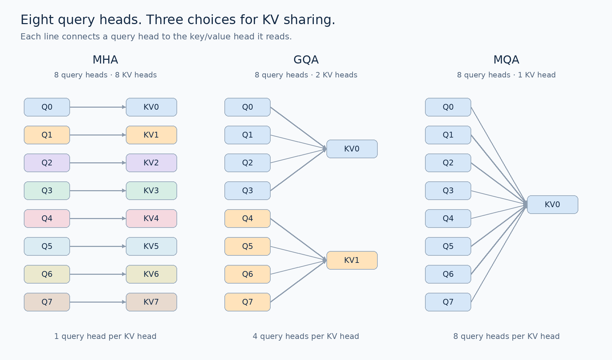
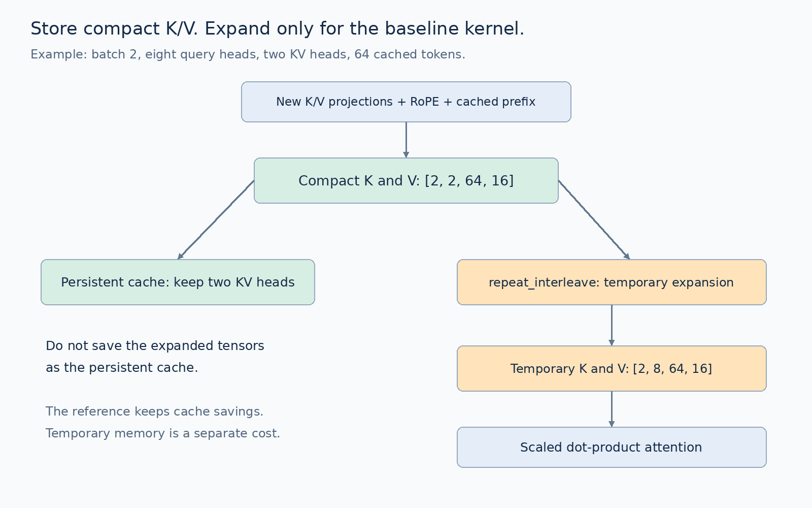

# Your KV Cache Stores More Than It Needs To
## Build grouped-query attention in PyTorch, measure the memory savings, and find the bugs that shape checks miss

Your model fits in memory. Then the conversations get longer.

The weights have not changed. The tokenizer has not changed. But every active request keeps adding keys and values to its cache, and the room you thought you had begins to disappear.

Consider a hypothetical decoder with 32 layers, 32 attention heads, a head width of 128, and an 8,192-token context. At batch size one, storing keys and values in a two-byte format requires **4 GiB of KV-cache data**. That excludes the model weights and everything else the runtime needs.

Keep all 32 query heads, but let groups of four share keys and values. The same calculation falls to **1 GiB**.

The model still asks 32 different questions about its context. It maintains only eight sets of keys and values for those questions to consult.

That is the practical attraction of grouped-query attention, or GQA.

But there are two catches. Sharing keys and values changes the model’s parameterization, so converting an existing checkpoint is not a harmless reshape. And a smaller stored cache does not automatically make your implementation faster, especially if your code expands it again before every attention call.

We will make both catches visible.

By the end, you will have a small decoder that supports multi-head attention, grouped-query attention, and multi-query attention. You will inspect real cache tensors, compare independent implementations, deliberately break head grouping, train three variants on the same data stream, and convert an MHA checkpoint into GQA for continued training.

The core lab runs on a CPU. No pretrained model download is required. GPU timing is an optional extension, and the article distinguishes measured results from calculated examples throughout.

## Contents

1. Get a result before reading the implementation
2. What the cache remembers, and why it grows
3. One example: eight questions, fewer sets of keys and values
4. What sharing preserves and what it changes
5. Count the memory before promising a speedup
6. Build the GQA projections
7. Connect each query head to the correct KV head
8. Keep the cache compact
9. Preserve RoPE offsets and causal visibility
10. Three implementations, three different purposes
11. Tests that catch plausible-looking mistakes
12. Train MHA, GQA, and MQA under controlled conditions
13. Convert a checkpoint without pretending it is the same function
14. Import the model from our NeoX lab
15. Benchmark the actual execution path
16. What the original paper established
17. Choose a KV-head count for your workload
18. Further experiments and references

## 1. Get a result before reading the implementation

Download `GQA_Companion_Lab.zip`, extract it, and enter the `GQA_Companion_Lab` directory.

Use Python 3.10–3.12 in a fresh environment:

```bash
python -m venv .venv
source .venv/bin/activate
python -m pip install -r requirements.txt
python test_gqa.py
python inspect_cache.py
```

On Windows PowerShell, the activation command is `.venv\Scripts\Activate.ps1`.

The cache inspection script constructs three variants of the same small decoder. They all have eight query heads, four layers, hidden width 128, and a byte vocabulary of size 256. They differ in how many key/value heads they learn.

For a batch of two sequences with 64 tokens each, using FP32 cache tensors, you should see:

```text
8 KV heads: 524288 bytes, 0.5000 MiB
2 KV heads: 131072 bytes, 0.1250 MiB
1 KV head:   65536 bytes, 0.0625 MiB
```

These are actual tensor byte counts, not estimated device allocations. The script also computes the expected count independently and asserts that the two agree.

The first model uses ordinary MHA. The second uses GQA with four query heads per KV head. The third uses MQA, where all query heads share one key head and one value head.

We now have a concrete result to explain: **changing eight KV heads to two reduces the stored KV tensors by a factor of four**.

The rest of the tutorial explains how to obtain that result without confusing head identities, breaking cached inference, or overstating what it means for speed and quality.

### What you need to know first

You should be comfortable with PyTorch modules, tensor shapes, and the idea that causal attention prevents a token from reading future tokens. Our earlier GPT-NeoX tutorial provides the underlying decoder, but this ZIP contains all the code needed to run independently.

The model remains intentionally small. It uses parallel residual blocks, partial rotary embeddings, ordinary GELU, and separate input and output embeddings. We are changing the attention parameterization, not reproducing a commercial model’s complete training recipe.

## 2. What the cache remembers, and why it grows

When a decoder processes a token, each attention layer produces a query, a key, and a value for that token.

The query describes how the current position will compare with available keys. The resulting attention weights determine how values are combined.

During autoregressive generation, the next token needs to consult earlier positions. Recomputing all earlier keys and values at every step is wasteful, so the model keeps them in a KV cache.

The cache grows with the number of processed tokens. Each layer has its own cache because each layer computes a different representation.

Queries are different. In ordinary incremental decoding, once the model has computed an earlier position’s output, that position’s query is not needed to produce future outputs. Its keys and values are still useful to future queries.

This asymmetry creates an opportunity: retain many query heads while reducing the number of stored key/value heads.

Multi-query attention introduced sharing keys and values across query heads to reduce the memory-bandwidth demands of incremental decoding. [1]

The benefit matters particularly during decoding, when a small number of new queries may read a long prefix. Prompt processing, training, and serving many concurrent requests have different execution characteristics. We will measure prompt processing and decoding separately later.

### Checkpoint: what happens if the prompt doubles?

Hold the batch size, layer count, KV-head count, head width, and cache dtype fixed. If the number of cached tokens doubles, the logical size of the KV tensors doubles.

That statement is independent of whether those tensors are laid out contiguously, allocated in pages, or placed across devices. Allocation overhead and replication can change actual memory consumption, but the underlying tensor payload still has to represent those values.

## 3. One example: eight questions, fewer sets of keys and values

We will use eight query heads throughout the lab. Keeping that number fixed makes the alternatives easy to compare.

**Multi-head attention:** every query head has its own key head and value head. Eight query heads means eight key heads and eight value heads.

**Multi-query attention:** all eight query heads share one key head and one value head.

**Grouped-query attention:** divide the eight query heads into groups. With two KV heads, the first four query heads share the first key/value pair, and the last four share the second.



In the paper’s terminology, the number of groups is the number of KV heads. GQA with one group is MQA; GQA with one group per query head is MHA. The method therefore spans a range of sharing choices. [2]

Two numbers are easy to mix up:

- **Number of KV heads:** how many distinct key/value projections exist.
- **Queries per KV head:** how many query heads share each pair.

With eight query heads and two KV heads, there are two groups, each containing four query heads.

Our configuration calls these `num_heads` and `num_kv_heads`. We compute the group size as `num_heads // num_kv_heads` and reject configurations that do not divide evenly.

This implementation uses equal-sized, contiguous groups. Other assignments would need a different mapping and corresponding checkpoint conversion logic.

## 4. What sharing preserves and what it changes

Sharing keys and values does not force query heads to produce identical attention patterns.

Two query heads can compare different query vectors against the same keys. Their compatibility scores can differ, their normalized weights can differ, and their weighted combinations of the shared values can differ.

For example, imagine two available positions. Their keys point in different directions. A query aligned with the first key can emphasize the first position, while another query aligned with the second emphasizes the second position. The keys and values are shared, but the questions differ.

The analogy is useful up to that point. It should not be taken to mean that heads have clean human-readable roles or that each head learns one named linguistic function.

What changes is the available key/value representation. MHA can learn eight independent key projections and eight independent value projections in our example. GQA with two KV heads learns two of each. The restriction is real.

This is why GQA is an architectural tradeoff. It is not lossless compression of arbitrary MHA weights.

### The output width stays the same

Every query head still produces a head-width output. We concatenate all eight query-head outputs and apply the output projection.

If hidden width is 128 and there are eight query heads, each head has width 16. Eight outputs of width 16 still concatenate to width 128, regardless of whether there are eight, two, or one KV heads.

The residual stream does not become narrower simply because the cache does.

### Checkpoint: does the attention score tensor become four times smaller?

Not in the straightforward dense formulation.

There are still eight query heads, and each query head still scores the permitted key positions. Reducing KV heads from eight to two does not remove three quarters of the query-head attention maps.

The K/V projections become smaller. The stored cache becomes smaller. A naive implementation’s score tensor still scales with the number of query heads.

This distinction prevents one of the most common explanations of GQA from becoming misleading: reduced KV storage is not the same thing as reducing every part of attention computation by that factor.

## 5. Count the memory before promising a speedup

Count every element that must be stored:

1. Both keys and values.
2. Every transformer layer.
3. Every sequence in the batch.
4. Every cached token.
5. Every KV head.
6. Every feature in that head.
7. The bytes used to represent each feature.

In code, the calculation is short:

```python
expected_bytes = (
    2
    * num_layers
    * batch_size
    * cached_tokens
    * num_kv_heads
    * head_dim
    * bytes_per_element
)
```

For the introductory hypothetical model, substitute 32 layers, batch one, 8,192 tokens, 32 KV heads, head width 128, and two bytes per element. The result is 4 GiB.

Replacing 32 KV heads with eight produces 1 GiB. Using one produces 128 MiB.

Those calculations assume ordinary dense K/V tensors with no quantization metadata, padding, tensor-parallel replication, or allocator overhead. They are a budget for the payload, not a prediction of the process’s peak memory.

### Four separate questions

When someone says GQA “saves memory,” ask which of these they measured:

**Persistent cache storage.** How many bytes remain in the K/V tensors between decode steps?

**Temporary forward allocations.** Does the implementation materialize repeated K/V tensors or a full attention score matrix?

**Model and training state.** How much storage is used by parameters, gradients, and optimizer state?

**Peak device allocation.** What is the maximum allocation reached during the actual workload, including the implementation’s temporary work?

These quantities can move differently.

Our default attention path stores a compact cache but temporarily repeats K/V tensors for a portable attention call. It establishes correctness and cache savings. It does not demonstrate the lowest achievable forward-pass memory use.

## 6. Build the GQA projections

The earlier NeoX lab used one fused QKV projection. Its output layout placed query, key, and value segments inside each head.

Here, separate projections make the unequal head counts explicit:

```python
self.q_proj = nn.Linear(hidden_size, num_query_heads * head_dim)
self.k_proj = nn.Linear(hidden_size, num_kv_heads * head_dim)
self.v_proj = nn.Linear(hidden_size, num_kv_heads * head_dim)
self.out = nn.Linear(hidden_size, hidden_size)
```

For hidden width 128, eight query heads, and two KV heads:

- Q projects 128 input features to 128 output features.
- K projects 128 input features to 32 output features.
- V projects 128 input features to 32 output features.
- The final attention output projection remains 128 to 128.

With a batch of two 64-token sequences, the tensors become:

```text
Q: [2, 8, 64, 16]
K: [2, 2, 64, 16]
V: [2, 2, 64, 16]
```

The axes are batch, heads, tokens, and head features.

The grouping changes the second axis of K and V. It does not change their token count or head width.

The implementation validates these choices before allocating a model:

```python
if num_kv_heads < 1 or num_query_heads % num_kv_heads:
    raise ValueError("Query heads must divide into equal KV groups")
```

We also require hidden width to be divisible by query-head count and require the rotary dimension to be positive and even.

This turns invalid configurations into immediate, understandable errors.

## 7. Connect each query head to the correct KV head

For eight query heads and two KV heads, our mapping is:

```python
kv_head_for_query = [0, 0, 0, 0, 1, 1, 1, 1]
```

The portable implementation expands K and V along their head dimension before calling ordinary scaled dot-product attention:

```python
repeats = num_query_heads // num_kv_heads
expanded_k = k.repeat_interleave(repeats, dim=1)
expanded_v = v.repeat_interleave(repeats, dim=1)
```

After this operation, the temporary tensors have eight heads. The first KV head occupies the first four head slots, and the second occupies the last four.

This is a computation convenience. The model still learns only two K projections and two V projections.

### The bug that survives a shape check

Replace `repeat_interleave` with this:

```python
wrong_k = k.repeat(1, repeats, 1, 1)
```

The shape is still `[batch, 8, tokens, head_dim]`.

But the assignment is now:

```python
wrong_kv_head_for_query = [0, 1, 0, 1, 0, 1, 0, 1]
```

That is a different grouping. If the model and checkpoint were designed around contiguous groups, this substitution changes which learned representation each query head receives.

An interleaved grouping could be a deliberate design if every related operation consistently used it. Here it is a bug because it violates our declared mapping.

### Test identity, not just dimensions

The lab creates two value heads with visibly different contents and uses zero queries and keys. With one available position, each query must return the value assigned to its group.

```python
q = torch.zeros(1, 8, 1, 2)
k = torch.zeros(1, 2, 1, 2)
v = torch.tensor([[[[10.0, 11.0]], [[20.0, 21.0]]]])
```

The first four query heads must return `[10, 11]`. The last four must return `[20, 21]`.

The wrong repeat operation alternates them. A shape assertion passes; this semantic test fails.

That pattern is worth reusing in other model code: assign distinctive values to identities you want to preserve, then verify where they arrive.

## 8. Keep the cache compact

There is one ordering decision that determines whether the implementation actually saves persistent cache space.

Create the cache entry before expanding heads:

```python
present = (k, v) if use_cache else None
expanded_k = k.repeat_interleave(repeats, dim=1)
expanded_v = v.repeat_interleave(repeats, dim=1)
```

Do not save `expanded_k` and `expanded_v` as the cache.

For GQA with two KV heads, the stored tensors should have two heads. If they have eight, you have preserved the shared computation semantics but thrown away the intended cache-storage reduction.



The lab checks both the stored shape and its actual byte count.

```python
def cache_bytes(cache):
    return sum(
        tensor.numel() * tensor.element_size()
        for layer_cache in cache
        for tensor in layer_cache
    )
```

The tensors in this cache are ordinary compact tensors. In a more general system involving views, aliases, preallocated capacity, or memory pools, summing logical tensor sizes may differ from counting underlying allocated storage.

Our decoder also uses `torch.cat` when extending a cache. That keeps the code readable but repeatedly allocates and copies data. The cache inspection result is still valid; it simply does not claim to measure the cost of an optimized serving cache.

## 9. Preserve RoPE offsets and causal visibility

GQA changes head sharing. The other requirements of autoregressive attention remain.

Queries receive rotary position information for their positions. Newly computed keys receive rotary position information for those same positions. The cache stores keys after rotation, so old keys must not be rotated again.

The head counts can differ because the rotary operation broadcasts over heads. Queries and keys still use compatible head widths and position conventions.

For a cached prefix of five tokens followed by a chunk of three, the new positions are five, six, and seven.

- The query at five can see keys zero through five.
- The query at six can see keys zero through six.
- The query at seven can see keys zero through seven.

Construct the mask using absolute positions:

```python
query_positions = offset + torch.arange(new_length, device=x.device)
key_positions = torch.arange(total_key_length, device=x.device)
allowed = key_positions[None, :] <= query_positions[:, None]
```

Every query head uses that same causal visibility rule. Head sharing and token visibility are separate axes of the computation.

For PyTorch’s scaled dot-product attention API, boolean `True` means a position is allowed. We pass the explicit mask and use `is_causal=False`, avoiding ambiguity about built-in triangular alignment when query and key lengths differ. [3]

The complete attention module used by the lab is below. Its `Rotary` helper and model assembly are in `model.py`.

```python
class Attention(nn.Module):
    def __init__(self, c):
        super().__init__()
        self.heads, self.kv_heads = c.num_heads, c.num_kv_heads
        self.head_dim = c.hidden_size // c.num_heads
        self.backend = c.backend
        self.q_proj = nn.Linear(c.hidden_size, self.heads * self.head_dim)
        self.k_proj = nn.Linear(c.hidden_size, self.kv_heads * self.head_dim)
        self.v_proj = nn.Linear(c.hidden_size, self.kv_heads * self.head_dim)
        self.out = nn.Linear(c.hidden_size, c.hidden_size)
        self.rope = Rotary(int(self.head_dim * c.rotary_pct), c.rope_base)

    def forward(self, x, past=None, use_cache=False):
        batch, length, width = x.shape
        def split(projection, heads):
            return projection(x).view(batch, length, heads, self.head_dim).transpose(1, 2)
        q = split(self.q_proj, self.heads)
        k, v = split(self.k_proj, self.kv_heads), split(self.v_proj, self.kv_heads)
        offset = 0 if past is None else past[0].shape[-2]
        q, k = self.rope(q, offset), self.rope(k, offset)
        if past is not None:
            expected = (batch, self.kv_heads, offset, self.head_dim)
            if tuple(past[0].shape) != expected or tuple(past[1].shape) != expected:
                raise ValueError('Cache has wrong batch/head/sequence/dimension shape')
            k = torch.cat((past[0], k), dim=-2)
            v = torch.cat((past[1], v), dim=-2)
        # Save compact K/V BEFORE any temporary repetition for the kernel.
        present = (k, v) if use_cache else None
        query_positions = offset + torch.arange(length, device=x.device)
        key_positions = torch.arange(k.shape[-2], device=x.device)
        allowed = key_positions[None, :] <= query_positions[:, None]
        if self.backend == 'grouped':
            y = grouped_attention(q, k, v, allowed)
        elif self.backend == 'native':
            # No hidden fallback: unsupported kernels should fail visibly.
            y = F.scaled_dot_product_attention(q, k, v, attn_mask=allowed,
                    dropout_p=0.0, is_causal=False, enable_gqa=True)
        else:
            repeats = self.heads // self.kv_heads
            expanded_k = k.repeat_interleave(repeats, dim=1)
            expanded_v = v.repeat_interleave(repeats, dim=1)
            y = F.scaled_dot_product_attention(q, expanded_k, expanded_v,
                    attn_mask=allowed, dropout_p=0.0, is_causal=False)
        y = y.transpose(1, 2).contiguous().view(batch, length, width)
        return self.out(y), present
```

## 10. Three implementations, three different purposes

The lab offers three attention backends. Choose them explicitly; an unsupported path does not silently become another implementation.

### The repeat backend: a portable baseline

The default backend expands keys and values with `repeat_interleave`, then calls ordinary scaled dot-product attention.

It is easy to inspect and compare. It also creates temporary expanded tensors. Those tensors can limit peak-memory improvements and add work during each decode step.

Use this path to establish behavior before making performance claims.

### The grouped reference: see the grouping directly

We can also keep the KV-head axis explicit and reshape queries into groups.

With eight query heads and two KV heads, the query tensor becomes `[batch, 2, 4, query_tokens, head_dim]`. The new axis of size four represents the query heads assigned to each KV head.

Here is the reference implementation:

```python
def grouped_attention(q, k, v, allowed):
    """Readable reference: no explicit K/V repetition; materializes scores."""
    batch, hq, length, dim = q.shape
    hkv, source = k.shape[1], k.shape[-2]
    queries = q.reshape(batch, hkv, hq // hkv, length, dim)
    scores = torch.einsum('bgrtd,bgsd->bgrts', queries, k) * (dim ** -0.5)
    scores = scores.masked_fill(~allowed, float('-inf'))
    weights = scores.float().softmax(-1).to(q.dtype)
    output = torch.einsum('bgrts,bgsd->bgrtd', weights, v)
    return output.reshape(batch, hq, length, dim)
```

The first `einsum` compares every query in a group with that group’s keys. The second combines the group’s values using the resulting attention weights.

This implementation does not explicitly repeat K and V. However, it materializes attention scores for all query heads. Its backend may also create internal temporaries. It is a readable reference, not a promise of kernel efficiency.

### The native backend: let the attention operator handle grouping

PyTorch exposes an `enable_gqa` option that accepts different query and KV head counts, subject to divisibility and backend support. [3]

```python
y = F.scaled_dot_product_attention(
    q,
    k,
    v,
    attn_mask=allowed,
    dropout_p=0.0,
    is_causal=False,
    enable_gqa=True,
)
```

Calling this API does not by itself establish which kernel ran, whether expansion occurred internally, or what speedup you should expect. Inspect the backend and profile the workload on the actual device.

The lab sets attention dropout to zero in all paths so the reference comparisons have deterministic semantics. If you add dropout, use consistent training and evaluation behavior and rethink direct sample-by-sample comparisons.

## 11. Tests that catch plausible-looking mistakes

Run:

```bash
python test_gqa.py
```

The suite checks twelve properties, with several repeated across all three head configurations.

**Head identity.** The distinctive-value example catches a wrong repetition order.

**Reference outputs and gradients.** The grouped implementation must agree with repeated-KV attention, including gradients flowing into Q, K, and V. Shared K/V parameters should receive contributions from all query heads in their group.

**Native-backend agreement.** When the native GQA path is supported, its logits must agree with the baseline within tolerance. Unsupported environments report a skip rather than pretending the path was verified.

**Cache parity.** A full forward pass must match one-token decoding and multi-token continuation chunks.

**Causality.** Changing future tokens must not alter earlier outputs.

**Compact cache storage.** Stored K/V tensors must retain the configured KV-head count and match the independently calculated byte budget.

**Pooling arithmetic.** Conversion must average the intended head groups, including biases. A conversion that keeps the original head count must preserve outputs.

**Non-equivalence after real compression.** Reducing KV heads in a random MHA checkpoint should generally change its outputs. The test makes that expectation explicit.

**Checkpoint roundtrip and generation.** Saving and reloading preserves predictions; cached and uncached greedy generation agree in the controlled test.

**Matched shared initialization.** Same-name, same-shape parameters start identically across the training variants.

**Trainability.** Each variant must be able to reduce loss on a tiny repeated batch.

**Configuration validation.** Zero, nondividing, and excessive KV-head counts are rejected.

A passing suite is evidence for the properties tested. It is not evidence that a trained GQA model has the same quality as an arbitrary MHA model.

## 12. Train MHA, GQA, and MQA under controlled conditions

Run the short comparison:

```bash
python run_suite.py --steps 30 --batch 2 --block 32 --device cpu
```

This launches three independent runs using eight, two, and one KV heads. It saves each checkpoint, each metrics file, and a combined summary.

All three runs receive the same sampled training windows because the data sampler has its own seeded generator. Model construction cannot consume random numbers from that generator and accidentally change the data sequence.

The initialization function also seeds each parameter by name. Same-name, same-shape parameters, including queries and MLP weights, start identically. K/V parameter shapes differ, so the three complete models are not identical initial functions.

This reduces avoidable experimental differences without pretending that different architectures can share every parameter.

### Hold the comparison budget still

Each variant uses the same byte tokenizer, hidden width, query-head count, depth, MLP width, optimizer settings, batch size, sequence length, and number of updates.

They do not have the same total parameter count. The K/V projection reduction makes GQA and MQA smaller. The metrics file reports the difference.

An equal-token experiment asks how the architectures behave after seeing the same training examples. An equal-runtime experiment asks what each can achieve within a fixed time budget. These are different questions.

### The included data is a smoke test

The bundled `demo.txt` is original synthetic text with repeated sentences. It is useful because the pipeline runs without a dataset download. It is not an appropriate corpus for claiming language-model quality or ranking attention architectures.

In the CPU smoke run, the eight-KV-head model went from approximately 5.6343 to 3.3758 validation byte NLL. The two-KV-head model went from 5.6592 to 3.3880, and the one-KV-head model went from 5.6168 to 3.3731. Each received 30 updates with batch size two and block length 32. These closely spaced results on repetitive data establish that all three training paths work; they do not establish which architecture is best.

For a more substantial educational run, download Tiny Shakespeare and use the same settings for all variants:

```bash
python download_data.py
python run_suite.py --text input.txt --steps 1000 --batch 4 --block 128 --out runs/shakespeare
```

The source is Karpathy’s char-rnn dataset repository. [4]

The script splits raw bytes into a 90 percent training portion and a 10 percent validation portion before constructing windows. Evaluation uses a fixed prefix of the validation split, capped by `--eval-blocks` in `train.py`. By default, this is 64 blocks. The metrics file records the number of evaluated target bytes.

For a fuller evaluation, invoke `train.py` directly with a larger evaluation cap and use the same cap for every comparison. For research conclusions, use independent document-level splits, check duplication, and reserve a final test set.

### Read the loss in the correct units

This model predicts UTF-8 bytes. Its loss is next-byte negative log-likelihood, not word loss or subword-token loss.

Do not compare its perplexity directly with a pretrained model using a different tokenizer. Even for these three variants, a small difference after one short run is not a reliable architecture ranking. Repeat across seeds and report variability.

## 13. Convert a checkpoint without pretending it is the same function

Suppose you already trained the eight-KV-head MHA model. How can you initialize a two-KV-head GQA model from it?

Keep the query projection, output projection, embeddings, MLPs, and normalizations. Divide the K heads into contiguous groups of four and average the corresponding projection weights within each group. Do the same for V.

Because this lab uses projection biases, average those within each group as well.

A PyTorch key-projection weight has shape `[output_features, input_features]`. For eight heads of width 16 and input width 128, that is `[128, 128]`.

To produce two KV heads, interpret it as `[2, 4, 16, 128]`: two groups, four original heads per group, 16 output features per head, and 128 input features. Average the second axis and reshape to `[32, 128]`.

The operation reduces parameters. It is not merely a different view of the same values.

```python
pooled_weight = weight.view(
    num_kv_heads,
    queries_per_group,
    head_dim,
    hidden_size,
).mean(dim=1).reshape(num_kv_heads * head_dim, hidden_size)
```

The original GQA work uses mean pooling for checkpoint conversion, followed by further pretraining to adapt the converted model. [2]

### Why the output changes

Averaging projected keys changes the scores that each query produces. Softmax is nonlinear, so averaging keys before softmax does not generally reproduce the behavior of separate attention heads. Averaging values imposes another sharing constraint.

There are special cases where pooling preserves behavior, such as already-identical K/V heads within a group. It is not a general guarantee.

### Run the conversion experiment

First train the MHA source:

```bash
python train.py --kv-heads 8 --steps 300 --out runs/mha
```

Convert it:

```bash
python convert.py --source runs/mha/model.pt --kv-heads 2 --out runs/converted/model.pt
```

Evaluate before making any updates:

```bash
python train.py --init runs/converted/model.pt --steps 0 --out runs/converted_eval
```

Continue training:

```bash
python train.py --init runs/converted/model.pt --steps 300 --out runs/converted_trained
```

When using `--init`, the checkpoint’s architecture controls the head counts. The `--kv-heads` argument applies only to a newly initialized model.

The continuation starts a new optimizer. It is not exact training resumption, and this short byte-level experiment is not a reproduction of the paper’s large-scale uptraining recipe.

To interpret the result, compare the original MHA checkpoint, the pooled checkpoint before updates, and the pooled checkpoint after updates on the same evaluation data. Also continue training an MHA copy for the same additional token budget. Otherwise, improvements after conversion may simply reflect additional training.

## 14. Import the model from our NeoX lab

The companion loader accepts the earlier lab’s fused-QKV checkpoint format.

That compatibility needs explicit work because the old tensor ordering was head-local: each head contained its own Q segment, K segment, and V segment.

For the weight tensor, the loader first reshapes to `[heads, 3, head_dim, hidden_size]`. It extracts Q, K, and V along the second axis, then flattens each projection’s output features.

Biases are unpacked using the same head-local ordering.

Do not take the first third of the old fused output and assume it contains all query heads. That would apply a different layout convention to the same bytes.

Import preserves the original query-head count and initially gives every query head its own KV head. The old default had four query heads, so valid reductions include two or one KV heads.

```bash
python convert.py --source ../my_neox_run/model.pt --kv-heads 2 --out runs/neox_to_gqa/model.pt
```

The loader is specifically for our teaching checkpoint schema. It is not a general loader for GPT-NeoX-20B, Hugging Face models, or tensor-parallel shards.

For any published checkpoint conversion, verify the exact architecture, projection layout, rotary convention, normalization settings, tied-weight policy, and serialization format before touching weights.

## 15. Benchmark the actual execution path

Once correctness is established, run:

```bash
python benchmark.py --device cpu --backend repeat
python benchmark.py --device cpu --backend grouped --out results/grouped_benchmark.json
```

For a supported accelerator and native GQA path:

```bash
python benchmark.py --device cuda --backend native --out results/cuda_native.json
```

The script warms up each model, repeats measurements, and reports median prompt-processing time separately from median time per decode step. It synchronizes supported accelerators around timing boundaries.

The decode phase uses predetermined token IDs. This keeps sequence length and work comparable across variants without allowing different generated continuations or early EOS tokens to change the benchmark.

It measures full model forwards, including output logits, mask creation, and cache concatenation. It excludes tokenization and sampling. It also records logical final-cache bytes, the software version, dtype, thread count, and raw timing samples.

This is a small-model benchmark harness, not a production-serving benchmark. We do not infer serving throughput or GPU speedups from the CPU results.

### Why a smaller cache can still be slower

There are several plausible reasons:

- The baseline temporarily repeats compact K/V tensors into full query-head-sized tensors.
- Small matrix multiplications may use the device less efficiently.
- Python dispatch, mask creation, and cache copying can dominate a tiny model.
- The workload may spend most of its time in MLPs or the vocabulary projection.
- The chosen backend may not exploit KV sharing efficiently.

A benchmark result that shows no speedup does not refute the cache arithmetic. It tells you something about that execution path and workload.

### GQA and FlashAttention address different choices

GQA determines how many K/V representations the model learns and stores. FlashAttention changes how attention is executed to reduce costly movement through memory while computing the same attention operation for its inputs. [5]

They can be used together. Neither name, by itself, specifies the full execution path of your model.

## 16. What the original paper established

The GQA paper evaluates converted and uptrained T5-family models, rather than the small decoder-only byte model in this lab. It applies the attention changes to decoder self-attention and cross-attention. Its experiments found an intermediate grouping choice could retain quality close to MHA while approaching MQA’s inference efficiency. [2]

Its additional-training budget is expressed relative to original pretraining. The commonly cited five-percent setting is not a promise that any model can be converted successfully with a few local gradient steps.

Our lab explores the mechanism, verifies implementation properties, and supplies a conversion experiment. Its smoke-test losses should not be presented as confirmation of the paper’s quality results.

## 17. Choose a KV-head count for your workload

Start with the constraint you are actually facing.

If long contexts and concurrent requests make KV storage the limiting factor, calculate how much each candidate head count would save. Include the cache dtype, batching policy, expected context lengths, and any distributed replication.

Then verify the kernel path. The mathematically compact representation must translate into useful execution on your target hardware. A portable reference implementation is an excellent correctness baseline, but it may not be your final inference implementation.

Next, evaluate quality under the tasks and lengths that matter. Reducing KV heads restricts model capacity. A favorable result for one model family or task does not select the best count for every workload.

Finally, account for migration cost. If you already have an MHA checkpoint, conversion and additional training introduce a different engineering project from selecting GQA before pretraining begins.

For our eight-query-head model, two KV heads make a useful teaching midpoint. They give a clear fourfold cache reduction while leaving more than one shared representation. That is a convenient experimental choice, not a universal optimum.

## 18. Further experiments and references

If you want to extend the lab, these experiments answer distinct questions:

**Vary KV heads while holding query heads fixed.** Add four KV heads to the existing eight/two/one comparison. Track cache bytes and held-out loss, and repeat training across seeds.

**Compare initialization strategies for conversion.** Mean pooling is one choice. Compare it against selecting one head per group or initializing new K/V projections. Give each converted model the same continuation budget.

**Remove repeated cache growth allocations.** Replace `torch.cat` with a preallocated inference cache. Preserve cached-versus-full parity tests, then remeasure decoding. This isolates cache-management overhead from head-sharing changes.

**Separate the attention kernel from the rest of the model.** Benchmark projected Q/K/V inputs independently, then compare with end-to-end results. A faster attention kernel may produce a smaller overall improvement when other components dominate.

**Add padding deliberately.** The current model expects equal-length, unpadded sequences. Supporting variable-length requests requires valid-token masks and correct per-sequence positions. Add those semantics before claiming a serving-ready implementation.

**Test longer-context behavior.** Train and evaluate with deliberate length splits. Passing a longer position into RoPE is not proof that the model generalizes to that length.

**Validation record.** The companion lab passed twelve tests on CPU with Python 3.12.14 and PyTorch 2.15.0+cpu. All three short training runs completed, as did checkpoint pooling, continued training, generation, legacy NeoX import, and both reference timing workflows. The ZIP contains raw results and a `VALIDATION.md` record. GPU performance and realistic language-model quality were not evaluated.

The most useful habit from this exercise is to keep three claims separate: the model shares K/V projections, the cache actually stores fewer values, and the measured workload runs faster. You can prove the first two with code and tensor inspection. The third needs a benchmark that names its hardware, backend, and workload.

That is how a four-times-smaller cache becomes an engineering result readers can reproduce, rather than a speedup they have to take on faith.

### References

[1] Noam Shazeer. *Fast Transformer Decoding: One Write-Head is All You Need* (2019). https://arxiv.org/abs/1911.02150

[2] Joshua Ainslie et al. *GQA: Training Generalized Multi-Query Transformer Models from Multi-Head Checkpoints* (2023). https://arxiv.org/abs/2305.13245

[3] PyTorch. *scaled_dot_product_attention documentation*, including GQA semantics, mask conventions, and backend constraints. https://docs.pytorch.org/docs/stable/generated/torch.nn.functional.scaled_dot_product_attention.html

[4] Andrej Karpathy. *Tiny Shakespeare dataset in char-rnn.* https://github.com/karpathy/char-rnn/tree/master/data/tinyshakespeare

[5] Tri Dao et al. *FlashAttention: Fast and Memory-Efficient Exact Attention with IO-Awareness* (2022). https://arxiv.org/abs/2205.14135

[6] Meta. *Llama reference implementation*, including separate query/KV head counts and KV repetition. https://github.com/meta-llama/llama/blob/main/llama/model.py

The companion ZIP includes an editorial note describing the Medium articles reviewed for teaching structure. Technical claims above are grounded in primary papers, official documentation, and the lab’s own tests.

Suggested Medium topics: Machine Learning, Deep Learning, Python, Large Language Models, Artificial Intelligence.
