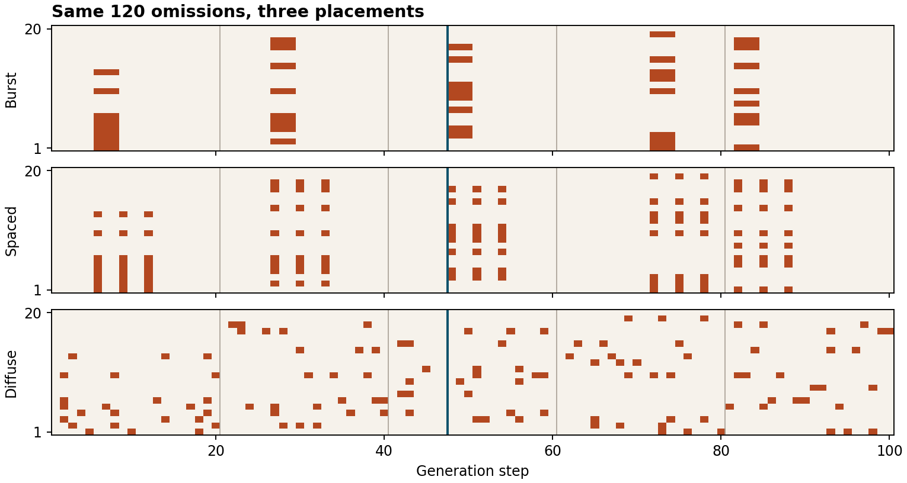

# Breakdown of Autoregressive Multi-Step Reasoning Under Clustered Head Dropout

<div align="center">

[](https://www.python.org/)
[]()
[](test_lab.py)
[](https://arxiv.org/html/2611.14209v1)
[](LICENSE)

*A clean, zero-dependency educational laboratory modeling the fragility of sequential autoregressive reasoning chains under spatiotemporally concentrated attention head failure versus budget-matched diffuse dropout.*

Based on research on cortical off-states and multi-step LLM reasoning:  
**["Breakdown of Autoregressive Multi-Step Reasoning Under Concentrated vs. Diffuse Attention Head Dropout"](https://arxiv.org/html/2611.14209v1)** (arXiv:2611.14209, Nov 2026).

</div>

---

## Executive Summary

Autoregressive Large Language Models execute multi-step reasoning by chaining intermediate token decisions. If an error is committed at step $t$, subsequent steps condition on corrupted state, frequently precipitating irreversible chain collapse.

Neurobiological research reveals that biological neural networks regularly experience **cortical "off-states"**—transient, localized silences where clusters of neurons drop out synchronously. When analogous spatiotemporally concentrated disruptions occur in Transformer attention heads (e.g. transient hardware faults, localized pruning, or grouped dropout), how do autoregressive models respond?

This laboratory isolates and proves the fundamental asymmetry:
- **Diffuse Dropout**: Dispersing 120 head omissions uniformly across 100 steps maintains peak damage at $\le 4$ missing heads per step; the reasoning chain absorbs the noise and survives.
- **Concentrated Burst / Spaced Disruptions**: Clustering the exact same budget of 120 omissions into 3-step bursts spikes peak instantaneous damage to 8 heads, breaching the model's error-correction threshold and collapsing the reasoning chain as early as step 6.

```
Total Disruption Budget: Exactly 120 head-step omissions in all 3 schedules
┌────────────────────────────────────────────────────────────────────────┐
│ 1. Concentrated Burst (Adjacent offsets 0, 1, 2)                       │
│    Peak Damage: 8 heads/step -> Reasoning collapsed at step 6          │
├────────────────────────────────────────────────────────────────────────┤
│ 2. Spaced Burst (Strided offsets 0, 3, 6)                              │
│    Peak Damage: 8 heads/step -> Reasoning collapsed at step 6          │
├────────────────────────────────────────────────────────────────────────┤
│ 3. Diffuse Dropout (Scattered uniformly across time bins)              │
│    Peak Damage: 4 heads/step -> Full reasoning chain preserved         │
└────────────────────────────────────────────────────────────────────────┘
```

---

## Visual Gallery: Disruption Schedules

<div align="center">



*Figure 1: Comparison of three disruption schedules across 100 decoding steps and 20 attention heads (Seed 7). Orange cells denote omitted head outputs. Each schedule has an identical total volume of 120 omitted head-positions partitioned into 5 bins of 20 steps.*

</div>

---

## Mathematical Foundations

### 1. The Sequential Copy Model with Discrete Feedback

To isolate the interaction between instantaneous head capacity and recursive token feedback without the confound of million-parameter weights, `lab.py` models an autoregressive copying channel:

- Total available attention heads: $H = 20$.
- Omitted heads at step $t$: $M_t \subset \{0, \dots, H-1\}$.
- State variable $b_t \in \{0, 1\}$ initialized to $b_0 = 1$.
- Fixed threshold / zero-bias parameter: $\theta \in \mathbb{R}^+$.

The affirmative logit score at step $t$ is the sum of votes from all active heads reading previous token $b_{t-1}$:

$$s_1(t) = b_{t-1} \cdot (H - |M_t|)$$

The next token is chosen deterministically:

$$b_t = \mathbb{I}\left[ s_1(t) > \theta \right]$$

#### Collapse Boundary
If at any step $t$ the number of active heads drops below or equal to $\theta$:
$$|M_t| \ge H - \theta \implies s_1(t) \le \theta \implies b_t = 0$$
Because subsequent steps evaluate $s_1(t+1) = 0 \cdot (H - |M_{t+1}|) = 0 \le \theta$, the state is permanently trapped at $0$.

Under default parameters ($H=20, \theta=13$):
- **Burst schedule**: Instantaneous loss $|M_6| = 8 \implies s_1(6) = 1 \cdot (20 - 8) = 12 \le 13 \implies b_6 = 0$ (**Immediate Collapse**).
- **Diffuse schedule**: Instantaneous loss $|M_t| \le 4 \implies s_1(t) \ge 16 > 13 \implies b_t = 1$ for all $t$ (**Chain Survives**).

---

### 2. McNemar's Exact Binomial Test for Paired Item Disruption

Evaluating reasoning degradation on the GSM8K benchmark requires paired statistical testing. For each test item $i$, let:
- $L$ denote the number of questions solved under diffuse dropout but failed under concentrated burst dropout (**Losses**).
- $G$ denote the number of questions failed under diffuse dropout but solved under concentrated burst dropout (**Gains**).

Under the null hypothesis $H_0$ that burst clustering has no distinct effect relative to diffuse dropout, discordances are equally likely ($p_{\text{loss}} = p_{\text{gain}} = 0.5$). The exact two-sided p-value is given by the binomial tail:

$$p_{\text{exact}} = 2 \sum_{k=0}^{\min(L, G)} \binom{L + G}{k} \left(\frac{1}{2}\right)^{L + G}$$

#### Reconstructed Empirical Results (from Table 1 at Disruption Budget $B=0.10$ on 250 items):
- **Qwen3-8B**:
  $$\text{Losses} = 39, \quad \text{Gains} = 8 \implies \Delta = \frac{8 - 39}{250} = \mathbf{-12.4 \text{ pp}}, \quad \mathbf{p = 5.54 \times 10^{-6}}$$
- **LLaMA-3.1-8B**:
  $$\text{Losses} = 36, \quad \text{Gains} = 18 \implies \Delta = \frac{18 - 36}{250} = \mathbf{-7.2 \text{ pp}}, \quad \mathbf{p = 0.0198}$$

Both models exhibit statistically significant degradation under concentrated dropout despite identical total disruption budgets!

---

## Reproduction & CLI Commands

Requires Python 3.9+ standard library only:

```bash
cd head-mask-lab

# 1. Run formal unit tests
python3 -m unittest -v

# 2. Run standard simulation (seed 7, stop 47, bias 13)
python3 lab.py

# 3. Explore different early-stopping horizons and bias margins
python3 lab.py --stop 40
python3 lab.py --stop 100 --bias 11
python3 lab.py --seed 19 --stop 47
```

### Standard Output Example

```
burst   planned=120 exposed=48 peak=8 final_bit=0 first_error=6
spaced  planned=120 exposed=48 peak=8 final_bit=0 first_error=6
diffuse planned=120 exposed=55 peak=4 final_bit=1 first_error=None
Qwen: difference=-12.4 pp, exact paired p=5.5396216e-06
Llama: difference=-7.2 pp, exact paired p=0.019834327
```

---

## Unit Testing & Verification

The suite verifies budget identity across 30 random seeds, stride offsets, bin boundaries, discrete copy dynamics, and exact McNemar binomial tails:

```bash
python3 -m unittest -v test_lab.py
```

```
test_copy_state (test_lab.MaskTests.test_copy_state) ... ok
test_exact_p (test_lab.MaskTests.test_exact_p) ... ok
test_exposure_at_boundaries (test_lab.MaskTests.test_exposure_at_boundaries) ... ok
test_matching_by_bin_and_identity (test_lab.MaskTests.test_matching_by_bin_and_identity) ... ok
test_spaced_and_burst (test_lab.MaskTests.test_spaced_and_burst) ... ok

----------------------------------------------------------------------
Ran 5 tests in 0.003s

OK
```

---

## Repository Structure

```
head-mask-lab/
├── README.md       # This comprehensive engineering and mathematical guide
├── lab.py          # Disruption schedule generator, discrete copy task, and McNemar test
├── schedules.png   # High-resolution raster visual comparison of burst vs diffuse schedules
└── test_lab.py     # 5 unit tests verifying budgets, strides, and exact statistical formulas
```

---

## Academic References

1. **Breakdown of Autoregressive Multi-Step Reasoning Under Concentrated vs. Diffuse Attention Head Dropout** (2026). arXiv preprint [arXiv:2611.14209](https://arxiv.org/html/2611.14209v1).
2. **McNemar, Quinn (1947)**. *Note on the sampling error of the difference between correlated proportions or percentages*. Psychometrika, 12(2), 153–157.
3. **Vyazovskiy, V. V. et al. (2011)**. *Local sleep in awake rats*. Nature, 472(7344), 443–447.

---

## License

This project is licensed under the [MIT License](../LICENSE).
