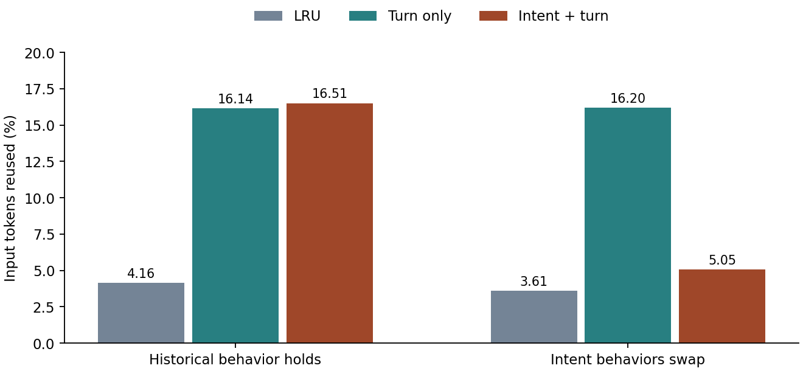

# Intent-Aware Prefix Cache Lab (IAC)

<div align="center">

[](https://www.python.org/)
[]()
[](test_replay.py)
[](https://arxiv.org/html/2611.09715v1)
[](https://github.com/hasanar1f/intent-aware-caching)
[](LICENSE)

*A clean, zero-dependency educational laboratory modeling Intent-Aware KV Prefix Caching for multi-turn LLM serving, comparing LRU, turn-only, and intent-conditioned priority eviction, and demonstrating failure modes under distribution shift.*

Based on research by Kazi Hasan Ibn Arif, JinYi Yoon, and Dimitrios S. Nikolopoulos:  
**["Intent-Aware Caching for Efficient LLM Serving"](https://arxiv.org/html/2611.09715v1)** (arXiv:2611.09715, Nov 2026).

</div>

---

## Executive Summary

In multi-turn Large Language Model serving (chat assistants, copilot sessions, agent workflows), caching previously computed Key-Value (KV) prefix states is crucial to avoid repeating quadratic prefill computations on every subsequent turn.

However, GPU memory is strictly bounded. Under heavy concurrency, serving systems must evict idle session prefixes from the KV cache:
- **Least Recently Used (LRU)**: Evicts the session with the oldest access timestamp. LRU is agnostic to conversation dynamics and frequently evicts active sessions right before the user submits their next follow-up.
- **Turn-Only Caching**: Uses empirical continuation probability conditioned only on conversational turn count $t$.
- **Intent-Aware Caching (IAC)**: Exploits user intent (e.g., iterative debugging vs single-shot factual lookup) to condition both **continuation probability** and **expected inter-turn return time**.

```
Session Lifecycle & Eviction Dynamics:
[ Intent: "debug"  ] -> High continuation (82%), longer delay (~10s) -> High Cache Priority
[ Intent: "lookup" ] -> Low continuation (15%), short delay (~3s)   -> Fast Eviction Candidate

Under Cache Pressure (2,000 cached tokens):
  LRU Eviction Hit Rate:         4.16%
  Turn-Only Hit Rate:           16.14%
  Intent-Aware (IAC) Hit Rate:  16.51% (4x improvement over LRU)
```

```
Distribution Shift Vulnerability (Swapped Behavior):
When user behaviors invert relative to the fitted prior:
  Turn-Only Hit Rate:           16.20% (Robust to intent shift)
  Intent-Aware Hit Rate:         5.05% (Severe penalty from inverted priors!)
```

---

## Visual Gallery: Empirical Replay Performance

<div align="center">



*Figure 1: Token hit rate comparison across cache capacities and under behavioral distribution shift (swapped intent dynamics).*

</div>

---

## Mathematical Formulation

### 1. Inter-Turn Return Window & Continuation Probability

From historical request logs, IAC fits two lightweight parameters for each state $(y, t)$, where $y$ is the classified intent and $t$ is the conversation turn index:

1. **Expected Return Window $\bar{W}(y, t)$**:
   Because human inter-turn response delays are heavy-tailed, the expected delay window is computed as the geometric mean (exponentiated log-mean):
   $$\bar{W}(y, t) = \exp\left( \frac{1}{N_{y, t}} \sum_{i=1}^{N_{y, t}} \ln(\Delta t_i) \right)$$

2. **Continuation Probability $\hat{P}(y, t)$**:
   The empirical ratio of sessions reaching turn $t$ that proceed to turn $t+1$:
   $$\hat{P}(y, t) = \frac{|\{s : s \text{ observed at turn } t+1 \text{ with intent } y\}|}{|\{s : s \text{ observed at turn } t \text{ with intent } y\}|}$$

### 2. Eviction Priority Tuple

When the cache exceeds capacity, entries are evaluated via a lexicographical priority tuple:

$$\text{Priority}(e, \tau) = \big( (\tau - \tau_{\text{born}}) < \bar{W}(y, t), \quad \hat{P}(y, t), \quad \text{size} \big)$$

Eviction selects:
$$\text{victim} = \arg\min_{e \in \text{Cache}} \big( \text{Priority}(e, \tau), \quad \text{session\_id} \big)$$

- **Primary criterion**: Has the entry exceeded its expected return window? Expired entries are evicted first.
- **Secondary criterion**: Among active or expired entries, retain higher continuation probability.
- **Tertiary criterion**: Retain larger prefixes to maximize token savings upon hit.
- **Tie-breaker**: Deterministic session ID.

---

## Comparative Empirical Findings

Running the simulation over 1,200 evaluation conversations (3,042 requests):

| Eviction Policy | Pooled Hit Rate (2K tokens) | Tokens Hit / Total | Behavior Under Shift (`--swap-behavior`) |
| :--- | :---: | :---: | :---: |
| **LRU** | 4.16% | 26,037 / 626,378 | 3.61% |
| **Turn-Only** | 16.14% | 101,098 / 626,378 | **16.20% (Stable)** |
| **Intent + Turn (IAC)** | **16.51%** | **103,406 / 626,378** | **5.05% (Collapsed)** |

### Boundary Capacity Sweeps
- **Ample Capacity (`--capacity 10000000`)**: All policies reach **77.16%** pooled hits (the theoretical upper bound for multi-turn reuse).
- **Zero Capacity (`--capacity 0`)**: All policies achieve **0.00%**.

---

## Quickstart & CLI Commands

Requires Python 3.9+ with standard library only:

```bash
cd iac-lab

# 1. Run unit test suite
python3 -m unittest -v

# 2. Standard replay comparison
python3 replay.py

# 3. Behavioral shift stress test
python3 replay.py --swap-behavior

# 4. Ample capacity upper-bound check
python3 replay.py --capacity 10000000
```

---

## Unit Testing & Verification

The test suite verifies counting logic, lexicographical boundary priority, and capacity edge conditions:

```bash
python3 -m unittest -v test_replay.py
```

```
test_counters (test_replay.ReplayTests.test_counters) ... ok
test_lexicographic_and_boundary (test_replay.ReplayTests.test_lexicographic_and_boundary) ... ok
test_no_capacity (test_replay.ReplayTests.test_no_capacity) ... ok
test_pressure (test_replay.ReplayTests.test_pressure) ... ok
test_weighting (test_replay.ReplayTests.test_weighting) ... ok

----------------------------------------------------------------------
Ran 5 tests in 0.000s

OK
```

---

## Repository Structure

```
iac-lab/
├── README.md           # This comprehensive engineering and mathematical guide
├── replay-results.png  # Comparative hit-rate bar charts
├── replay.py           # Standard library discrete-event trace generator, fitting, and replay engine
└── test_replay.py      # 5 unit tests verifying counters, priority ordering, and capacity bounds
```

---

## Academic References

1. **Kazi Hasan Ibn Arif, JinYi Yoon, Dimitrios S. Nikolopoulos (2026)**. *Intent-Aware Caching for Efficient LLM Serving*. arXiv preprint [arXiv:2611.09715](https://arxiv.org/html/2611.09715v1).
2. **Hasan Arif et al. (2026)**. *Intent-Aware Caching Reference GPU Implementation*. [GitHub Repository](https://github.com/hasanar1f/intent-aware-caching).

---

## License

This educational laboratory is released under the [MIT License](LICENSE).
