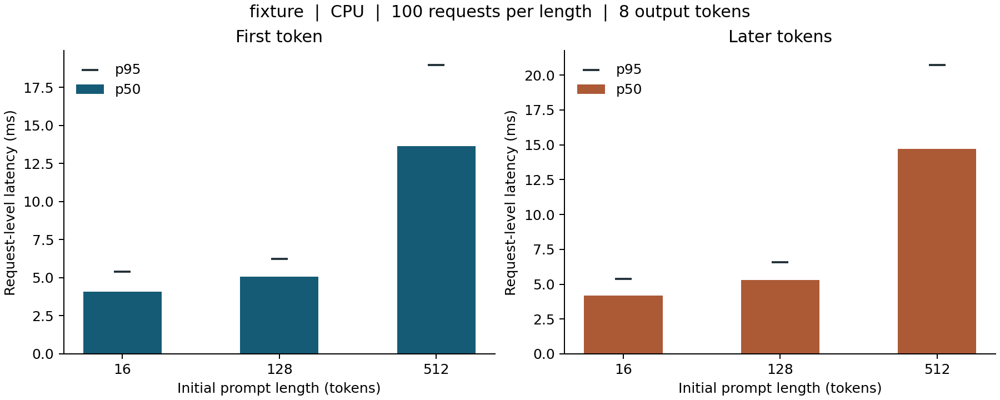

# Your LLM Processes 264,160 Token Positions to Write 64 Tokens

*Building an inference server from scratch, Episode 1. Write a greedy PyTorch generator, trace the work behind each output, and measure a baseline you can use when you add a KV cache.*

Give a language model a 4,096-token incident report. Ask it for a 64-token summary. By the time the simplest generation loop finishes, the model has processed 264,160 token positions.

You can account for every one of them. The first forward pass reads 4,096 positions and predicts the first word fragment. The second reads the same report plus that fragment. The last reads 4,159 positions to choose one more token. A user sees a short answer. The GPU has seen the opening sentence 64 times.

There is a good reason to build this version first. Once the input to every forward pass is visible, you can predict exactly which work a cache should remove. Then you can ask the harder engineering question. How much of that saved work turns into lower latency on your machine?

The companion lab starts small enough to answer both questions on a laptop CPU. It ships a trained two-layer GPT-2 model, its tokenizer, a generation loop you can read in a minute, and the raw measurements behind the figure below. Bring a larger local checkpoint when you want to test the same loop on a GPU.

## Contents

1. Follow four tokens through the generator
2. Count the work that repeats
3. Run the lab and inspect the trace
4. Put a timer around the right operation
5. Read a real latency distribution
6. Interpret the laptop GPU’s 21% result
7. Carry the baseline into the next seven experiments
8. References and code

## 1. Follow four tokens through the generator

Start with a deliberately limited language. Our training examples describe a sensor. When it reports hot, the fan turns on. When it reports cold, the fan turns off. Spaces separate the words, and a standalone period is a token. Knowing this little language lets us inspect a complete generation by eye.

The prompt `sensor reports cold` contains three tokens. The first call supplies all three IDs. A decoder-only transformer returns a vector of vocabulary scores at every position. The scores at the final position describe what could come after *cold*. Greedy decoding picks the ID with the largest score. Here that token is a period.

Now the model receives `sensor reports cold .` and predicts *fan*. The third call receives five tokens and predicts *off*. The fourth receives six and predicts another period. We have obtained four output IDs from four forward passes. The input lengths were 3, 4, 5 and 6. The transformer processed 18 positions.

Here is the essential loop. The input has shape `[1, prompt_length]`. The leading dimension is the batch size.

```python
model.eval()
sequence = input_ids

with torch.inference_mode():
    for _ in range(output_length):
        logits = model(input_ids=sequence, use_cache=False).logits
        token = logits[:, -1, :].argmax(dim=-1, keepdim=True)
        sequence = torch.cat((sequence, token), dim=1)
        del logits

continuation = sequence[:, input_ids.shape[1]:]
```

Three choices make this a reproducible baseline. Greedy decoding gives us a concrete output to compare across implementations. Evaluation mode controls training-specific behavior such as dropout, and inference mode removes autograd bookkeeping. Finally, `use_cache=False` explicitly disables the model’s generation cache. Some Transformers models return a cache by default. Discarding a cache after each forward can incur the cost of constructing it while gaining none of the reuse. [1, 2]

There are smaller costs in this code that will matter later. Concatenating the sequence creates a new tensor at each step. The vocabulary head also produces scores for positions whose predictions we throw away. On a model with a large vocabulary, producing all those logits can consume substantial memory. Keeping these choices visible makes future comparisons fair. If you switch to a last-position-only vocabulary head at the same time you introduce caching, both changes contribute to the speedup.

## 2. Count the work that repeats

At the first layer, the embedding for an old token is unchanged when we append a token on the right. Its position is unchanged too. In a causal transformer, that old position can attend only to itself and earlier positions. The newly appended token is outside its allowed view. The same argument carries through each layer when the model is in evaluation mode and the positional scheme stays fixed.

That gives us a specific opportunity. Each layer previously computed keys and values for the old positions. Store them once and the next query can use them again. The new position still has to pass through the layers, and its attention still reads the available history. A cached decoder progressively trades computation for storage and memory traffic. [1]

Keep two counts in mind when reading a profile.

**Positions passed through dense layers.** At a prefix length of 512, the uncached loop runs embeddings, projections and feed-forward layers across 512 positions. At 1,024 it processes twice as many positions. With fixed width, that portion of the arithmetic grows roughly linearly per forward.

**Pairs of positions involved in attention.** The first position has one legal key, the second has two, and so on. Doubling a long prefix produces roughly four times as many legal query-key pairs. Kernel implementations can process tiles, skip masked blocks or avoid materializing the full score matrix. Pair counting describes an algorithmic growth rate. A timer includes the rest of the model, memory movement, dispatch and the kernel selected for that shape. [3]

An eightfold increase in input length can therefore produce a fourteenfold increase in elapsed time without identifying the dominant kernel. A profiler or a controlled change to the attention implementation can investigate that attribution.

For the 4,096-token prompt in the opening, there are 64 lengths from 4,096 through 4,159. Their sum is 264,160. With a conventional KV cache, the initial prompt pass produces the first output and the next 63 forwards each consume one new input position. That is 4,159 processed input positions across the same 64 predictions. The final generated token has no reason to go through the model until someone requests another prediction.

Dividing those counts gives about 63.5. Treat it as a ratio of input positions processed. Converting it directly to a speedup would assign the same cost per position to a long parallel prompt pass and a single-token decode pass. Those operations use the hardware very differently.

## 3. Run the lab and inspect the trace

Extract the companion ZIP, enter `inference_lab`, and run these commands on Linux or macOS. The README includes Windows activation instructions. Python 3.12 was used for the recorded run.

```bash
python -m venv .venv
source .venv/bin/activate
python -m pip install -r requirements.txt
python run.py --prompt "sensor reports cold"
```

Look for *fan off* in the continuation. Change *cold* to *hot* and run it again. The model directory already contains the checkpoint and tokenizer, so after package installation the experiment can run offline. If you want to see exactly how the weights were obtained, open `train_fixture.py`. It trains on both short sentences with a fixed seed. This small vocabulary makes mistakes in indexing or stopping easy to spot.

Next, record one request that emits exactly four tokens.

```bash
python run.py --prompt "sensor reports cold" --lengths 3 \
  --new 4 --runs 1 --warmup 0 --out results/four.json
```

Open `results/four.json` and look inside `groups[0].requests[0]`. Find the input lengths, the count of 18 positions, and the three values in `itl_ms`. The first token has no preceding output token, which is why four outputs give three inter-token gaps. Add those three times to the recorded first-token latency. You should recover the total duration to rounding precision.

The text-generation command stops when the model emits the tokenizer’s end token. The length-sweep command deliberately runs the specified number of steps even if it emits that token early. Otherwise two configurations might appear to differ in speed simply because one finished its sentence earlier. The sweep constructs exact token lengths by repeating and slicing the tokenized prompt. This lets you control shape without finding a naturally occurring paragraph of exactly 512 tokens.

Try one deliberate mistake on a copy of the loop. Replace `sequence` in the model call with `sequence[:, -1:]`, leaving caching disabled. The input sizes become small immediately. But on the next call the model has lost the information distinguishing *hot* from *cold*. A fast loop can silently compute a different function. Restore the original call and run the checks before benchmarking.

```bash
python -m unittest -v
```

The tests compare the baseline’s greedy IDs with incremental cached inference through the same checkpoint. They also vary the end of a sequence and verify that earlier causal logits are stable, check what happens when the very first output is EOS, and verify the percentile convention. The cached path is a correctness reference for the exercise.

## 4. Put a timer around the right operation

Suppose the first output is ready at 40 milliseconds, the second at 55, and the third at 75. The user waited 40 milliseconds for the first token. The next two gaps were 15 and 20 milliseconds, giving a mean of 17.5 milliseconds per subsequent output token. Dividing three tokens by the full 75 milliseconds gives 40 output tokens per second. Taking the reciprocal of the 17.5-millisecond mean gives about 57 tokens per second. Both calculations are correct. They describe different parts of the request.

In this lab, **time to first token (TTFT)** starts with token IDs already on the device. It ends when the first greedy token and updated sequence are ready there. It includes the prompt forward pass, token selection and append. A client timing a deployed endpoint also experiences tokenization, transfer, queueing, networking and stream handling. When reporting measurements, name the boundary alongside the number. Serving benchmark tools expose related client-facing metrics. [4]

**Inter-token latency (ITL)** records each gap after the first output. **Time per output token (TPOT)** is the mean of those gaps within a request. If a request emits just one token, it has a TTFT and an undefined TPOT. The JSON represents the missing value as `null`. Recording zero would make a set of very short completions look artificially fast.

**Output throughput** here is total emitted tokens divided by summed timed request durations. Requests run serially, and the measurement excludes preparation between them. In an online server where requests overlap, aggregate throughput instead uses a common wall-clock observation window. Adding overlapping durations would double-count time.

**Tail latency** needs a population. Our p95 TPOT is the 95th percentile of request-level mean gaps at a fixed prompt length. The p95 of all individual gaps pooled together answers a different question. Keep the raw observations so either statistic can be calculated later.

### The synchronization detail that changes the answer

CUDA can return control to Python before the device finishes a kernel. A CPU timer around a forward call can stop while most of the actual work is still queued. In the lab, we synchronize before starting the request and after each generated token before taking its timestamp. The CPU path executes synchronously. The MPS path uses the corresponding MPS synchronization call. [5]

```python
synchronize(device)
start = time.perf_counter_ns()

# Forward, select a token, then append it to the sequence.
synchronize(device)
token_ready = time.perf_counter_ns()
```

This measures host-observed token completion in an instrumented, serial loop. Synchronizing every step adds overhead and limits overlap. Keep the same boundary for the cached comparison. If you later want aggregate device throughput, run a separate experiment that synchronizes around the entire interval. CUDA events can measure time between specified points in a device stream. Label the resulting measurement accordingly.

Warm up each workload shape. Use a fixed dtype and thread count. Time loading the model separately if startup matters to your application. For a CUDA run, the JSON also records peak *allocated* tensor bytes for each length group. It includes resident model tensors. PyTorch’s allocator can reserve additional device memory, so a system monitor can show a different total. [5]

## 5. Read a real latency distribution

Here is the command used to produce the bundled CPU reference. Run it first with ten requests for a quick check, then use the full hundred for the article’s workload.

```bash
python run.py --device cpu --dtype float32 --threads 1 \
  --lengths 16 128 512 --new 8 --runs 100 --warmup 2 \
  --out results/my_cpu.json
python plot.py results/my_cpu.json --out figures/my_cpu.png
```

The model has 166,272 parameters. The recorded run used one PyTorch CPU thread on an AMD EPYC 9V74 host, PyTorch 2.8.0+cpu and Transformers 4.55.4. The three groups each contain 100 timed requests with eight outputs. Two warm-up requests preceded each group.



*Figure 1. The bars show the median and the horizontal marks show p95 across requests. Each panel has its own vertical axis. On the right, each observation is one request’s average of seven later token gaps.*

At **16 prompt tokens**, median first-token latency was **4.08 ms**. Median TPOT was **4.19 ms**, and service throughput was **220.6 output tokens/s**. At **128 prompt tokens**, the medians rose to **5.07 ms** and **5.30 ms**, with **184.0 output tokens/s**. At **512 prompt tokens**, first-token latency reached **13.64 ms**, median TPOT reached **14.72 ms**, and throughput fell to **63.0 output tokens/s**.

The p99 request duration at length 512 was **229.09 ms**, compared with a median of **116.11 ms**. With 100 observations and the nearest-rank convention, p99 is the second-largest observation. A second run under different host load can move that number considerably. Repeat the whole sweep before treating a small tail change as an optimization.

The per-request trace also explains a possible surprise. At length 512, every output requires processing between 512 and 519 positions. The first-token time and later-token time are therefore of similar magnitude. A cache changes the shape of those later calls radically. The distinction between prompt processing and incremental decoding becomes much sharper in the next episode.

The fixture’s parameters occupy only 665,088 bytes in float32. Its CPU timings teach us how this implementation behaves as the prefix grows. A billion-parameter checkpoint changes the amount of data moved, the shape of the matrix multiplies and the relative contribution of framework overhead. To establish a baseline for that checkpoint, run the same loop with its own local model directory, an appropriate device and a supported precision.

```bash
python run.py --model /path/to/local/causal-model --device cuda \
  --dtype float16 --prompt "The server received a request" \
  --lengths 16 128 512 --new 8 --runs 100 --out results/my_gpu.json
```

Record the exact checkpoint revision and GPU variant alongside the JSON. Check model capacity first. A dense eight-billion-parameter model at two bytes per parameter already needs about 16 decimal GB for weights alone. Activations, logits, allocator behavior and runtime workspaces all affect whether the forward pass fits.

## 6. What the laptop GPU’s 21% result measures

In a March 2026 development log, the Pico-vLLM author reports a full-prefix benchmark on an **RTX 5070 Laptop GPU with 8 GB of VRAM**. A step took 47 ms at 16 positions, 55 ms at 512, 115 ms at 1,024, 272 ms at 2,048 and 764 ms at 4,096. The endpoints correspond to about 21 and 1.3 output tokens per second. The author also calls out a sudden change near 512 positions and leaves its cause open. [6]

We can reconstruct the headline calculation. The post assumes **288 GB/s** of peak bandwidth and about **3 GB** of weights. Reading that many bytes once at peak bandwidth would take approximately **10.4 ms**. Its reciprocal is **96 tokens/s** if each read yields one output. The author’s rounded short-prompt observation of 20 tokens/s is roughly **21%** of 96. Using the listed 21.0 tokens/s gives about **22%**. Rounding accounts for the difference. [6]

That percentage compares output rate with a simplified weight-streaming model. To measure actual DRAM bandwidth utilization, collect hardware counters for bytes transferred and time on the device. The rate ratio alone cannot tell you how much time went to dispatch, which kernels were compute-limited, how much data came from cache, or how many extra bytes activations and outputs moved.

Consider the dense projection in isolation. For one input position in BF16, a large matrix-vector product does roughly two floating-point operations per two-byte weight. If those weights must be fetched from device memory for each new token, compute units can finish their arithmetic faster than memory supplies the next weights. Increasing the number of positions in the matrix multiply lets the kernel reuse a weight across more inputs. An uncached prefix pass with 512 positions therefore has a different arithmetic intensity from a single-position cached decode. A batch of many users offers another way to reuse the weights. [7]

Even the simplified roofline estimate depends on which card you own. NVIDIA lists **2,039 GB/s** for the A100 80 GB SXM and **1,935 GB/s** for the PCIe variant. Under the same one-read assumption, 16 GB of weights gives roughly **127** or **121 tokens/s**, respectively. The **3.35 TB/s** specification used in the supplied draft belongs to the **H100 SXM**. On that card, the corresponding arithmetic gives about **209 tokens/s**. Keep the device, model bytes and batch size attached to each estimate. [8, 9]

### How to investigate a jump in latency

Suppose your own sweep shows a sudden change between 512 and 528 positions. First run those two lengths repeatedly in alternating order, then reverse the order. This reduces confusion between a shape change and a laptop heating up. Record power mode, dtype, attention backend and the prompt and output lengths.

Next, capture operator or kernel timings for both shapes in a separate profiling run. Did the attention kernel change? Did output projection or memory allocation begin to dominate? Compare the profiles before proposing a cause. Profiling adds overhead, so use the original harness to measure the size of the effect and the profiler to investigate where the extra time went. [10]

A second control is to change the number of emitted tokens while holding the initial prompt fixed. A one-output run only measures the initial forward. A 32-output run includes 31 opportunities for prefix reuse. If a proposed cache optimization produces its entire speedup on the one-output run, inspect the implementation for another change, such as a different attention backend or a smaller output projection.

## 7. Carry the baseline forward

Save the JSON and a short note describing the machine. The most valuable result from Episode 1 is a comparison you can repeat. Each later episode changes either the implementation, the workload, or both. Give each change an experiment that can answer its particular question.

**Episode 2, KV caching.** Keep the same weights, precision, prompt IDs and greedy policy. Compare emitted IDs first. Compare TTFT and TPOT separately at the same lengths. Inspect the forward inputs and check that only the first has the full prompt. A long prefix can still make incremental attention expensive because the new query reads a growing history.

**Episode 3, continuous batching.** Introduce independent requests with staggered arrivals and different completion lengths. Admit new work when finished requests release slots. Measure aggregate outputs per wall-clock second at a stated arrival rate, alongside client TTFT and tail latency. A single serial request gives a scheduler little opportunity to demonstrate its purpose. [11]

**Episode 4, paged KV storage.** Hold the scheduler fixed and change how it allocates cache blocks. Track reserved capacity, live KV tokens, admitted requests and throughput at a latency target. The original vLLM paper reports 2–4× throughput in its evaluated comparisons with systems including FasterTransformer and Orca. That result depends on the systems and workloads compared. [12]

**Episode 5, sampling.** Add a reproducible sampling workload. Measure time spent selecting the next token and its share of the whole step. A twofold improvement in a component that consumes 5% of a step can save only about 2.5% of total time if everything else stays fixed.

**Episode 6, speculative decoding.** Record draft cost, target verification time and accepted tokens per proposal. Compare interactive latency across prompts with different acceptance rates. For sampling, test the output distribution as well as speed. [13]

**Episode 7, multi-worker routing.** Increase the offered load and record per-worker queue depths, resource use and request tails. Test whether the routing policy can keep workers busy when some users send long prompts.

**Episode 8, comparison with vLLM.** Replay the same request trace against both systems. Match the model revision, dtype, hardware, sampling policy and output accounting. Plot throughput against latency as offered load rises. This lets a reader see which configuration satisfies a given service target.

For today’s experiment, write down the prediction before running the next version. With the three-token prompt and four outputs, caching should reduce the inputs to `[3, 1, 1, 1]`. Both implementations should still generate the same four IDs. The timer then answers a question the work count cannot answer for you. On this model, at this length, how much time did those twelve avoided positions actually save?

## References and code

1. Hugging Face, [How caching works](https://huggingface.co/docs/transformers/cache_explanation).
2. PyTorch, [Inference mode](https://docs.pytorch.org/docs/stable/generated/torch.autograd.grad_mode.inference_mode.html).
3. Dao et al., [FlashAttention](https://arxiv.org/abs/2205.14135), on attention arithmetic and memory traffic.
4. vLLM project, [Serving benchmark metrics and options](https://docs.vllm.ai/en/latest/cli/bench/serve/).
5. PyTorch, [CUDA semantics and asynchronous execution](https://docs.pytorch.org/docs/2.8/notes/cuda.html).
6. koas-w, [Pico-vLLM development log 2, autoregression and profiling](https://koas-w.github.io/posts/20260324-run/), March 24, 2026. Original laptop measurements.
7. UC Berkeley, [vLLM: An Efficient Inference Engine for Large Language Models](https://www2.eecs.berkeley.edu/Pubs/TechRpts/2025/EECS-2025-192.html), technical report EECS-2025-192.
8. NVIDIA, [A100 specifications](https://www.nvidia.com/en-us/data-center/a100/).
9. NVIDIA, [H100 specifications](https://www.nvidia.com/en-us/data-center/h100/).
10. PyTorch, [Profiler](https://docs.pytorch.org/docs/stable/profiler.html).
11. Yu et al., [Orca, a distributed serving system for transformer-based generative models](https://www.usenix.org/conference/osdi22/presentation/yu), OSDI 2022.
12. Kwon et al., [Efficient Memory Management for Large Language Model Serving with PagedAttention](https://arxiv.org/abs/2309.06180), SOSP 2023.
13. Leviathan et al., [Fast Inference from Transformers via Speculative Decoding](https://arxiv.org/abs/2211.17192).

*The accompanying ZIP includes the runnable generator, the local model, its training script, the raw CPU traces, the figure generator, four executable checks and the step-by-step README.*
