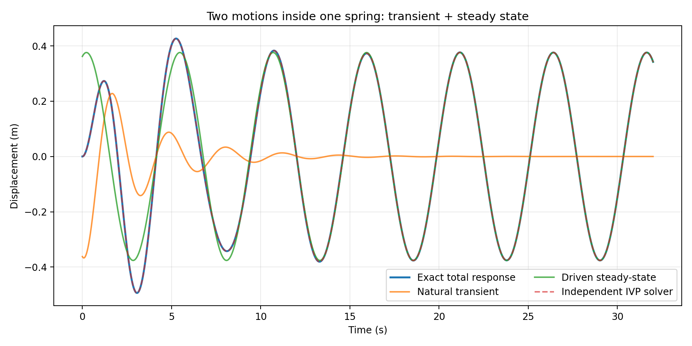
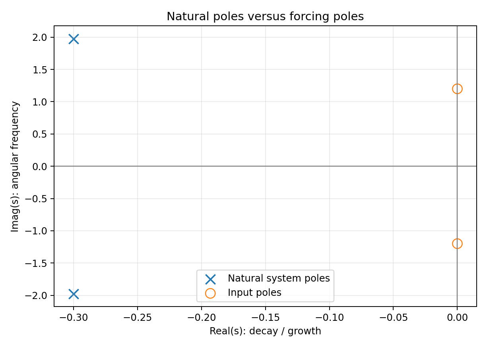
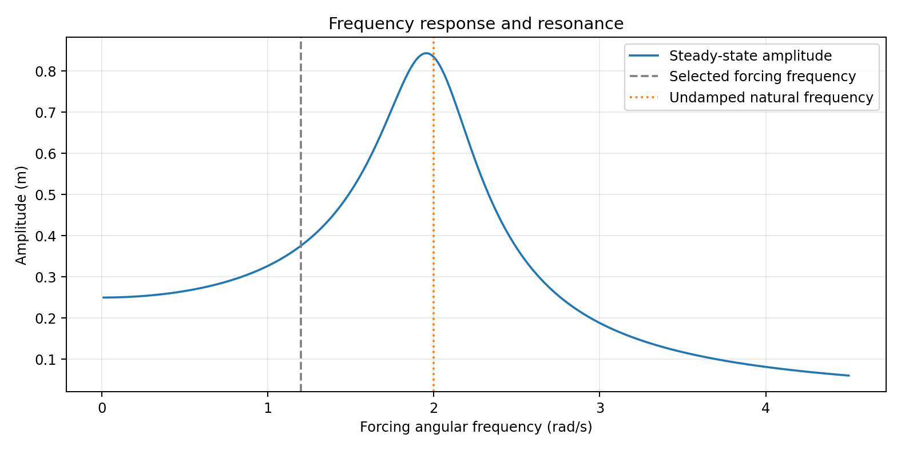
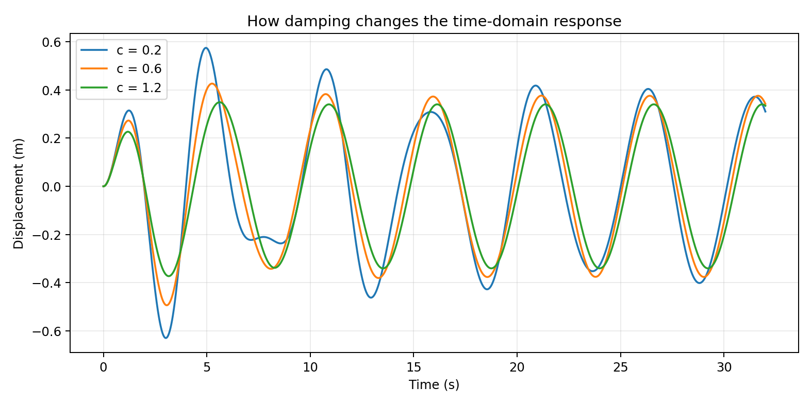

# Forced Damped Oscillator: Transient & Steady-State Decomposition Lab

[](https://www.python.org/downloads/)
[](https://scipy.org/)
[](#mathematical-formulation)
[](#test-suite)
[](https://opensource.org/licenses/MIT)

A reproducible numerical lab inspired by 3Blue1Brown's *Why Laplace transforms are so useful*, explaining why a driven spring looks irregular before settling into a clean sinusoid. It analytically decomposes an underdamped mass-spring-damper into its **decaying natural transient** and **driven steady-state response** (with arbitrary initial conditions $x_0, v_0$) and cross-checks the sum against an independent high-precision ODE integrator (`scipy.integrate.solve_ivp`) to within $3.3 \times 10^{-12}$.

---

## Mathematical Formulation

For an underdamped ($c^2 < 4mk$) single-degree-of-freedom oscillator driven by $F \cos(\omega t)$:
$$m x''(t) + c x'(t) + k x(t) = F \cos(\omega t), \qquad x(0) = x_0, \quad x'(0) = v_0$$

Its unilateral Laplace transform splits cleanly into **forcing poles** ($\pm i\omega$) and **natural system poles** ($-\alpha \pm i\omega_d$):
$$X(s) = \frac{\frac{F s}{s^2 + \omega^2} + m s x_0 + m v_0 + c x_0}{m s^2 + c s + k}$$

### Closed-Form Decomposition
With decay rate $\alpha = \frac{c}{2m}$ and damped natural frequency $\omega_d = \sqrt{\frac{k}{m} - \alpha^2}$:

$$\begin{aligned}
A &= \frac{F}{\sqrt{(k - m\omega^2)^2 + (c\omega)^2}}, \qquad \phi = \operatorname{atan2}(c\omega,\; k - m\omega^2) \\
x_{\text{ss}}(t) &= A \cos(\omega t - \phi) \\
x_{\text{tr}}(t) &= e^{-\alpha t} \big[ C \cos(\omega_d t) + D \sin(\omega_d t) \big] \\
C &= x_0 - A\cos\phi, \qquad D = \frac{v_0 - A\omega\sin\phi + \alpha C}{\omega_d} \\
x(t) &= x_{\text{tr}}(t) + x_{\text{ss}}(t)
\end{aligned}$$

```
  TOTAL MOTION x(t) = x_tr(t) + x_ss(t)
  ├── Natural System Poles (-0.30 +/- 1.977i) ---> Decaying Transient x_tr(t)  (e^(-alpha*t) envelope)
  └── Forcing Input Poles  ( 0.00 +/- 1.200i) ---> Driven Steady State x_ss(t) (A * cos(omega*t - phi))
```

---

## Generated Visualizations

| Transient + Steady-State Decomposition | Natural Poles vs. Forcing Poles |
| :---: | :---: |
|  |  |

| Frequency Response & Resonance | Effect of Damping ($c = 0.2, 0.6, 1.2$) |
| :---: | :---: |
|  |  |

---

## Baseline Results (`figures/results.json`)

Default configuration ($m=1.0$, $c=0.6$, $k=4.0$, $F=1.0$, $\omega=1.2$, $x_0=0$, $v_0=0$):

| Quantity | Value |
|:---|---:|
| Natural System Poles | $-0.300 \pm 1.9774i$ |
| Forcing Input Poles | $0.000 \pm 1.2000i$ |
| Steady-State Amplitude ($A$) | `0.3760 m` |
| Phase Lag ($\phi$) | `0.2742 rad` |
| Envelope Decay Rate ($\alpha$) | `0.3000 s⁻¹` |
| 1% Envelope Attenuation Time ($\ln(100)/\alpha$) | `15.35 s` |
| Max Error vs. Independent `solve_ivp` | `3.27e-12` |

---

## Quickstart

### 1. Setup & Run

```bash
# Clone the repository
git clone https://github.com/AdityaInamdar334/Deep-Learning-Implementations.git
cd Deep-Learning-Implementations/laplace_forced_oscillator_lab

# Create virtual environment and install dependencies
python3 -m venv .venv
source .venv/bin/activate
pip install -r requirements.txt

# Generate figures and figures/results.json
python3 oscillator.py

# Explore low damping or nonzero initial conditions
python3 oscillator.py --damping 0.2 --frequency 1.9 --out figures-low-damping
python3 oscillator.py --x0 0.5 --v0 -0.25 --out figures-new-initial-state
```

### 2. Test Suite

```bash
python3 -m unittest discover -s tests -v
```

The 6 automated unit tests verify:
- **`test_poles`**: Natural system poles match $-0.3 \pm \sqrt{3.91}i$.
- **`test_initial_conditions`**: Nonzero $(x_0, v_0)$ satisfied at $t=0$ and initial slope.
- **`test_exact_vs_numerical`**: Analytic sum agrees with `scipy.integrate.solve_ivp` within $2 \times 10^{-8}$.
- **`test_phase_amplitude`**: Exact amplitude formula and first-quadrant phase lag.
- **`test_bad_damping`**: Rejects critically damped / overdamped inputs ($c^2 \ge 4mk$).
- **`test_components_sum`**: Exact identity $x_{\text{tr}} + x_{\text{ss}} = x_{\text{total}}$.

---

## File Structure

```
laplace_forced_oscillator_lab/
├── README.md                       # Derivations, figures, baseline table, and CLI guide
├── requirements.txt                # numpy, scipy, matplotlib
├── .gitignore                      # Ignores __pycache__ and bytecode
├── oscillator.py                   # Analytic Laplace modes, solve_ivp verifier, and plotting
├── figures/
│   ├── decomposition.png           # Transient + steady-state + numerical overlay
│   ├── pole_map.png                # Complex s-plane natural vs forcing poles
│   ├── resonance.png               # Steady-state amplitude vs forcing frequency
│   ├── damping_comparison.png      # Multi-damping time-domain comparison
│   └── results.json                # Machine-readable summary report
└── tests/
    └── test_oscillator.py          # 6 automated unit tests
```

---

## References

- 3Blue1Brown, [*Why Laplace transforms are so useful*](https://www.3blue1brown.com/lessons/laplace-for-odes/)
- SciPy Reference: [`scipy.integrate.solve_ivp`](https://docs.scipy.org/doc/scipy/reference/generated/scipy.integrate.solve_ivp.html)
- MIT OpenCourseWare: [18.03 Differential Equations](https://ocw.mit.edu/courses/18-03-differential-equations-spring-2010/)
