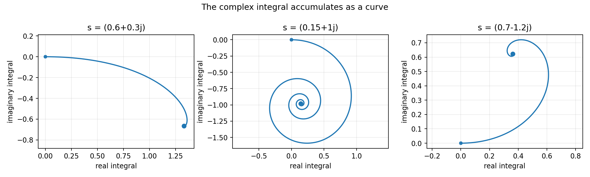
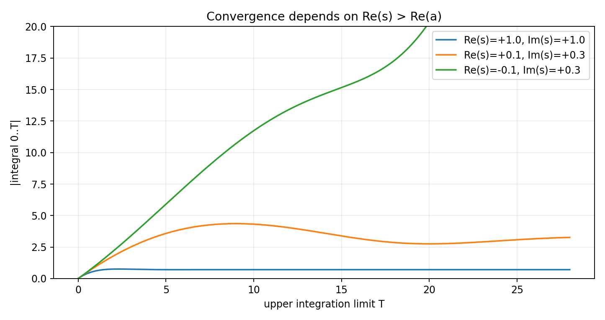
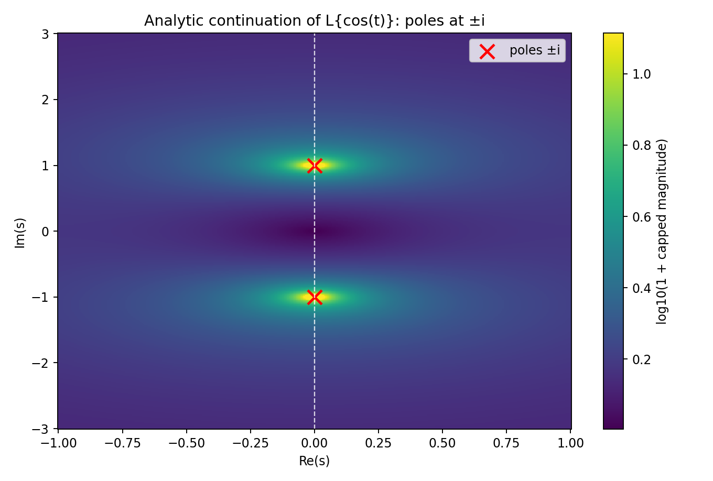
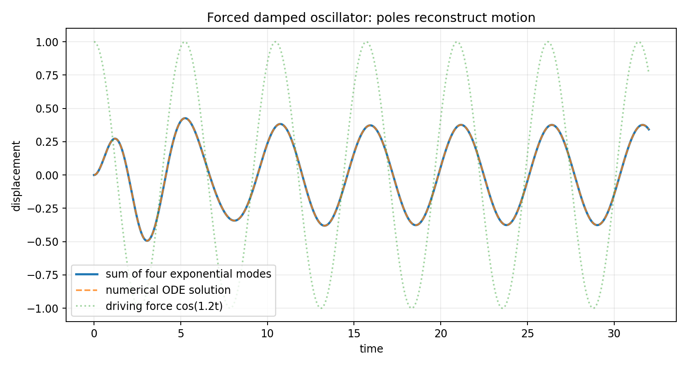

# Laplace Transforms From Scratch: Poles, Convergence, and a Spring

[](https://www.python.org/downloads/)
[](https://scipy.org/)
[](#mathematical-formulation)
[](#test-suite)
[](https://opensource.org/licenses/MIT)

A reproducible numerical companion lab inspired by Grant Sanderson's (3Blue1Brown) *But what is a Laplace Transform?*. It connects **complex spiral integrals**, **regions of convergence (ROC)** versus **analytic continuation**, and **partial-fraction pole/residue decomposition** for solving a forced damped harmonic oscillator—verified directly against SciPy's numerical ODE integrator (`scipy.signal.lsim`).

---

## Mathematical Formulation

### 1. Unilateral Integral vs. Meromorphic Continuation
For a complex exponential $f(t) = e^{at}$, the truncated unilateral integral is:
$$F_T(s) = \int_0^T e^{(a - s)t}\,dt = \frac{e^{(a - s)T} - 1}{a - s}$$
As $T \to \infty$, $F_T(s)$ converges to $\frac{1}{s - a}$ **if and only if** $s$ lies in the open right half-plane $\text{Re}(s) > \text{Re}(a)$. Outside this Region of Convergence (ROC), the integral diverges, even though the rational expression $\frac{1}{s - a}$ remains algebraically well-defined as its analytic continuation.

```
                        COMPLEX s-PLANE (s = sigma + i*omega)

                                     Im(s)
                                       |
                   Divergent Integral  |  Convergent Unilateral Integral
                   (Analytic Cont.)    |  (Region of Convergence: Re(s) > 0)
                                       |
                            x (+i) ----+          L{cos(t)} = s / (s^2 + 1)
                                       |
                        ---------------+---------------> Re(s)
                                       |
                            x (-i) ----+
                                       |
```

### 2. Forced Damped Oscillator via Poles & Residues
For a zero-initial-condition spring-mass-damper driven by $\cos(\omega t)$:
$$m x''(t) + c x'(t) + k x(t) = \cos(\omega t), \qquad x(0) = x'(0) = 0$$
Taking the Laplace transform converts differentiation into algebra:
$$X(s) = \frac{s}{(s^2 + \omega^2)(m s^2 + c s + k)} = \sum_{j=1}^4 \frac{r_j}{s - p_j}$$
Inverting term-by-term reconstructs the exact time-domain motion as a sum of four exponential modes:
$$x(t) = \text{Re}\left(\sum_{j=1}^4 r_j e^{p_j t}\right)$$
Two complex-conjugate poles in the left half-plane ($\text{Re}(p) < 0$) govern the decaying transient, while two purely imaginary poles ($\pm i\omega$) govern the steady-state forced oscillation.

---

## Generated Visualizations

| Complex Integral Spiral Paths | Region of Convergence ($\text{Re}(s) > \text{Re}(a)$) |
| :---: | :---: |
|  |  |

| Analytic Continuation of $\mathcal{L}\{\cos(t)\}$ | Forced Damped Oscillator (Poles vs. ODE) |
| :---: | :---: |
|  |  |

---

## Quickstart

### 1. Setup & Run

```bash
# Clone the repository
git clone https://github.com/AdityaInamdar334/Deep-Learning-Implementations.git
cd Deep-Learning-Implementations/laplace_transform_from_scratch_lab

# Create virtual environment and install dependencies
python3 -m venv .venv
source .venv/bin/activate
pip install -r requirements.txt

# Regenerate all four figures
python3 laplace_lab.py
```

### 2. Test Suite

```bash
python3 -m unittest discover -s tests -v
```

The 5 automated unit tests verify:
- **`test_exponential_converges_in_roc`**: Truncated integral at $T=35$ matches $\frac{1}{s-a}$ to $10^{-8}$ inside the ROC.
- **`test_at_pole_finite_integral_grows_with_time`**: Stable removable-singularity evaluation at $s = a$ yields exact linear growth $T$.
- **`test_cosine_transform`**: Exact algebraic identity $\frac{s}{s^2+1} = \frac{1}{2}\left(\frac{1}{s-i} + \frac{1}{s+i}\right)$.
- **`test_four_oscillator_poles`**: Partial-fraction poles match polynomial roots of $(m s^2 + cs + k)(s^2 + \omega^2)$.
- **`test_oscillator_against_numerical_solver`**: Residue-reconstructed trajectory agrees with `scipy.signal.lsim` within $5 \times 10^{-4}$ and satisfies $x(0) = 0$.

---

## File Structure

```
laplace_transform_from_scratch_lab/
├── README.md                            # Derivations, figures, and experiments
├── requirements.txt                     # numpy, scipy, matplotlib
├── .gitignore                           # Ignores __pycache__ and bytecode
├── laplace_lab.py                       # Integrals, residue solver, and plotting scripts
├── figures/
│   ├── integral_paths.png               # Complex curve accumulation for three s values
│   ├── region_of_convergence.png        # Finite integral growth vs convergence in T
│   ├── cosine_poles.png                 # Log-magnitude continuation of s/(s^2 + 1)
│   └── damped_oscillator.png            # 4-pole modal sum vs numerical ODE solution
└── tests/
    └── test_lab.py                      # 5 automated unit tests
```

---

## Suggested Experiments

1. **Near-Resonance Tuning**: Sweep driving frequency $\omega$ toward the natural frequency $\sqrt{k/m}$ and observe amplitude peaking and phase shift.
2. **Damping & Stability**: Increase $c$ to push the transient poles deeper into the left half-plane ($\text{Re}(p) \ll 0$).
3. **Undamped Resonance**: Set $c = 0$ and $\omega = \sqrt{k/m}$ to trigger repeated poles (producing secular $t e^{pt}$ growth).
4. **Nonzero Initial Conditions**: Add $m(s x_0 + v_0) + c x_0$ to the numerator of $X(s)$ to include nonzero initial displacement and velocity.

---

## References

- Grant Sanderson (3Blue1Brown), [*But what is a Laplace Transform?*](https://www.youtube.com/watch?v=j0wJBEZdwLs)
- MIT OpenCourseWare, [Signals and Systems: Laplace Transform](https://ocw.mit.edu/courses/res-6-007-signals-and-systems-spring-2011/)
- SciPy Reference: [`scipy.signal.residue`](https://docs.scipy.org/doc/scipy/reference/generated/scipy.signal.residue.html) & [`scipy.signal.lsim`](https://docs.scipy.org/doc/scipy/reference/generated/scipy.signal.lsim.html)
