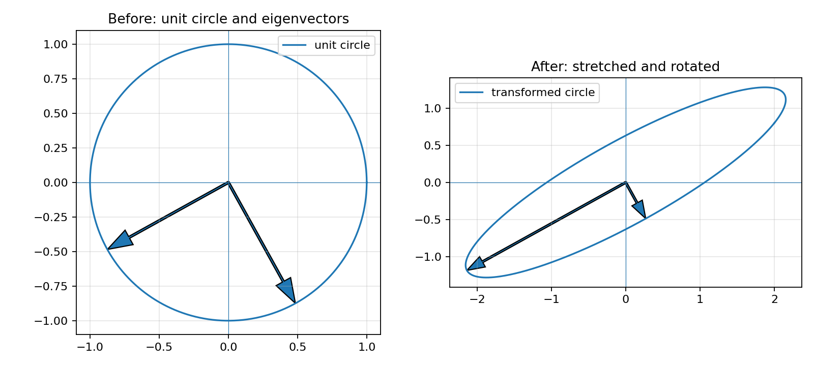
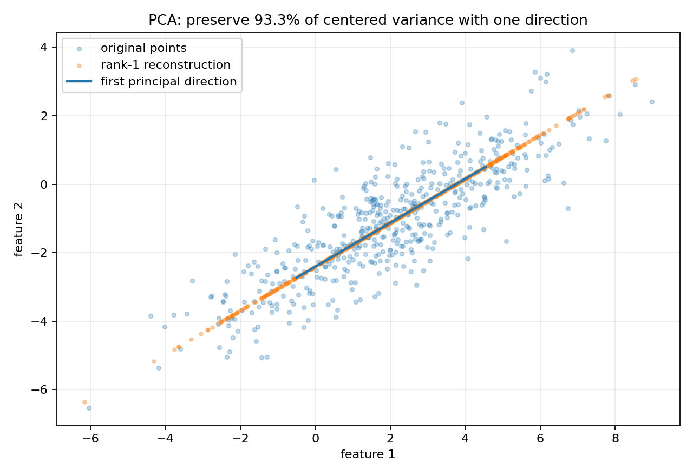
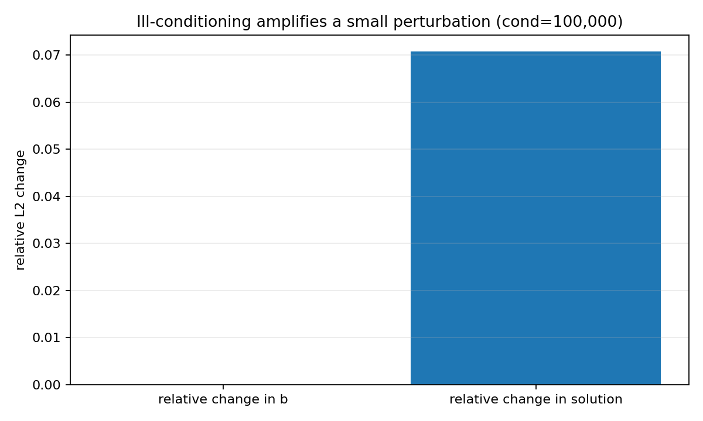

# Linear Algebra Is What Your Neural Network Actually Does

[](https://www.python.org/downloads/)
[](https://numpy.org/)
[](#core-experiments)
[](#test-suite)
[](https://opensource.org/licenses/MIT)

A reproducible NumPy visual lab illustrating the core geometric and numerical concepts from Chapter 2 of *Deep Learning* (Goodfellow, Bengio, & Courville, 2016): **symmetric eigendecomposition**, **SVD rank-1 PCA projection**, and **ill-conditioned perturbation amplification**.

---

## Core Experiments

### 1. Matrix Geometry & Eigendecomposition
For the symmetric matrix $A = \begin{bmatrix} 2.0 & 0.8 \\ 0.8 & 1.0 \end{bmatrix} = V \Lambda V^\top$, mapping the unit circle $S^1$ yields an ellipse whose semi-axes align with the orthonormal eigenvectors $V$ and scale by the eigenvalues $\lambda_1 \approx 0.557, \lambda_2 \approx 2.443$.

### 2. Rank-1 PCA via SVD
Centering correlated 2D data $\tilde{X} = X - \bar{x}$ and taking its SVD $\tilde{X} = U \Sigma V^\top$ projects points onto the leading right singular vector $v_1$, preserving $\sigma_1^2 / (\sigma_1^2 + \sigma_2^2) = 93.3\%$ of centered variance with orthogonal residuals $(X - \hat{X}) v_1 = \mathbf{0}$.

### 3. Ill-Conditioning & Perturbation Amplification
For $A = \operatorname{diag}(1.0, 10^{-5})$ with condition number $\kappa(A) = 10^5$, a tiny $10^{-6}$ relative perturbation along the weak singular direction amplifies by over $70{,}000\times$ into a $7.07\%$ relative error in the solution $x = A^{-1} b$.

---

## Generated Visualizations

| Unit Circle & Eigenvectors | Rank-1 PCA Projection ($93.3\%$ Var) | Ill-Conditioning ($\kappa = 10^5$) |
| :---: | :---: | :---: |
|  |  |  |

---

## Baseline Results (`figures/results.json`)

| Metric | Value |
|:---|---:|
| Symmetric Eigenvalues ($\lambda_1, \lambda_2$) | `0.5566`, `2.4434` |
| PCA 1st Component Explained Variance | `93.31%` |
| PCA Rank-1 Reconstruction MSE | `0.2832` |
| Linear System Condition Number $\kappa(A)$ | `100,000` |
| Relative Perturbation in $b$ | `1.00e-6` |
| Relative Error in Solution $x$ | `7.07e-2` ($70{,}711\times$ amplification) |

---

## Quickstart

### 1. Setup & Run

```bash
# Clone the repository
git clone https://github.com/AdityaInamdar334/Deep-Learning-Implementations.git
cd Deep-Learning-Implementations/linear_algebra_visual_lab

# Install dependencies
python3 -m pip install -r requirements.txt

# Regenerate all 3 figures + figures/results.json
python3 lab.py --out figures
```

### 2. Test Suite

```bash
python3 -m unittest discover -s tests -v
```

The 6 automated unit tests verify:
- **`test_eigen_equation`** & **`test_eigen_orthonormal`**: $AV = V\Lambda$ and $V^\top V = I$ to $10^{-12}$.
- **`test_condition_number`** & **`test_perturbation_amplification`**: $\kappa(A) = 10^5$ and $>100\times$ error amplification.
- **`test_pca_variance`** & **`test_pca_reconstruction`**: Exact singular-value variance ratio, lower MSE than mean baseline, and orthogonal residuals $(X - R)v_1 = \mathbf{0}$.

---

## File Structure

```
linear_algebra_visual_lab/
├── README.md                        # Derivations, figures, metrics, and notes
├── requirements.txt                 # numpy, matplotlib
├── .gitignore                       # Ignores __pycache__ and bytecode
├── lab.py                           # Eigendecomposition, PCA, conditioning, and plots
├── figures/
│   ├── matrix_geometry.png          # Unit circle -> ellipse with eigenvectors
│   ├── pca_projection.png           # Rank-1 SVD projection onto leading axis
│   ├── conditioning.png             # Input vs solution relative perturbation bar chart
│   └── results.json                 # Deterministic numerical metrics
└── tests/
    └── test_lab.py                  # 6 automated unit tests
```

---

## References

- Ian Goodfellow, Yoshua Bengio, & Aaron Courville (2016), *Deep Learning*, Chapter 2: Linear Algebra. [deeplearningbook.org](https://www.deeplearningbook.org/contents/linear_algebra.html)
- NumPy Linear Algebra Reference: [`numpy.linalg`](https://numpy.org/doc/stable/reference/routines.linalg.html)
