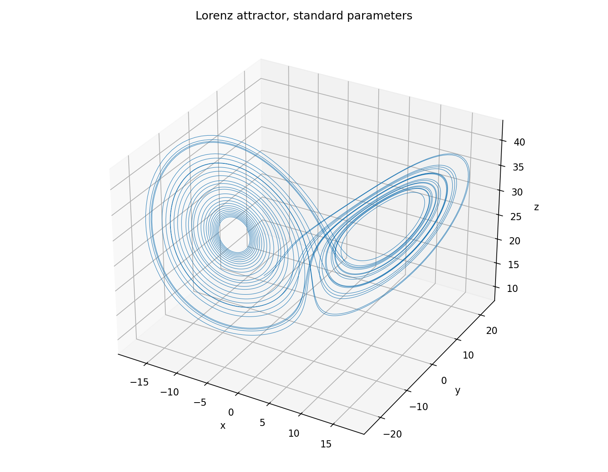
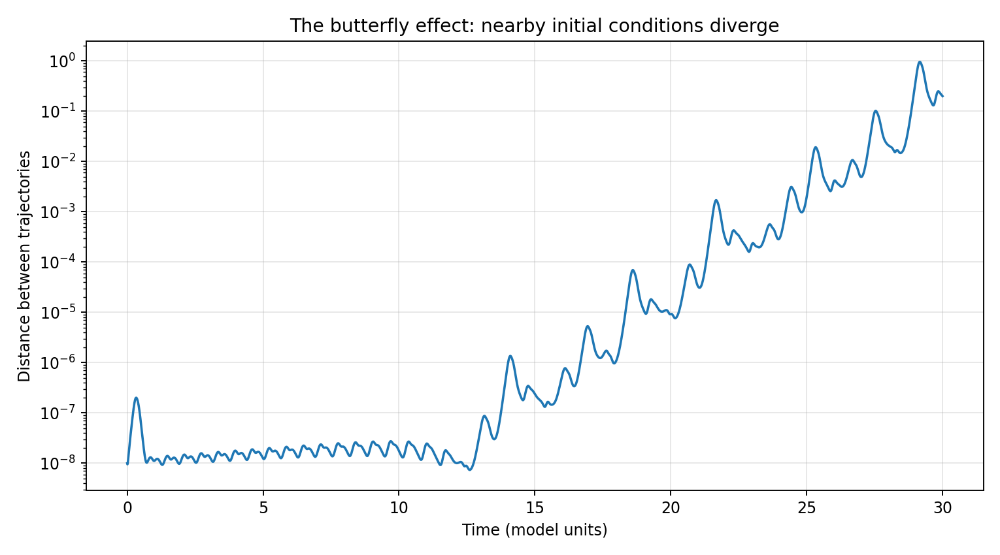
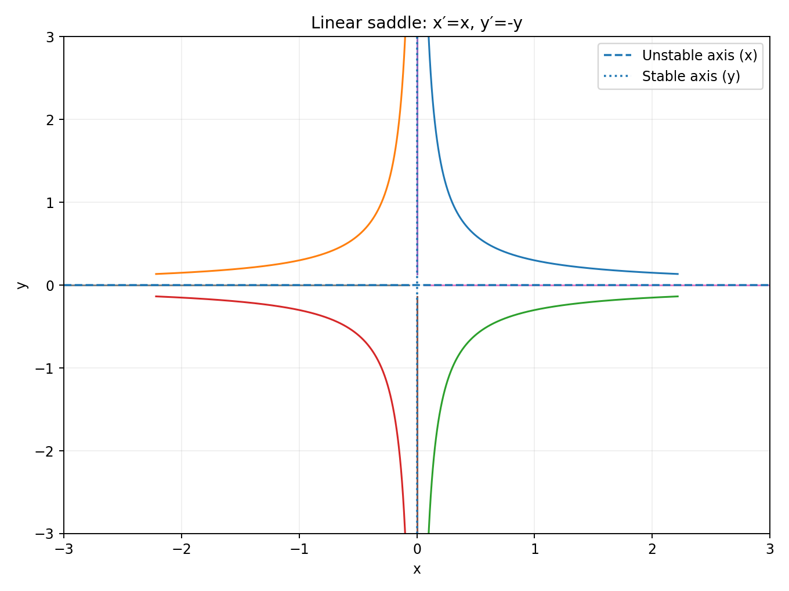
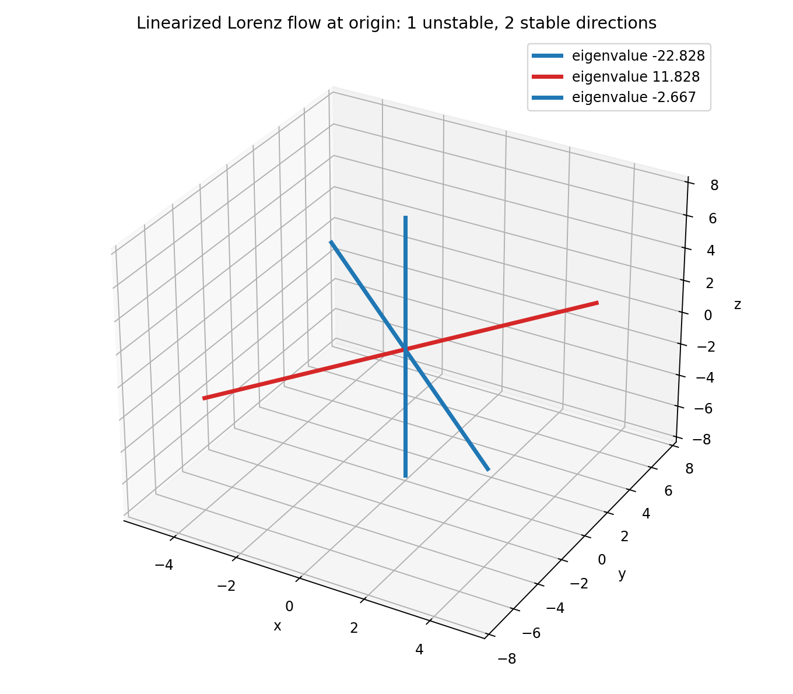

# Lorenz Attractor & Stable/Unstable Manifolds Lab

[](https://www.python.org/downloads/)
[](https://docs.scipy.org/doc/scipy/reference/generated/scipy.integrate.solve_ivp.html)
[](#mathematical-formulation)
[](#test-suite)
[](https://opensource.org/licenses/MIT)

A reproducible numerical visualization lab exploring the geometry of deterministic chaos in the **Lorenz-63 system**: high-order ODE integration (`DOP853`), exponential divergence of nearby initial conditions, linear 2D saddle dynamics, and the linearized stable/unstable eigenspaces at the origin.

> [!IMPORTANT]
> **Scope & Mathematical Precision:** This lab computes trajectories and **local linear eigen-directions** at the origin—it does **not** compute a global 2D stable-manifold mesh. Constructing the full convoluted 2D global stable manifold $W^s(\mathbf{0})$ of the Lorenz system requires specialized continuation algorithms such as the geodesic level-set method of Krauskopf and Osinga (2003).

---

## Mathematical Formulation

### 1. The Lorenz-63 Vector Field
With classical chaotic parameters $\sigma = 10$, $\rho = 28$, and $\beta = \frac{8}{3}$:

$$\begin{aligned}
\dot{x} &= \sigma(y - x) \\
\dot{y} &= x(\rho - z) - y \\
\dot{z} &= xy - \beta z
\end{aligned}$$

The system is **dissipative**: phase-space volume contracts uniformly at a constant exponential rate given by the divergence of the vector field:
$$\nabla \cdot \mathbf{F} = \frac{\partial \dot{x}}{\partial x} + \frac{\partial \dot{y}}{\partial y} + \frac{\partial \dot{z}}{\partial z} = -(\sigma + 1 + \beta) = -\frac{41}{3} \approx -13.667$$

### 2. Linearization & Saddle Geometry at the Origin
Evaluating the Jacobian matrix $J(\mathbf{x})$ at the equilibrium $\mathbf{0} = (0, 0, 0)$ yields:

$$J(\mathbf{0}) = \begin{bmatrix} -\sigma & \sigma & 0 \\ \rho & -1 & 0 \\ 0 & 0 & -\beta \end{bmatrix} = \begin{bmatrix} -10 & 10 & 0 \\ 28 & -1 & 0 \\ 0 & 0 & -\frac{8}{3} \end{bmatrix}$$

Its spectrum consists of **1 unstable (positive)** and **2 stable (negative)** real eigenvalues:
- $\lambda_1 = \frac{-(\sigma + 1) + \sqrt{(\sigma - 1)^2 + 4\sigma\rho}}{2} \approx +11.8277$ (1D unstable eigenspace $E^u$)
- $\lambda_2 = -\beta \approx -2.6667$ (stable $z$-axis direction)
- $\lambda_3 = \frac{-(\sigma + 1) - \sqrt{(\sigma - 1)^2 + 4\sigma\rho}}{2} \approx -22.8277$ (fast contracting direction)

```
                     SADDLE STRUCTURE AT THE ORIGIN (0, 0, 0)

                            z-axis (lambda_2 = -2.667, Stable)
                                          |
                                          v
                           \              |              /
          2D Stable         \             |             /
          Eigenspace E^s  ---*----------> O <----------*---
          (lambda_2, lambda_3)           / \
                                        /   \
                                       v     v
                     1D Unstable Eigenspace E^u (lambda_1 = +11.828)
                     (Branches into Left & Right Butterfly Wings)
```

---

## Generated Figures

| Lorenz Attractor (3D) | Butterfly Effect ($\Delta x_0 = 10^{-8}$) |
| :---: | :---: |
|  |  |

| 2D Linear Saddle Prototype | Origin Jacobian Eigenvectors |
| :---: | :---: |
|  |  |

---

## Quickstart

### 1. Setup & Run

```bash
# Clone the repository
git clone https://github.com/AdityaInamdar334/Deep-Learning-Implementations.git
cd Deep-Learning-Implementations/lorenz_manifolds_lab

# Create virtual environment and install dependencies
python3 -m venv .venv
source .venv/bin/activate
python3 -m pip install -r requirements.txt

# Regenerate all four figures
python3 lorenz_lab.py --output figures
```

### 2. Test Suite

```bash
python3 -m unittest discover -s tests -v
```

The 5 automated unit tests verify:
- Exact zero-derivative equilibria at the origin $\mathbf{0}$ and symmetric convective fixed points $C_\pm = (\pm\sqrt{\beta(\rho - 1)}, \pm\sqrt{\beta(\rho - 1)}, \rho - 1)$.
- Numerical trajectory shape, finiteness, and attractor boundedness under `DOP853` (`rtol=1e-10, atol=1e-12`).
- Sensitive dependence on initial conditions ($10^{-8}$ perturbation diverging past $1.0$).
- Exact Jacobian eigenvalue spectrum (1 unstable, 2 stable, $\lambda_z = -\beta$, trace $= -(\sigma + 1 + \beta)$).
- End-to-end rendering of all four PNG figures.

---

## Suggested Experiments

1. **Perturbation Scaling**: Change `1e-8` in `plot_sensitivity` to `1e-6` or `1e-12` and measure the logarithmic shift in predictability horizon (estimating the maximal Lyapunov exponent $\lambda_{\max} \approx 0.906$).
2. **Subcritical Bifurcation**: Change `RHO = 28.0` to `RHO = 10.0` (below the subcritical Hopf bifurcation at $\rho_H \approx 24.74$) and observe trajectories spiral into the stable fixed points $C_\pm$.
3. **Long-Horizon Shadowing**: Integrate past $t = 50$ with two different tolerances (`rtol=1e-8` vs `1e-10`) to see pointwise trajectories diverge while the attractor's invariant geometry remains unchanged.

---

## File Structure

```
lorenz_manifolds_lab/
├── README.md                              # Mathematical derivation, figures, and guide
├── requirements.txt                       # numpy, scipy, matplotlib
├── .gitignore                             # Ignores __pycache__ and bytecode
├── lorenz_lab.py                          # DOP853 solver, Jacobian eigen-analysis, and plotting
├── figures/
│   ├── lorenz_attractor.png               # 3D Lorenz butterfly trajectory
│   ├── butterfly_effect.png               # Log-scale trajectory divergence
│   ├── stable_unstable_linear.png         # 2D linear saddle phase portrait
│   └── lorenz_local_directions.png        # 3D origin Jacobian eigenvectors
└── tests/
    └── test_lorenz.py                     # 5 automated unit tests
```

---

## References

- E. N. Lorenz (1963), *Deterministic Nonperiodic Flow*, Journal of the Atmospheric Sciences, 20(2), 130–141. [doi:10.1175/1520-0469(1963)020<0130:DNF>2.0.CO;2](https://doi.org/10.1175/1520-0469(1963)020%3C0130:DNF%3E2.0.CO;2)
- B. Krauskopf and H. M. Osinga (2003), *Computing Geodesic Level Sets on Global (Un)stable Manifolds of Vector Fields*, SIAM J. Applied Dynamical Systems, 2(4), 546–569. [doi:10.1137/030600180](https://doi.org/10.1137/030600180)
- H. M. Osinga and B. Krauskopf (2002), *Visualizing the structure of chaos in the Lorenz system*, Computers & Graphics, 26(5), 815–823. [ScienceDirect](https://www.sciencedirect.com/science/article/pii/S009784930200136X)
