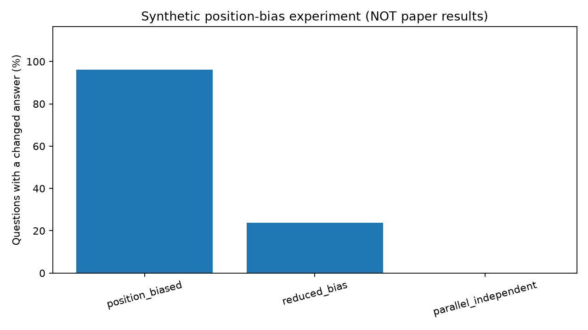

# Maya a1 / Laya Option-Order Sensitivity: Companion Lab

<div align="center">

[](https://www.python.org/)
[]()
[](tests/test_core.py)
[](https://arxiv.org/abs/2611.09803)
[](LICENSE)

*An educational, model-agnostic audit toolkit dissecting option-order sensitivity in multiple-choice language models, cyclic permutation flip rates, slot-bias priors, and parallel layout order-invariance.*

Based on research by Mohammed Nayeem Khan and Logesh L:  
**["Maya a1: Do the Options Read the Model, or Does Their Position?"](https://arxiv.org/abs/2611.09803)** (arXiv:2611.09803, Nov 2026)  
and the upstream **[Laya](https://github.com/NandhaKishorM/laya)** parallel option architecture.

</div>

---

## Executive Summary

When Large Language Models or sequence classifiers evaluate multiple-choice questions, human evaluators assume the model selects options based on semantic merit. In reality, models frequently exhibit severe **positional bias** (option-order sensitivity)—preferring options simply because they appear first, last, or in specific token slots.

In recent empirical findings by Khan & Logesh (2026):
- A baseline classifier flips its predicted choice on **25.8% of questions** simply when the presentation order of options is rotated or permuted.
- Standard fine-tuning without shuffling leaves an **11.4% flip rate**.
- Fine-tuning with random option shuffling reduces flips to **7.2%**.
- A **parallel option layout** (scoring options with isolated, slot-independent attention masks) reduces flips to **0.5%**, establishing near-perfect structural order-invariance.

```
Standard Sequential Presentation (Positional Bias Induced):
Order 1: [ Q: "What causes tides?" | (A) Moon's gravity | (B) Solar winds | (C) Earth's tilt ] -> Predicts (A)
Order 2: [ Q: "What causes tides?" | (A) Earth's tilt   | (B) Moon's gravity | (C) Solar winds ] -> Predicts (A) !
                                                                                                    (FLIP!)
Parallel / Slot-Independent Presentation (Order-Invariant by Construction):
Score(Moon's gravity) = 2.45   (Evaluated identically regardless of slot index)
Score(Earth's tilt)   = 0.12
Score(Solar winds)    = -0.40  -> ALWAYS selects Moon's gravity (Flip Rate: 0.0%)
```

This companion laboratory provides an open-source, model-agnostic testing harness to audit any model's predictions, measure question-level flip rates with cluster bootstrap confidence intervals, diagnose slot priors using identical-input probes, and explore how training data shuffling eliminates learned position confounds.

---

## Visual Gallery: Flip Rates Across Presentation Paradigms

<div align="center">



*Figure 1: Flip rate audit across 240 synthetic multiple-choice questions (3-, 5-, and 12-options) under (1) Strong Positional Bias (96.3% flip rate), (2) Reduced Positional Bias (23.8% flip rate), and (3) Parallel / Slot-Independent Scoring (0.0% flip rate, exact invariance).*

</div>

---

## Rigorous Scope & Pedagogical Disclosures

> [!IMPORTANT]
> **What this laboratory provides:**
> - A pure Python (standard library core) auditing toolkit for multiple-choice order sensitivity.
> - An exact mathematical implementation of question-level flip rates, cyclic rotation generation, Total Variation (TV) slot prior calculations, confidence-weighted plurality voting, and cluster bootstrap confidence intervals.
> - A synthetic softmax training ablation demonstrating how position-confounded training data induces slot bias and how training-time option shuffling restores order robustness.
> - A production-ready JSONL ingestion CLI (`analyze`) to audit external models (including real Laya, ModernBERT, or LLM outputs) given canonical option IDs.
>
> **What this laboratory does NOT do:**
> - It does **not** download the 421M Laya checkpoint or bundle the proprietary 951 teacher-filtered benchmark questions.
> - Numerical outputs in `demo` and `train` are generated pedagogically from synthetic signals to demonstrate the mathematics transparently on any CPU in milliseconds without GPU requirements.

---

## Mathematical Foundations

### 1. Positional Bias Formulation

Let $q$ denote a question context and $C = \{c_1, \dots, c_K\}$ denote candidate answer options. When presented in permutation order $\pi = (\pi_1, \dots, \pi_K)$, the logit for option $c_k$ at slot $j = \pi(k)$ is modeled as:

$$z(c_k \mid q, \pi) = s(q, c_k) + b_j$$

where $s(q, c_k)$ is the true semantic content score and $b_j$ is the additive positional bias for slot $j$.

The predicted choice is:
$$\hat{y}(\pi) = \arg\max_{k \in \{1 \dots K\}} \left( s(q, c_k) + b_{\pi(k)} \right)$$

If the gap between semantic scores $\Delta s = s(c_1) - s(c_2)$ is smaller than the positional bias gap $\Delta b = b_1 - b_2$, permuting the options will flip the model's decision even though the underlying question and candidates are identical.

### 2. Question-Level Flip Rate

Given a set of presentation orders $\Pi(q)$ evaluated for question $q$:
$$\text{Flipped}(q) = \mathbb{I}\left[ \exists \, \pi_a, \pi_b \in \Pi(q) \text{ such that } \hat{y}(\pi_a) \neq \hat{y}(\pi_b) \right]$$

The overall dataset flip rate is the fraction of unstable questions:
$$\text{FlipRate} = \frac{1}{|Q|} \sum_{q \in Q} \text{Flipped}(q)$$

*Note on Cluster Bootstrap*: Because presentations of the same question share common content and are strongly correlated, standard i.i.d. variance estimation is invalid. This toolkit implements cluster bootstrap resampling at the **question level** to compute valid 95% confidence intervals.

### 3. The Slot Prior & Total Variation Distance

To measure a model's pure positional bias independent of semantic content, the toolkit presents identical candidate options ($c_1 = c_2 = \dots = c_K$):

$$P(\text{slot}_j) = \frac{\exp(b_j)}{\sum_{m=1}^K \exp(b_m)}$$

Under a perfectly order-invariant scorer, $P(\text{slot}_j) = \frac{1}{K}$ (uniform distribution). Positional bias is quantified via Total Variation (TV) distance:
$$\text{TV}(P, U) = \frac{1}{2} \sum_{j=1}^K \left| P(\text{slot}_j) - \frac{1}{K} \right| \in [0, 1]$$

---

## Toolkit Capabilities & CLI Commands

### 1. Synthetic Order-Sensitivity Demo (`demo`)

Generates 240 questions across 3, 5, and 12 options under full cyclic rotations and random permutations, evaluating three scoring regimes:

```bash
python3 -m option_audit demo --out results
```

```
{
  "position_biased": {
    "flip_rate": 0.9625,
    "mean_accuracy": 0.4859
  },
  "reduced_bias": {
    "flip_rate": 0.2375,
    "mean_accuracy": 0.9221
  },
  "parallel_independent": {
    "flip_rate": 0.0,
    "mean_accuracy": 1.0
  }
}
```

### 2. Training Ablation (`train`)

Trains a miniature softmax classifier on intentionally position-confounded data (where gold answers correlate with Slot 0):
- **Arm 1 (No Shuffle)**: Learns heavy slot bias ($b_0 = +1.23, b_1 = -0.58$), yielding **47.3% flip rate** on held-out rotated audits.
- **Arm 2 (Shuffled)**: Randomly permutes options during training, driving slot bias to near zero ($b_0 \approx -0.07, b_1 \approx 0.08$) and reducing flip rate to **3.3%**.

```bash
python3 -m option_audit train --out results/training_ablation.json
```

### 3. External Model Audit (`analyze`)

Ingest JSONL predictions from any external model (e.g. Laya, ModernBERT, Qwen, GPT-4) to compute flip rates, vote accuracy, and slot distributions:

```bash
python3 -m option_audit analyze examples/external_predictions.jsonl --out results/external_audit.json
```

#### JSONL Schema Specification
```json
{
  "id": "ticket-001",
  "gold": "billing",
  "presentations": [
    {
      "order": ["billing", "technical", "other"],
      "scores": {"billing": 2.0, "technical": 0.1, "other": -0.4}
    },
    {
      "order": ["technical", "other", "billing"],
      "scores": {"billing": 1.4, "technical": 0.4, "other": -0.4}
    }
  ]
}
```
*Crucial*: The dictionary keys in `scores` must be the **canonical option IDs** (`"billing"`), not positional slot indices (`0, 1`).

---

## Unit Testing & Verification

18 comprehensive unit tests verify permutation generation, softmax properties, TV distance bounds, stable tie-breaking, and training dynamics:

```bash
python3 -m unittest discover -s tests -v
```

```
test_bias_reveals_flips (test_core.TestAudit.test_bias_reveals_flips) ... ok
test_duplicate_rejected (test_core.TestAudit.test_duplicate_rejected) ... ok
test_identical_options_biased (test_core.TestAudit.test_identical_options_biased) ... ok
test_identical_options_parallel_uniform (test_core.TestAudit.test_identical_options_parallel_uniform) ... ok
test_item_flip (test_core.TestAudit.test_item_flip) ... ok
test_item_nonflip (test_core.TestAudit.test_item_nonflip) ... ok
test_mismatched_permutations_rejected (test_core.TestAudit.test_mismatched_permutations_rejected) ... ok
test_parallel_order_invariance (test_core.TestAudit.test_parallel_order_invariance) ... ok
test_predict_stable_tie (test_core.TestAudit.test_predict_stable_tie) ... ok
test_rotations_count (test_core.TestAudit.test_rotations_count) ... ok
test_rotations_cover_slots (test_core.TestAudit.test_rotations_cover_slots) ... ok
test_sampled_unique (test_core.TestAudit.test_sampled_unique) ... ok
test_sampling_all_possible (test_core.TestAudit.test_sampling_all_possible) ... ok
test_softmax_valid (test_core.TestAudit.test_softmax_valid) ... ok
test_train_same_rows_differ (test_core.TestAudit.test_train_same_rows_differ) ... ok
test_training_shuffling_improves_flip_rate (test_core.TestAudit.test_training_shuffling_improves_flip_rate) ... ok
test_tv_invalid (test_core.TestAudit.test_tv_invalid) ... ok
test_tv_uniform (test_core.TestAudit.test_tv_uniform) ... ok

----------------------------------------------------------------------
Ran 18 tests in 0.028s

OK
```

---

## Repository Structure

```
maya_option_order_lab/
├── LICENSE                     # MIT Open Source License
├── README.md                   # This comprehensive technical guide and audit reference
├── SOURCES.md                  # Literature links, Laya repo details, and reported paper metrics
├── requirements-optional.txt   # Optional plotting dependencies (matplotlib>=3.7.0)
├── option_audit/               # Core audit engine (Python 3.10+ standard library)
│   ├── __init__.py             # Public module exports
│   ├── __main__.py             # CLI entrypoint for demo, train, and analyze subcommands
│   ├── core.py                 # Rotations, TV distance, flip metrics, cluster bootstrap
│   └── train.py                # Synthetic position-bias training ablation
├── examples/                   # Demonstration prediction datasets
│   └── external_predictions.jsonl # Sample 2-question multi-presentation JSONL trace
├── notebooks/                  # Interactive exploration
│   └── order_bias_walkthrough.ipynb # Jupyter notebook walking through order sensitivity
├── results/                    # Generated audit outputs and visualizations
│   ├── external_audit.json     # Output from analyze CLI
│   ├── toy_flip_rates.png      # Bar chart comparing flip rates across 3 regimes
│   ├── toy_metrics.json        # Detailed metrics from demo CLI
│   └── training_ablation.json  # Model weights and flip rates before/after shuffling
└── tests/                      # Formal unit test suite
    └── test_core.py            # 18 mathematical and invariant unit tests
```

---

## Academic References

1. **Mohammed Nayeem Khan, Logesh L (2026)**. *Maya a1: Do the Options Read the Model, or Does Their Position?* arXiv preprint [arXiv:2611.09803](https://arxiv.org/abs/2611.09803).
2. **Nandha Kishor M et al. (2025)**. *Laya: A Parallel Option Classifier Architecture*. [GitHub Repository](https://github.com/NandhaKishorM/laya).
3. **Pouya Pezeshkpour, Estevam Hruschka (2024)**. *Large Language Models Sensitivity to The Order of Options in Multiple-Choice Questions*. Findings of NAACL 2024. [ACL Anthology](https://aclanthology.org/2024.findings-naacl.130/).
4. **Chujie Zheng et al. (2023)**. *Large Language Models Are Not Robust Multiple Choice Selectors*. [arXiv:2309.03882](https://arxiv.org/abs/2309.03882).

---

## License

This companion lab is released under the [MIT License](LICENSE).
