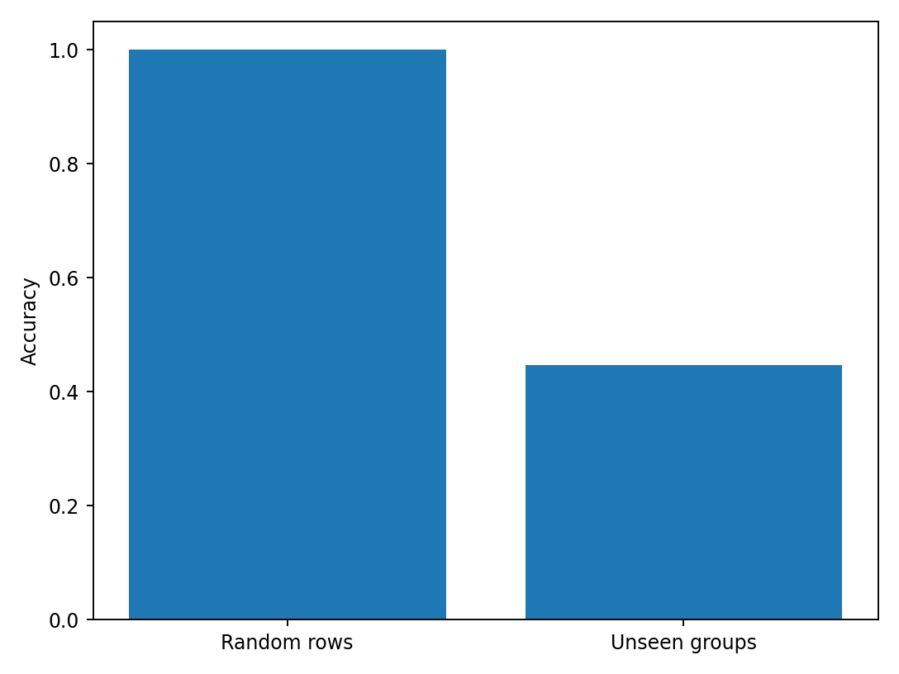
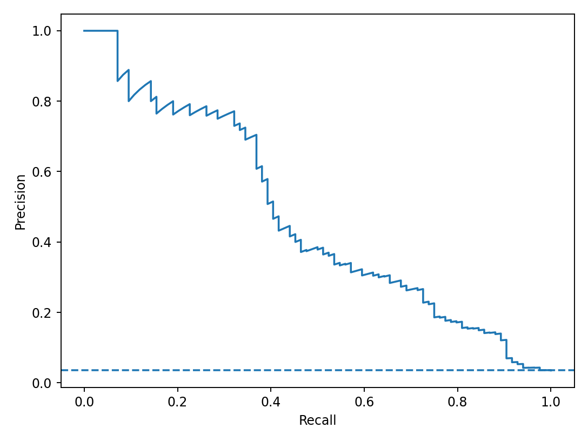
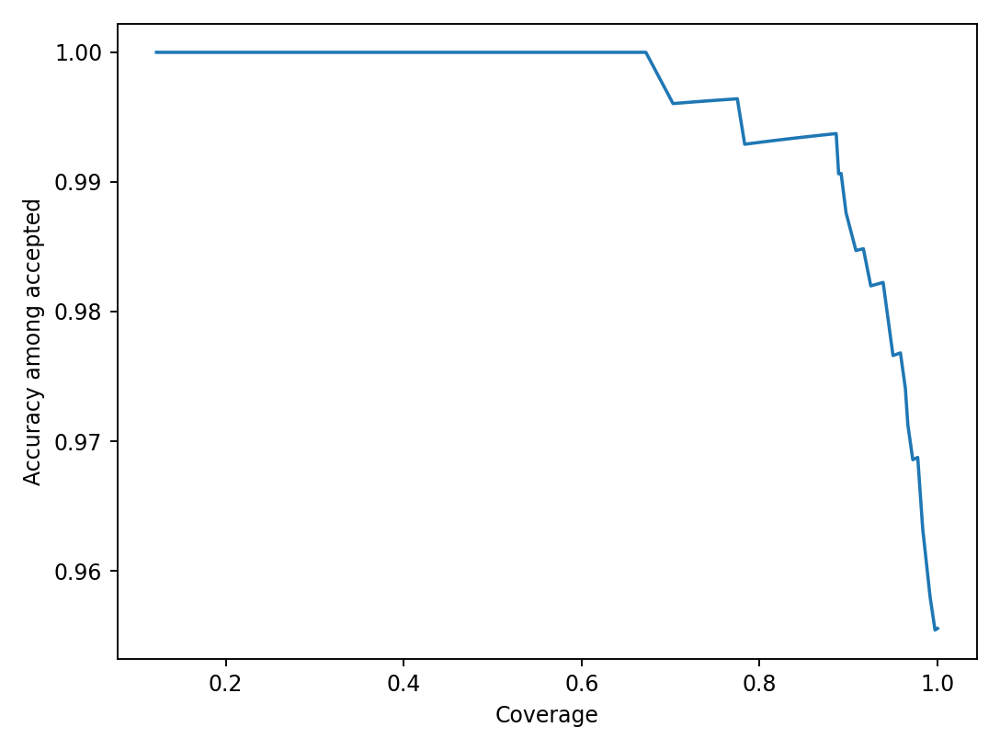
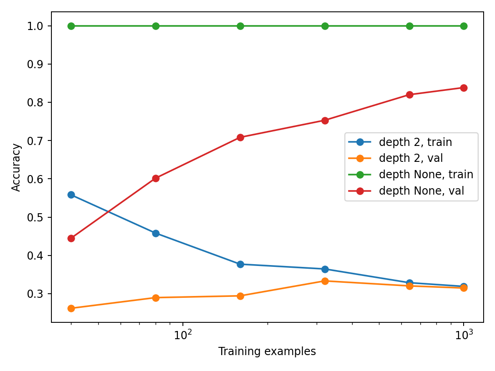
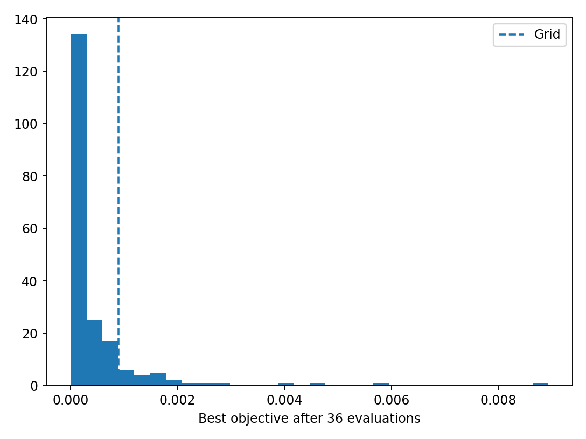

# Practical ML Methodology Lab (Chapter 11)

[](https://www.python.org/)
[](https://scikit-learn.org/)
[](https://pytorch.org/)
[](#verification)

Six controlled CPU-only experiments illustrating core practices in applied machine learning methodology — **group leakage**, **asymmetric-cost thresholding**, **selective prediction (abstention)**, **bias–variance learning curves**, **random vs. grid hyperparameter search**, and **tiny-set overfitting & finite-difference gradient checks** — accompanying [`article.md`](./article.md).

> **Scope note:** All experiments are educational, self-contained synthetic/Digits benchmarks designed to isolate failure modes rather than serve as production policies.

---

## Key Results (`results.json`)

### 1. Group Leakage vs. Unseen Groups
400 entities with 8 noisy observations each and random binary labels per entity (`1-NN` classifier):

| Split strategy | Shared entities (train ∩ test) | Test accuracy |
| --- | ---: | ---: |
| Random row split | 357 | **100.0%** |
| Group shuffle split | 0 | **44.6%** |



### 2. Rare-Event Decision Costs (`cost = FP + 20 × FN`)
12,000 samples with `3.5%` test prevalence (`AP = 0.471`, `Brier = 0.0248`), threshold tuned strictly on validation:

| Policy | Threshold | Accuracy | FP | FN | Total cost |
| --- | ---: | ---: | ---: | ---: | ---: |
| All-negative baseline | `2.000` | 96.5% | 0 | 84 | 1,680 |
| Default threshold | `0.500` | 97.0% | 4 | 69 | 1,384 |
| Validation-selected | `0.035` | 80.3% | 464 | 9 | **644** |



### 3. Selective Prediction (Abstention)
Digits logistic regression with confidence threshold `t = 0.48` chosen on validation for `≥ 98%` accepted accuracy:

| Split & policy | Coverage | Accuracy among accepted |
| --- | ---: | ---: |
| Test (all predictions) | 100.0% | 95.6% |
| Test (threshold `0.48`) | 96.4% | **97.4%** |
| Validation (threshold `0.48`) | 95.5% | 98.3% |



### 4. Learning Curves (Bias vs. Variance)
Decision trees (`max_depth=2` vs. unconstrained `None`) averaged across 3 seeds (`11, 22, 33`) on nested subsets of Digits:
- **`max_depth=2` (high bias):** validation accuracy plateaus near `31.5%` even at `n = 1,000`.
- **`max_depth=None` (variance reduced by data):** validation accuracy climbs from `44.5%` (`n = 40`) to `83.8%` (`n = 1,000`).



### 5. Grid Search vs. Random Search
36 evaluations on a 2D objective with one sensitive coordinate and one nearly flat coordinate (`(x - 0.37)² + 10⁻⁴(z - 0.71)²`):

| Method | Best objective | Random win fraction (200 trials) |
| --- | ---: | ---: |
| 6 × 6 Grid search | `9.01e-4` | — |
| Random search (median) | **`1.06e-4`** | **88.0%** |



### 6. Debugging Sanity Checks
- **Tiny-set overfit (16 Digits examples, 2-layer MLP):** `100.0%` accuracy, final loss `3.08e-4`.
- **Central finite-difference gradient check:** max absolute error `1.79e-11` (`< 1e-8`).

---

## Quickstart

```bash
pip install -r requirements.txt
python3 lab.py
```

## Verification

```bash
python3 -m unittest discover -s tests -v
```

## Files

| Path | Description |
| --- | --- |
| [`lab.py`](./lab.py) | End-to-end script reproducing all six investigations and figures |
| [`results.json`](./results.json) | Saved numerical results across all six investigations |
| [`run.log`](./run.log) | Console output from the reference run |
| [`article.md`](./article.md) | Companion technical write-up |
| [`tests/test_methodology.py`](./tests/test_methodology.py) | Unit and artifact verification suite |
| [`figures/`](./figures) | Generated plots (`leakage.png`, `precision_recall.png`, `coverage.png`, `learning_curves.png`, `search.png`) |
