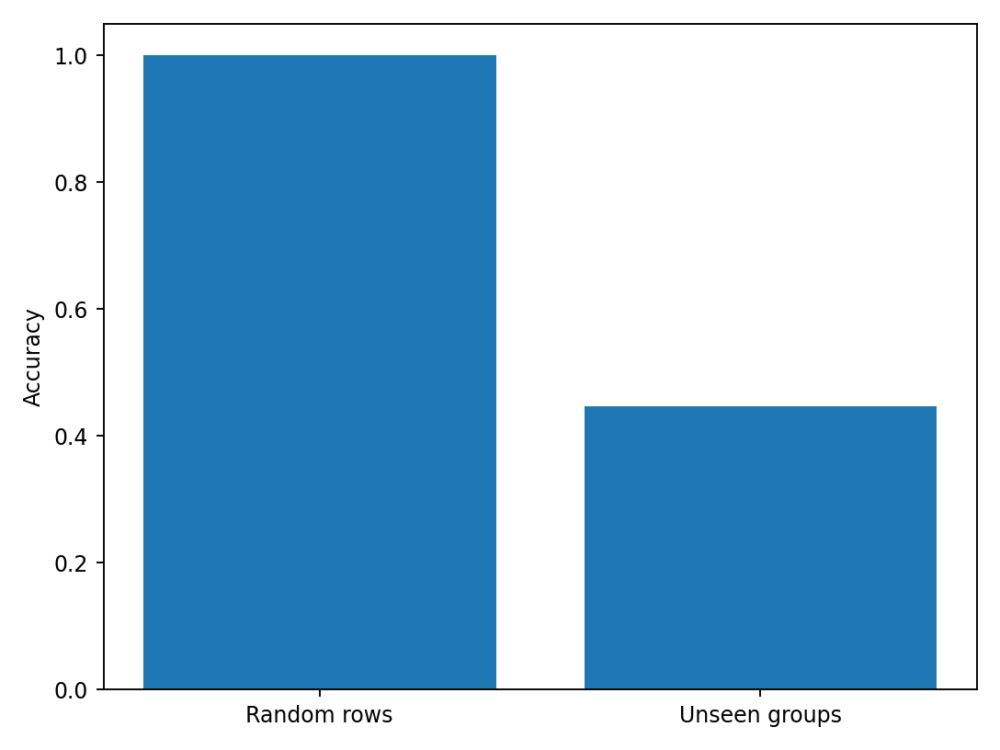
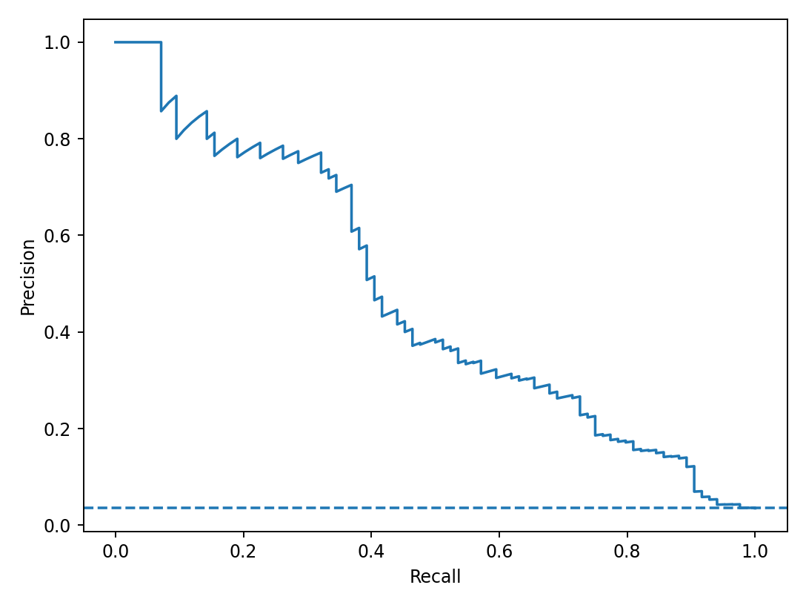
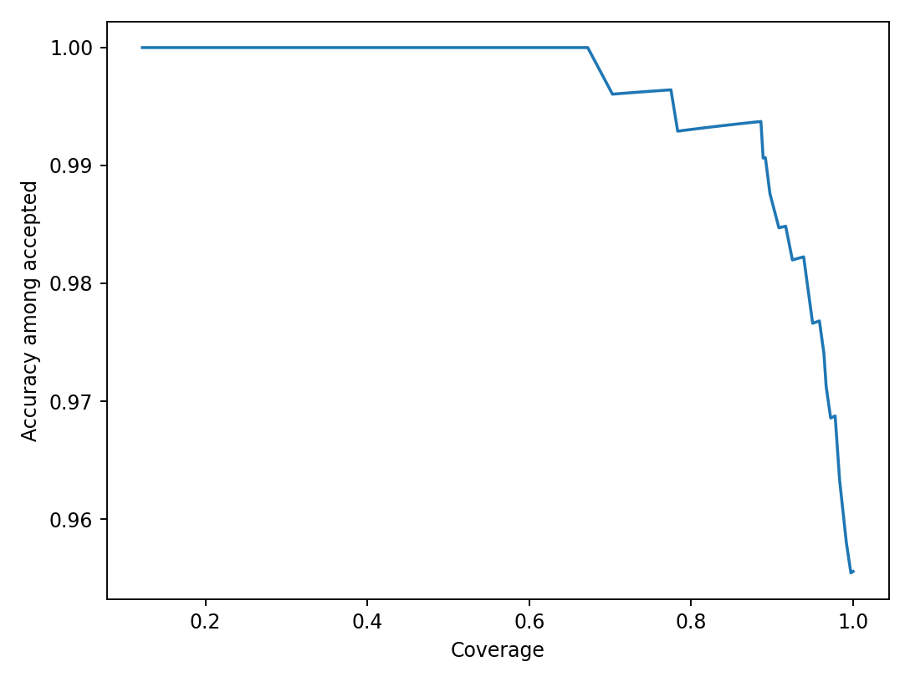
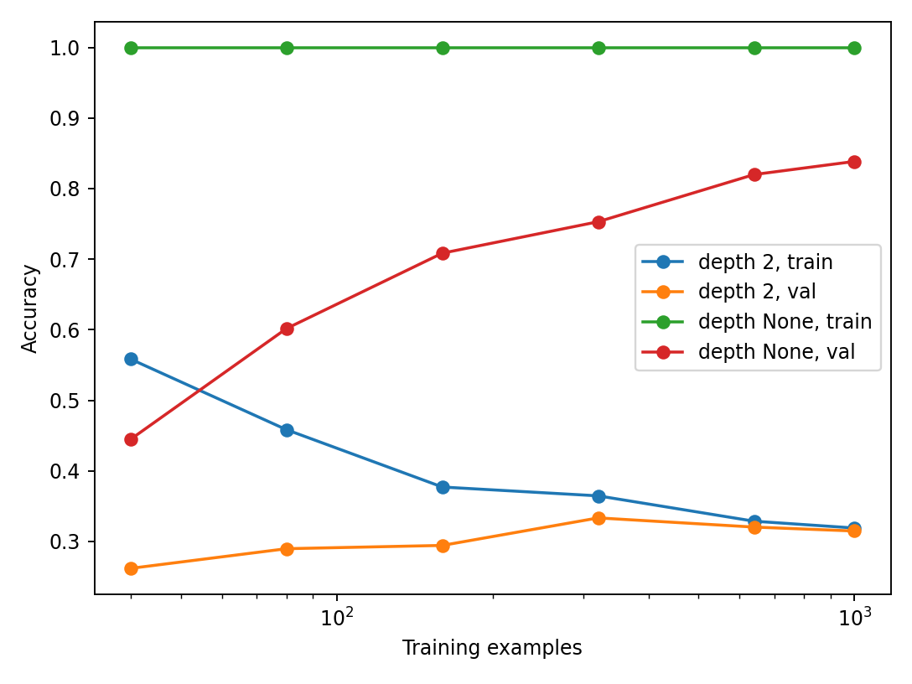
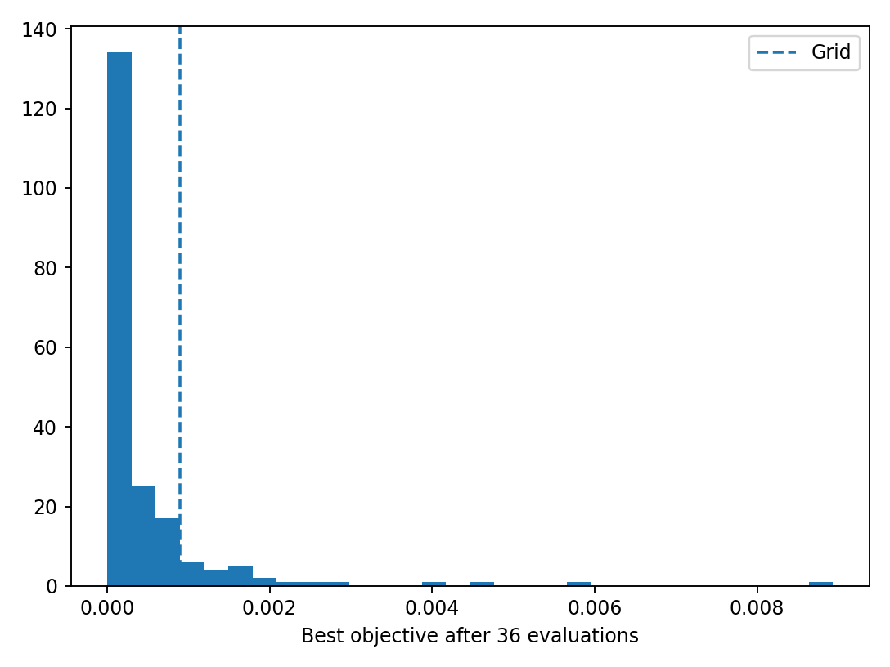

# Your Machine Learning Model Has 99% Accuracy. So Why Is It Failing in Production?

*From data leakage and misleading metrics to hyperparameter optimization, model debugging and reliable evaluation: a research-backed, hands-on guide to building machine learning systems that actually work.*

Imagine spending three weeks training a classifier. The architecture is correct, the validation score looks excellent, and the training loop runs without errors. Then you deploy it on new customers and everything changes. Before opening another notebook to try a larger network, ask a more fundamental question: what did the validation score actually measure?

In our first experiment, a classifier achieves 100% accuracy when evaluated on randomly held-out rows. When we instead hold out entire entities, its accuracy drops to 44.63%. The labels are deliberately random across entities, so the model has no transferable signal to learn. It has learned to identify familiar entities, not to predict unfamiliar ones.

This is the difference between knowing machine learning algorithms and knowing how to build machine learning systems.

## Abstract

This tutorial extends Chapter 11 of Goodfellow, Bengio and Courville (2016) into a practical experimental methodology. Six CPU-compatible studies investigate entity leakage, cost-sensitive classification, selective prediction, learning curves, hyperparameter search and implementation verification. We connect the observations to research on calibration, distribution shift, reproducibility, automated tuning, and contemporary evaluation contamination. All experimental values come from the accompanying executable lab. The studies illustrate mechanisms rather than establish universal model rankings.

**Keywords:** machine learning methodology, data leakage, calibration, selective prediction, hyperparameter optimization, reproducibility.

## Contents

1. Define success before training
2. Build a baseline and protect the split
3. When accuracy is the wrong metric
4. Knowing when not to predict
5. Should we collect more data?
6. Hyperparameter optimization
7. Debugging the learning algorithm
8. The Street View case study
9. From offline experiments to production and LLM evaluation
10. Reproduction and limitations
11. References

## 1. Define success before training

Imagine that you maintain a service that detects suspicious transactions. Your stakeholders do not care whether you use an MLP or a gradient-boosted tree. They care whether the system catches costly events without overwhelming the review team. The training loss is not the business objective. Cross-entropy offers a differentiable signal, while the operational decision is a thresholded prediction whose mistakes may have different costs.

The population risk is the expected loss under the distribution where a model will be used. Empirical risk is its average loss over an observed dataset. The two need not agree. Even an optimal classifier has irreducible error when features do not determine the label. Under 0–1 loss the Bayes error is E[1 − max_y P(y|X)]. That expression is useful because it separates missing information from limited model capacity. No optimization algorithm can recover information that is absent from the inputs.

Goodfellow et al. (2016) recommend selecting a metric and target, establishing an end-to-end baseline, instrumenting the system, then making incremental changes informed by the measurements. We will follow that procedure. A modern addition is to define the unit of independence and deployment population before splitting the data. If our service predicts for new customers, then customers, rather than individual events, are the unit of evaluation.

Write a short experimental contract: what is predicted, at what time, what features are available then, how mistakes are priced, what population is evaluated, and what constraints apply to latency, memory and coverage. A model that improves accuracy while exceeding the review budget may be an inferior system.

## 2. Build a baseline and protect the split

Start with a constant predictor and a model you understand. For tabular data, logistic regression and boosted trees are useful candidates. For images, compare a small CNN or a pretrained feature extractor. For text, consider a sparse linear model, pretrained encoder or an appropriate language-model baseline. The original textbook's 2016 advice favored gated recurrent networks for sequences; modern pretrained transformers and state-space models extend the choice, rather than making recurrence irrelevant. Transfer learning, including contrastive image-text pretraining (Radford et al., 2021), changes the cost of obtaining a useful baseline.

A baseline is not merely a lower score to beat. It is a working measurement instrument. It should use the same split, metrics and available features as the more complicated model. Keep preprocessing fitted on training data only. Use a validation set for model selection, and reserve a test set for final assessment. If data are grouped, temporal or spatial, ordinary random splitting may answer the wrong question.

### Experiment A: a perfect classifier that learns nothing transferable

We create 400 synthetic entities, each with eight observations. Every entity has a random 16-dimensional fingerprint and an independently sampled binary label. Each observation is its fingerprint with small Gaussian noise. A nearest-neighbor classifier can recognize the fingerprint, but the fingerprint has no population-level relationship to the label.

```python
from sklearn.model_selection import GroupShuffleSplit
from sklearn.neighbors import KNeighborsClassifier

splitter = GroupShuffleSplit(n_splits=1, test_size=.25,
                             random_state=42)
train, test = next(splitter.split(X, y, groups))
assert not set(groups[train]) & set(groups[test])
model = KNeighborsClassifier(n_neighbors=1)
model.fit(X[train], y[train])
print(model.score(X[test], y[test]))
```

The full lab compares two splitting procedures. Random row splitting produces 100% accuracy, with 357 entities appearing in both partitions. Group splitting produces 44.625% accuracy, with zero overlapping entities. The latter is a finite-sample result around the chance-level behavior expected for independent random labels, not evidence of systematic inverse prediction.



*Figure 1. Original experiment: random-row versus held-out-entity accuracy. The two evaluation populations differ by design.*

This mechanism is related to data leakage, but whether overlap is inappropriate depends on deployment. If predicting new observations of known customers is the actual task, entity overlap may be legitimate, provided temporal ordering and feature availability are respected. If the task is generalization to unseen customers, it is not.

Kaufman et al. (2012) formalized leakage as information about the target that should not be available to the learner. Kapoor and Narayanan (2023) documented leakage-related reproducibility issues across scientific fields. Varma and Simon (2006) showed why using the same cross-validation procedure to tune and estimate error can introduce bias. The solution is not a magic random seed: it is designing an evaluation that matches the intended use.

Practical examples include fitting supervised feature selection before cross-validation, generating augmented copies before splitting, computing target encodings from held-out labels, or including an event that occurs after prediction time. Scaling before splitting is also improper, although its impact varies by dataset and algorithm. Put fitted transformations inside a pipeline so they are refitted independently in each fold.

## 3. When accuracy is the wrong metric

Suppose 35 out of every 1,000 events are positive. Predicting negative for every event gives 96.5% accuracy. It also detects nothing. The confusion matrix exposes this failure: true positives (TP), false positives (FP), true negatives (TN), and false negatives (FN).

Precision = TP / (TP + FP)

Recall = TP / (TP + FN)

F1 = 2 × precision × recall / (precision + recall)

Precision is undefined when no positives are predicted, although software may adopt zero or another convention. Recall is undefined when the evaluation set has no true positives. Report denominators and conventions. The textbook's rare-disease illustration is intended to demonstrate the accuracy paradox; a classifier making no positive predictions does not have a meaningful perfect precision estimate.

ROC curves describe true-positive versus false-positive rates. Precision-recall curves describe the quality of positive predictions as recall changes. Saito and Rehmsmeier (2015) explain why PR curves are especially useful for imbalanced tasks. Average precision is a particular weighted sum of precision over recall increments, not necessarily identical to trapezoidal PR area. Its random-ranking baseline is approximately the positive prevalence.

### Experiment B: lower accuracy, better decisions

Generate 12,000 synthetic examples using scikit-learn, with a nominal 3% positive class and default label noise. Fit a standardized logistic regression on 60%, choose a threshold on 20%, and evaluate on the remaining 20%. In this toy application a false negative costs 20 units and a false positive costs one. This cost ratio is illustrative, not a real fraud or medical policy.

```python
import numpy as np
from sklearn.metrics import confusion_matrix

def cost(y, p, threshold):
    tn, fp, fn, tp = confusion_matrix(
        y, p >= threshold, labels=[0, 1]).ravel()
    return fp + 20 * fn

threshold = min(np.linspace(0, 1, 201),
                key=lambda t: cost(y_val, p_val, t))
```

On 2,400 held-out examples, the all-negative baseline achieves 96.50% accuracy and incurs cost 1,680. At threshold 0.5, the logistic model achieves 96.96% accuracy, misses 69 of 84 positives, and incurs cost 1,384. Validation selects threshold 0.035. On test, this policy detects 75 positives, misses nine, and produces 464 false positives. Accuracy falls to 80.29%, but cost falls to 644. The model weights have not changed.



*Figure 2. Test precision-recall curve. Average precision is 0.4714; the horizontal baseline represents prevalence 0.035.*

If p is a calibrated probability, predicting positive costs C_FP(1−p) in expectation, and predicting negative costs C_FN p. Choose positive when p ≥ C_FP/(C_FP+C_FN). For this example the theoretical threshold is 1/21 ≈ 0.0476. Our empirical threshold differs because of finite validation data, imperfect calibration and the discrete candidate grid. A review capacity constraint can change the optimal policy again.

Discrimination and calibration are different. A ranking can be good while its probabilities are unreliable. The Brier score is the mean squared probability error (Brier, 1950); our binary test Brier score is 0.02483. A constant prevalence predictor has a Brier score near prevalence × (1−prevalence), so always interpret it relative to a baseline. Reliability diagrams group predictions into probability bins and compare observed frequencies with predicted probabilities. Expected calibration error depends on binning and sample size. Guo et al. (2017) found temperature scaling useful for modern neural classifiers: divide logits by a positive fitted temperature before softmax. Fit it on validation or separate calibration data, never the final test set. It does not change the argmax, and cannot repair every distribution shift (Ovadia et al., 2019).

## 4. Knowing when not to predict

A production system can sometimes abstain and route a case to a human. If the model accepts only high-confidence predictions, evaluate both the accepted accuracy and the acceptance rate, called coverage. Selective risk is the error conditional on acceptance. With no accepted examples it is undefined, not zero.

Chow (1970) studied optimal recognition with rejection. Geifman and El-Yaniv (2017) extended selective classification to deep networks. SelectiveNet (2019) learns a rejection mechanism jointly with the prediction model. Conformal prediction offers a different approach: output a set of labels with marginal coverage under exchangeability, using a calibration quantile (Angelopoulos & Bates, 2023). This is not a guarantee of 98% accuracy for every individual or subgroup, nor a guarantee under arbitrary distribution shift.

### Experiment C: a confidence threshold is not a guarantee

Train logistic regression on the handwritten digits dataset with a fixed 60/20/20 stratified split. Choose the lowest confidence threshold on a 0.01 grid that achieves at least 98% accepted accuracy on validation. Use that threshold unchanged on test.

```python
confidence = probabilities.max(axis=1)
accept = confidence >= threshold
coverage = accept.mean()
accepted_accuracy = (probabilities.argmax(1)[accept]
                     == labels[accept]).mean() if accept.any() else None
```

Validation selected 0.48, achieving 98.25% accepted accuracy at 95.54% coverage. Test accuracy without rejection is 95.56%. With rejection, test coverage is 96.39% and accepted accuracy is 97.41%. We missed the 98% target on unseen examples even though we met it on validation. This is the point: empirical tuning does not certify a guarantee.



*Figure 3. Descriptive test coverage–accuracy trade-off. Only the validation-selected threshold defines the evaluated policy.*

A production requirement could instead use a conservative confidence bound for accepted error on an independent calibration sample. For multiple thresholds, account for selection or use a risk-controlling procedure. Also monitor the review queue, error rate among accepted cases, and coverage across meaningful subgroups. A global coverage target can hide disproportionate rejection of particular populations.

## 5. Should we collect more data?

Suppose training performance is weak. Gathering another million samples may not fix a broken loss function. Conversely, perfect training accuracy with poor validation performance suggests a generalization problem. These are diagnostic hypotheses, not proofs. A distribution shift or incorrectly computed validation metric can create the same pattern.

The useful decomposition is validation error = training error + observed generalization gap, provided both errors use the same metric. This is an arithmetic identity, not the formal bias–variance decomposition. Classical squared-error bias–variance analysis averages across hypothetical training samples; the observed gap is a single empirical quantity.

### Experiment D: learning curves reveal different problems

Use the same digits training and validation pools. For each of three seeded permutations, create nested subsets of 40, 80, 160, 320, 640 and 1,000 examples. Train a depth-two decision tree and an unrestricted tree on every subset, giving 36 fits. Evaluate every model on the same validation set. The validation curve is for development, not a final test estimate.

```python
from sklearn.tree import DecisionTreeClassifier

for n in [40, 80, 160, 320, 640, 1000]:
    ids = permutation[:n]
    model = DecisionTreeClassifier(max_depth=None, random_state=11)
    model.fit(X[ids], y[ids])
    print(model.score(X[ids], y[ids]), model.score(X_val, y_val))
```

At 40 examples, mean unrestricted-tree training accuracy is 100% and validation accuracy is 44.48%. At 1,000 examples, training remains 100% while validation reaches 83.84%. The depth-two tree reaches only 31.90% training and 31.48% validation accuracy at 1,000 examples. Four leaves cannot correctly distinguish ten classes in general. More examples improve the unrestricted tree substantially but do not eliminate the shallow tree's representational limitation.



*Figure 4. Mean training and validation accuracy across three nested-subset permutations. Seeds share the same validation pool and are not independent dataset replications.*

Deep networks complicate this classical picture. Belkin et al. (2019) describe double descent, where test error can decrease again beyond the interpolation threshold. Nakkiran et al. (2020) study deep double descent across model size, training time and data. These findings caution against assuming that every capacity curve must be U-shaped. They do not imply that increasing model size always improves generalization.

Learning curves can also inform acquisition decisions. Hestness et al. (2017), Kaplan et al. (2020) and Hoffmann et al. (2022) investigate empirical scaling behavior. A power-law fit such as L(N) = L_inf + aN^(−b) is a hypothesis, not an invariant law. Extrapolation can fail when the data distribution, model size, training budget or label quality changes. Chinchilla's compute-optimal findings concern particular language-model training regimes, not a universal dataset-to-parameter ratio for every task.

Before collecting more data, inspect representative failures and label quality. Active learning can prioritize informative cases, but introduces a sampling process that must be recorded. Confident learning (Northcutt et al., 2021) uses predicted probabilities to identify potentially problematic labels; flagged examples require review, not automatic deletion. Data quality, diversity and relevance can matter more than raw counts.

## 6. Hyperparameter optimization: spend experiments wisely

Parameters are fitted inside training; hyperparameters determine how training is performed. The objective of hyperparameter optimization (HPO) is validation performance under resource constraints. This is a nested optimization problem, not a replacement for proper evaluation. Cawley and Talbot (2010) explain that model selection itself can overfit finite validation data.

Manual tuning begins with a working learning rate, then capacity, regularization, batch size and training budget. Inspect training loss, not just the final score. A too-small learning rate can resemble underfitting at a fixed budget. A too-large one can destabilize optimization. Tune positive scale parameters logarithmically. Increasing dropout or weight decay can reduce effective capacity; changing depth or width also changes computation. Do not change everything at once when trying to identify a mechanism.

### Experiment E: grid versus random search

Bergstra and Bengio (2012) showed why random search can use trials more efficiently when only a few coordinates matter. We illustrate the mechanism using a synthetic objective, not neural-network training:

J(x,z) = (x−0.37)² + 0.0001(z−0.71)².

The first coordinate matters much more than the second. A six-by-six grid evaluates 36 pairs but only six distinct values of x. Random search evaluates 36 distinct x values almost surely. Across 200 independent 36-evaluation random searches, the median best objective is 0.00010646, versus 0.00090081 for the fixed grid. Random search beats that grid in 88% of trials. It does not win every time; the grid is deterministic and could win if it contains the optimum.



*Figure 5. Distribution of best objective values from 200 random searches, compared with one fixed grid at the same evaluation budget.*

```python
rng = np.random.default_rng(42)
learning_rate = 10 ** rng.uniform(-5, -1)
weight_decay = 10 ** rng.uniform(-6, -2)
```

A log-uniform distribution puts equal mass on equal multiplicative ranges. Include zero as a separate discrete option if no regularization is plausible. Grid search remains useful for a tiny number of discrete parameters or for deliberately mapping a response surface.

### Bayesian optimization and multi-fidelity methods

A Gaussian-process surrogate estimates validation performance and uncertainty at untried configurations. Expected improvement balances promising predictions with uncertainty. For minimization, EI(x) = E[max(f_best − F(x), 0)], where F(x) is the surrogate's predictive random variable. Snoek et al. (2012) applied Bayesian optimization to ML tuning. TPE instead models parameter densities conditional on whether observed scores are good or bad (Bergstra et al., 2011). SMAC uses a model-based approach suitable for mixed configuration spaces (Hutter et al., 2011). None can rescue an invalid validation objective.

Successive halving allocates a small budget to many configurations, promotes the better ones, and increases their resources. Hyperband (Li et al., 2018) explores several breadth-versus-depth trade-offs. ASHA (Li et al., 2020) avoids synchronized waiting by promoting or stopping trials asynchronously. BOHB (Falkner et al., 2018) combines model-based proposals with Hyperband-style allocation. Optuna (Akiba et al., 2019) provides define-by-run search spaces and pruning; population-based training (Jaderberg et al., 2017) adapts hyperparameters during training. Bischl et al. (2023) survey these approaches and practical considerations.

A pruning strategy can discard slow starters that would eventually outperform early leaders. Compare methods at equal resource budgets, count failed trials, and keep a reproducible search log. For expensive neural networks, use a credible low-fidelity proxy rather than assuming a tiny model preserves every ranking. The μTransfer work (Yang et al., 2022) investigates transferring hyperparameters across width under an appropriate parameterization. Its assumptions matter.

A fair HPO experiment uses an outer held-out evaluation and an inner tuning procedure, or nested cross-validation when appropriate. Fit all preprocessing within the inner folds. After selecting a recipe, refit under a documented protocol and evaluate once on the outer test. If you repeatedly use the test to select models, it has become a validation set.

## 7. Debugging the learning algorithm

Ordinary software tests compare a known output with an actual output. ML systems complicate this because expected behavior is learned rather than explicitly specified. Adaptive layers may compensate for bugs elsewhere, so a good accuracy score cannot prove every component works. The textbook recommends creating cases simple enough to predict and isolating components (Goodfellow et al., 2016).

### Experiment F: make the problem small enough to solve

Take 16 digits examples and train a 64→64→10 ReLU MLP with Adam at 0.01 for 300 full-batch updates. Our run attains 100% training accuracy and final recorded loss 0.00030805. This proves the small model and training loop can fit those examples, not that they generalize. If this test fails, inspect parameter registration, labels, tensor shapes, loss reduction, gradient flow and optimizer updates before scaling up.

```python
model.train()
for _ in range(300):
    optimizer.zero_grad()
    loss = torch.nn.functional.cross_entropy(model(x), y)
    loss.backward()
    optimizer.step()
assert (model(x).argmax(1) == y).all()
```

Disable stochastic augmentation and heavy regularization for this sanity check. Confirm that labels have the expected encoding and that cross-entropy receives logits, not already-softmaxed probabilities. A classification network that cannot fit one example may have a bug, but contradictory labels or hard architectural constraints can also prevent memorization.

### Verify derivatives independently

For a smooth scalar function f, a centered finite difference estimates the i-th partial derivative as [f(w+εe_i) − f(w−εe_i)]/(2ε). Taylor expansion gives truncation error of order ε² under suitable smoothness. Roundoff grows as ε becomes too small. Use float64 and several perturbation sizes. Avoid nondifferentiable kinks during gradient checks.

```python
w = np.array([.2, -.4, 1.])
f = lambda w: np.sum(np.sin(w) + w*w)
eps = 1e-5
numerical = np.array([(f(w+eps*e)-f(w-eps*e))/(2*eps)
                      for e in np.eye(len(w))])
analytical = np.cos(w) + 2*w
assert np.max(abs(numerical-analytical)) < 1e-8
```

The measured maximum absolute error is 1.79 × 10⁻¹¹. For large operators, check directional derivatives by projecting inputs and outputs along random vectors. PyTorch's `torch.autograd.gradcheck` provides a practical tool for custom differentiable operations. Complex-step differentiation (Squire & Trapp, 1998) avoids subtractive cancellation for analytic functions supporting complex arithmetic; it is not appropriate for arbitrary ReLU, absolute-value or branching operations.

Monitor activation and gradient histograms per layer. For a rectifier, measure the fraction of zeros and units that remain inactive across diverse batches. Inspect gradient RMS and actual update-to-weight norms. For adaptive optimizers the update is not simply learning rate times gradient. A relative update norm is a diagnostic, not a universal 1% target. Check finite values before and after the optimizer step. Test checkpoint save/load parity, evaluation mode, dropout and BatchNorm behavior. Fix random seeds where useful, but remember deterministic execution can depend on hardware and software versions.

Finally, inspect high-confidence mistakes, not just aggregate scores. Sort wrong predictions by confidence, inspect labels and inputs, and tag failure categories. A small manually reviewed error sample can direct engineering effort toward a broken preprocessing stage rather than a new architecture.

## 8. The Street View case study: fix the pipeline, not the network

Goodfellow et al. (2014) studied multi-digit recognition for Street View imagery. The textbook's retrospective describes an operational objective of 98% transcription accuracy with at least 95% coverage. This is a separate target from the paper's reported per-digit benchmark accuracy; do not conflate the metrics.

The initial system used a CNN baseline. A more principled sequence likelihood improved rejection decisions. Training and evaluation errors were similar, suggesting that simply adding data might not be the best immediate intervention. Reviewing confident errors revealed images whose crops omitted digits. The team widened the crop regions, and the textbook reports a ten-percentage-point coverage improvement. Subsequent capacity tuning improved performance further. The important lesson is not that wider crops always work. It is that error inspection identified a mechanism which an aggregate metric could not reveal (Goodfellow et al., 2016, Chapter 11).

For your own OCR pipeline, keep raw inputs, crop coordinates, transformed images and outputs linked by an identifier. Evaluate detection, transcription and end-to-end accuracy separately. A perfect recognizer cannot transcribe a digit that never reaches it. Modern OCR may use CTC or encoder-decoder architectures, but those architectures still depend on valid inputs and appropriate metrics.

## 9. From offline experiments to production and LLM evaluation

Sculley et al. (2015) described hidden technical debt in ML systems: dependencies, feedback loops and changing data can dominate the maintenance cost. Breck et al. (2017) proposed an ML test score covering data, models, infrastructure and monitoring. Gebru et al. (2021) and Mitchell et al. (2019) proposed datasheets and model cards to document provenance, intended use and evaluation limitations.

Distribution shift is not one phenomenon. Covariate shift changes P(X), label shift changes P(Y) under particular conditional invariance assumptions, and concept shift changes P(Y|X). Dataset shift can combine them. Monitoring input drift does not prove accuracy has declined; monitoring accuracy requires outcomes, which may arrive late or selectively. WILDS (Koh et al., 2021) provides benchmarks involving naturally occurring shifts. Underspecification (D'Amour et al., 2022) describes how pipelines can return similarly performing in-distribution models with very different deployment behavior. Shortcut learning (Geirhos et al., 2020) describes reliance on predictive but brittle cues. Slice metrics and stress tests can expose such behavior even when aggregate validation looks good.

### Recent research: why evaluation methodology remains active

DataSAIL (2025) investigates similarity-aware data splitting for biological ML tasks intended to generalize beyond related examples. Its goal is particularly relevant where random splits put nearly identical molecules or proteins in both partitions. This is a sophisticated relative of our entity-splitting demonstration, not the same algorithm. A 2026 addendum is linked on the publication page.

Choi et al. (2025) propose Kernel Divergence Score for detecting LLM benchmark contamination by examining embedding similarity changes around benchmark fine-tuning. Bordt et al. (2025) study the problem of forgetting contamination. These studies show why an apparently strong language-model score must be interpreted with knowledge of training and evaluation data. Contamination detection is imperfect, especially for proprietary pretraining corpora. A recent controlled preprint, *Not All Data Leakage Is Equal* (2026), investigates several leakage mechanisms separately; its conclusions are preliminary and not independently replicated here.

For LLM applications, evaluate the entire pipeline: retrieval, generation, tool execution and final task success. A RAG system with excellent answer accuracy may still have poor retrieval recall or unsupported citations. Record prompt templates, model versions, sampling settings, tool traces, and data provenance. Keep user or task families separated when relevant. Evaluate semantic correctness with human adjudication where feasible; automated judges can introduce position, verbosity and self-preference biases (Zheng et al., 2023). Use pairwise or rubric-based assessment with randomized presentation and report agreement. HELM (Liang et al., 2023) advocates multidimensional evaluation rather than one aggregate score.

A practical deployment gate combines offline holdout metrics, representative slices, calibration, latency and cost. Shadow evaluation tests predictions without acting on them; controlled rollout and rollback criteria reduce operational risk. A/B tests can measure downstream outcomes, but randomization, interference, delayed labels and repeated testing need attention. Production monitoring should distinguish service failure, feature drift and observed quality degradation. Record changes and evaluate retrained models against an appropriate fresh test population.

## 10. Reproduce the experiments

```bash
python -m venv .venv
source .venv/bin/activate
pip install -r requirements.txt
python lab.py
```

The companion lab writes `results.json`, five PNG figures, and console measurements. It uses synthetic data and scikit-learn's bundled digits dataset, so no external dataset or GPU is required. The code snippets above illustrate portions of the full implementation; variables such as split indices and probabilities are defined in the runnable lab.

Try these extensions: change the entity fingerprint noise and group sizes; vary the false-negative cost and compare threshold policies; bootstrap the selective classifier's accepted accuracy with an independent calibration design; add a regularized tree or a pretrained model to the learning curve; rotate the synthetic HPO objective and compare random search with a surrogate-based method; intentionally corrupt an analytical derivative and verify that the test catches it. In each case, write the hypothesis and measurement protocol before examining results.

### Limitations and conclusion

These are small controlled experiments, not industrial benchmarks. The leakage task is deliberately constructed with random labels. The cost model is hypothetical. The selective predictor does not certify a statistical accuracy guarantee. Learning curves reuse a single validation split. Random search is compared on an intentionally anisotropic synthetic objective rather than a trained model. The gradient check tests a smooth analytical function, not every neural-network operator. Contemporary research is discussed from the literature, not reproduced at scale. The review is selective, not an exhaustive systematic review.

The most important skill here is deciding what evidence would change your mind. If training loss is high, test whether the optimization loop works. If validation is suspiciously good, audit the split. If predictions are accurate but expensive, change the metric and decision policy. If errors cluster, inspect those cases. If a larger model does not help, reconsider the information entering the system.

The next time you see a disappointing model, resist the urge to change its architecture immediately. First find out what problem you are actually solving.

## References

- Goodfellow, I., Bengio, Y., & Courville, A. (2016). *Deep Learning*, Chapter 11: Practical Methodology. MIT Press. https://www.deeplearningbook.org/contents/guidelines.html
- Goodfellow, I., et al. (2014). Multi-digit number recognition from Street View imagery using deep convolutional neural networks. ICLR. https://arxiv.org/abs/1312.6082
- Brier, G. W. (1950). Verification of forecasts expressed in terms of probability. Monthly Weather Review. https://doi.org/10.1175/1520-0493(1950)078%3C0001:VOFEIT%3E2.0.CO;2
- Chow, C. K. (1970). On optimum recognition error and reject tradeoff. IEEE Transactions on Information Theory. https://doi.org/10.1109/TIT.1970.1054406
- Kaufman, S., Rosset, S., Perlich, C., & Stitelman, O. (2012). Leakage in data mining: Formulation, detection, and avoidance. ACM TKDD. https://doi.org/10.1145/2382577.2382579
- Kapoor, S., & Narayanan, A. (2023). Leakage and the reproducibility crisis in machine-learning-based science. Patterns. https://doi.org/10.1016/j.patter.2023.100804
- Varma, S., & Simon, R. (2006). Bias in error estimation when using cross-validation for model selection. BMC Bioinformatics. https://doi.org/10.1186/1471-2105-7-91
- Cawley, G., & Talbot, N. (2010). On over-fitting in model selection and subsequent selection bias in performance evaluation. JMLR. https://jmlr.org/papers/v11/cawley10a.html
- Saito, T., & Rehmsmeier, M. (2015). The precision-recall plot is more informative than the ROC plot when evaluating binary classifiers on imbalanced datasets. PLOS ONE. https://doi.org/10.1371/journal.pone.0118432
- Guo, C., et al. (2017). On calibration of modern neural networks. ICML. https://proceedings.mlr.press/v70/guo17a.html
- Ovadia, Y., et al. (2019). Can you trust your model's uncertainty? Evaluating predictive uncertainty under dataset shift. NeurIPS. https://arxiv.org/abs/1906.02530
- Geifman, Y., & El-Yaniv, R. (2017). Selective classification for deep neural networks. NeurIPS. https://arxiv.org/abs/1705.08500
- Geifman, Y., & El-Yaniv, R. (2019). SelectiveNet. ICML. https://proceedings.mlr.press/v97/geifman19a.html
- Angelopoulos, A. N., & Bates, S. (2023). Conformal prediction: A gentle introduction. https://arxiv.org/abs/2107.07511
- Belkin, M., et al. (2019). Reconciling modern machine-learning practice and the classical bias–variance trade-off. PNAS. https://doi.org/10.1073/pnas.1903070116
- Nakkiran, P., et al. (2020). Deep double descent. ICLR. https://arxiv.org/abs/1912.02292
- Hestness, J., et al. (2017). Deep learning scaling is predictable, empirically. https://arxiv.org/abs/1712.00409
- Kaplan, J., et al. (2020). Scaling laws for neural language models. https://arxiv.org/abs/2001.08361
- Hoffmann, J., et al. (2022). Training compute-optimal large language models. https://arxiv.org/abs/2203.15556
- Northcutt, C., Jiang, L., & Chuang, I. (2021). Confident learning. JAIR. https://arxiv.org/abs/1911.00068
- Bergstra, J., & Bengio, Y. (2012). Random search for hyper-parameter optimization. JMLR. https://jmlr.org/papers/v13/bergstra12a.html
- Bergstra, J., et al. (2011). Algorithms for hyper-parameter optimization. NeurIPS. https://papers.nips.cc/paper/4443-algorithms-for-hyper-parameter-optimization
- Snoek, J., Larochelle, H., & Adams, R. (2012). Practical Bayesian optimization of machine learning algorithms. NeurIPS. https://arxiv.org/abs/1206.2944
- Hutter, F., Hoos, H., & Leyton-Brown, K. (2011). Sequential model-based optimization for general algorithm configuration. LION. https://doi.org/10.1007/978-3-642-25566-3_40
- Li, L., et al. (2018). Hyperband. JMLR. https://jmlr.org/papers/v18/16-558.html
- Li, L., et al. (2020). A system for massively parallel hyperparameter tuning. MLSys. https://arxiv.org/abs/1810.05934
- Falkner, S., Klein, A., & Hutter, F. (2018). BOHB. ICML. https://proceedings.mlr.press/v80/falkner18a.html
- Akiba, T., et al. (2019). Optuna. KDD. https://arxiv.org/abs/1907.10902
- Jaderberg, M., et al. (2017). Population based training of neural networks. https://arxiv.org/abs/1711.09846
- Bischl, B., et al. (2023). Hyperparameter optimization: Foundations, algorithms, best practices, and open challenges. https://doi.org/10.1002/widm.1484
- Yang, G., et al. (2022). Tensor Programs V: Tuning large neural networks via zero-shot hyperparameter transfer. https://arxiv.org/abs/2203.03466
- Squire, W., & Trapp, G. (1998). Using complex variables to estimate derivatives of real functions. SIAM Review. https://doi.org/10.1137/S003614459631241X
- Radford, A., et al. (2021). Learning transferable visual models from natural language supervision. ICML. https://proceedings.mlr.press/v139/radford21a.html
- Sculley, D., et al. (2015). Hidden technical debt in machine learning systems. NeurIPS. https://papers.nips.cc/paper/5656-hidden-technical-debt-in-machine-learning-systems
- Breck, E., et al. (2017). The ML test score. IEEE Big Data. https://doi.org/10.1109/BigData.2017.8258038
- Gebru, T., et al. (2021). Datasheets for datasets. CACM. https://arxiv.org/abs/1803.09010
- Mitchell, M., et al. (2019). Model cards for model reporting. FAT*. https://arxiv.org/abs/1810.03993
- Koh, P. W., et al. (2021). WILDS: A benchmark of in-the-wild distribution shifts. ICML. https://proceedings.mlr.press/v139/koh21a.html
- D'Amour, A., et al. (2022). Underspecification presents challenges for credibility in modern machine learning. JMLR. https://jmlr.org/papers/v23/20-1335.html
- Geirhos, R., et al. (2020). Shortcut learning in deep neural networks. Nature Machine Intelligence. https://arxiv.org/abs/2004.07780
- Data splitting to avoid information leakage with DataSAIL (2025). Nature Communications. https://www.nature.com/articles/s41467-025-58606-8
- Choi, H. K., Khanov, M., Wei, H., & Li, Y. (2025). How contaminated is your benchmark? ICML. https://proceedings.mlr.press/v267/choi25b.html
- Bordt, S., Srinivas, S., Boreiko, V., & von Luxburg, U. (2025). How much can we forget about data contamination? ICML. https://proceedings.mlr.press/v267/bordt25a.html
- Not All Data Leakage Is Equal: A Controlled Benchmark of Evaluation Inflation in Tabular Classification (2026). Preprint. https://arxiv.org/abs/2611.18598
- Zheng, L., et al. (2023). Judging LLM-as-a-judge with MT-Bench and Chatbot Arena. NeurIPS. https://arxiv.org/abs/2306.05685
- Liang, P., et al. (2023). Holistic evaluation of language models. TMLR. https://arxiv.org/abs/2211.09110
