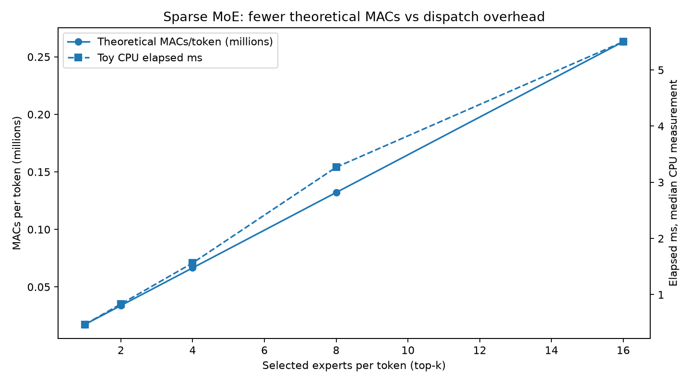

# Trillion-Parameter Illusion: Companion MoE Lab

[](https://www.python.org/downloads/)
[](https://numpy.org/)
[](https://matplotlib.org/)
[](tests/)
[](LICENSE)
[](moe_lab/)

A small, **CPU-only** and fully reproducible learning lab for the article about Kimi K3.1 Pro, Mistral Large 4, Tencent Hy4 and Inkling 2 Small (source verification date: 2026-11-07).

**No model weights are downloaded.** This project demonstrates the underlying ideas, not the proprietary implementations or their benchmark results.

## Learning outcomes

1. Build a tiny Mixture-of-Experts feed-forward block with a top-k router in NumPy.
2. Verify that choosing all experts reproduces a dense all-expert mixture.
3. Watch active parameters and theoretical multiply-accumulates (MACs) change with `top_k`, while stored weights remain constant.
4. See why CPU Python dispatch overhead can mask theoretical compute savings.
5. Estimate theoretical weight capacity for four frontier models without pretending that capacity means validated production deployment.
6. Try a conventional KV-cache estimate and understand why MLA/sparse attention needs architecture-specific handling.

## Install and run

Python 3.9+ recommended. In this directory:

```bash
python -m venv .venv
source .venv/bin/activate    # Windows: .venv\Scripts\activate
python -m pip install -r requirements.txt
python -m unittest discover -s tests -v
python -m moe_lab.benchmark --experts 16 --top-k 1,2,4,8,16
python -m moe_lab.plot
python -m moe_lab.planner --bits 4 --csv results/model_capacity.csv
```

Notebook: `MoE_Field_Lab.ipynb` is an optional walkthrough using the same modules.

## Experiments

**Experiment 1: Change k.** With fixed `experts=16`, compare top-k = 1, 2, 4, 8, 16. Expected: *stored* parameter count remains identical; the router and active expert count change; theoretical expert MACs grow with k. The numerical output changes because you are using different experts and renormalized gates. `k=16` should agree with the dense reference.

**Experiment 2: Change expert count.** Repeat with `--experts 8 --top-k 1,2,4,8`, then 32. Expected: stored weights scale with expert count. At the same k and expert width, active expert arithmetic remains close (routing cost still grows with the number of experts).

**Experiment 3: Contrast arithmetic and time.** Examine `results/moe_lab_plot.png`. CPU Python loops, small matrices, and routing overhead can dominate. Do not use these timings to infer speedups on vLLM or real multi-GPU MoE deployments.



**Experiment 4: Memory planning.** For a theoretical baseline:

```bash
python -m moe_lab.planner --bits 4 --weight-overhead-pct 0 --reserve-gb-per-gpu 0 --extra-gb 0
```

Then try a *hypothetical* 10% weight-format overhead, 4 GB reserved per GPU and 100 GB of total cache/buffers:

```bash
python -m moe_lab.planner --bits 4 --weight-overhead-pct 10 --reserve-gb-per-gpu 4 --extra-gb 100
```

These values are **illustrative**, not universally recommended. Real requirements must be measured for a specific architecture and inference stack.

**Experiment 5: KV cache.** Open a Python shell and run:

```python
from moe_lab.planner import conventional_kv_gb
print(conventional_kv_gb(layers=32, kv_heads=8, head_dim=128, tokens=131072, batch=1, bits=16))
```

That is a full-cache textbook estimate. It is **not** a correct estimate for every published frontier model here: they can use MLA, KV latent compression, sparse attention, mixed layers and index caching.

## What's in the folder

- `moe_lab/core.py` - explicit top-k router, expert feed-forward networks, parameter / MAC accounting.
- `moe_lab/benchmark.py` - repeatable timed CPU experiments and CSV generation.
- `moe_lab/planner.py` - capacity estimates, numerical model profiles, conventional KV-cache helper.
- `moe_lab/plot.py` - reproduce an explanatory figure from the CSV.
- `tests/test_lab.py` - correctness checks for routing, reference output, capacity math.
- `results/` - a sample run (your measured times will differ by machine).
- `SOURCES.md` - official upstream docs and verification notes.
- `MoE_Field_Lab.ipynb` - optional beginner-friendly notebook.

## What this lab does not prove

- A toy feed-forward MoE is not a full language model or the architecture of any of the four releases.
- Random expert weights are not trained to specialize.
- Active parameter count is not equivalent to FLOP count for a complete transformer.
- GPU inference requires kernels, expert-parallel communication, routing balance and KV cache.
- Quantized weights use scales and metadata; checkpoint size may exceed the mathematical lower bound.
- Memory sums across H100s are necessary capacity conditions, not sufficient deployment recipes.
- `elapsed_ms_CPU_median` is host-specific; regenerate it before reporting.

## License

Original lab code: MIT, see `LICENSE`. Third-party source links are informational and remain subject to their own licenses. Model names and specs are from their providers and may change.
