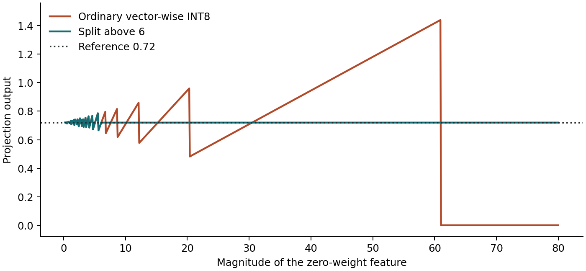

# LLM.int8(): Mixed-Precision Outlier Decomposition

<div align="center">

[](https://www.python.org/)
[](https://numpy.org/)
[](test_lab.py)
[](https://arxiv.org/abs/2208.07339)
[-blueviolet.svg)](https://nn.labml.ai/neox/utils/llm_int8.html)
[](LICENSE)

*A clean, dependency-minimal reference laboratory dissecting the emergent feature outlier problem in large language models (6.7B+), row-wise INT8 quantization with INT32 accumulation, and vector-wise mixed-precision decomposition.*

Based on foundational research by Tim Dettmers, Mike Lewis, Younes Belkada, and Luke Zettlemoyer:  
**["LLM.int8(): 8-bit Matrix Multiplication for Transformers at Scale"](https://arxiv.org/abs/2208.07339)** (NeurIPS 2022).

</div>

---

## Executive Summary

When Large Language Models scale beyond **6.7 billion parameters**, an emergent phase transition occurs in their representations: systematic, high-magnitude outlier features spontaneously develop across a tiny subset ($\approx 0.1\%$) of hidden feature dimensions.

While standard features have magnitudes around $\pm 0.2$ to $\pm 1.0$, outlier dimensions reach values of $\pm 20$ to $\pm 100$. Because uniform INT8 quantization maps the entire dynamic range $[-M, M]$ onto $[-127, 127]$:

$$\text{scale} = \frac{\max(|x|)}{127}$$

A single extreme outlier inflates the scaling denominator, causing all the small non-outlier features (which carry 99.9% of the semantic signal) to round down to **exactly zero**!

```
The Dynamic Range Underflow Problem:
Input row: [ 64.0,  0.24,  0.24,  0.24 ]  (Outlier = 64.0, Non-outliers = 0.24)
Weight row:[  0.0,   1.0,   1.0,   1.0 ]
True Reference Output: 64*0 + 0.24*1 + 0.24*1 + 0.24*1 = 0.720000

Without Decomposition (Threshold = 0):
  scale = 64.0 / 127 ≈ 0.5039
  Non-outlier code = round(0.24 / 0.5039) = round(0.476) = 0!
  Quantized row: [ 127, 0, 0, 0 ]
  Output: 127 * 0 * scale = 0.000000 (100% Information Destruction!)

With LLM.int8() Vector-wise Decomposition (Threshold = 6.0):
  Column 0 (> 6.0) is routed to 16-bit float matrix multiplication.
  Remaining columns [0.24, 0.24, 0.24] scale cleanly without underflow:
  scale = 0.24 / 127 ≈ 0.00189 -> Codes = [127, 127, 127]
  Output: 0.0 (FP16 outlier) + 0.72 (INT8 core) = 0.720000 (Exact Recovery!)
```

This laboratory provides an inspectable, CPU-friendly reference implementation of vector-wise mixed-precision linear projections, isolating the exact arithmetic dynamics of `bitsandbytes.nn.Linear8bitLt` and GPT-NeoX INT8 serving.

---

## Visual Gallery: Quantization Scale Inflation

<div align="center">



*Figure 1: Demonstration of how a growing outlier feature in dimension 0 progressively compresses and zeroes out the effective quantization grid of three neighboring small features.*

</div>

---

## Mathematical Foundations

### 1. Symmetric Row-Wise INT8 Quantization

Given an input matrix $X \in \mathbb{R}^{B \times D_{\text{in}}}$ and weight matrix $W \in \mathbb{R}^{D_{\text{out}} \times D_{\text{in}}}$:

1. **Row-wise absolute maximum scales**:
   $$s_X(i) = \frac{\max_{j} |X_{i, j}|}{127}, \quad s_W(k) = \frac{\max_{j} |W_{k, j}|}{127}$$

2. **Quantized integer representations**:
   $$Q_X(i, j) = \text{clip}\left( \left\lfloor \frac{X_{i, j}}{s_X(i)} \right\rceil, -127, 127 \right) \in \text{int8}$$
   $$Q_W(k, j) = \text{clip}\left( \left\lfloor \frac{W_{k, j}}{s_W(k)} \right\rceil, -127, 127 \right) \in \text{int8}$$

3. **Integer tensor core multiplication & dequantization**:
   $$A = Q_X \cdot Q_W^T \in \text{int32}$$
   $$\hat{Y}_{i, k} = A_{i, k} \cdot \left( s_X(i) \cdot s_W(k) \right)$$

### 2. Vector-Wise Mixed-Precision Decomposition

To prevent extreme values from distorting $s_X(i)$, LLM.int8() sets a coordinate threshold $\alpha \ge 0$ (typically $\alpha = 6.0$):

1. **Outlier Column Selection**:
   $$C = \left\{ j \in \{0, \dots, D_{\text{in}}-1\} : \exists i \text{ s.t. } |X_{i, j}| > \alpha \right\}$$

2. **Input Partitioning**:
   $$X_{\text{outlier}} = X_{*, C} \in \mathbb{R}^{B \times |C|}, \quad X_{\text{ordinary}} = X \text{ with columns in } C \text{ zeroed out}$$

3. **Combined Linear Projection**:
   $$Y = \left( Q_{X_{\text{ord}}} \cdot Q_W^T \right) \odot (S_X S_W^T) + X_{*, C} \cdot W_{*, C}^T + \text{bias}$$

Where:
- The bulk non-outlier product ($\approx 99.9\%$ of coordinates) executes in INT8 with INT32 accumulation.
- The outlier coordinates ($\approx 0.1\%$) execute in higher precision (FP16 or FP32).

---

## Empirical Benchmark & Sweep

Running `lab.py` on a synthetic projection ($B=32$ tokens, $D_{\text{in}}=128$, $D_{\text{out}}=48$, with seeded outliers at dimensions 3 and 91):

```bash
python3 lab.py --threshold 0 6 16 32
```

```
Hand example (reference 0.720000)
threshold=0  output=0.000000  columns=[]
threshold=6  output=0.720000  columns=[0]

Synthetic projection: 32 tokens, 128 input and 48 output features
threshold=0   columns=  0   RMSE=0.039697   max_abs=0.238564  (Full INT8, No Decomposition)
threshold=6   columns=  2   RMSE=0.008386   max_abs=0.034141  (LLM.int8() Optimal: 4.7x Lower RMSE)
threshold=16  columns=  1   RMSE=0.019686   max_abs=0.114139  (Partial Outlier Capture)
threshold=32  columns=  0   RMSE=0.039697   max_abs=0.238564  (Threshold Too High)
```

### Packed Weight Correction Mode (`--packed-correction`)
When deployed in production, models cannot store both INT8 weights and redundant FP16 weights without doubling storage. Instead, correction weights for the outlier slice $C$ are dequantized on-the-fly from the stored INT8 weights:

```bash
python3 lab.py --packed-correction --threshold 6
```
```
threshold=6   columns=  2   RMSE=0.012718   max_abs=0.052670
```

---

## Quickstart & Verification

Requires Python 3.10+ and NumPy:

```bash
cd neox-int8-lab

# 1. Run unit test suite
python3 -m unittest -v

# 2. Run default simulation and threshold sweep
python3 lab.py

# 3. Test packed correction mode
python3 lab.py --packed-correction --threshold 6
```

---

## Unit Testing & Formal Verification

The test suite verifies hand example exact recovery, all-column decomposition bounds, signed outlier handling, bias application, packed weight dequantization, and INT32 accumulation overflow safety:

```bash
python3 -m unittest -v test_lab.py
```

```
test_accumulation_width (test_lab.Int8Tests.test_accumulation_width) ... ok
test_all_columns_bias_once (test_lab.Int8Tests.test_all_columns_bias_once) ... ok
test_hand_example (test_lab.Int8Tests.test_hand_example) ... ok
test_packed_correction (test_lab.Int8Tests.test_packed_correction) ... ok
test_zero_and_union (test_lab.Int8Tests.test_zero_and_union) ... ok

----------------------------------------------------------------------
Ran 5 tests in 0.036s

OK
```

---

## Repository Structure

```
neox-int8-lab/
├── README.md       # This comprehensive engineering and mathematical guide
├── check_cuda.py   # Optional script verifying state-dict loading against bitsandbytes on CUDA
├── lab.py          # Reference NumPy CPU implementation of row-wise INT8 and outlier decomposition
├── scales.png      # Visualization of quantization scale inflation under feature outliers
└── test_lab.py     # 5 unit tests verifying hand-calculated numbers, masks, and accumulation
```

---

## Academic References

1. **Tim Dettmers, Mike Lewis, Younes Belkada, Luke Zettlemoyer (2022)**. *LLM.int8(): 8-bit Matrix Multiplication for Transformers at Scale*. NeurIPS 2022. [arXiv:2208.07339](https://arxiv.org/abs/2208.07339).
2. **LabML.ai (2023)**. *Annotated PyTorch Implementation of GPT-NeoX LLM.int8() Utilities*. [nn.labml.ai](https://nn.labml.ai/neox/utils/llm_int8.html).
3. **Hugging Face & bitsandbytes Team (2023)**. *bitsandbytes Linear8bitLt Layer Documentation*. [Hugging Face Docs](https://huggingface.co/docs/bitsandbytes/reference/nn/linear8bit).

---

## License

This project is released under the [MIT License](../LICENSE).
