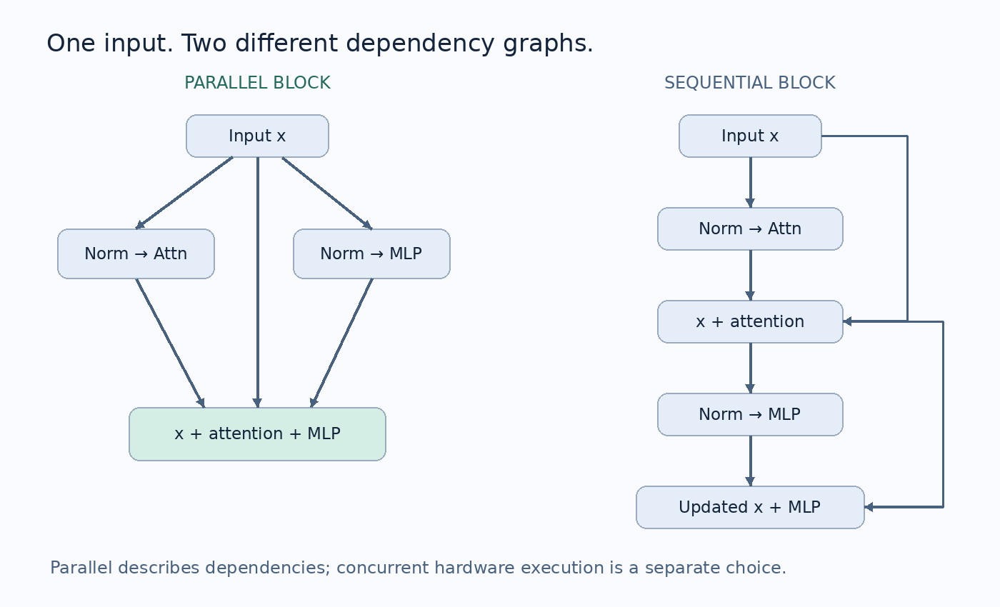
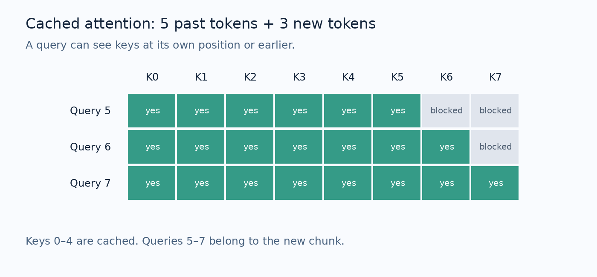

# Your Transformer Passes Every Shape Check. Its KV Cache Can Still Be Wrong.
## Build GPT-NeoX from scratch, prove that cached generation is correct, and fine-tune a small pretrained NeoX-family model

The model loads. Every tensor has the right shape. A forward pass returns logits. Generation even produces something that resembles a sentence.

Then you enable the KV cache, and the continuation changes.

Nothing crashes. There is no helpful exception pointing to the line where the model stopped computing the function you intended. A misplaced rotary offset or a causal mask aligned to the wrong corner can quietly change what each token is allowed to see.

This is why rebuilding a language model is such a useful exercise. You discover that understanding attention means more than recognizing the familiar projection, softmax, and weighted sum. You need to understand the contract between positions, tensor layouts, checkpoint weights, and inference state.

GPT-NeoX is a particularly good model to study this way. Its implementation exposes several decisions that are easy to miss in a high-level API: attention and the MLP read the same block input, rotary embeddings touch only part of each head, and fused query/key/value weights have a specific internal ordering.

We will build those components, train a small model, and test that it behaves consistently. Then we will move to a pretrained Pythia model for generation and bias-only adaptation.

You do not need hardware capable of loading GPT-NeoX-20B to follow the core lab. The default model has **858,880 parameters**, uses a byte vocabulary, and can run on a CPU. Its job is to make the architecture inspectable. The separate pretrained path uses an actual NeoX-family checkpoint and its matching tokenizer.

## Contents

1. What “GPT-NeoX” refers to
2. The model we will build
3. Parallel residual blocks, explained through data flow
4. Fused QKV projections and the silent layout trap
5. Partial rotary embeddings without equations
6. Building attention with an explicit causal mask
7. KV caching: prefill, decoding, and positions
8. Assembling the model
9. Tests that establish more than shape correctness
10. Training a tiny byte-level language model
11. Using a pretrained Pythia model
12. Fine-tuning only the biases
13. Tokenizers and checkpoints form one contract
14. Reading the original distributed checkpoint loader
15. Memory, quantization, and pipeline parallelism
16. Research experiments and debugging
17. What this lab proves, and what it does not
18. References

## 1. What “GPT-NeoX” refers to

There are three related things to keep separate.

**GPT-NeoX is a training codebase.** EleutherAI’s repository provides infrastructure for training autoregressive models with distributed execution. It builds on the Megatron and DeepSpeed ecosystem. [1]

**GPT-NeoX-20B is a released model.** The 2022 paper describes a dense, autoregressive model trained on the Pile. Its released configuration specifies 44 transformer layers, a hidden width of 6,144, 64 attention heads, an MLP width of 24,576, and a context length of 2,048 tokens. Its input and output embeddings are untied. [2, 3]

**The labml implementation is an educational implementation.** It makes model components, checkpoint loading, inference, quantization, and fine-tuning easier to inspect. The source supplied with this tutorial is especially valuable because it puts the tensor operations close to their explanations. [4]

These are not interchangeable download targets. A small model that follows the same block structure is not the released 20B model. A library class named `GPTNeoXForCausalLM` is not itself a pretrained checkpoint. And a working model definition does not automatically know how to reconstruct a distributed training checkpoint.

Our project uses two paths:

- **Architecture path:** implement a small NeoX-style decoder ourselves, with no model download.
- **Pretrained path:** use Transformers to load `EleutherAI/pythia-70m`, including its tokenizer and model configuration.

Pythia is a research-oriented model suite trained with the GPT-NeoX framework. Its 70M model provides a practical checkpoint for this exercise; it has six layers, a hidden width of 512, and eight attention heads. It is a base language model, so the examples use text continuation rather than a chat interface. [5]

## 2. The model we will build

Unzip `GPT_NeoX_Companion_Lab.zip` and enter its `NeoX_Companion_Lab` directory.

Start with Python 3.10–3.12 and a fresh environment:

```bash
python -m venv .venv
source .venv/bin/activate
python -m pip install -r requirements.txt
python test_model.py
```

On Windows PowerShell, activate the environment with `.venv\Scripts\Activate.ps1`.

The default configuration uses a vocabulary of 256 byte values, hidden width 128, four attention heads, four blocks, and an MLP width of 512. Each attention head therefore contains 32 features. A rotary fraction of one quarter means that eight features per head receive rotary position information.

The context budget is 256 bytes. The input embedding and output projection are separate parameters. The MLP uses ordinary GELU, and the model omits dropout. We initialize linear and embedding weights from a normal distribution with standard deviation 0.02.

Those are deliberate teaching choices. This is not an exact recreation of the original model’s training recipe or tokenizer, and its ordinary GELU setting should not be assumed equivalent to every checkpoint’s configured activation.

The essential files are:

- `model.py`, containing the architecture and cached generation.
- `test_model.py`, containing eight behavioral tests.
- `train.py` and `generate.py`, for training and reloading the small model.
- `verify_hf.py`, for comparison against a controlled Hugging Face reference.
- `pretrained.py`, for pretrained generation and bias-only adaptation.
- `download_data.py`, for an optional Tiny Shakespeare download.
- `demo.txt`, a small, original synthetic corpus for offline smoke testing.

The code excerpts below come from the runnable files. When reproducing the experiment, use the complete files in the ZIP; the excerpts concentrate on the operations worth understanding.

## 3. Parallel residual blocks, explained through data flow

Imagine that a transformer block receives the current representation of every token.

In a familiar sequential pre-normalization block, attention reads a normalized version of that representation. Its output is added to the residual stream. The MLP then reads a normalized version of this updated stream.

The MLP can therefore react to attention’s update within the same block.

In the NeoX-style parallel block used here, the two branches both read the original block input. Attention has its own normalization, and the MLP has another. Their outputs are added to the original residual together.

The implementation is short:

```python
def forward(self, x, past=None, use_cache=False):
    attention, present = self.attn(self.attn_norm(x), past, use_cache)
    return x + attention + self.mlp(self.mlp_norm(x)), present
```



Notice which tensor enters `mlp_norm`: it is `x`, not `x + attention`.

This distinction changes the computation even though both alternatives produce the same output shape and contain very similar modules. A shape test will not detect a mistaken substitution.

“Parallel” describes the dependency structure. These two Python calls do not automatically execute simultaneously on a GPU. Kernel scheduling, communication, and implementation choices determine whether independent branches lead to actual overlap or reduced overhead. The original NeoX work discusses the parallel branch design as an architectural and implementation choice. [2]

For our implementation, the practical consequence is simple: preserve the dependency graph before thinking about optimizing it.

## 4. Fused QKV projections and the silent layout trap

A single dense projection can compute queries, keys, and values together. This usually makes the implementation more compact and avoids three separate projection calls.

But a fused tensor needs an ordering convention.

Suppose the input has shape `[batch, tokens, hidden]`. The fused projection produces `[batch, tokens, 3 × hidden]`.

One possible ordering stores all query heads first, then all key heads, then all value heads. Another stores a query segment, key segment, and value segment for each head before moving to the next head.

Both contain the same number of values. Both can be reshaped into plausible tensors. Only one matches a particular checkpoint’s interpretation.

Following the supplied NeoX implementation, our code first separates heads and then splits each head’s query, key, and value segments:

```python
fused = self.qkv(x).view(batch, length, self.heads, 3 * self.head_dim)
q, k, v = [t.transpose(1, 2) for t in fused.chunk(3, dim=-1)]
```

After the transpose, each tensor has shape `[batch, heads, tokens, head_dim]`.

For the default lab model, a batch of two 64-byte sequences produces Q, K, and V tensors with shape `[2, 4, 64, 32]`.

The important lesson is broader than this model: **shape compatibility does not establish semantic compatibility**. If you load fused weights into code using a different layout, either transform the weights deliberately or change the interpretation of the fused output. Do not hope that a successful reshape means the mapping is correct.

Our optional reference test copies a controlled Hugging Face model’s parameters into the custom model and compares logits. That test is much more informative than checking that every weight fits.

## 5. Partial rotary embeddings without equations

A token’s position must influence how it interacts with other tokens. Rotary positional embeddings do this by rotating pairs of query and key features according to position.

Think of a pair of feature values as a point on a plane. A rotation changes its direction while preserving its length. Different feature pairs rotate at different rates. This creates a position-dependent relationship between queries and keys without adding a separate learned position vector to the residual stream. RoPE was introduced in the RoFormer work. [6]

For the specific NeoX configuration we are studying, rotary embeddings affect only part of each attention head. The remaining features pass through unchanged.

The released 20B configuration uses 25 percent of each head. Its 6,144 hidden features divided across 64 heads produce a head width of 96. One quarter of that is 24 rotary features, leaving 72 untouched. [3]

Our small model uses eight rotary features and 24 untouched features per head.

### Feature pairing must match the checkpoint

The supplied implementation uses a split-half convention. It divides the rotary subvector into two halves, negates the second half, and concatenates it before the first.

```python
first, second = rotated.chunk(2, dim=-1)
half_turn = torch.cat((-second, first), dim=-1)
```

This is not the same storage interpretation as pairing adjacent elements by default. Both conventions can express rotations, but the surrounding weight layout must agree with the chosen convention.

Here is the complete rotary module from the lab:

```python
class Rotary(nn.Module):
    def __init__(self, dim, base):
        super().__init__()
        self.dim, self.base = dim, base

    def forward(self, x, offset):
        # x: batch, heads, new_tokens, head_dim. Angles are computed in FP32.
        positions = torch.arange(offset, offset + x.shape[-2],
                                 device=x.device, dtype=torch.float32)
        inv_freq = self.base ** (-torch.arange(0, self.dim, 2,
                        device=x.device, dtype=torch.float32) / self.dim)
        angles = positions[:, None] * inv_freq[None, :]
        angles = torch.cat((angles, angles), dim=-1)
        cos, sin = angles.cos().to(x.dtype), angles.sin().to(x.dtype)
        rotated, rest = x[..., :self.dim], x[..., self.dim:]
        first, second = rotated.chunk(2, dim=-1)
        half_turn = torch.cat((-second, first), dim=-1)
        return torch.cat((rotated * cos + half_turn * sin, rest), dim=-1)
```

We compute positions and angles in FP32, then cast sine and cosine to the activation dtype. This avoids constructing the phase values directly in a lower-precision activation format.

The implementation recomputes the trigonometric values rather than maintaining a global cache. For a small teaching model, that keeps device movement and state management straightforward. A production implementation can cache or fuse this work after correctness is established.

### Why we validate the rotary dimension

A rotation needs pairs. Our configuration rejects a rotary dimension that is zero or odd.

For example, a hidden width of 24 with four heads gives six features per head. Multiplying by one quarter and truncating gives one rotary feature. That is not a valid dimension for this split-half implementation.

Silently accepting it would make the configuration appear legitimate until a later operation failed or behaved incorrectly. Rejecting it at construction makes the source of the problem obvious.

## 6. Building attention with an explicit causal mask

Attention compares each query with available keys, normalizes those scores over key positions, and uses the resulting weights to combine values.

In our layout, attention scores would have shape `[batch, heads, query_tokens, key_tokens]`. Normalization is over the final, key-token dimension.

The supplied labml code uses a different score layout, `[batch, query_tokens, key_tokens, heads]`, so its softmax over dimension `-2` is appropriate there. Copying that axis into our layout would normalize over the wrong dimension.

This is another example of a detail that cannot be understood independently of tensor shape.

The lab uses PyTorch’s scaled dot-product attention operation. It supplies an explicit boolean mask and sets dropout to zero. For this API, `True` means the position is allowed to participate in attention. Its dropout argument must also be set appropriately by the caller; evaluation mode alone does not rewrite the supplied probability. [7]

The full attention implementation is:

```python
class Attention(nn.Module):
    def __init__(self, c):
        super().__init__()
        self.heads = c.num_heads
        self.head_dim = c.hidden_size // c.num_heads
        self.qkv = nn.Linear(c.hidden_size, 3 * c.hidden_size)
        self.out = nn.Linear(c.hidden_size, c.hidden_size)
        self.rope = Rotary(int(self.head_dim * c.rotary_pct), c.rope_base)

    def forward(self, x, past=None, use_cache=False):
        batch, length, width = x.shape
        fused = self.qkv(x).view(batch, length, self.heads, 3 * self.head_dim)
        q, k, v = [t.transpose(1, 2) for t in fused.chunk(3, dim=-1)]
        offset = 0 if past is None else past[0].shape[-2]
        q, k = self.rope(q, offset), self.rope(k, offset)
        if past is not None:
            k = torch.cat((past[0], k), dim=-2)
            v = torch.cat((past[1], v), dim=-2)
        # Boolean True means allowed in scaled_dot_product_attention.
        query_positions = offset + torch.arange(length, device=x.device)
        key_positions = torch.arange(k.shape[-2], device=x.device)
        allowed = key_positions[None, :] <= query_positions[:, None]
        y = F.scaled_dot_product_attention(q, k, v, attn_mask=allowed,
                                           dropout_p=0.0, is_causal=False)
        y = y.transpose(1, 2).contiguous().view(batch, length, width)
        return self.out(y), ((k, v) if use_cache else None)
```

The crucial mask is generated from positions. A key is visible when its absolute position is no later than the query’s absolute position.

For a full sequence starting at position zero, this produces the familiar causal triangle. For a cached sequence, it produces a rectangular mask with the correct offset.

We explicitly set `is_causal=False` because our supplied mask already encodes causality. This removes ambiguity about how an attention backend aligns a built-in triangular mask when query and key lengths differ.

## 7. KV caching: prefill, decoding, and positions

Without a cache, generation repeatedly runs the entire prefix through the model. Each newly generated token makes that prefix longer.

A KV cache stores previous keys and values for each layer. The new token still needs a new query, key, and value, but it can attend to stored representations for earlier positions.

There are two phases worth distinguishing.

**Prefill** processes the prompt. If the prompt has five tokens, each layer creates five keys and five values.

**Decode** processes a new token using that stored state. Its query length is one, while its key length is six: five cached keys plus its own new key.

The next generated token has position six, not position zero. Rotary embeddings for the new query and new key must use that offset.

### A concrete cached-mask example

Assume the cache contains positions zero through four. We now process a chunk containing positions five, six, and seven.

- Query five can see keys zero through five.
- Query six can see keys zero through six.
- Query seven can see keys zero through seven.



The mask has three query rows and eight key columns. Applying a plain three-by-eight lower triangle anchored at the top left would restrict the first new query to key zero, which is incorrect.

That mistake may leave every tensor shape valid. It can also produce fluent-looking text because the network still performs many sensible operations. The error appears when you compare cached and uncached logits.

### Store rotated keys, not a second copy of positions

In our implementation, newly computed keys receive rotary position information before being appended to the cache. Cached keys are already rotated and are reused directly.

Rotating the entire concatenated key tensor on every step would rotate old keys again. Applying an offset of zero to every new key would also be wrong. The cache must preserve a consistent interpretation of position.

Values are cached without rotary transformation.

### A cache belongs to one sequence and one model state

Starting another prompt requires a fresh cache. Changing model weights requires a fresh cache. Mixing keys and values from different layers, batches, or model versions breaks the computation.

The lab represents the cache as a list containing one key/value pair per layer. Each generation call starts with `past=None`, which makes sequence ownership visible.

This small API intentionally excludes variable-length padded batches, beam search cache reordering, sliding-window eviction, and serving multiple requests concurrently. Those require additional position and ownership rules.

The cache also does not eliminate attention over the growing prefix. It saves recomputation of previous token states, while new queries still interact with stored keys and values.

## 8. Assembling the model

The complete decoder has four stages:

1. Look up input token embeddings.
2. Apply the stack of parallel residual blocks.
3. Normalize the final residual representation.
4. Project each position to vocabulary logits.

There is no learned absolute position embedding in our custom model. Rotary position information enters through queries and keys inside attention.

The MLP expands hidden features, applies GELU, and contracts them again:

```python
self.mlp = nn.Sequential(
    nn.Linear(c.hidden_size, c.intermediate_size),
    nn.GELU(),
    nn.Linear(c.intermediate_size, c.hidden_size),
)
```

Our embedding and output head have separate weights. Accidentally tying them would change the model’s parameterization and invalidate a parameter-by-parameter reference comparison.

The `TinyNeoX` class in `model.py` checks the context budget and routes the correct cache entry to each layer. Its generation method supports both cached and uncached execution, which gives us a useful comparison surface.

For clarity, generation uses greedy decoding when temperature is zero. Positive temperature enables sampling. The default context limit is enforced rather than silently extending positions beyond the intended experiment.

A rotary formula may accept a larger position index mathematically, but that alone does not establish reliable model behavior at longer contexts.

## 9. Tests that establish more than shape correctness

Run:

```bash
python test_model.py
```

The tests cover eight properties.

### Output shape and untied embeddings

A batch of token IDs must produce one vocabulary-sized logit vector per position. The embedding and readout weights must occupy different storage.

These are basic checks, but they establish the outer interface before investigating behavior.

### Future tokens cannot change earlier logits

The test changes tokens in the second half of a sequence and compares outputs in the first half.

If those earlier outputs change, the model has a causal dependency it should not have. This catches reversed or missing attention masks much more directly than a training-loss check.

### Cached inference matches a full forward pass

We evaluate the same sequence in one pass, one token at a time, and in chunks of five, three, and four tokens. Then we concatenate chunk outputs and compare them to the full result.

The multi-token chunk case matters. A cache implementation that happens to work for query length one may still mishandle a longer continuation chunk.

```python
full, _ = model(ids)
cache = None
pieces = []
offset = 0

for length in [5, 3, 4]:
    output, cache = model(
        ids[:, offset:offset + length],
        past=cache,
        use_cache=True,
    )
    pieces.append(output)
    offset += length

torch.testing.assert_close(
    full,
    torch.cat(pieces, dim=1),
    rtol=1e-4,
    atol=1e-5,
)
```

Use evaluation mode for this comparison. The bundled test sets it before the forward passes.

### Cached and uncached greedy generation agree

The same prompt should produce the same greedy continuation for our fixed test model. Logit comparisons remain the stronger diagnostic because very small numerical differences can change an argmax when candidates are nearly tied.

### Rotary embeddings preserve the intended properties

The norm of the rotated subvector should be preserved within numerical tolerance. The pass-through features should remain exactly unchanged.

### Checkpoint save and reload preserve logits

The test saves a state dictionary, loads it into a fresh model, and compares predictions. This checks serialization as well as architecture reconstruction.

### The model can learn a tiny batch

We repeatedly optimize a single synthetic batch and require its loss to decrease substantially. This is an optimization sanity check. It does not measure generalization.

### Invalid rotary settings are rejected

Configurations that cannot form feature pairs should fail before training begins.

### A separate reference comparison

Install the optional dependencies and run:

```bash
python -m pip install -r requirements-hf.txt
python verify_hf.py
```

This creates a small random `GPTNeoXForCausalLM`, explicitly configures its activation and residual behavior, maps its parameters into the custom implementation, and compares logits.

It needs no pretrained model download.

During preparation of this lab, the maximum absolute difference was approximately **8.94 × 10⁻⁸** on CPU in FP32. That result applies to this controlled random configuration. It does not claim that the custom model can directly load the original distributed 20B checkpoint or every Pythia configuration.

## 10. Training a tiny byte-level language model

The offline path converts UTF-8 bytes directly into IDs from zero through 255. This avoids a tokenizer-training step and ensures that every input byte has a representation.

It also makes the unit of evaluation explicit: the training loss is next-byte negative log-likelihood.

Start with a short smoke run:

```bash
python train.py --steps 30 --batch 2 --block 32 --device cpu --out runs/smoke
python generate.py --checkpoint runs/smoke/model.pt --tokens 30 --device cpu
```

The bundled `demo.txt` contains repeated, synthetic sentences. It is intended to test the pipeline without downloading data. Repetition across its training and validation portions means its held-out loss must not be interpreted as evidence of meaningful language generalization.

In the authoring run, the validation byte loss decreased from about **5.58 to 3.41** after 30 updates. The generated text remained repetitive. That is exactly why a falling smoke-test loss should not be turned into a model-quality claim.

For a larger educational corpus:

```bash
python download_data.py
python train.py --text input.txt --steps 1000 --batch 4 --block 128 --out runs/shakespeare
python generate.py --checkpoint runs/shakespeare/model.pt --prompt "ROMEO:" --tokens 100
```

The download script retrieves Tiny Shakespeare from Karpathy’s char-rnn repository and prints a SHA256 hash. [8]

### Make the target shift explicit

The custom model returns logits; it does not compute a training loss internally. The training script takes a window one byte longer than the desired block, uses all but the last byte as input, and uses all but the first byte as targets.

```python
batch = torch.stack(windows).to(device)
logits, _ = model(batch[:, :-1])
loss = torch.nn.functional.cross_entropy(
    logits.reshape(-1, 256),
    batch[:, 1:].reshape(-1),
)
```

The pretrained Transformers path behaves differently: its causal-language-model loss shifts labels internally. There, we supply the same token sequence as input and labels. Shifting manually in both places would train the wrong prediction task.

### Split before constructing windows

The script splits the raw byte stream into the first 90 percent for training and the final 10 percent for validation. Training windows are sampled only within the training portion.

This prevents a single sampled window from crossing the split boundary. It does not guarantee that repeated passages, related scenes, or document-level information are independent. For research work, construct document-level splits and audit duplicate content.

### Save enough information to interpret the run

The checkpoint contains the model configuration and learned tensors. A separate metrics file records run arguments, data hash, Python version, and PyTorch version.

The script does not save optimizer state or random-number-generator state. Reloading supports inference, not exact continuation of the previous optimization trajectory.

Use `python -m pip freeze > environment-lock.txt` to record the resolved software environment. The supplied dependency ranges define a compatibility target, not a promise that every possible combination has been tested.

## 11. Using a pretrained Pythia model

A randomly initialized byte model teaches architecture. A pretrained model lets you investigate behavior inherited from large-scale training.

The optional path uses Transformers to own checkpoint loading and tokenizer compatibility:

```bash
python -m pip install -r requirements-hf.txt
python pretrained.py --model EleutherAI/pythia-70m --tokens 50
```

The script prints the resolved base revision when available. For a reproducible experiment, pass that commit through `--revision` on later runs and keep it with the dataset hash and environment information.

The script loads FP32 weights for a straightforward CPU-compatible path. Pythia-70M’s nominal 70 million parameters imply roughly 280 MB of FP32 weight storage alone. Actual process memory includes runtime allocations, activations, tokenization, and loading overhead.

The code automatically selects CUDA, then MPS, then CPU. Use `--device cpu` to force the baseline path. Selecting a backend does not establish that every library version and operation has been validated on that backend.

This is a text-completion experiment. A base model can continue text in unhelpful or repetitive ways; it has not become an instruction-following assistant merely because the prompt resembles a question.

## 12. Fine-tuning only the biases

The linked labml fine-tuning example trains biases while distributing layers through a pipeline. [9]

We separate those ideas. The companion lab includes bias-only adaptation on a small pretrained model using one device. That lets you inspect the optimization policy without also debugging multi-GPU scheduling.

The parameter-selection rule is explicit:

```python
model.requires_grad_(False)
for name, parameter in model.named_parameters():
    if name.endswith('.bias'):
        parameter.requires_grad_(True)
```

This selects biases in linear layers and normalization modules wherever their parameter names match. It freezes weight matrices, embedding weights, and normalization scale parameters.

Bias-only adaptation changes additive offsets throughout the network. Because those offsets interact with normalization, nonlinearities, and attention, their effects are not limited to adding a fixed offset to final logits. Whether that restricted update space is sufficient for a task is an experimental question.

Run an initial evaluation without updates:

```bash
python pretrained.py --text input.txt --steps 0 --block 128 --tokens 20
```

Then train:

```bash
python pretrained.py --text input.txt --steps 100 --block 128 --out runs/pythia_bias
```

Reload the saved model:

```bash
python pretrained.py --model runs/pythia_bias --text input.txt --steps 0 --block 128
```

The script reports held-out token loss before and after adaptation. It keeps autograd enabled through the frozen network during training because trainable biases in earlier layers still need gradients propagated through later operations.

It saves a **full model checkpoint**, including frozen weights, through Transformers. This makes reload simple, but the resulting file is not a compact bias delta. Small trainable parameter counts do not automatically produce small checkpoint files.

To design a delta-only format, you would need to save selected tensors along with base-model identity, immutable revision, exact parameter names, tokenizer identity, and a strict reload procedure. Missing or unexpected keys should be errors.

### How this differs from our LoRA lab

LoRA adds trainable low-rank corrections to selected weight projections. Bias-only adaptation updates existing additive parameters. Both restrict the optimization space, but they restrict it in different ways.

A fair comparison should keep the dataset, held-out split, tokenization, and evaluation protocol fixed. Also report trainable parameter counts and optimization budgets. Equal numbers of steps do not imply equal runtime or equal representational capacity.

## 13. Tokenizers and checkpoints form one contract

The tokenizer snippet in the supplied material loads `20B_tokenizer.json` through the `tokenizers` library. That file defines how text becomes the IDs expected by the model.

An embedding row has no intrinsic knowledge of the text fragment represented by its index. Its meaning was learned while paired with a particular tokenizer. Replacing the tokenizer with another one of the same size does not preserve that meaning.

The byte tokenizer in our small model and the tokenizer in pretrained Pythia are deliberately separate. They are not interchangeable, and their per-token losses are not directly comparable.

The released model configuration contains 50,432 embedding rows. That allocation size should not be treated as a universal statement about the number of ordinary text tokens a tokenizer emits. Check tokenizer vocabulary, special tokens, added tokens, and any padding of model vocabulary dimensions independently. [3]

Before trusting a pretrained loading path, verify that:

- The tokenizer comes from the intended checkpoint or an explicitly compatible release.
- Emitted IDs fit within the model’s embedding range.
- BOS, EOS, and padding behavior match the experiment.
- Text preprocessing and special-token insertion are recorded.
- Generation uses the correct stopping convention.

For the byte model, decoding arbitrary generated bytes can produce invalid UTF-8. The lab displays replacement characters rather than crashing. This is an output-format limitation of the byte-level experiment, not evidence of a cache failure.

## 14. Reading the original distributed checkpoint loader

The supplied implementation contains helpers that merge two parameter partitions. Different tensors require different merge operations. The helper names are a useful guide, but the correct operation follows the original distributed computation. [10]

**Concatenate output partitions.** If separate workers produced different output features, reconstruct the full parameter by joining those slices along the corresponding output dimension.

**Concatenate input partitions.** If workers stored different input-feature columns for the same output projection, join those columns along the input dimension.

**Verify replicated parameters.** Some parameters, such as normalization parameters in the supplied loader, are duplicated. Check that the copies agree before selecting or combining them.

**Respect partial-contribution conventions.** The supplied checkpoint loader sums certain output biases. That reflects the format it expects; it is not a general rule that all distributed biases should be added.

The dangerous case is a merge that produces the expected shape but the wrong values. Concatenating on an incorrect axis, summing replicated parameters, or overlooking QKV ordering can all produce a loadable but incorrect model.

For a conversion project, validate progressively: compare embeddings, the first block’s output, several intermediate layers, and final logits on fixed token IDs. A mismatch near the bottom of the network is easier to diagnose before it propagates through dozens of layers.

The companion lab does not download or convert the historical slim checkpoint. It uses a controlled reference mapping for the small model and delegates pretrained loading to Transformers.

## 15. Memory, quantization, and pipeline parallelism

It helps to identify which memory problem a technique actually addresses.

### Weight storage

Using the rounded 20-billion-parameter size, storing each weight in two bytes gives approximately 40 GB of raw weight data, or about 37.3 GiB. This is arithmetic, not an end-to-end device-memory requirement.

Loading can create temporary copies. Inference also needs activations, attention workspaces, caches, allocator overhead, and runtime state.

### KV-cache storage

For standard multi-head attention, each layer stores a key and a value for every cached position and batch element.

Using the released configuration’s 44 layers and width 6,144, a batch of one with 2,048 cached positions in a two-byte dtype uses approximately **2.06 GiB** for keys and values alone. That calculation counts both K and V across every layer; it excludes allocation overhead.

Doubling the batch size doubles this cache requirement. Increasing sequence length increases it proportionally. Quantizing model weights does not automatically quantize the cache.

Our teaching cache uses concatenation when appending tokens. This is convenient but repeatedly allocates and copies tensors. High-throughput serving generally needs more careful cache allocation and management.

### Training state

Full fine-tuning may require gradients and optimizer state for large numbers of parameters. Bias-only tuning reduces that trainable state, but frozen weights must still be present and activations may still need to be retained for backpropagation.

The same distinction applies to LoRA: fewer trainable parameters do not mean the entire training computation disappears.

### LLM.int8()

LLM.int8() uses eight-bit computation for much of the matrix multiplication while handling important outlier feature dimensions through a higher-precision path. Its goal is to reduce the memory cost of large-model inference without the failures associated with naive uniform treatment of outliers. [11]

This is separate from KV caching and separate from choosing trainable parameters.

For supported systems, Transformers exposes bitsandbytes integration through a quantization configuration. Hardware support, package compatibility, and loading behavior must be checked against the current documentation. [12]

The core lab deliberately does not depend on bitsandbytes. If you add quantized inference, compare held-out loss and output behavior against a nonquantized baseline using the same tokenizer and prompt protocol. Do not assume that a published result guarantees identical behavior for every checkpoint and backend.

### Pipeline parallelism

Pipeline parallelism places groups of layers on different devices and moves activations between them. It can distribute model memory, but it also introduces communication and scheduling concerns.

This differs from the parallel residual block. One is a multi-device execution strategy; the other is the dependency structure inside a block.

The labml example demonstrates pipeline fine-tuning with FairScale. Its device assignment and microbatching are useful material for a later systems experiment, but they are not prerequisites for understanding the architecture or testing bias-only updates. [9]

## 16. Research experiments and debugging

Once the basic model is trustworthy, make controlled changes rather than changing several design decisions at once.

**Compare parallel and sequential residual blocks.** Keep width, depth, tokenizer, training data, and token budget fixed. Change only where the MLP reads its input. Train each variant from scratch and compare multiple seeds. Rewiring an existing pretrained checkpoint without retraining answers a different question.

**Vary the rotary fraction.** Try valid fractions that produce even rotary dimensions. Track held-out loss at multiple sequence lengths. A longer accepted position range is not sufficient evidence of length generalization.

**Benchmark caching separately from correctness.** First compare logits. Then measure prompt processing and incremental decoding separately, record sequence lengths, and synchronize accelerator work around timing measurements. CPU Python overhead can dominate a tiny model, so its speed ratio does not predict performance at 20B scale.

**Compare bias-only adaptation with LoRA and full tuning.** Record trainable parameter count, peak memory, elapsed time, data exposure, and held-out performance. Preserve an untouched base-model evaluation.

**Inspect checkpoint conversion layer by layer.** Save intermediate tensors for one deterministic input and locate the first mismatch. Looking only at generated text makes numerical bugs much harder to isolate.

When something goes wrong, use the symptom to narrow the search:

- If future-token edits affect earlier logits, inspect mask construction and normalization axes.
- If uncached inference works but cached inference diverges, inspect RoPE offsets, rotated-key reuse, and mask alignment.
- If one-token decoding passes but chunked decoding fails, inspect rectangular causal masks.
- If random-reference parity fails, inspect QKV order, normalization epsilon, activation choice, residual dependencies, and tied weights.
- If the pretrained loss is unexpectedly large immediately after loading, check tokenizer and checkpoint compatibility before adjusting learning rates.
- If training loss decreases while held-out loss worsens, investigate overfitting and data splits rather than assuming the architecture is broken.

## 17. What this lab proves, and what it does not

The core implementation was executed on CPU using Python 3.12 and PyTorch 2.15.0+cpu. All eight tests passed. The controlled reference comparison passed with Transformers 4.57.6. A 30-update training smoke run saved a checkpoint that was then reloaded for generation.

Those checks establish useful properties of the small implementation: causality, consistent cache positions, serialization, trainability on a tiny batch, and agreement with a specified reference configuration.

They do not establish original GPT-NeoX-20B checkpoint compatibility, production serving performance, successful distributed training, or language quality comparable to a pretrained model. CUDA, MPS, quantized inference, and multi-GPU training require separate validation.

The optional Pythia-70M path was also tested on CPU: generation, two bias-only updates on the synthetic demo corpus, full-checkpoint saving, and reload evaluation all completed. Reload reproduced the post-update held-out token loss of approximately 4.60619. Comparing the saved model against its base checkpoint confirmed that only bias tensors changed. This was a functional smoke test, not a fine-tuning quality study.

The most useful result of this exercise is a model whose behavior you can explain and test. When you change a cache, a projection layout, or a residual connection, you have a concrete way to determine whether you preserved the intended computation.

That is a much stronger starting point for reading the next architecture paper than a forward pass that merely returns the right shape.

## 18. References

[1] EleutherAI. *GPT-NeoX training codebase.* https://github.com/EleutherAI/gpt-neox

[2] Black et al. *GPT-NeoX-20B: An Open-Source Autoregressive Language Model* (2022). https://arxiv.org/abs/2204.06745

[3] EleutherAI. *GPT-NeoX-20B released configuration.* https://huggingface.co/EleutherAI/gpt-neox-20b/blob/main/config.json

[4] labml.ai. *GPT-NeoX annotated model implementation.* https://nn.labml.ai/neox/model.html

[5] EleutherAI. *Pythia-70M model card.* https://huggingface.co/EleutherAI/pythia-70m

[6] Su et al. *RoFormer: Enhanced Transformer with Rotary Position Embedding.* https://arxiv.org/abs/2104.09864

[7] PyTorch. *Scaled dot-product attention API.* https://docs.pytorch.org/docs/stable/generated/torch.nn.functional.scaled_dot_product_attention.html

[8] Karpathy. *Tiny Shakespeare dataset in char-rnn.* https://github.com/karpathy/char-rnn/tree/master/data/tinyshakespeare

[9] labml.ai. *Fine Tune GPT-NeoX.* https://nn.labml.ai/neox/samples/finetune.html

[10] labml.ai. *GPT-NeoX checkpoint helpers.* https://nn.labml.ai/neox/checkpoint.html

[11] Dettmers et al. *LLM.int8(): 8-bit Matrix Multiplication for Transformers at Scale* (2022). https://arxiv.org/abs/2208.07339

[12] Hugging Face. *Bitsandbytes quantization documentation.* https://huggingface.co/docs/transformers/quantization/bitsandbytes

[13] Hugging Face. *GPT-NeoX model documentation.* https://huggingface.co/docs/transformers/model_doc/gpt_neox

Suggested Medium topics: Machine Learning, Deep Learning, Python, Artificial Intelligence, Large Language Models.
