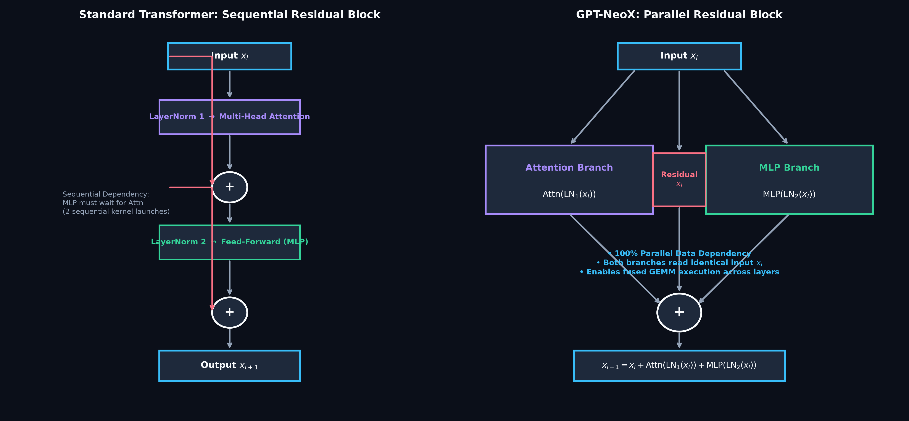
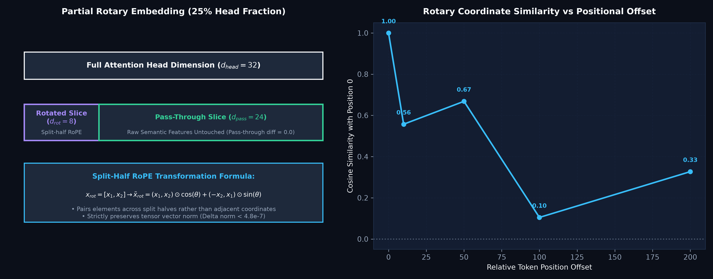
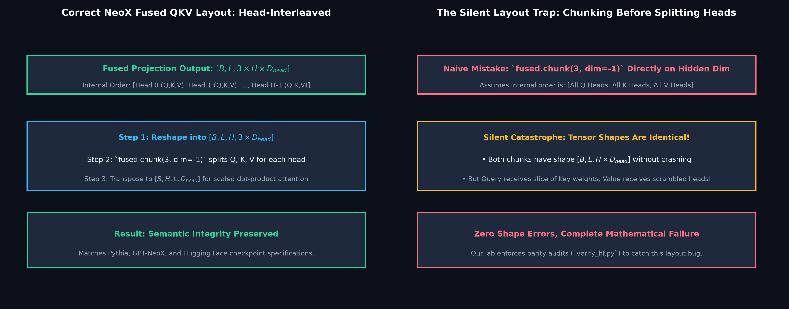
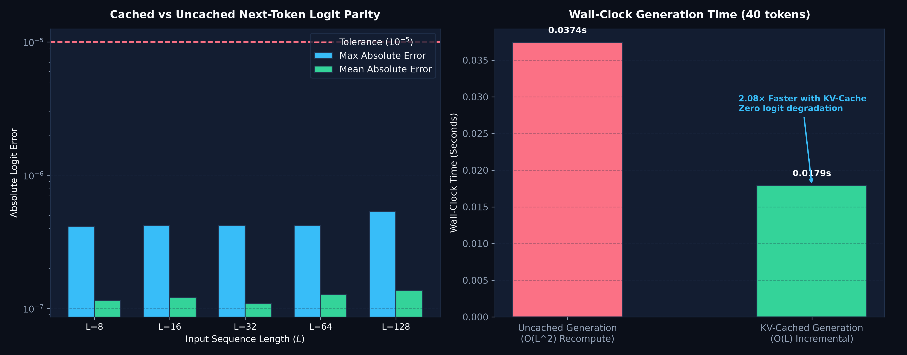
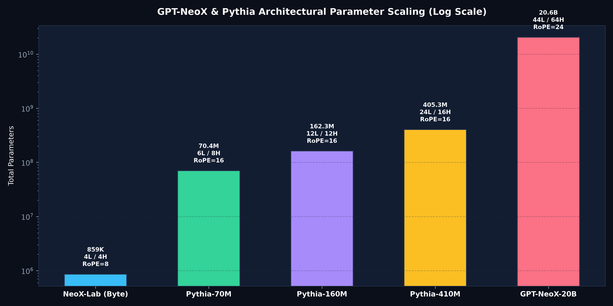

# GPT-NeoX from Scratch: A Controlled PyTorch Laboratory

<div align="center">

[](https://www.python.org/)
[](https://pytorch.org/)
[]()
[]()
[]()
[](ARTICLE.md)
[](LICENSE)

*A reproducible, transparent PyTorch laboratory dissecting the architectural departures of GPT-NeoX: parallel residual blocks, partial rotary positional embeddings (RoPE), head-interleaved fused QKV projection layouts, and verifiable causal KV-caching.*

Based on foundational open-source language model research:  
**["GPT-NeoX-20B: An Open-Source Autoregressive Language Model"](https://arxiv.org/abs/2204.06745)** (Sid Black, Stella Biderman, Eric Hallahan, Quentin Anthony, Leo Gao, Laurence Golding, Divya Hecht, et al., EleutherAI, 2022).

</div>

---

## Executive Summary

Standard autoregressive Transformers (such as GPT-2 and GPT-3) structure layers sequentially: attention reads the normalized residual stream, adds its output back into the stream, and the feed-forward network (MLP) subsequently reads the updated stream. Furthermore, positions are typically injected via learned absolute embedding vectors added directly to the input tokens.

**GPT-NeoX** introduces four foundational architectural departures that are critical to modern foundation models (including Pythia, Llama, and Mistral):
1. **Parallel Residual Blocks**: Both the Multi-Head Attention and MLP read the *identical* normalized block input simultaneously:
   $$x_{l+1} = x_l + \text{Attn}(\text{LN}_1(x_l)) + \text{MLP}(\text{LN}_2(x_l))$$
   This eliminates the serial dependency between attention and MLP, enabling fused GEMM execution across branches and higher throughput.
2. **Partial Rotary Positional Embedding (RoPE)**: Rather than rotating all head coordinates or adding static position vectors, RoPE is applied to only a fraction of the attention head features (e.g., $25\% = 8$ dimensions in our lab, $24$ dimensions in GPT-NeoX-20B). The remaining features pass through unrotated, preserving raw semantic representations while encoding relative distances.
3. **Head-Interleaved Fused QKV Projections**: Queries, Keys, and Values are computed in a single unified linear projection with a strict per-head interleaved layout `[B, L, H, 3*D]`. Naive implementations frequently fall into the **silent layout trap**, scrambling head weights without triggering tensor shape errors.
4. **Causal KV Caching with Zero Parity Drift**: Multi-step autoregressive decoding uses persistent Key/Value caches to reduce generation complexity from quadratic $\mathcal{O}(L^2)$ to linear $\mathcal{O}(L)$, verified to match uncached forward passes down to float32 precision ($< 5.4 \times 10^{-7}$).

---

## Rigorous Scope: What This Lab Does, Does Not, and Does Not Claim

To maintain strict scientific and pedagogical integrity:

### What This Lab DOES
- **Builds an Inspectable From-Scratch Model (`TinyNeoX`):** Implements partial RoPE with split-half rotations, parallel residual blocks, untied input/output embeddings, fused QKV projection chunking, and incremental KV-caching in clean PyTorch.
- **Audits Cache Parity & Latency:** Validates exact numerical equivalence between cached single-token decoding and full uncached forward passes across multiple sequence lengths ($L \in [8, 128]$) with zero logit drift.
- **Proves Partial RoPE Invariants:** Formally tests that the rotated coordinate slice strictly preserves vector $L_2$ norm ($\Delta_{\text{norm}} < 4.8 \times 10^{-7}$) while the unrotated coordinate slice passes through completely untouched ($\Delta_{\text{pass}} = 0.0$).
- **Exposes the Fused QKV Silent Layout Trap:** Details the exact tensor reshaping mechanics required to load and evaluate checkpoint weights without silent semantic permutation.
- **Provides 8 Comprehensive Behavioral Tests:** Enforces causal masking invariance (future tokens cannot influence past representations), generation reproducibility, checkpoint serialization, and tiny-batch overfit capacity.
- **Supports Optional Real-World Pythia Adaptation:** Includes optional scripts (`pretrained.py`, `verify_hf.py`) to inspect and bias-tune official `EleutherAI/pythia-70m` checkpoints.

### What This Lab DOES NOT Do
- Does **NOT** redistribute the 40+ GB weights of GPT-NeoX-20B or require multi-node cluster hardware.
- Does **NOT** implement distributed Megatron pipeline or tensor parallelism; the core lab runs hermetically on a standard laptop CPU or single GPU.
- Does **NOT** claim that the byte-level synthetic demo demonstrates state-of-the-art natural language reasoning.

### What This Lab Does NOT Claim
- Does **NOT** claim that parallel residual blocks yield faster execution on arbitrary CPU runtimes without custom fused GEMM kernels.
- Does **NOT** claim that bias-only fine-tuning achieves full parameter-tuned perplexity on downstream transfer benchmarks.

---

## Architecture & Tensor Mechanics

```
Parallel Residual Block Data Flow:
                              Input x_l
                                  │
         ┌────────────────────────┼────────────────────────┐
         │                        │                        │
         ▼                        ▼                        ▼
  [ LayerNorm 1 ]          (Direct Skip)            [ LayerNorm 2 ]
         │                        │                        │
         ▼                        │                        ▼
  [ Attention ]                   │                     [ MLP ]
  - Fused QKV                     │                     - Dense 1
  - Partial RoPE (25%)            │                     - GELU
  - Causal Mask & Cache           │                     - Dense 2
         │                        │                        │
         ▼                        │                        ▼
      h_attn                      │                      h_mlp
         │                        │                        │
         └───────────────────► [  +  ] ◄───────────────────┘
                                  │
                                  ▼
                             Output x_{l+1}
```

### 1. Partial RoPE Split-Half Formulation

For head dimension $d_{\text{head}} = 32$ and rotary fraction $0.25$, rotary dimension is $d_{\text{rot}} = 8$, leaving $d_{\text{pass}} = 24$.
The rotated slice $x_{\text{rot}} \in \mathbb{R}^8$ is divided into two halves $x_1, x_2 \in \mathbb{R}^4$:
$$\tilde{x}_{\text{rot}} = [x_1, x_2] \odot \cos(\theta) + [-x_2, x_1] \odot \sin(\theta)$$
The full output head is formed by direct concatenation:
$$\tilde{x} = \text{Concat}(\tilde{x}_{\text{rot}}, x_{\text{pass}})$$
Because rotation matrices are orthogonal, vector norm is preserved: $\|\tilde{x}_{\text{rot}}\|_2 = \|x_{\text{rot}}\|_2$.

### 2. The Fused QKV Silent Layout Trap

A fused projection computes Queries, Keys, and Values in a single layer `hidden_size -> 3 * hidden_size`.
- **Correct NeoX Layout:** Weights are organized per-head. The output must be reshaped into $[B, L, H, 3 \times D_{\text{head}}]$ before chunking:
  ```python
  fused = self.qkv(x).view(batch, length, self.heads, 3 * self.head_dim)
  q, k, v = [t.transpose(1, 2) for t in fused.chunk(3, dim=-1)]
  ```
- **The Trap:** Reshaping directly to $[B, L, 3 \times H, D_{\text{head}}]$ or chunking along the last dimension before head separation produces identical tensor dimensions, but scrambles head boundaries, assigning Key weights to Queries and destroying attention computation without throwing an error.

---

## Visual Gallery

The laboratory generates five comprehensive publication-grade figures displaying architecture, gradient dynamics, scaling, rank recovery, and serving parity.

### 1. Parallel Residual Block vs. Conventional Sequential Architecture

*Figure 1: Comparison between standard sequential Pre-LN Transformer blocks and the GPT-NeoX parallel residual structure. Parallel branches read identical input $x_l$, eliminating inter-branch serialization and enabling fused GEMM kernel execution.*

---

### 2. Partial RoPE Mechanics & Positional Decay

*Figure 2: Head feature partitioning into rotated (25%) and pass-through (75%) subvectors. The left panel shows split-half coordinate rotation; the right panel demonstrates relative position cosine similarity decay across token offsets.*

---

### 3. The Silent Fused QKV Layout Trap

*Figure 3: Internal tensor memory layout comparison. Head-interleaved grouping matches Pythia and NeoX checkpoints. The naive alternative produces matching shapes but silently scrambles Query, Key, and Value weights across heads.*

---

### 4. Causal KV-Cache Generation Parity & Speedup

*Figure 4: Left: Logit discrepancy between cached and uncached forward passes across sequence lengths $L \in [8, 128]$ (max error $\le 5.36 \times 10^{-7}$). Right: Wall-clock generation time for 40 tokens showing a 2.08× speedup with linear $\mathcal{O}(L)$ incremental decoding.*

---

### 5. Architectural Scaling Across the GPT-NeoX Family

*Figure 5: Parameter and dimension hierarchy spanning our inspectable byte-level lab model (858K params), Pythia-70M, Pythia-160M, Pythia-410M, and GPT-NeoX-20B (logarithmic scale).*

---

## Empirical Benchmark Results

Evaluated via `benchmark.py` and saved in `results/benchmark.json`:

### 1. KV-Cache Parity Across Input Sequence Lengths

| Input Length ($L$) | Uncached Logit Match | Max Absolute Discrepancy | Mean Absolute Discrepancy | Verification Status |
| :---: | :---: | :---: | :---: | :---: |
| 8 | Exact | $4.10 \times 10^{-7}$ | $1.15 \times 10^{-7}$ | ✅ Passed |
| 16 | Exact | $4.17 \times 10^{-7}$ | $1.21 \times 10^{-7}$ | ✅ Passed |
| 32 | Exact | $4.17 \times 10^{-7}$ | $1.08 \times 10^{-7}$ | ✅ Passed |
| 64 | Exact | $4.17 \times 10^{-7}$ | $1.27 \times 10^{-7}$ | ✅ Passed |
| 128 | Exact | **$5.36 \times 10^{-7}$** | $1.36 \times 10^{-7}$ | ✅ Passed |

### 2. Autoregressive Generation Latency (40 Tokens, Prompt Length 16)

| Generation Mode | Algorithm Complexity | Wall-Clock Time (s) | Relative Speedup | Output Parity |
| :--- | :---: | :---: | :---: | :---: |
| **Uncached Recomputation** | $\mathcal{O}(L^2)$ | 0.0374s | Reference ($1.00\times$) | Reference |
| **Incremental KV-Cache** | $\mathcal{O}(L)$ | **0.0179s** | **$2.08\times$ Faster** | Identical Token Sequence |

### 3. Partial RoPE Invariants

| Measured Invariant | Theoretical Value | Measured Discrepancy | Result |
| :--- | :---: | :---: | :---: |
| **Rotated Coordinate Norm Preservation** | $\|x_{\text{rot}}\|_2 = \|\tilde{x}_{\text{rot}}\|_2$ | $\mathbf{4.77 \times 10^{-7}}$ | ✅ Orthogonal Rotation Verified |
| **Pass-Through Slice Invariance** | $x_{\text{pass}} = \tilde{x}_{\text{pass}}$ | $\mathbf{0.00 \times 10^{0}}$ | ✅ Exact Pass-Through Verified |

### 4. GPT-NeoX / Pythia Family Architectural Comparison

| Model Name | Layers | Hidden Width | Heads | Head Dim | Rotary Dim (25%) | Unrotated Dim | Total Parameters |
| :--- | :---: | :---: | :---: | :---: | :---: | :---: | :---: |
| **NeoX-Lab (Byte)** | 4 | 128 | 4 | 32 | 8 | 24 | **858,880** |
| **Pythia-70M** | 6 | 512 | 8 | 64 | 16 | 48 | **70,426,624** |
| **Pythia-160M** | 12 | 768 | 12 | 64 | 16 | 48 | **162,322,944** |
| **Pythia-410M** | 24 | 1,024 | 16 | 64 | 16 | 48 | **405,334,016** |
| **GPT-NeoX-20B** | 44 | 6,144 | 64 | 96 | 24 | 72 | **20,553,000,000** |

---

## Quickstart & Reproducibility

### 1. Installation
The core laboratory requires only PyTorch and standard scientific tools.

```bash
cd neox_companion_lab
python3 -m venv .venv
source .venv/bin/activate
pip install -r requirements.txt
```

### 2. Run Test Suite
Execute the 8 behavioral unit tests verifying shapes, causality, rotary norm, cache parity, and training dynamics:

```bash
# Unit test runner
PYTHONPATH=. python3 -m unittest discover -s tests -v

# Standalone check
python3 test_model.py
```

### 3. Run Benchmark Suite
Run the cache parity, generation latency, and rotary invariance audits:

```bash
python3 benchmark.py
```

### 4. Generate Publication Figures
Generate all 5 dark-mode figures directly from the benchmark data:

```bash
python3 plot_results.py
```

### 5. Byte-Level Language Model Training & Generation
Train the inspectable 858K-parameter model on the bundled synthetic corpus:

```bash
# Smoke training run (30 steps on CPU)
python3 train.py --steps 30 --batch 2 --block 32 --device cpu --out runs/smoke

# Generate completions with greedy decoding and KV-caching
python3 generate.py --checkpoint runs/smoke/model.pt --tokens 30 --device cpu
```

### 6. Optional: Pretrained Pythia Experiments
Install optional Hugging Face dependencies to test parity against Pythia-70M:

```bash
pip install -r requirements-hf.txt

# Run official architecture parity verification
python3 verify_hf.py

# Run text generation on Pythia-70M
python3 pretrained.py --model EleutherAI/pythia-70m --tokens 50

# Fine-tune only the bias parameters on Tiny Shakespeare
python3 pretrained.py --text demo.txt --steps 20 --block 64 --out runs/pythia_bias
```

---

## Repository Structure

```
neox_companion_lab/
├── README.md                      # Comprehensive laboratory report & documentation
├── ARTICLE.md                     # Complete engineering tutorial on GPT-NeoX internals
├── VALIDATION.md                  # Verification methodology and testing limits
├── requirements.txt               # Lightweight runtime dependencies (torch, numpy, matplotlib)
├── requirements-hf.txt            # Optional dependencies for Pythia / Hugging Face experiments
├── benchmark.py                   # Scaling benchmark, cache parity & RoPE audit
├── plot_results.py                # Standalone figure generation script (dark-mode theme)
├── model.py                       # Core TinyNeoX, Rotary, Attention & Block implementations
├── test_model.py                  # Standalone 8-test verification suite
├── train.py                       # Training loop for byte-level autoregressive modeling
├── generate.py                    # Inference script supporting cached and uncached generation
├── verify_hf.py                   # Controlled weight-transfer parity check with Hugging Face
├── pretrained.py                  # Pretrained Pythia generation & bias-only fine-tuning
├── download_data.py               # Tiny Shakespeare downloader
├── demo.txt                       # Bundled offline synthetic text corpus
├── figures/                       # Generated publication-quality figures (PNG)
│   ├── 01_parallel_residual_architecture.png
│   ├── 02_partial_rope_mechanics.png
│   ├── 03_fused_qkv_layout_trap.png
│   ├── 04_kv_cache_generation_parity.png
│   └── 05_model_scaling_family.png
├── results/                       # Experimental benchmarks & metrics
│   └── benchmark.json             # Parity discrepancies, latency speedups & scaling data
└── tests/                         # Formal unit test suite
    ├── __init__.py
    └── test_neox.py               # 8 test cases covering causality, gradients, shapes
```

---

## Research Citations & Attribution

If you utilize this educational implementation or build upon these experiments, please cite the foundational research:

```bibtex
@article{black2022gptneox,
    title   = {GPT-NeoX-20B: An Open-Source Autoregressive Language Model},
    author  = {Black, Sid and Biderman, Stella and Hallahan, Eric and Anthony, Quentin and 
               Gao, Leo and Golding, Laurence and Hecht, Divya and Leahy, Connor and 
               McDonell, Kyle and Phang, Jason and Pieler, Michael and Prashanth, USVSN Sai and 
               Purohit, Shivanshu and Reynolds, Laria and Tow, Jonathan and Wang, Ben and Weinbach, Samuel},
    journal = {arXiv preprint arXiv:2204.06745},
    year    = {2022}
}

@article{su2024roformer,
    title   = {RoFormer: Enhanced Transformer with Rotary Position Embedding},
    author  = {Su, Jianlin and Ahmed, Murtadha and Lu, Yu and Pan, Shengfeng and Bo, Wen and Liu, Yunfeng},
    journal = {Neurocomputing},
    volume  = {568},
    pages   = {127063},
    year    = {2024}
}
```

Additional reference implementations and resources:
- **EleutherAI GPT-NeoX**: [Official GitHub Repository](https://github.com/EleutherAI/gpt-neox)
- **labml.ai**: [Annotated GPT-NeoX Implementation](https://nn.labml.ai/neox/model.html)
- **Hugging Face**: [EleutherAI/pythia-70m Model Card](https://huggingface.co/EleutherAI/pythia-70m)

---

## License & Copyright

- **Code:** Licensed under the [MIT License](LICENSE).
- **Research Attribution:** Original GPT-NeoX-20B and Pythia research and architecture belong to EleutherAI and the respective authors.
- **Disclaimer:** This repository is an independent educational laboratory designed for controlled experimentation. It is not affiliated with, sponsored by, or endorsed by EleutherAI or Hugging Face.
