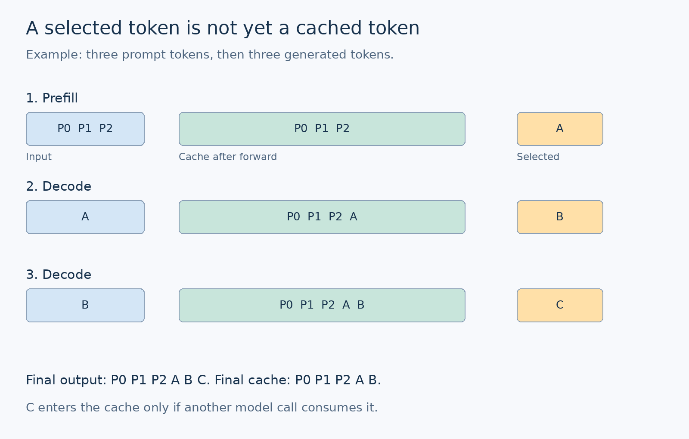
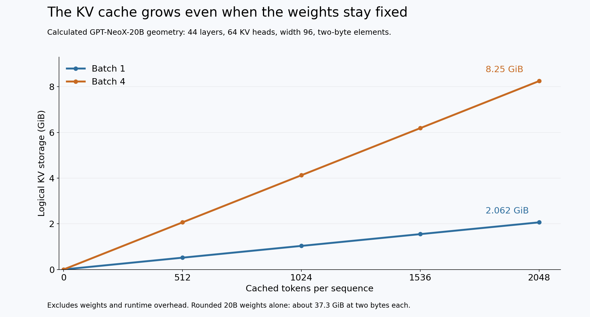

# The First Token Is Different
## Build GPT-NeoX’s generation loop from scratch: prefill, KV caches, sampling, and the state bugs that plausible text can hide

Your prompt contains a thousand tokens. The model reads all of them, predicts the next token, and appends it to the conversation.

For the next prediction, you send the model just one token.

How can that possibly be enough?

The answer is hidden behind a short line in a generation script: the model has kept its past keys and values. The next call supplies only the new work. It still attends to the earlier context through the cache.

That distinction is the foundation of efficient autoregressive inference. It is also where a surprising number of bugs begin. Send the prompt twice, reset the position offset, borrow the wrong request's cache, or select logits from the wrong position, and the program may keep producing text without telling you that its state is wrong.

We are going to build the generation loop around those details.

Our starting point is labml's GPT-NeoX generation example: load the layers, process a prompt, choose a token, then feed one token at a time while advancing cached state. The original example targets a large pretrained model. Our companion lab uses a small NeoX-style decoder that runs on CPU, so you can inspect every cache tensor and test the loop without needing a large GPU. [1]

By the end, you will have a working byte-level generator, a cached-versus-uncached correctness test, streaming output that handles multibyte characters, a memory calculator, and a benchmark that separates the first token from the tokens that follow.

No pretrained download is required. The small model is an implementation exercise, not a substitute for GPT-NeoX-20B's language capabilities.

## Contents

1. Run the generation loop locally
2. What the original GPT-NeoX script is doing
3. The first forward pass is prefill
4. What the next-token logits actually mean
5. Why one input token is enough after prefill
6. Trace the cache one step at a time
7. Preserve positions and causal visibility
8. Make request state explicit
9. Evaluation mode and disabled gradients solve different problems
10. Move from greedy decoding to sampling
11. Stop at the right time and stream the right bytes
12. Understand the memory requirement
13. Train a tiny model and inspect its continuation
14. Test correctness before measuring performance
15. Benchmark first-token and decode latency separately
16. Bugs worth introducing on purpose
17. What changes when this becomes a service

## 1. Run the generation loop locally

Download `GPT_NeoX_Generation_Companion_Lab.zip`, extract it, and enter the `NeoX_Generation_Lab` directory.

Create a fresh environment and run the tests:

```bash
python -m venv .venv
source .venv/bin/activate
python -m pip install -r requirements.txt
python test_generation.py
```

On Windows PowerShell, activate the environment with `.venv\Scripts\Activate.ps1`.

Now run a short generation:

```bash
python generate.py --prompt "The cache " --tokens 16
```

The command starts with random weights unless you supply a checkpoint. Its output is useful for tracing execution, not reading meaningful language. A later section trains the model on the bundled synthetic corpus.

Open `results/trace.json` after the command finishes. Every generated token has a record containing the number of tokens passed into the model, cache length before and after the forward call, logical cache bytes, output length, and selected token ID.

That trace is the first deliverable of the lab. Before worrying about whether a continuation sounds convincing, we want to know whether the generator is computing the intended sequence.

The model has two Transformer blocks, hidden width 96, four attention heads, partial rotary position embeddings, and parallel attention/MLP residual branches. Its vocabulary contains 256 byte values plus a reserved end-of-sequence ID. Its context policy permits 256 tokens.

This is deliberately small. The code for model execution, cache state, and generation fits into files you can read end to end.

## 2. What the original GPT-NeoX script is doing

The supplied sample has two phases. It first runs the entire prompt and selects the final position's prediction. It then feeds the previously selected token into each subsequent call. The first prediction plus the following 99 iterations produce 100 new tokens. Selection uses the largest logit, so this is greedy decoding, not random sampling. [1]

The line assigning `state_ids` deserves particular attention:

```python
cache.set('state_ids', (None, 1))
```

In labml's implementation, the pair identifies the previous cached state to consume and the next state to store. A missing previous state starts the request. Later pairs such as `(1, 2)` advance between cached generations. These IDs are not token positions. Attention obtains its position offset from the length of the cached keys. [2]

This distinction matters for a long prompt. A first request with a thousand prompt tokens can still use next-state ID 1. The next new input belongs at sequence position 1000, not position 1.

The original cache organizes layer values in queues. Correct retrieval therefore depends on the same layer execution order that produced those values. [2] Our lab replaces this implicit global mechanism with an explicit list of per-layer tensors returned from each model call.

The sample also offers a layer filter for testing. Running only a few layers is useful for checking a loading path or reducing a debugging workload. It does not turn the full pretrained checkpoint into an equivalent smaller language model. Removing blocks changes the computation the weights were trained to perform.

Read the original script as a compact demonstration of a generation path. The lab below makes the state contract explicit and adds tests around it.

## 3. The first forward pass is prefill

The first token requires a different workload from later tokens.

The model starts without a cache. It embeds the full prompt and runs all its positions through every Transformer block. Each position can read the appropriate earlier positions under the causal mask.

During this pass, each layer produces keys and values for the prompt. We retain them. The final prompt position supplies the logits for the first new token.

This phase is commonly called **prefill**.

For a prompt of length `L`, a conventional causal language model returns logits with shape:

```text
[batch_size, L, vocabulary_size]
```

The output rows are not `L` new tokens waiting to be appended. Each row predicts the token after its own input position. Only the last row predicts the continuation immediately after the complete prompt.

The lab can avoid projecting every position into vocabulary logits during inference:

```python
if last_only:
    hidden = hidden[:, -1:, :]

logits = output_projection(final_norm(hidden))
```

This optimization does not skip the prompt's Transformer computation. The model still needs the prompt representations and their K/V tensors. It saves unnecessary work in the final vocabulary projection when only the last prediction is needed.

Training uses all positions. The test suite checks that the last-only inference result matches the final row of the full-logit result.

For a real application, time to first token includes more than prefill. Tokenization, request scheduling, model loading when applicable, sampling, and transport may contribute. Our benchmark names the subset it measures rather than presenting model-side timing as complete user-facing latency.

## 4. What the next-token logits actually mean

A logit is an unnormalized score for a vocabulary item. Its meaning depends on which input position produced it.

If your input is:

```text
The cache
```

the final position's logits describe possible continuations after that complete tokenized prefix. Earlier rows describe predictions after shorter prefixes inside the input.

For greedy generation, select the largest score from the final row:

```python
next_token = logits[:, -1, :].argmax(dim=-1, keepdim=True)
```

There is no need to compute softmax first. Softmax preserves the ordering of finite logits, so the argmax is unchanged.

The original `infer()` helper calculates argmax predictions for all input positions and returns them as a list. Its caller takes the last entry. Our version selects the final row directly.

Keep the distinction between vocabulary scores and token IDs visible in your variable names. A tensor of shape `[1, 257]` holds scores over the vocabulary. A tensor of shape `[1, 1]` can hold the single selected ID. A tensor of shape `[1, sequence_length]` holds the growing token sequence.

Confusing these shapes is one kind of error. Selecting a valid row for the wrong position is another. The latter often passes shape checks.

A quick prediction exercise: if you choose the first prompt row instead of the last, which context did the model use to make that decision? It used the prefix ending at the first token. The rest of the supplied prompt has not become visible to that row just because it exists in the same tensor.

## 5. Why one input token is enough after prefill

After selecting the first new token, the generator has two different kinds of state:

- The output sequence contains the prompt and the new token.
- The cache contains K/V tensors for the prompt only.

The selected token has not passed through the model yet. Selection chooses an ID. It does not compute that ID's representations.

The next forward call consumes the selected token. Each attention layer computes its new query, key, and value. The new key and value are appended to that layer's cache. The query attends to the cached keys and values, which now include the newly consumed token.

That call produces the next token's logits.

The input can therefore contain one token while the attention computation still reads a much longer context.

This is the boundary to remember: **a short input tensor does not imply a short attention context.**

We cache keys and values because future tokens need them. Earlier queries were used to compute earlier outputs; ordinary forward generation does not need to retain them for future attention.

The model is also allowed to reuse earlier K/V tensors because it is causal. Appending a future token does not change what earlier positions were permitted to attend to. With fixed model weights and the same position semantics, those earlier representations remain valid.

That reasoning does not apply if you edit an earlier token, change model weights, or silently change how positions are interpreted. A cache represents a particular computation over a particular prefix, not a bag of interchangeable context vectors.

## 6. Trace the cache one step at a time

Use a prompt with three tokens and ask for three new tokens.

The first call receives all three prompt tokens. It produces a cache of length three and selects generated token A. The output sequence is now length four.

The second call receives A. It extends the cache to length four and selects B. The output sequence is length five.

The third call receives B. It extends the cache to length five and selects C. The output sequence is length six.

We stop there. C belongs to the output, but it has not yet been consumed by a model call.



After each selection in this implementation:

```python
cache_length == output_length - 1
```

That final pending token explains many apparent off-by-one errors in cache inspection.

For a prompt of length `L` and `N` emitted tokens, cached generation processes `L` input positions during prefill and one position during each of the following `N - 1` calls.

Uncached generation processes the growing prefix again on every call: lengths `L`, `L + 1`, through `L + N - 1`.

For a 64-token prompt and 32 new tokens, the cached loop supplies 95 input positions in total. The uncached loop supplies 2,544. This count measures repeated input processing, not a direct ratio of FLOPs or wall-clock time. Cached attention still reads the growing prefix, and each operation has its own cost.

The lab checks those input lengths and reports them beside timing results.

## 7. Preserve positions and causal visibility

Suppose the cache already contains 64 tokens. A one-token decode call has local input index zero, but its sequence position is 64.

Position embeddings must use the sequence position, not the local index.

Our attention implementation computes the offset from the cache length and uses it when applying rotary position embeddings to the new queries and keys:

```python
offset = 0 if past is None else past[0].shape[-2]
q = rotate(q, offset)
k = rotate(k, offset)
```

Cached keys are already rotated for their original positions. We append the newly rotated keys to them. We do not rotate the entire accumulated cache again on every step.

If you reset the new token's offset to zero, shapes remain valid. The model still produces logits. It is simply interpreting each new token as if it occupied the beginning of the sequence.

The causal mask has a similar offset requirement, especially when processing more than one new token against a cache.

The lab builds masks from absolute query and key positions:

```python
query_positions = offset + torch.arange(new_length, device=device)
key_positions = torch.arange(total_key_length, device=device)
allowed = key_positions[None, :] <= query_positions[:, None]
```

This permits each new query to read earlier cached positions and the permitted portion of the new block. In PyTorch's scaled dot-product attention API, boolean `True` means allowed. [3]

For a single new token and a complete causal prefix, every key currently present is visible. For chunked prefill, different queries in the new chunk have different visibility limits. Testing only one-token decoding can miss a bug in the multi-token case.

Our chunked-prefill test processes part of a sequence, caches it, and processes the remaining block. It compares every continuation logit row with the corresponding rows from a full forward pass.

That test is particularly useful when you later add speculative verification, which also scores multi-token blocks against cached prefixes.

## 8. Make request state explicit

The original sample coordinates cache state through a shared object. For a single demonstration, that keeps the generation code compact. For multiple requests, cache ownership needs to be unmistakable.

The lab's model interface is:

```python
logits, next_cache = model(
    input_ids,
    past=current_cache,
    use_cache=True,
    last_only=True,
)
```

`current_cache` belongs to one request. The model's weights can be shared across requests. Their caches cannot be exchanged just because their tensor shapes happen to match.

Inside `generate()`, the cache starts as `None` every time:

```python
past = None

for step in range(max_new_tokens):
    incoming = ids if past is None else ids[:, -1:]
    logits, past = model(
        incoming, past=past, use_cache=True, last_only=True
    )
    next_token = choose(logits[:, -1, :])
    ids = torch.cat((ids, next_token), dim=1)
```

This excerpt shows the state transition; the complete function also handles uncached mode, sampling settings, validation, EOS, and callbacks.

The first input is the complete prompt. Every later input is the one token that was selected but not yet consumed.

Two failure cases are worth distinguishing.

If you pass the full growing output while retaining its existing cache, you duplicate already-processed history. If you pass only the newest token while discarding the cache, you lose the earlier context. Both errors can produce perfectly valid tensor operations.

The test suite interleaves two independent request caches through the same model and compares their results with fresh full-prefix calculations. This checks the behavior you need before even considering concurrent serving.

Our CLI does not expose a resumable session. If you add one, return both the cache and the final pending token, along with the request's token history and sampling state. Returning only the cache would omit the newest selected token from the next continuation.

## 9. Evaluation mode and disabled gradients solve different problems

A generation path should make inference intent explicit:

```python
model.eval()

with torch.inference_mode():
    logits, cache = model(ids, use_cache=True)
```

`eval()` changes the behavior of modules that distinguish training from evaluation, such as dropout. Disabling gradients prevents autograd from recording the computation for a backward pass. One does not substitute for the other. PyTorch explicitly notes that `inference_mode()` does not set evaluation mode automatically. [4]

The lab's generator requires an already-evaluated model. This keeps a training-mode mistake visible rather than silently changing the caller's model state.

Its small model uses no attention dropout, but the explicit contract remains useful if you extend the architecture. When using scaled dot-product attention directly, also set the supplied dropout probability appropriately; that function applies the dropout value you pass. [3]

`torch.no_grad()` is a valid alternative for many inference workflows. `inference_mode()` applies additional restrictions and can reduce some bookkeeping. If tensors need to re-enter gradient-tracked work later, choose the context deliberately rather than treating the two as interchangeable everywhere.

This article's generation and timing paths perform inference only. Training remains in a separate script with ordinary gradient tracking.

## 10. Move from greedy decoding to sampling

Greedy decoding chooses the largest final-row logit. It is a useful reference because cached and uncached runs should select the same tokens when numerical differences do not change the winner.

Sampling draws from a probability distribution instead.

The lab supports a positive temperature and optional top-k restriction. It divides the logits by temperature, retains the selected vocabulary entries if top-k is enabled, converts the remaining scores to probabilities, and draws a token.

```python
scores = logits.float() / temperature
probabilities = scores.softmax(dim=-1)
next_token = torch.multinomial(probabilities, num_samples=1)
```

This excerpt omits the top-k filtering and seeded generator to show the basic transition from scores to a sample. The complete implementation includes both.

Lower positive temperatures concentrate probability toward higher-scoring choices. Higher temperatures flatten it. In this lab, temperature zero selects the greedy branch directly. We never divide by zero and hope it behaves like argmax.

Top-k keeps a fixed number of candidate IDs. The implementation uses stable sorting to make tie handling explicit. A top-k of one should reproduce greedy token choices; the tests check that property.

The random generator belongs to the request. Setting a seed makes repeated calls with the same implementation and configuration reproducible in our test environment. It does not promise identical sampled text across every backend, precision, or library version.

Sampling amplifies small differences: a small numerical change near a cumulative probability boundary can change one draw, which changes all later prefixes. This is why logit parity with tolerances is a more direct cache-correctness test than expecting every sampled string to match across devices.

For teaching simplicity, the sampling branch transfers probabilities to CPU and uses a CPU random generator. That decision introduces overhead on accelerators. A production sampler would usually keep those operations on the device. The greedy benchmark does not use that probability-transfer path, but it still synchronizes when retrieving selected token IDs.

## 11. Stop at the right time and stream the right bytes

A generation loop needs an explicit stopping policy.

The lab accepts a maximum number of new tokens and an EOS ID. After selecting a token, it appends that token, records the trace, and checks whether it should stop. The EOS token can exist in the returned token sequence without being printed as ordinary text.

A zero-token budget returns the prompt without running the model. An empty prompt is rejected because this lab has not defined an implicit beginning-of-sequence policy. If you want empty-prompt generation, add a documented BOS token and train or load a model that understands it.

The context policy is also explicit: prompt length plus requested new-token budget must fit within the configured limit. This is conservative because the final selected token is pending rather than cached, but it keeps the accepted request length easy to reason about.

Do not silently discard old tokens when the cache fills. Eviction changes the available context and may change position semantics. It is a separate design decision that needs its own tests.

Streaming has a less obvious edge case in our byte vocabulary. A visible Unicode character may require several UTF-8 bytes. Printing each generated byte independently can produce replacement characters even when the complete byte sequence is valid.

The lab uses an incremental decoder:

```python
import codecs

decoder = codecs.getincrementaldecoder("utf-8")(errors="replace")

for token in generated_byte_ids:
    fragment = decoder.decode(bytes([token]), final=False)
    print(fragment, end="", flush=True)

print(decoder.decode(b"", final=True), end="")
```

The decoder buffers incomplete characters until the necessary bytes arrive. At the end, it flushes any remaining state. Invalid model-generated byte sequences are displayed with replacement characters rather than crashing the stream.

The test suite feeds a string containing Devanagari text, an accented Latin character, and an emoji through the stream one byte at a time and verifies exact reconstruction.

A pretrained tokenizer needs its own streaming behavior. Our byte decoder is not a drop-in replacement for GPT-NeoX's tokenizer. Always pair a checkpoint with the tokenizer and special-token configuration it expects.

## 12. Understand the memory requirement

The original labml page states that its single-GPU example needs more than 45 GB of memory. Treat that as guidance for the demonstrated large-model setup, not a universal minimum for every GPT-NeoX-style generator. [1]

There are several different memory costs.

First are the weights. A rounded estimate of 20 billion parameters at two bytes per parameter is 40 billion bytes, approximately 37.3 GiB, before other allocations. That is an estimate from the rounded model size, not an exact checkpoint footprint.

Second is the KV cache. It grows with the number of active sequences and their cached lengths. Quantizing weights does not automatically quantize the cache.

Third are temporary activations, attention workspaces, allocator overhead, framework state, and possible loading-time copies. A model fitting in steady-state weight storage does not guarantee that every load path or generation workload fits.

The published GPT-NeoX-20B configuration has 44 layers, hidden width 6,144, and 64 attention heads. That implies a head width of 96. Its configured maximum position count is 2,048. [5]

For ordinary multi-head attention with two-byte K/V elements, one token's logical cache across all layers occupies:

```python
bytes_per_token = 2 * 44 * 64 * 96 * 2
```

The first factor of two counts keys and values. The last counts bytes per stored element.

That is 1,081,344 bytes, or approximately 1.03125 MiB per token per sequence. At 2,048 cached tokens, one sequence needs 2.0625 GiB of logical K/V data. Four such sequences need 8.25 GiB.

These are calculations from the stated geometry and dtype, not measured peak GPU allocations. The accompanying `memory.py` script reproduces them:

```bash
python memory.py
python memory.py --tokens 2048 --batch 4
```



Our tiny lab model uses FP32 and has much smaller dimensions. In the default benchmark, its final cache stores 95 positions and occupies 145,920 bytes, or 142.5 KiB. That count comes directly from the tensors' element counts and element sizes.

The uncached path retains no K/V cache between calls, but it still allocates intermediate tensors during each forward pass. A reported zero persistent-cache size is not zero total memory use.

Different cache strategies trade memory, copying, and execution constraints. Framework documentation describes dynamic, static, offloaded, and other cache approaches. [6] Before comparing them, define whether you are measuring logical tensor contents, allocated device memory, reserved allocator memory, or peak runtime memory.

## 13. Train a tiny model and inspect its continuation

Random weights are enough for many correctness tests. They are less satisfying when you want to watch a sentence continue.

Train the bundled model on the synthetic text:

```bash
python train.py --steps 200 --out runs/model.pt
```

The training script reads raw UTF-8 bytes, splits them into training and validation segments, samples training blocks with a seeded generator, and predicts each next byte using cross-entropy. It saves the model configuration and state together.

Generation reloads that checkpoint:

```bash
python generate.py \
    --checkpoint runs/model.pt \
    --prompt "The cache " \
    --tokens 64
```

In the included CPU run, validation byte-level negative log likelihood decreased from about 5.6131 to 0.1533 after 200 steps. The evaluation covered 1,968 target bytes.

That sharp improvement is a property of an intentionally small, repetitive corpus. The held-out segment repeats the same kinds of sentences seen during training. This is useful for checking that the training, saving, loading, and generation pipeline works. It is not evidence of broad language understanding or realistic generalization.

The generated continuation began:

```text
The cache stores keys and values from previous tokens tokens.
```

It then deteriorated. That is worth showing rather than polishing away. A low loss on a repeated teacher-forced corpus does not guarantee a clean free-running continuation. Once the model emits an unusual prefix, later predictions are conditioned on that prefix.

The cached and uncached commands produced the same greedy continuation in this run:

```bash
python generate.py --checkpoint runs/model.pt --tokens 64
python generate.py --checkpoint runs/model.pt --tokens 64 --no-cache
```

You can then change the decoding policy:

```bash
python generate.py \
    --checkpoint runs/model.pt \
    --temperature 0.8 \
    --top-k 20 \
    --tokens 64
```

The corpus does not contain the reserved EOS token, so this training exercise does not teach the model when to stop. The maximum-token budget remains the meaningful stopping mechanism for this example. EOS control flow is tested separately.

The archive excludes generated checkpoints to keep the download small. The documented training command recreates one locally.

## 14. Test correctness before measuring performance

A plausible continuation is a weak test of a generation engine. Language models can produce readable text from the wrong context, and random outputs reveal little about the source of a failure.

The lab uses a more direct correctness ladder.

First, compare cached next-token logits with full-prefix logits at multiple positions. This checks the values before token selection hides differences. We use numerical tolerances because different execution shapes can change floating-point rounding.

Second, compare chunked prefill with full-sequence inference. This exercises the rectangular causal mask and position offsets with multiple new tokens.

Third, compare complete greedy continuations with and without caching. If this fails, inspect the logit comparisons to find the first divergent step.

Fourth, inspect state transitions. The first input length must equal the prompt length; later cached inputs must have length one. After each selection, cache length must equal output length minus one. The measured byte count must agree with tensor geometry and dtype.

Fifth, check independent requests. Run one prompt, run a different prompt, then rerun the first. Its deterministic result should not depend on the intervening request. Also interleave explicit caches through the same model and compare each branch with its own full-prefix reference.

Finally, test the boundaries: zero requested tokens, EOS on the first generated token, invalid input settings, context limits, checkpoint reload, and multibyte output streaming.

The delivered lab passed all 15 tests on CPU with Python 3.12.14 and PyTorch 2.15.0+cpu. The test log is included in `results/tests.txt`.

These tests do not establish correctness for every dtype, device, tokenizer, or cache implementation. They establish a reference you can keep when changing those pieces.

## 15. Benchmark first-token and decode latency separately

Run:

```bash
python benchmark.py --prompt-tokens 64 --tokens 32
```

The default benchmark uses the same randomly initialized model for both cached and uncached execution. Training quality is irrelevant to this fixed-shape mechanics comparison. It disables EOS stopping, generates exactly 32 tokens, and checks that both paths produce the same greedy sequence.

The script warms up both paths, shuffles measurement order, and records seven repeats. It reports total generation latency, first-token latency, and the mean interval between subsequent tokens. On accelerators, it synchronizes to avoid measuring only queued work.

In the included CPU run, the median total time was about **56.38 ms without caching** and **23.48 ms with caching**, approximately **2.40 times faster** for this particular small workload.

The median first-token measurements were about **1.74 ms uncached** and **1.90 ms cached**. Both paths still process the complete prompt. Caching does not eliminate prefill, and this small difference should not be read as a stable first-token penalty.

The median mean interval for later tokens was about **1.77 ms uncached** and **0.71 ms cached**. This is where avoiding repeated prefix processing pays off in the measured run.

The final cached state contained 142.5 KiB of logical K/V data. The trade is visible: keep past work in memory to avoid recomputing it.

These timings came from a shared CPU environment, two PyTorch threads, FP32 execution, batch one, a 64-token prompt, and 32 generated tokens. They are not GPT-NeoX-20B benchmark results and are not GPU speedup predictions.

The timed region includes input tensor creation, model forwards, greedy selection, trace bookkeeping, and per-token synchronization. It excludes checkpoint loading, text tokenization, and printing. First-token timing is measured from that region's start to the first selected-token callback. It is not network time to first byte.

All raw repeats are saved in `results/benchmark.json`. If you extend the benchmark, preserve those samples rather than retaining only the best run.

Also resist an overly broad complexity claim. KV caching removes repeated projections and transformations of earlier tokens, but dense attention for a new token still reads previous keys and values. Longer context remains costly. The one-token input is an interface convenience backed by a growing amount of state.

## 16. Bugs worth introducing on purpose

The fastest way to understand a state contract is to violate one part of it and predict the failure.

**Resend the full prefix with an existing cache.** Change the cached path to pass the entire `ids` tensor every time. Watch the cache grow faster than the output. The history is being duplicated, and the context limit may be reached early.

**Drop the cache but keep the one-token input.** The model now sees only the most recently selected token. Compare its next-token logits with the full-prefix reference. The code still runs; the conditioning is different.

**Reset the rotary offset to zero.** Keep the cached tensors but assign each new input a fresh position at the start. The first prefill pass may remain correct while later logit comparisons fail.

**Choose the first logit row during prefill.** The predicted token comes from the wrong prompt position. A shape assertion will not catch it. Compare against the final-row reference.

**Reuse a cache from a different prompt of the same length.** Shape validation succeeds. The test named `test_wrong_history_changes_output` demonstrates that the values matter, not just their dimensions.

**Decode each byte separately.** Feed a known multibyte string through the output path. The streaming test shows why the decoder needs state of its own.

Do these experiments in a copy of the lab and rerun the relevant tests after each change. Tie each failure to one invariant rather than accumulating several bugs and trying to interpret the final text.

## 17. What changes when this becomes a service

Our generator handles one request at a time. A serving system adds scheduling, variable-length prompts, padding, cancellation, concurrency, and memory allocation across many requests.

Those additions do not replace the state contract. They make it more important.

Each active sequence needs the correct token history, position state, K/V cache, stopping state, and sampling generator. Shared model weights are compatible with independent request state. Shared mutable request state requires careful ownership and synchronization.

Padding also changes which output row is the last real prompt position. The simple `logits[:, -1, :]` selection assumes the last position is valid for the sequence being continued. If you introduce right-padded batches, that assumption fails unless you gather each sequence's actual final token position and handle its masks and positions correctly.

Prefix caching across requests needs a stronger identity than equal length. The tokens, model weights, positional configuration, and other computation-affecting settings must match. A reusable prefix also needs a cache representation that can be shared without accidental mutation.

Dynamic concatenation is convenient for a tutorial but repeatedly allocates and copies tensors. Static buffers or page-based allocation can improve memory management. When you change the cache representation, keep the same full-prefix reference tests and verify every update in logical sequence length.

Finally, separate mechanisms from model quality. A correct generation loop can run a poor model perfectly. A strong pretrained model can hide a broken loop behind fluent output. You need both a meaningful model evaluation and a trustworthy execution path.

The original GPT-NeoX example fits the core idea into a small script: process the prompt, select a token, and continue with cached state. The useful lesson is not merely that the cache makes inference faster. It is that every call has a precise relationship to the token sequence.

The prompt establishes the past. A selected token waits to be consumed. The next forward pass adds it to that past and predicts what follows.

Once you can trace that transition without guessing, generation stops being a mysterious `model.generate()` call. It becomes a loop you can test, measure, and extend.

### References and companion materials

[1] labml.ai. *Generate Text with GPT-NeoX.* The supplied generation example and its documented single-GPU setup. https://nn.labml.ai/neox/samples/generate.html

[2] labml.ai. *GPT-NeoX Model Definition* and *Cache for Intermediate Activations.* State IDs, layer queues, cached K/V tensors, and position offsets. https://nn.labml.ai/neox/model.html and https://nn.labml.ai/neox/utils/cache.html

[3] PyTorch. *scaled_dot_product_attention.* Mask semantics and explicit dropout behavior. https://docs.pytorch.org/docs/stable/generated/torch.nn.functional.scaled_dot_product_attention.html

[4] PyTorch. *inference_mode.* Gradient-mode behavior and the distinction from evaluation mode. https://docs.pytorch.org/docs/stable/generated/torch.autograd.grad_mode.inference_mode.html

[5] EleutherAI. *GPT-NeoX-20B configuration and model card.* Published model dimensions and tokenizer/checkpoint information. https://huggingface.co/EleutherAI/gpt-neox-20b/blob/main/config.json and https://huggingface.co/EleutherAI/gpt-neox-20b

[6] Hugging Face. *Cache strategies.* Cache implementation choices and their tradeoffs. https://huggingface.co/docs/transformers/main/en/kv_cache

The companion ZIP includes this article, the standalone model, training and generation commands, 15 tests, streaming and cache traces, memory calculations, timing results, and diagrams. `VALIDATION.md` identifies the tested environment and the limits of the measurements.

Suggested Medium topics: Machine Learning, Large Language Models, Python, Deep Learning, Software Engineering.
