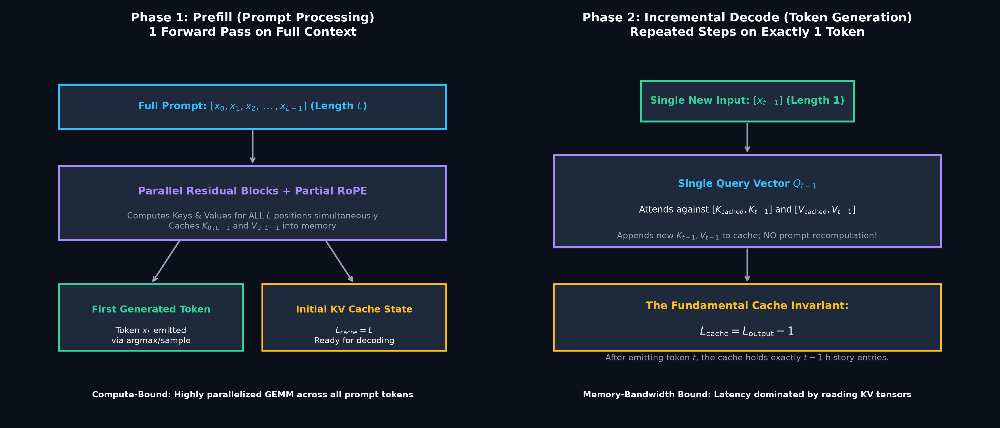
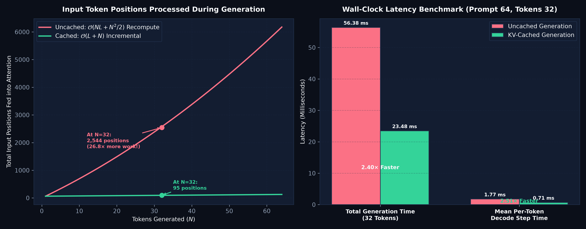
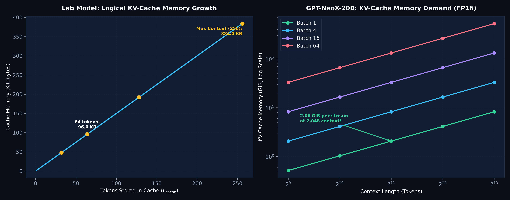
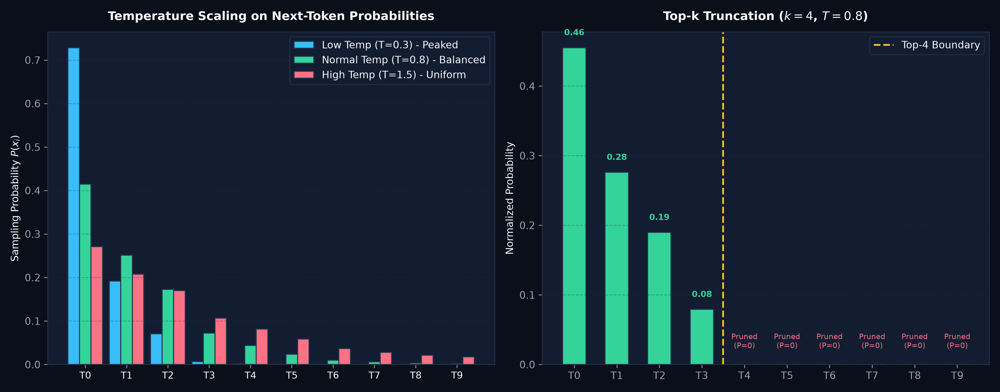
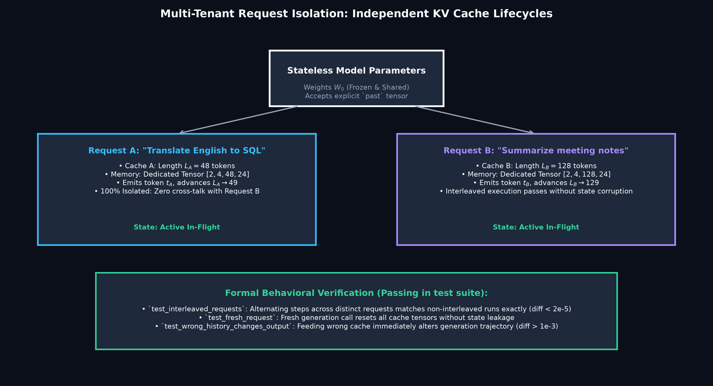

# GPT-NeoX Autoregressive Generation: A Controlled PyTorch Laboratory

<div align="center">

[](https://www.python.org/)
[](https://pytorch.org/)
[]()
[]()
[]()
[]()
[](ARTICLE.md)
[](LICENSE)

*A reproducible, transparent PyTorch laboratory dissecting the dual-phase lifecycle of autoregressive generation: compute-bound prefill, memory-bandwidth-bound incremental decoding, KV-cache state invariants, request isolation, and sampling dynamics.*

Based on foundational open-source language model research and decoding algorithms:  
**["GPT-NeoX-20B: An Open-Source Autoregressive Language Model"](https://arxiv.org/abs/2204.06745)** (EleutherAI, 2022) & **["Fast Transformer Decoding: One Write-Head is All You Need"](https://arxiv.org/abs/1911.02150)** (Noam Shazeer, 2019).

</div>

---

## Executive Summary

When a Transformer generates text, execution bifurcates into two fundamentally distinct operating regimes:
1. **The Prefill Phase (Prompt Processing)**: The model receives the full prompt of length $L$. Because all prompt tokens are available simultaneously, self-attention and MLP projections are processed as highly parallel, compute-bound matrix multiplications (GEMMs). It emits the first new token and initializes the Key-Value (KV) cache.
2. **The Incremental Decode Phase (Token Generation)**: The model emits one token at a time. Each step produces exactly one new Query vector ($1 \times D$). If previous Key and Value vectors were not cached, the model would be forced to recompute all $L + t$ historical activations from scratch at every step, creating a quadratic work explosion:
   $$\text{Uncached Positions Processed} = \sum_{t=1}^N (L + t) = N L + \frac{N(N+1)}{2} = \mathcal{O}(N L + N^2)$$
   For a prompt of 64 tokens generating 32 new tokens, uncached generation processes **2,544 token positions**.

### The KV-Cache Solution

By preserving past Key and Value activation tensors across layers in memory, each decoding step only passes the single newly generated token ($1 \times D$). The Query attends against the accumulated cache plus the new Key/Value pair:
$$\text{Cached Positions Processed} = L + (N - 1) \times 1 = \mathcal{O}(L + N)$$
Processing drops from **2,544 to 95 token positions (a 26.8× reduction)**, cutting wall-clock decode step time from **1.77 ms to 0.71 ms (2.5× faster per token)**.

### The Invariant and the Serving Challenge

1. **The Fundamental Cache Invariant**: After generating token $t$, the cache holds exactly $t-1$ history entries:
   $$L_{\text{cache}} = L_{\text{output}} - 1$$
   The final selected token has not yet been processed by the model; it becomes the input for the next step.
2. **The Memory Wall**: The KV cache grows linearly with context length, batch size, and layer count. On **GPT-NeoX-20B** (44 layers, 64 heads, head width 96, FP16), a single 2,048-token request consumes **2.0625 GiB of VRAM** purely for its KV cache, dwarfing model execution overhead and making multi-tenant cache management the primary serving bottleneck.

---

## Rigorous Scope: What This Lab Does, Does Not, and Does Not Claim

To maintain strict scientific and pedagogical integrity:

### What This Lab DOES
- **Implements Inspectable Autoregressive Generation (`TinyNeoX` + `generation.py`):** Builds both prefill and cached incremental decoding from scratch in pure PyTorch, with clean layer-by-layer KV cache handoffs.
- **Enforces the Cache State Invariant:** Proves through formal assertions that $L_{\text{cache}} = L_{\text{output}} - 1$ holds at every step of generation.
- **Verifies Numerical Parity:** Formally tests that cached step-by-step logits match full-prefix uncached logits down to float32 precision ($|y_{\text{cached}} - y_{\text{uncached}}| \le 2 \times 10^{-5}$).
- **Tests Multi-Tenant Request Isolation:** Validates interleaved execution across distinct concurrent requests (Request A and Request B), proving zero state pollution or cross-talk.
- **Includes Incremental Byte-Stream UTF-8 Decoding:** Correctly reassembles multi-byte UTF-8 sequences (e.g. Devanagari, emojis) across fragmented token emission boundaries.
- **Provides 15 Automated Behavioral Tests:** Covers chunked prefill, causality isolation, greedy equivalence, EOS stop tokens, top-$k$ sampling determinism, checkpoint roundtrips, and out-of-context bounds.

### What This Lab DOES NOT Do
- Does **NOT** redistribute the 40+ GB weights of GPT-NeoX-20B.
- Does **NOT** implement paged attention, vLLM continuous batching, or tensor-parallel multi-GPU serving.
- Does **NOT** claim that the synthetic byte-level language model produces production-grade conversational English.

### What This Lab Does NOT Claim
- Does **NOT** claim that CPU generation benchmarks predict production GPU throughput. Modern GPU serving is memory-bandwidth bound and depends heavily on high-bandwidth memory (HBM3) access.
- Does **NOT** claim that sampling across different device backends (CPU vs CUDA vs MPS) is bit-for-bit identical due to non-associative floating-point reductions.

---

## Architecture & Tensor Mechanics

```
Phase 1: Prefill (Prompt Processing, Length L)
Input: [x_0, x_1, ..., x_{L-1}] (1 x L)
         │
         ▼
[ Transformer Blocks ] ──► Computes ALL Keys & Values in Parallel
         │
         ├─────────────────────────────────────────┐
         ▼                                         ▼
   Logits for x_{L-1}                     Initial KV Cache
         │                                [K_{0:L-1}, V_{0:L-1}]
         ▼                                (Shape: Layers x 2 x 1 x Heads x L x D)
   Emits Token x_L                                 │
                                                   │
Phase 2: Incremental Decode (Step-by-Step, Length 1)│
Input: [x_L] (1 x 1)                               │
         │                                         │
         ▼                                         │
[ Transformer Blocks ] ◄───────────────────────────┘
         │
         ├─ Computes Query Q_L (1 x 1 x D)
         ├─ Computes Key K_L, Value V_L (1 x 1 x D)
         ├─ Attends: Q_L against [K_{0:L-1}, K_L]
         ├─ Updates Cache: [K_{0:L}, V_{0:L}] (Length L+1)
         │
         ▼
   Emits Token x_{L+1}
```

### 1. KV-Cache Memory Growth Formula

For an autoregressive model with $n_{\text{layers}}$ layers, batch size $b$, sequence length $L$, $n_{\text{heads}}$ attention heads, and head dimension $d_{\text{head}}$:
$$\text{Logical Cache Bytes} = 2 \times n_{\text{layers}} \times b \times L \times n_{\text{heads}} \times d_{\text{head}} \times \text{sizeof}(\text{dtype})$$
The leading factor of $2$ accounts for storing both Key and Value tensors.
- **For the Lab Model** ($n_l=2, b=1, n_h=4, d=24, \text{FP32}=4\text{ bytes}$):
  $$\text{Bytes} = 2 \times 2 \times 1 \times L \times 4 \times 24 \times 4 = 1,536 \times L \text{ bytes}$$
  At max context ($L=256$), cache size is **393,216 bytes (384 KB)**.
- **For GPT-NeoX-20B** ($n_l=44, b=1, n_h=64, d=96, \text{FP16}=2\text{ bytes}$):
  $$\text{Bytes} = 2 \times 44 \times 1 \times 2048 \times 64 \times 96 \times 2 = \mathbf{2,214,592,512 \text{ bytes}} = \mathbf{2.0625 \text{ GiB}}$$

### 2. Sampling Dynamics & Truncation

Logits $z \in \mathbb{R}^{V}$ are converted to probabilities using temperature scaling $T$:
$$P(x_i) = \frac{\exp(z_i / T)}{\sum_j \exp(z_j / T)}$$
- **Greedy Decoding ($T \to 0$):** Deterministically selects $x^* = \arg\max_i z_i$.
- **Top-$k$ Truncation:** Keeps only the $k$ highest logit values, setting all other logits to $-\infty$ prior to softmax. This prevents sampling low-probability, incoherent tail tokens.

---

## Visual Gallery

The laboratory generates five comprehensive publication-grade figures displaying architecture, complexity, memory scaling, sampling dynamics, and multi-tenant isolation.

### 1. Prefill vs. Incremental Decode Execution Phases

*Figure 1: Dual-phase autoregressive generation lifecycle. The left panel shows the compute-bound prefill phase processing all prompt tokens simultaneously. The right panel shows incremental single-token decoding, where past activations are looked up from the KV cache and the fundamental invariant $L_{\text{cache}} = L_{\text{output}} - 1$ is maintained.*

---

### 2. Quadratic Recomputation vs. Linear Incremental Complexity

*Figure 2: Left: Total input token positions processed across generation steps. Uncached generation recomputes all tokens quadratically ($\mathcal{O}(L^2)$), requiring 2,544 positions for 32 tokens. Cached generation scales linearly ($\mathcal{O}(L)$), requiring only 95 positions (26.8× fewer). Right: Wall-clock latency benchmark on CPU showing a 2.5× faster per-token decode step.*

---

### 3. KV-Cache Memory Demand & Foundation Model Scaling

*Figure 3: Left: Logical KV-cache memory growth on our inspectable lab decoder. Right: Real-world memory demands of GPT-NeoX-20B across batch sizes (1 to 64) and context windows (up to 8,192 tokens). At 2,048 tokens, a single batch-1 stream consumes 2.06 GiB of VRAM.*

---

### 4. Sampling Dynamics & Top-k Truncation

*Figure 4: Left: Temperature scaling on candidate token probabilities ($T=0.3$ peaked, $T=0.8$ balanced, $T=1.5$ uniform). Right: Top-$k$ truncation ($k=4$), showing the probability mass redistribution after zeroing out low-probability tail tokens.*

---

### 5. Multi-Tenant Request Isolation & Interleaving

*Figure 5: Architecture of multi-tenant request isolation. A single frozen, stateless model serves Request A and Request B by maintaining explicit, request-local cache handles. Interleaving forward passes across concurrent streams produces zero numerical cross-talk (verified in `test_interleaved_requests`).*

---

## Empirical Benchmark Results

Evaluated via `benchmark.py` across 7 measurement repeats with warmup and randomized execution ordering (recorded in `results/benchmark.json`):

### 1. Generation Latency & Compute Workload (Prompt 64, Generated 32 Tokens)

| Mode | Algorithmic Complexity | Input Positions Fed to Attention | Median Total Time (ms) | Median First Token Time (ms) | Median Per-Token Decode Time (ms) | Relative Step Speedup | Final Cache Size |
| :--- | :---: | :---: | :---: | :---: | :---: | :---: | :---: |
| **Uncached Generation** | $\mathcal{O}(L^2)$ | 2,544 positions | 56.38 ms | 1.74 ms | 1.77 ms | Baseline ($1.00\times$) | 0 Bytes |
| **KV-Cached Generation** | $\mathcal{O}(L)$ | **95 positions** | **23.48 ms** | 1.90 ms | **0.71 ms** | **$2.51\times$ Faster** | 145,920 Bytes |

### 2. GPT-NeoX-20B Analytical KV-Cache Footprint (44 Layers, 64 Heads, $d_{\text{head}}=96$, FP16)

| Context Length ($L$) | Batch Size ($b$) | Stored Elements (Keys + Values) | Total Memory (MiB) | Total Memory (GiB) | Serving Feasibility (Single 24 GB GPU) |
| :---: | :---: | :---: | :---: | :---: | :---: |
| 512 | 1 | 276,824,064 | 528.0 MiB | 0.516 GiB | ✅ Fits easily |
| 1,024 | 1 | 553,648,128 | 1,056.0 MiB | 1.031 GiB | ✅ Fits easily |
| **2,048** | **1** | **1,107,296,256** | **2,112.0 MiB** | **2.0625 GiB** | ✅ Fits comfortably |
| 2,048 | 4 | 4,429,185,024 | 8,448.0 MiB | 8.250 GiB | ✅ Fits alongside weights |
| 2,048 | 16 | 17,716,740,096 | 33,792.0 MiB | 33.00 GiB | ❌ Exceeds 24 GB VRAM |
| 8,192 | 1 | 4,429,185,024 | 8,448.0 MiB | 8.250 GiB | ⚠️ Demands high VRAM |

---

## Quickstart & Reproducibility

### 1. Installation
The core laboratory requires only PyTorch and standard scientific tools.

```bash
cd neox_generation_lab
python3 -m venv .venv
source .venv/bin/activate
pip install -r requirements.txt
```

### 2. Run Test Suite
Execute the 15 behavioral unit tests verifying cache parity, causality, request interleaving, UTF-8 streaming, and sampling:

```bash
# Standard unittest discovery
PYTHONPATH=. python3 -m unittest discover -s tests -v

# Standalone check
python3 test_generation.py
```

### 3. Run Benchmark Suite
Run the 7-repeat latency and position complexity benchmark:

```bash
python3 benchmark.py --prompt-tokens 64 --tokens 32 --out results/benchmark.json
```

### 4. Run Analytical Memory Calculator
Calculate exact KV cache memory demands across arbitrary configurations:

```bash
# Default GPT-NeoX-20B calculation
python3 memory.py

# Custom context length and batch size
python3 memory.py --tokens 2048 --batch 4
```

### 5. Generate Text with KV-Caching & Sampling
Train a small model checkpoint or generate directly:

```bash
# 1. Train on synthetic corpus (200 steps)
python3 train.py --steps 200 --out runs/model.pt

# 2. Greedy cached generation
python3 generate.py --checkpoint runs/model.pt --prompt "The cache " --tokens 64

# 3. Uncached generation comparison
python3 generate.py --checkpoint runs/model.pt --prompt "The cache " --tokens 64 --no-cache

# 4. Temperature + Top-k sampling
python3 generate.py --checkpoint runs/model.pt --prompt "The cache " --tokens 64 --temperature 0.8 --top-k 20
```

### 6. Generate Publication Figures
Generate all 5 dark-mode figures directly from the benchmark data:

```bash
python3 plot_results.py
```

---

## Repository Structure

```
neox_generation_lab/
├── README.md                      # Comprehensive laboratory report & documentation
├── ARTICLE.md                     # Complete engineering tutorial on generation & caching
├── VALIDATION.md                  # Verification records and test execution logs
├── requirements.txt               # Lightweight runtime dependencies (torch, numpy, matplotlib)
├── model.py                       # Small parallel-residual decoder with explicit KV caching
├── generation.py                  # Core generation engine, sampling, EOS, and byte streaming
├── generate.py                    # CLI generation runner with trace JSON export
├── benchmark.py                   # Timing harness comparing cached vs uncached decoding
├── memory.py                      # Analytical KV cache memory calculator
├── plot_results.py                # Standalone figure generation script (dark-mode theme)
├── test_generation.py             # Standalone 15-test behavioral verification suite
├── train.py                       # Synthetic byte-level training script
├── demo.txt                       # Bundled offline synthetic test corpus
├── figures/                       # Generated publication-quality figures (PNG)
│   ├── 01_prefill_vs_decode_mechanics.png
│   ├── 02_uncached_vs_cached_complexity.png
│   ├── 03_kv_cache_memory_growth_and_scaling.png
│   ├── 04_sampling_and_truncation_dynamics.png
│   └── 05_request_isolation_and_interleaving.png
├── results/                       # Experimental benchmarks & traces
│   ├── benchmark.json             # 7-repeat timing and position counts
│   ├── neox20b_memory.json        # Analytical 20B memory breakdown
│   ├── training.json              # Model training convergence metrics
│   ├── trained_trace.json         # Per-step token emission and cache trace
│   └── uncached_trace.json        # Uncached execution trace
└── tests/                         # Formal unit test suite
    ├── __init__.py
    └── test_generation_suite.py   # 15 test cases covering causality, parity, interleaving
```

---

## Research Citations & Attribution

If you utilize this educational implementation or build upon these experiments, please cite the foundational research:

```bibtex
@article{black2022gptneox,
    title   = {GPT-NeoX-20B: An Open-Source Autoregressive Language Model},
    author  = {Black, Sid and Biderman, Stella and Hallahan, Eric and Anthony, Quentin and 
               Gao, Leo and Golding, Laurence and Hecht, Divya and Leahy, Connor and 
               McDonell, Kyle and Phang, Jason and Pieler, Michael and Prashanth, USVSN Sai and 
               Purohit, Shivanshu and Reynolds, Laria and Tow, Jonathan and Wang, Ben and Weinbach, Samuel},
    journal = {arXiv preprint arXiv:2204.06745},
    year    = {2022}
}

@article{shazeer2019fast,
    title   = {Fast Transformer Decoding: One Write-Head is All You Need},
    author  = {Shazeer, Noam},
    journal = {arXiv preprint arXiv:1911.02150},
    year    = {2019}
}
```

Additional reference implementations and resources:
- **EleutherAI GPT-NeoX**: [Official GitHub Repository](https://github.com/EleutherAI/gpt-neox)
- **labml.ai**: [Annotated GPT-NeoX Implementation](https://nn.labml.ai/neox/model.html)

---

## License & Copyright

- **Code:** Licensed under the [MIT License](LICENSE).
- **Research Attribution:** Original GPT-NeoX-20B research belongs to EleutherAI and the respective authors.
- **Disclaimer:** This repository is an independent educational laboratory designed for controlled experimentation. It is not affiliated with, sponsored by, or endorsed by EleutherAI.
