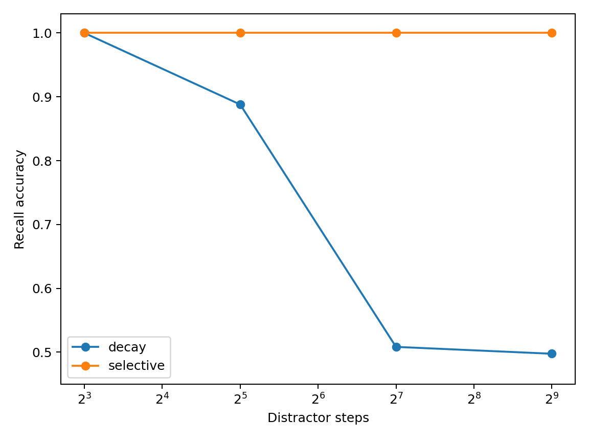
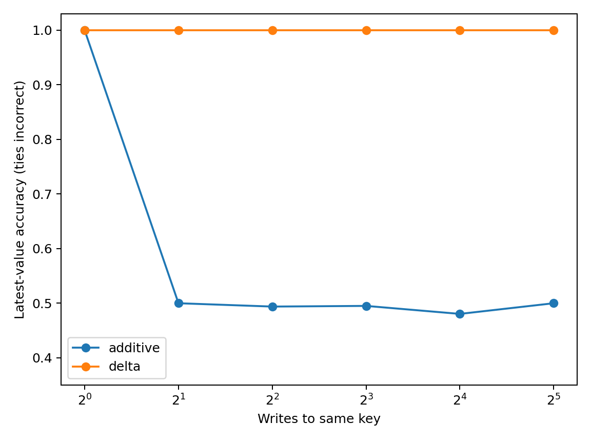

# Neural Memory Lab: Selective Gating, Delta Overwrite & Associative Scans

[](https://www.python.org/)
[](https://numpy.org/)
[](#verification)

Controlled mechanism experiments isolating three building blocks behind modern neural sequence memory — **selective gating vs. fixed exponential decay**, **delta-rule overwrite vs. additive accumulation**, and **parallel Hillis–Steele associative prefix scans** — alongside the companion sequence modeling benchmark (`lab.py`) and essay ([`article.md`](./article.md)).

> **Scope note:** `memory.py` tests controlled synthetic mechanisms (oracle write flags, exact scalar overwrites, and linear recurrences), not large-scale trained model benchmarks.

---

## Key Results (`memory_results.json`)

### 1. Selective Gating vs. Fixed Exponential Decay

A signed bit $b \in \{-1, +1\}$ is written at $t = 0$, followed by $T \in \{8, 32, 128, 512\}$ standard Gaussian distractors across $4{,}096$ trials. Fixed exponential decay ($h_t = 0.95 h_{t-1} + 0.05 x_t$) erodes the stored signal to chance as $T$ grows, whereas selective gating preserves it indefinitely.

| Distractor steps $T$ | Fixed decay accuracy | Selective gating accuracy |
| ---: | ---: | ---: |
| 8 | 100.0% | 100.0% |
| 32 | 88.8% | 100.0% |
| 128 | 50.8% | 100.0% |
| 512 | 49.8% | 100.0% |



### 2. Delta-Rule Overwrite vs. Additive Memory

Repeatedly writing $n \in \{1, 2, 4, 8, 16, 32\}$ signed values to the same key across $4{,}096$ trials. Additive accumulation ($S \leftarrow S + v$) mixes old and new writes and collapses to ~50% latest-value accuracy once $n \ge 2$ (ties counted incorrect), while the delta rule ($\Delta \leftarrow \Delta + (v - \Delta)$) overwrites cleanly with 100.0% accuracy.

| Writes to same key $n$ | Additive accuracy | Delta-rule accuracy |
| ---: | ---: | ---: |
| 1 | 100.0% | 100.0% |
| 2 | 50.0% | 100.0% |
| 4 | 49.4% | 100.0% |
| 8 | 49.5% | 100.0% |
| 16 | 48.0% | 100.0% |
| 32 | 50.0% | 100.0% |



### 3. Hillis–Steele Associative Prefix Scan

An educational inclusive Hillis–Steele parallel prefix scan for the linear recurrence $h_t = a_t h_{t-1} + b_t$ ($L = 129, d = 4$) matches the serial recurrence to floating-point machine precision:

- **Max absolute error:** `8.88e-16` (`< 1e-12`)

---

## Companion Sequence Benchmark (`lab.py`)

This lab also bundles the companion sequence modeling suite (`lab.py`, `results.json`, `run.log`) comparing gradient flow, training dynamics, and memory retention across sequence lengths:

- [`figures/gradient.png`](figures/gradient.png) — gradient magnitude across sequence depth
- [`figures/training.png`](figures/training.png) — training loss and accuracy curves
- [`figures/memory.png`](figures/memory.png) — sequence memory retention comparison

---

## Quickstart

```bash
pip install -r requirements.txt

# Run the controlled neural memory mechanism experiments
python3 memory.py

# Run the companion sequence modeling benchmark
python3 lab.py
```

## Verification

```bash
python3 -m unittest discover -s tests -v
```

The test suite (`tests/test_memory.py`) verifies:
- Selective gating preserves `100%` recall across $T \in \{8, 32, 128, 512\}$ while fixed decay collapses below `55%` at $T = 512$.
- Delta-rule overwrite preserves `100%` latest-value accuracy for $n \in \{1, 2, 4, 8, 16, 32\}$ while additive accumulation drops below `60%` for $n \ge 2$.
- Both the saved `scan_max_error` and a live Hillis–Steele associative prefix scan across sequence lengths `{1, 16, 65, 129}` match serial recurrence within `1e-12`.
- All companion scripts, JSON logs, essay, and PNG figures are present and non-empty.

## Files

| Path | Description |
| --- | --- |
| [`memory.py`](./memory.py) | Controlled selective gating, delta overwrite, and Hillis–Steele prefix scan experiments |
| [`memory_results.json`](./memory_results.json) | Saved metrics from `memory.py` |
| [`lab.py`](./lab.py) | Companion sequence modeling benchmark |
| [`results.json`](./results.json) | Saved metrics from `lab.py` |
| [`article.md`](./article.md) | Companion technical write-up |
| [`tests/test_memory.py`](./tests/test_memory.py) | Unit and artifact verification suite |
| [`figures/`](./figures) | Generated plots (`selective_recall.png`, `overwrite.png`, `gradient.png`, `training.png`, `memory.png`) |
