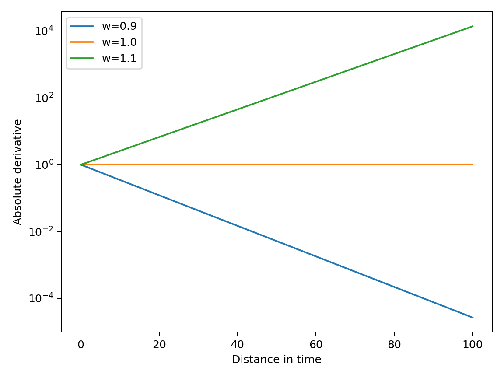
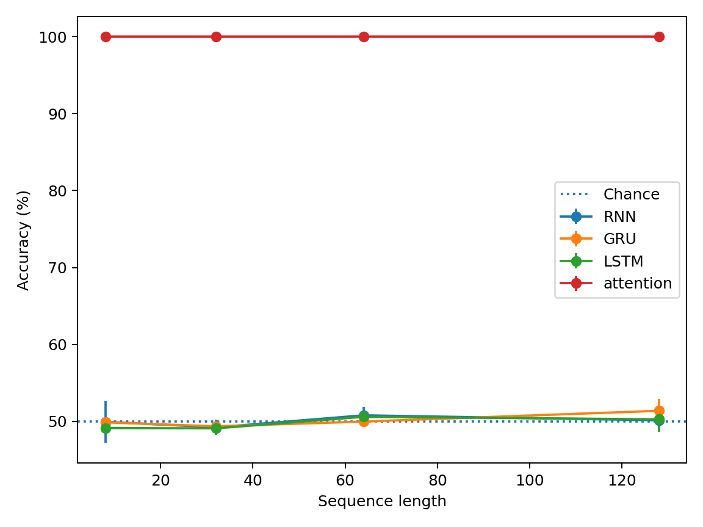
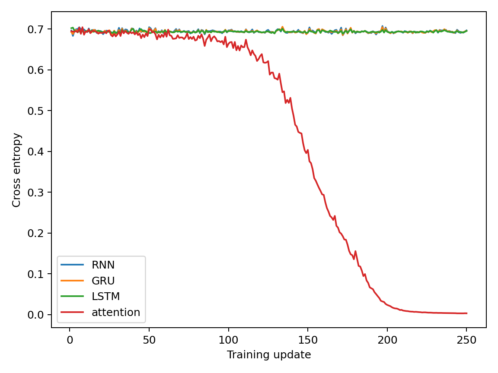
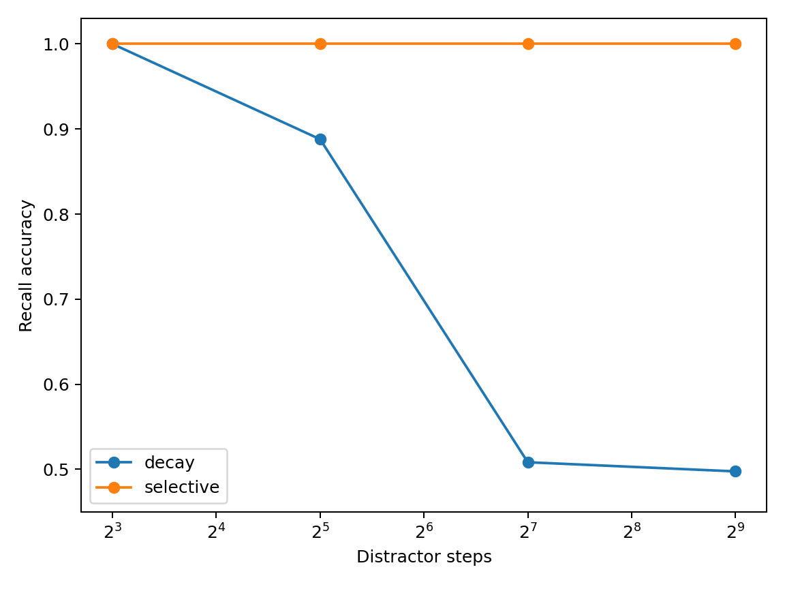
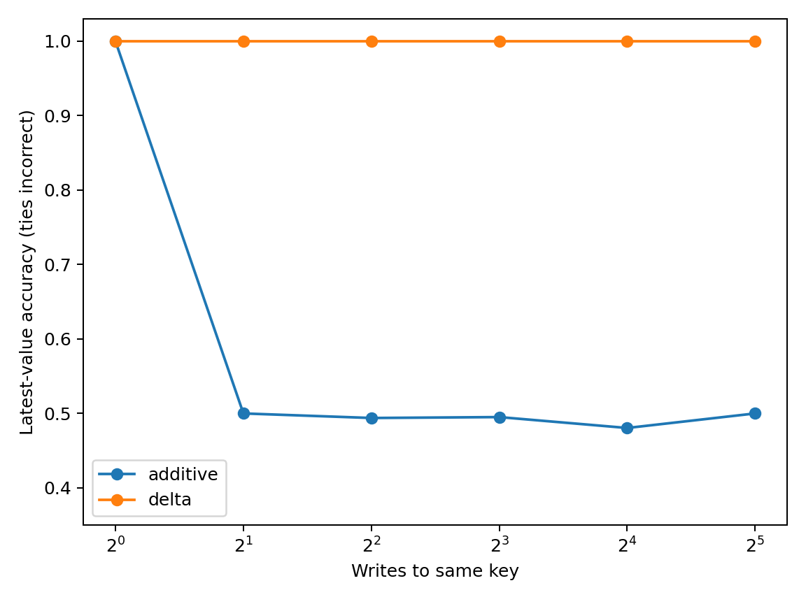

# How Does a Neural Network Remember? From LSTM Gates to the Architecture of Modern LLMs

*Build neural memory from scratch, understand why recurrent networks forget, and explore the research that connects RNNs, LSTMs, transformers, and Mamba.*

Imagine implementing a streaming application that processes thousands of events. Somewhere near the beginning of the stream, you receive a piece of information that will become important much later. You do not yet know when you will need it. Meanwhile, hundreds of unrelated events continue arriving.

As a software engineer, you might solve this problem with a dictionary, a cache, or a state machine. But how does a neural network solve it? How does it decide what to remember, discard, retrieve, or overwrite?

Those are distinct engineering problems. A network that preserves a bit indefinitely may still fail to retrieve a particular key-value association. A network that can represent a useful memory may never discover how to use it during gradient-based training.

We will investigate these distinctions with a previously executed 12-run neural-network comparison and three new controlled numerical experiments. The latter isolate retention, overwriting, and parallel scan, using hand-designed rules rather than claiming to train a modern language model. The journey starts with the recurrent computational graph and ends with research on efficient language-model memory in 2026.

## Abstract

This tutorial reviews recurrent and recursive sequence modeling, following Chapter 10 of Goodfellow, Bengio, and Courville (2016) and extending it to contemporary architectures. We derive backpropagation through time (BPTT), verify a NumPy implementation against automatic differentiation, investigate gradient propagation, and compare a vanilla RNN, GRU, LSTM, and single-query attention pooling on a synthetic delayed-recall task. We connect the findings to gating, reservoir computing, encoder-decoder attention, external memory, transformers, linear attention, and selective state-space models. The revised study adds controlled simulations of selective retention and overwrite, plus a numerical verification of an affine parallel scan. The experiments are educational and do not establish architecture superiority on real-world workloads.

**Keywords:** sequence modeling, BPTT, recurrent neural networks, LSTM, GRU, attention, state-space models, associative memory.

## Contents

1. The problem with treating a sequence as a vector
2. Building recurrence and backpropagation from scratch
3. Why gradients disappear
4. LSTM and GRU: learning when to forget
5. The experiment: remembering a bit
   - New lab: selective retention and overwrite
6. Teacher forcing, probability and generation
7. Bidirectionality, encoder-decoders and attention
8. Recursive networks, reservoirs and multiple time scales
9. External memory and the transformer
10. The return of recurrence: S4, Mamba and modern alternatives
11. Engineering sequence models in practice
12. Discussion, exercises and references
13. References

## 1. The problem with treating a sequence as a vector

Consider two event streams: `login → failed payment → logout` and `logout → failed payment → login`. They contain the same events, but describe different processes. A bag of events discards order; a dense network operating on a flattened fixed-length sequence assigns separate parameters to positions and cannot directly accept arbitrary lengths.

Elman (1990) explored a different approach: make the representation at the current step depend on the previous representation. Instead of learning a new operation for every position, learn one transition and reuse it.

```text
h[t] = tanh(U @ x[t] + W @ h[t-1] + b)
o[t] = V @ h[t] + c
```

For input dimension D, hidden dimension H, and output dimension K, U has shape H × D, W has shape H × H, and V has shape K × H. Including biases, the parameter count is H(D + H + 1) + K(H + 1). Sequence length T does not enter the count. The compute still grows with T.

Think of the hidden state as an accumulator in a streaming program. It is not a database of all previous events. It is a learned, generally lossy summary. Sharing weights permits processing lengths not seen in training, but does not guarantee successful extrapolation. A recurrent transition is also a modeling assumption: similar updates should be useful at different positions. Calendar features or timestamps can be added when dynamics are nonstationary.

A causal 1D convolution instead processes a local window. Dilation and stacking can extend its receptive field. Recurrence connects the past through the state, whereas convolution creates a finite receptive field determined by the architecture. Both share parameters across time.

The recurrent graph contains a delayed feedback connection. Unrolling it for T steps gives a directed acyclic computational graph with T applications of the same transition. Each application has its own activation but shares the same weights. That is why automatic differentiation can train it, and why conventional nonlinear recurrence is difficult to parallelize along time.

Theoretical results on recurrent networks simulating computation (Siegelmann & Sontag, 1995) assume idealized arithmetic and do not imply that a finite-precision trained RNN can reliably learn arbitrary programs.

## 2. Building recurrence and backpropagation from scratch

Install the companion lab:

```bash
python -m venv .venv
source .venv/bin/activate
pip install -r requirements.txt
python lab.py
python memory.py
```

On Windows PowerShell use `.venv\Scripts\Activate.ps1`. The dataset is generated locally. No API key or GPU is needed.

Start with a final-state squared-error objective L = 0.5 × ||h[T]||². This deliberately simple loss makes the gradient derivation easy to inspect. If d[t] denotes the gradient of L with respect to h[t], the preactivation gradient is:

```text
a_grad[t] = d[t] * (1 - h[t]**2)
d[t-1] = W.T @ a_grad[t]
W_grad += outer(a_grad[t], h[t-1])
U_grad += outer(a_grad[t], x[t])
```

The sums matter. The same W participates at every time step, so its gradient is the sum of contributions from every use. If there is an output loss at each step, add V.T @ o_grad[t] to d[t] before propagating it. For softmax cross-entropy, o_grad is predicted probabilities minus the one-hot target (for a summed loss).

This is BPTT (Werbos, 1990), not a fundamentally different differentiation algorithm. Here is the core implementation from the lab:

```python
import numpy as np
rng = np.random.default_rng(1)
x = rng.normal(size=(7, 3))
U = rng.normal(size=(4, 3)) * .2
W = rng.normal(size=(4, 4)) * .2
h = [np.zeros(4)]
for a in x:
    h.append(np.tanh(U @ a + W @ h[-1]))
d = h[-1].copy()
gW = np.zeros_like(W)
gU = np.zeros_like(U)
for t in reversed(range(len(x))):
    da = d * (1 - h[t + 1]**2)
    gW += np.outer(da, h[t])
    gU += np.outer(da, x[t])
    d = W.T @ da
```

To check it, build the same graph in PyTorch:

```python
import torch
u = torch.tensor(U, requires_grad=True)
w = torch.tensor(W, requires_grad=True)
z = torch.zeros(4, dtype=torch.float64)
for a in torch.tensor(x):
    z = torch.tanh(u @ a + w @ z)
(z.square().sum() / 2).backward()
print(np.max(abs(gU - u.grad.numpy())))
print(np.max(abs(gW - w.grad.numpy())))
```

Our measured maximum absolute errors were 5.55e-17 for U and 4.16e-17 for W. The implementation agrees with autograd to floating-point precision in this example. This test is a useful habit when implementing a custom operator: compare forward values and gradients separately against a trusted reference.

Ordinary BPTT stores activations across the sequence, giving training memory proportional to T for fixed width and batch. Streaming inference can retain just the current state. Truncated BPTT detaches the state every K steps. The forward state survives but gradients cannot cross the detached boundary, which changes the learning signal. Activation checkpointing instead recomputes activations and can preserve the full gradient at additional compute cost.

## 3. Why gradients disappear

Hochreiter (1991) and Bengio et al. (1994) identified a problem that became central to recurrent learning: information can be representable in a model while still being extremely difficult to learn through gradients.

For a scalar linear recurrence h[t] = w × h[t-1], the derivative of h[T] with respect to h[0] is w**T. Repeated multiplication is the problem. A factor of 0.9 seems harmless, but after 100 steps it is about 0.0000266. A factor of 1.1 grows to about 13,781. Neither behavior is good for stable long-range credit assignment.

```python
import numpy as np
for w in [.9, 1., 1.1]:
    print(w, w**100)
```



*Figure 1. Exact scalar derivatives for three fixed recurrent weights. The logarithmic axis makes exponential decay and growth visible. This is a mathematical demonstration, not a measured gradient distribution from a trained LSTM.*

For the nonlinear recurrence, the local Jacobian is diag(1 - h[t]²) @ W. Backpropagation multiplies transposed Jacobians. Saturated tanh units have small derivatives, even when the recurrent weight matrix looks well-conditioned. Eigenvalues explain the fixed linear case, but products of changing, noncommuting Jacobians require more care. Spectral radius below one implies asymptotic decay for a fixed linear matrix, not necessarily one-step contraction in Euclidean norm; singular values bound instantaneous amplification.

Pascanu et al. (2013) proposed clipping the global gradient norm and regularizing the propagation of gradients. The clipping rule is g ← g × min(1, threshold / ||g||). It prevents unusually large gradient updates but cannot restore a vanished learning signal. With Adam, clipping bounds the input gradient, not necessarily the final parameter-update norm.

```python
loss.backward()
torch.nn.utils.clip_grad_norm_(model.parameters(), 1.0)
optimizer.step()
```

This snippet belongs inside a training loop after zeroing gradients. Log the norm before clipping. When training in mixed precision, unscale gradients before clipping. Stop and diagnose NaNs rather than blindly continuing with corrupted optimizer state.

## 4. LSTM and GRU: learning when to forget

The 1997 LSTM paper introduced a controlled path for error propagation (Hochreiter & Schmidhuber, 1997). Gers et al. (2000) added the learned forget gate, an important distinction from the original architecture. The resulting modern LSTM is best understood as a memory update rather than a collection of four mysterious equations.

Imagine a service maintaining a session cache. It must decide whether to preserve the cached information, write something new, and expose the result to downstream processing. An LSTM makes analogous decisions continuously using learned gates.

```text
q = concatenate(x[t], h[t-1])
f = sigmoid(Wf @ q + bf)      # retention
i = sigmoid(Wi @ q + bi)      # write gate
g = tanh(Wg @ q + bg)         # candidate content
o = sigmoid(Wo @ q + bo)      # exposure gate
c[t] = f * c[t-1] + i * g
h[t] = o * tanh(c[t])
```

The equations are pseudocode. The cell state c is distinct from the exposed hidden state h. Holding gate values fixed, the direct derivative through the cell-state path is f. Across many steps it becomes the product of the forget gates. With f near 1, this path can preserve information much longer than a repeatedly saturated tanh. The full derivative also includes indirect paths through the gates, so LSTMs are not immune to vanishing or exploding gradients.

A forget value of 0.99 has a retention half-life of about 69 steps. A value of 0.9 has a half-life of about 6.6 steps. This connects gated recurrence to classical leaky integrators. A model can learn different time scales for different dimensions and different events.

Here is an educational LSTM cell that combines the four affine operations:

```python
from torch import nn
class MyLSTMCell(nn.Module):
    def __init__(self, d, h):
        super().__init__()
        self.gates = nn.Linear(d + h, 4*h)
    def forward(self, x, state):
        h, c = state
        i, f, g, o = self.gates(torch.cat([x, h], -1)).chunk(4, -1)
        c = f.sigmoid()*c + i.sigmoid()*g.tanh()
        h = o.sigmoid()*c.tanh()
        return h, c
```

Framework LSTMs fuse operations and often use two bias vectors rather than this single vector. Forget-gate bias initialization can encourage retention early in training (Jozefowicz et al., 2015); chrono initialization explicitly incorporates a prior over time scales (Tallec & Ollivier, 2018).

Cho et al. (2014) introduced the GRU in their encoder-decoder research. It eliminates the separate cell state and uses a reset gate and an update gate. In the PyTorch convention:

```text
r = sigmoid(Wir @ x + bir + Whr @ h + bhr)
z = sigmoid(Wiz @ x + biz + Whz @ h + bhz)
n = tanh(Win @ x + bin + r * (Whn @ h + bhn))
h_new = z * h + (1-z) * n
```

The reset gate controls how history influences the candidate; z determines how much old state is retained. Some publications reverse the meaning of z or apply the reset before the recurrent matrix multiplication. Do not interchange weights between implementations without checking this convention.

A single-layer PyTorch RNN with input width D and hidden width H has H(D+H+2) recurrent parameters; a GRU has three times that and an LSTM four times that, before the output head. Actual speed depends on fused kernels and device utilization, not just parameter counts. Studies by Greff et al. (2017) and Jozefowicz et al. (2015) examined gate variants; no universally winning design emerged.

## 5. The experiment: remembering a bit

Now let us recreate the streaming problem in miniature. At time zero, a bit is marked as important. The remaining bits are independently sampled distractors. At the end, predict the first bit. The marker is an explicit input, not a target leak: the task definition tells the model which event matters, but it must retain or retrieve its value.

```python
from lab import batch, MemoryModel
import torch
x, y = batch(4, 32, torch.Generator().manual_seed(42))
print(x.shape, y.shape)  # (4, 32, 3), (4,)
```

Input features are a two-dimensional one-hot bit and a marker channel. The recurrent models read the final hidden state. The attention model projects every token into a key and value, scores each key with a learned query, and pools the values with softmax weights. This is a single-query readout, not a complete transformer and not full pairwise self-attention.

```python
from torch import nn
m = MemoryModel('LSTM')
opt = torch.optim.Adam(m.parameters(), lr=.003)
rng = torch.Generator().manual_seed(111)
for step in range(250):
    x, y = batch(64, 32, rng)
    opt.zero_grad()
    loss = nn.functional.cross_entropy(m(x), y)
    loss.backward()
    nn.utils.clip_grad_norm_(m.parameters(), 1.)
    opt.step()
```

Run `python lab.py` to reproduce the full experiment. The model width is 32, seeds are 11, 22, 33, training length is 32, and each run observes 16,000 generated sequences in 250 updates. All configurations use Adam at 0.003 and clipping at 1. Test batches are independently generated with fixed seeds shared across models, 1,024 sequences per length. No validation-based selection or tuning was performed. The final checkpoint is evaluated once at each length.

The attention readout is implemented in the lab as:

```python
a = (self.key(x) @ self.query / 32**.5).softmax(dim=1)
h = (a.unsqueeze(-1) * self.value(x)).sum(1)
```

This makes the structural difference explicit: attention has a direct route to the marked input. The recurrent model must transport useful information through each intermediate state. The task favors the attention inductive bias, and a deterministic program that returns the first bit is an even simpler perfect baseline.

### Results

- **RNN (1,250 parameters):** T=8: 49.93% ± 2.72 pp; T=32: 49.22% ± 0.98 pp; T=64: 50.78% ± 1.12 pp; T=128: 50.13% ± 0.93 pp.
- **GRU (3,618 parameters):** T=8: 49.87% ± 0.36 pp; T=32: 49.35% ± 0.30 pp; T=64: 49.97% ± 0.09 pp; T=128: 51.37% ± 1.53 pp.
- **LSTM (4,802 parameters):** T=8: 49.12% ± 0.21 pp; T=32: 49.09% ± 0.30 pp; T=64: 50.59% ± 0.44 pp; T=128: 50.26% ± 1.61 pp.
- **attention (354 parameters):** T=8: 100.00% ± 0.00 pp; T=32: 100.00% ± 0.00 pp; T=64: 100.00% ± 0.00 pp; T=128: 100.00% ± 0.00 pp.



*Figure 2. Mean test accuracy with population standard deviation across three training seeds. Training length is 32. The other lengths probe behavior outside the training length. The dotted line indicates the theoretical 50% chance baseline.*



*Figure 3. Mean training cross-entropy per update across seeds. Fresh random batches cause fluctuations; the curves are not validation loss.*

The surprising observation is not that attention can solve this task. It is that merely replacing a vanilla recurrent cell with a gated one did not solve it within our chosen training budget. An LSTM has a path for retaining the bit but must discover the right gate behavior through optimization. The readout has direct access to all tokens and can learn to emphasize the marked one.

The attention model has 354 parameters, whereas the LSTM has 4,802. That does not make it a general replacement for an LSTM: this task needs only selection, not complicated temporal computation. The attention model has no positional representation except the marker, and cannot distinguish permutations of unmarked tokens. The RNN can in principle model order-dependent computations. A fair general architecture comparison would include variable marker positions, multiple key-value bindings, sequential state tracking, matched resource budgets, learning-rate searches, and a wider range of seeds. We did not perform those broader trained-model experiments.

### New experiment: a memory that knows when not to write

Imagine a service that receives a configuration update followed by ordinary telemetry. It would be absurd to overwrite its configuration with each telemetry value. Yet a fixed leaky integrator does something analogous: it blends every observation into its state.

Start with a bit b ∈ {−1, +1}. Then apply h = 0.95h + 0.05x for T independent standard Gaussian distractors. The contribution of the original bit is 0.95 raised to T, while the noise accumulates. Conditional on b, the final state is Gaussian with mean 0.95^T b and variance 0.05² times the sum of 0.95^(2j), for j from 0 to T−1. The signal-to-noise ratio tends to zero, even though the state never explodes. In contrast, a selective memory can use a supplied write flag to accept the initial bit and skip all later writes.

```python
import numpy as np
rng = np.random.default_rng(42)
bit = rng.choice([-1., 1.], 4096)
h = bit.copy()
for x in rng.normal(size=(128, 4096)):
    h = .95*h + .05*x
print(np.mean(np.sign(h) == bit))
```

The complete experiment in `memory.py` uses four lengths with a single reproducible random generator. At 8, 32, 128 and 512 distractor steps, the measured fixed-decay accuracies are 100%, 88.79%, 50.83% and 49.76%. The explicit gate preserves 100% at each length. It has privileged knowledge of the write flag and is not trained. The code excerpt uses a different random draw order from the full experiment, so its exact output need not match the figure.



*Figure 4. Accuracy over 4,096 synthetic trials per length. Fixed-decay recurrence versus an oracle-controlled write gate. This is a mechanism demonstration, not a learned LSTM or Mamba benchmark.*

Why does this matter? In the LSTM cell, the product of forget gates determines the direct path for old information. Selectivity means we need not impose one time constant on every event. But a learned gate must infer which input deserves a write and when to reset. This explains why the earlier trained LSTM experiment can fail despite the existence of a perfect hand-designed gate.

### New experiment: remembering is not the same as updating

Suppose a stream contains `PUT user_id = 7` followed by `PUT user_id = 9`. The correct answer to a lookup is 9, not 16. A purely additive memory needs some way to remove the obsolete association.

Consider a matrix memory S with key k and value v, both column vectors. An additive update is S ← S + v kᵀ. Reading uses S k. If the key is unit length and is repeatedly written, old values accumulate. The delta rule changes the update to:

```text
prediction = S @ k
error = v - prediction
S = S + beta * outer(error, k)
```

For a unit key and beta = 1, reading that key after the update returns exactly v. Other keys orthogonal to k are unaffected. Nonorthogonal keys experience interference proportional to their inner product with k. This is a useful mathematical bridge from associative memory to modern delta-rule recurrent networks, not a complete Gated DeltaNet layer.

```python
import numpy as np
S = np.zeros((2, 2))
k = np.array([1., 0.])
for v in [np.array([1., 0.]), np.array([0., 1.])]:
    S += np.outer(v - S @ k, k)
assert np.allclose(S @ k, [0., 1.])
```

Our new scalar same-key simulation writes independent signed bits repeatedly and asks for the most recent bit. After 32 writes, additive memory gets 49.98% correct when zero-valued ties count as errors; delta memory gets 100%. At two writes additive memory scores 49.98%, largely because opposite values cancel and are scored incorrect. A random tie-breaking rule would change the additive baseline. This is intentional: we measure whether the stored sign actually identifies the value, not whether a guess happens to be correct.



*Figure 5. Latest-value recall for additive and exact delta updates on 4,096 independent trials per write count. The scalar key is fixed and known; this is not a multi-query associative recall benchmark.*

Real language models face a harder problem: keys are learned, multiple associations coexist, values may be ambiguous, and the model must decide when to update. The Zoology study (Arora et al., 2024a) developed multi-query associative recall to examine this gap. Their subsequent Based study (Arora et al., 2024b) explores the balance between recall and throughput using linear attention and local mechanisms. Yang's DeltaNet technical explanation (2024) provides a useful bridge between the delta rule and efficient implementation. The research question is no longer simply whether a state can retain information, but whether it can support many selective reads and writes without intolerable interference.

## 6. Teacher forcing, probability and generation

A sequence model can be trained to estimate a joint distribution without constructing a table of every possible sequence. The probability chain rule states:

```text
P(y[1:T]) = product over t of P(y[t] | y[1:t-1])
```

Taking the negative logarithm converts the product into a sum. Next-token prediction is therefore a maximum-likelihood objective, not merely a convenient classification trick. An RNN compresses the conditioning history into h; an attention-based language model represents it differently. Both can use the same objective.

In teacher forcing, the input token at each step is the true preceding token. During free-running generation it is the model's sampled or selected output instead. This creates a mismatch: a model might perform well under true histories but drift after its own errors. Scheduled sampling (Bengio et al., 2015) mixes generated and true inputs during training, but Huszár (2015) showed that its objective has statistical consistency issues. Professor forcing (Lamb et al., 2016) instead encourages similar dynamics between training and sampling modes. None is an automatic fix; evaluate the actual rollout distribution.

For a token sequence, the implementation pattern is:

```python
inputs = tokens[:, :-1]
targets = tokens[:, 1:]
logits = language_model(inputs)  # B,T,V
loss = nn.functional.cross_entropy(
    logits.reshape(-1, logits.size(-1)), targets.reshape(-1))
```

This schematic assumes token IDs and a model returning vocabulary logits. Ignore padded labels with `ignore_index`, and mask padding wherever the architecture requires it. A beginning-of-sequence token starts generation; an end-of-sequence token stops it, subject to a maximum length safeguard. Other stopping formulations include predicting a length or a separate halting probability (Goodfellow et al., 2016).

Teacher forcing does not eliminate the sequential hidden-state dependencies of an ordinary RNN. It can decouple an architecture whose *only* temporal connection comes from a supplied previous output. Transformers can compute training positions in parallel with a causal mask, but autoregressive inference still generates tokens sequentially.

For conditional generation, factorize P(Y|X) similarly, conditioning on the source X. If output tokens are never fed back and the hidden states depend only on X, outputs may be conditionally independent given X; adding autoregressive feedback permits dependence among output tokens.

## 7. Bidirectionality, encoder-decoders and attention

A streaming fraud detector cannot use next week's transactions to make today's decision. An offline transcription system can use audio on both sides of an ambiguous phoneme. The difference is whether future observations are available at deployment.

Schuster and Paliwal (1997) introduced bidirectional RNNs that combine forward and backward states at each position. In PyTorch:

```python
encoder = nn.LSTM(16, 32, batch_first=True, bidirectional=True)
x = torch.randn(4, 20, 16)
y, (h, c) = encoder(x)
print(y.shape, h.shape)  # (4,20,64), (2,4,32)
```

For sequence classification with a bidirectional LSTM, concatenate the final forward and backward states from h, not simply y[:, -1], which contains the backward state at the last input position rather than its complete reverse summary. With padded variable-length sequences, use packed sequences or carefully gather valid states.

Cho et al. (2014) and Sutskever et al. (2014) developed encoder-decoder approaches that could map sequences of different lengths. An encoder reads a source sentence and a decoder generates a target sentence. In the original fixed-context design, the decoder must recover everything it needs from a fixed-size vector. A source sentence and its translation need not have equal lengths. Sutskever et al. explored reversing source sentences to shorten some dependency paths.

Bahdanau et al. (2015) addressed the bottleneck by letting the decoder attend to encoder states. At output step t, compute a score for every input position j, normalize the scores, and form a weighted context vector.

```text
e[t,j] = v.T @ tanh(Wq @ decoder_state[t-1] + Wk @ encoder_state[j])
a[t,:] = softmax(e[t,:])
context[t] = sum over j of a[t,j] * encoder_state[j]
```

This is additive attention. Modern scaled dot-product attention uses QKᵀ / sqrt(d) as scores. Our lab uses the simpler dot-product idea with one learned query. It illustrates the removal of the recurrent bottleneck but is not a reproduction of Bahdanau's translation system.

Stacked recurrent networks add depth across layers as well as time. They may produce richer representations but introduce more optimization paths. Residual connections can help; layer normalization can stabilize activations. Deep RNN design is discussed by Pascanu et al. (2014). Connectionist Temporal Classification (Graves et al., 2006) provides an alternative for monotonic input-output alignment by summing probabilities of valid alignments; it is not the same as an autoregressive encoder-decoder.

## 8. Recursive networks, reservoirs and multiple time scales

Not every structured input is naturally a chain. Consider an abstract syntax tree for `(a+b)*(c-d)`. A tree model can combine each pair of children and then compose the parent representation. Pollack (1990) studied recursive distributed representations; Tai et al. (2015) extended LSTM-style computation to trees. A balanced binary tree with T leaves has logarithmic depth, though total work still scales linearly in the number of nodes. An unbalanced tree can have linear depth, and choosing the wrong tree may destroy useful structure.

```python
class TreeCompose(nn.Module):
    def __init__(self, width):
        super().__init__()
        self.merge = nn.Linear(2*width, width)
    def forward(self, left, right):
        return self.merge(torch.cat([left, right], -1)).tanh()
```

This is one binary composition operator, not a full Tree-LSTM. Reuse it at every internal node. A compiler engineer can schedule nodes by depth, processing independent subtrees in parallel. Tree-LSTMs introduce gates for child states, and graph neural networks generalize message passing to non-tree structures.

An alternative to training recurrent weights is to freeze them. Echo state networks (Jaeger & Haas, 2004) create a reservoir of nonlinear temporal features and learn a readout, often with ridge regression. This avoids BPTT through the reservoir. The following illustrative NumPy procedure fits a one-step predictor on a synthetic signal:

```python
rng = np.random.default_rng(42)
W = rng.normal(size=(40,40))
W *= .9 / np.max(np.abs(np.linalg.eigvals(W)))
U = rng.normal(size=40) * .3
signal = np.sin(np.arange(1001)*.07)
h = np.zeros(40)
states = []
for value in signal[:-1]:
    h = np.tanh(W @ h + U*value)
    states.append(h.copy())
H = np.asarray(states)
A = H[50:800]
b = signal[51:801]
readout = np.linalg.solve(A.T@A + .01*np.eye(40), A.T@b)
pred = H[800:] @ readout
print(np.mean((pred-signal[801:])**2))
```

The initial 50 steps serve as washout; the final 200 are a chronological one-step evaluation using observed previous inputs, not a free-running forecast. Spectral scaling is a heuristic, not a sufficient echo-state guarantee for arbitrary nonlinear reservoirs. Liquid state machines (Maass et al., 2002) use spiking dynamics; both belong to reservoir computing.

Another approach is to build several memory time scales. A leaky state follows `h = alpha*h + (1-alpha)*x`; larger alpha retains information longer. Skip connections across time shorten some gradient paths; clockwork RNNs update groups at different rates (Koutník et al., 2014). Orthogonal or unitary recurrence constrains linear propagation, though nonlinearities and input dependence still matter. These ideas are important because modern efficient architectures revisit selective retention and parallelizable state transitions rather than inventing the memory problem anew.

## 9. External memory and the transformer

When a database grows, you do not ordinarily compress its entire content into a single mutable register. You retain records and build a retrieval mechanism. Neural Turing Machines (Graves et al., 2014) explored differentiable read and write operations over an external memory matrix. A read can be expressed as a weighted sum of memory slots. A write can use soft erase and add vectors, making addressing differentiable. Memory Networks (Weston et al., 2015) and Differentiable Neural Computers (Graves et al., 2016) developed related approaches. These architectures distinguish stored content from the controller that decides how to access it.

Vaswani et al. (2017) removed conventional recurrence from the transformer and used attention for token interactions. Self-attention constructs queries, keys and values from the sequence itself. Causal attention masks future positions. At fixed width, dense attention has quadratic pairwise arithmetic in sequence length, whereas a conventional recurrent layer has linear work but sequential depth. Transformer training can exploit parallel matrix operations across positions; generation still has a sequential outer loop.

FlashAttention (Dao et al., 2022) computes exact attention with tiling and online softmax, avoiding the need to materialize the full attention matrix in high-bandwidth memory. It does not remove the quadratic pairwise arithmetic. KV caching avoids recomputing previous projections during autoregressive decoding but stores keys and values growing with context length. Grouped-query attention (Ainslie et al., 2023) reduces the number of KV heads and therefore cache footprint.

For example, a hypothetical 32-layer model with 8 KV heads, head dimension 128 and BF16 cache requires 2 × 32 × 8 × 128 × 2 = 131,072 bytes per token per sequence, excluding allocator overhead. At 32,768 tokens that is 4 GiB. This is a worked estimate, not a benchmark. Quantization, paging, sliding windows and architecture choices alter actual usage.

External retrieval systems differ from KV caching: retrieval can access records beyond the current context, while the cache contains intermediate representations of tokens already processed. RAG (Lewis et al., 2020) retrieves external documents for conditional generation; it is not a replacement for all sequence memory.

## 10. The return of recurrence: S4, Mamba and modern alternatives

The tension between retrieval flexibility and bounded memory motivates a family of efficient sequence models. Start with a discrete linear state-space model:

```text
s[t] = A @ s[t-1] + B @ x[t]
y[t] = C @ s[t] + D @ x[t]
```

With constant matrices and zero initial state, expanding the recurrence yields a causal convolution with impulse-response coefficients C @ A**k @ B (matrix power). This is a powerful connection between the previous chapter's convolutional networks and the current chapter's recurrence. A model can train using a convolutional or scan formulation and perform streaming inference by maintaining state.

HiPPO (Gu et al., 2020) studied online compression of histories using polynomial projections. S4 (Gu et al., 2022) used structured state matrices to make long sequence modeling efficient. S5 (Smith et al., 2023) developed a simplified multi-input multi-output state-space layer using parallel scans. Mamba (Gu & Dao, 2024) made important state-space parameters input-dependent, enabling selective retention. Input dependence prevents a single stationary convolution kernel from describing the whole sequence; specialized selective scans address the computation.

For diagonal affine recurrence, composition of two transitions is associative:

```text
(a2,b2) compose (a1,b1) = (a2*a1, a2*b1+b2)
```

This makes a prefix scan possible. Work can remain linear with logarithmic parallel depth in suitable implementations. Ordinary nonlinear RNN transitions do not generally have such a compact closed composition law. This is the systems insight behind several recent linear-recurrent architectures.

Mamba-2 (Dao & Gu, 2024) connects structured state-space models and a class of structured attention-like operators through state-space duality. Mamba-3 (2026) revisits discretization, complex-valued state dynamics and multi-input multi-output computation; its authors report improvements over their comparison models at 1.5B scale. These are paper-reported findings, not results from our CPU lab.

A related line begins with linear attention (Katharopoulos et al., 2020). A feature map can allow attention-like aggregation to be expressed using a cumulative matrix state, rather than retaining every key-value pair. For normalized causal linear attention, maintain S = sum phi(k) vᵀ and z = sum phi(k); read with phi(q)ᵀ S / (phi(q)ᵀ z), assuming a positive nonzero denominator. The resulting operation is not generally identical to softmax attention. RWKV (Peng et al., 2023), RetNet (Sun et al., 2023), and Gated DeltaNet (Yang et al., 2025) explore different mechanisms for efficient recurrent or retention-based computation. Delta-rule updates can revise a stored key-value association rather than merely accumulating new contributions.

xLSTM (Beck et al., 2024) revisits LSTM design with exponential gating, stabilization and scalar or matrix memory variants. It is not simply a bigger conventional LSTM. Hybrid models such as Jamba (Lieber et al., 2024) combine attention with state-space layers, reflecting a practical compromise between access to individual tokens and compact state.

These architectures have fixed-size state with respect to sequence length at fixed model dimensions, but state size can grow substantially with hidden width and number of layers. Training activations still require memory. Hardware efficiency, numerical stability and kernel implementation are decisive. Do not infer deployment speed from asymptotic complexity alone.

Jelassi et al. (2024) investigate copying sequences with transformers and state-space models, demonstrating limitations of fixed-state compression for certain retrieval tasks. This echoes our toy experiment: the best memory architecture depends on what information must survive and how it must be accessed. A single marked bit needs tiny storage; remembering arbitrary key-value associations or copying long unpredictable sequences is harder. Recent surveys of state-space models (2025–2026) document applications in language, time series, vision and biological sequences, alongside these open questions.

### A practical bridge: parallelizing recurrence without changing its answer

The usual recurrent loop has a dependency on its previous output. An affine state update is special because we can compose transitions without knowing the initial state. For two updates, the combined coefficient is a2*a1 and the combined input is a2*b1+b2. The composition is associative but not commutative: order still matters.

The new lab verifies the entire sequence of 129 four-dimensional states against an inclusive parallel prefix scan. The educational Hillis-Steele implementation doubles the offset each round and copies the previous stage before updating. It uses O(T log T) work, unlike a work-efficient tree scan with O(T) work, but makes the mechanism easy to inspect.

```python
# a and b are arrays of shape (T, D); initial state is zero.
A, B = a.copy(), b.copy()
offset = 1
while offset < len(A):
    A0, B0 = A.copy(), B.copy()
    A[offset:] = A0[offset:] * A0[:-offset]
    B[offset:] = A0[offset:] * B0[:-offset] + B0[offset:]
    offset *= 2
```

The measured maximum absolute error relative to the serial loop was 8.88e−16 in float64. This is numerical equivalence, not a runtime benchmark. Martin and Cundy (2018) studied exploiting this property in recurrent models. The larger point for engineers is that a sequential mathematical definition need not imply sequential execution when an associative representation is available.

### Where the research went in 2026

Mamba-3 (ICLR 2026) combines changes in discretization, complex state dynamics and multi-input multi-output computation. At 1.5B parameters the authors report a 0.6 percentage-point average downstream improvement over Gated DeltaNet, with the MIMO variant adding another 1.2 points in their evaluation. Their methodological blog explains the numerical integration motivation. A subsequent preprint by Liang and Song (2026) investigates oscillatory dynamics and reports benefits on state tracking and length extrapolation in its controlled comparisons. Neither result establishes superiority for every sequence task.

ParaRNN (ICLR 2026) attacks a different bottleneck: parallel training of nonlinear recurrent models. Its research framework uses numerical methods to address the dependency structure rather than simply restricting every transition to an affine map. This is an important qualification to the conventional statement that nonlinear recurrence must always be trained with a serial loop. See the accompanying Apple research article for the implementation motivation; speedups are specific to its benchmark and hardware.

DART (August 2026 preprint) retains chunk-level recurrent state contributions and decodes keys and values for attention over those summaries. Hierarchical Memory Mamba (Wang et al., 2026 preprint) explores compressing and retrieving larger semantic units. Both investigate intermediate designs between a single fixed recurrent state and a full token-level cache. They are evidence of active investigation, not proof that the fixed-state retrieval problem has been solved. The trade-off is familiar to anyone who designs storage systems: a compressed index can be cheaper than preserving every record but may lose information required by an unexpected query.

## 11. Engineering sequence models in practice

A model architecture is only one part of a streaming system. First define what context is available at inference. For forecasting, split chronologically and fit preprocessing on the training period only. Randomly splitting overlapping windows can leak nearly identical observations across partitions. For multiple users or patients, split by identity when the deployment target is unseen identities. Compare persistence, moving average and autoregressive baselines before investing in complex architectures.

When batching variable-length sequences, remember that zero is a value, not necessarily padding. For classification with a recurrent model, the final padded time step is not the last valid state. Use `pack_padded_sequence` or gather the valid index. For language models, mask both invalid attention positions and padded targets where appropriate. For streamed requests, maintain one state per stream, reset at true boundaries, and avoid carrying one user's state into another's session.

A practical debugging sequence:

- Overfit a tiny batch to detect label alignment and implementation bugs.
- Inspect per-step gradient norms and gate distributions, not just a single loss value.
- Compare teacher-forced and free-running performance where generation is the task.
- Evaluate by dependency length rather than relying on aggregate accuracy.
- Test longer lengths and different event distributions separately from in-distribution data.
- Measure prefill latency, per-token decode latency, throughput, peak memory and numerical precision on the actual target device.

For real-time sensor processing, a small GRU or causal convolution may be an excellent baseline. For offline tagging, bidirectional recurrence or an encoder transformer is appropriate. For machine translation, encoder-decoder attention provides flexible alignment. For long streams with resource limits, compare state-space models, recurrent linear attention and hybrids. For exact long-context retrieval, explicitly test the information retention requirement, potentially using external storage. No architecture is automatically the right choice.

## 12. Discussion and exercises

Our results establish three limited claims: manual BPTT matched autograd in one test; repeated scalar derivatives demonstrate exponential decay and growth; and the tested attention readout solved the marked-bit task under a budget where the three tested recurrent configurations did not. They do not show that gated models cannot learn this task with different training or initialization. They also do not compare full transformer or Mamba implementations. The attention readout has direct access to the whole sequence and is intentionally well matched to a marked-token selection task. Parameter counts differ; only three seeds were used, and no hyperparameter sweep was conducted.

Try extending the lab. Start with length 4 and gradually increase to 32, compare fixed-length training with variable-length training, initialize the LSTM forget bias differently, and measure whether recall changes. Then move the marker to a random position and introduce multiple marked keys followed by a query. Finally create a state-tracking task where the answer depends on the order of all events, not a single token. Keep an independent test seed and use a separate validation stream to tune configurations. Compare performance at equal update budgets and equal wall-clock budgets, and report both.

The central lesson of sequence modeling is that memory is not one thing. It is a choice about what to preserve, how to preserve it, how to retrieve it, and whether gradients can teach those behaviors. The history from Elman networks to LSTMs, attention and modern state-space models is a history of different answers to these same questions.

The next time you write `nn.LSTM()` or load a transformer, ask what information your architecture is designed to remember, what it is likely to discard, and how you would test that assumption. That is a more useful starting point than asking which architecture is newest.

## References

The bibliography is a selected narrative review, not an exhaustive systematic survey. Dates generally refer to publication or conference year; linked preprints may precede publication.

- Goodfellow, I., Bengio, Y., & Courville, A. (2016). *Deep Learning*, Chapter 10. MIT Press. https://www.deeplearningbook.org/contents/rnn.html
- Elman, J. L. (1990). Finding structure in time. *Cognitive Science*, 14(2), 179–211. https://doi.org/10.1207/s15516709cog1402_1
- Werbos, P. J. (1990). Backpropagation through time: What it does and how to do it. *Proceedings of the IEEE*, 78(10), 1550–1560. https://doi.org/10.1109/5.58337
- Hochreiter, S. (1991). Untersuchungen zu dynamischen neuronalen Netzen. Diploma thesis, TU Munich. https://people.idsia.ch/~juergen/SeppHochreiter1991ThesisAdvisorSchmidhuber.pdf
- Bengio, Y., Simard, P., & Frasconi, P. (1994). Learning long-term dependencies with gradient descent is difficult. *IEEE Transactions on Neural Networks*, 5(2), 157–166. https://doi.org/10.1109/72.279181
- Siegelmann, H. T., & Sontag, E. D. (1995). On the computational power of neural nets. *Journal of Computer and System Sciences*, 50(1), 132–150. https://doi.org/10.1006/jcss.1995.1013
- Hochreiter, S., & Schmidhuber, J. (1997). Long short-term memory. *Neural Computation*, 9(8), 1735–1780. https://doi.org/10.1162/neco.1997.9.8.1735
- Gers, F. A., Schmidhuber, J., & Cummins, F. (2000). Learning to forget: Continual prediction with LSTM. *Neural Computation*, 12(10), 2451–2471. https://doi.org/10.1162/089976600300015015
- Schuster, M., & Paliwal, K. K. (1997). Bidirectional recurrent neural networks. *IEEE Transactions on Signal Processing*, 45(11), 2673–2681. https://doi.org/10.1109/78.650093
- Pascanu, R., Mikolov, T., & Bengio, Y. (2013). On the difficulty of training recurrent neural networks. ICML. https://proceedings.mlr.press/v28/pascanu13.html
- Pascanu, R., Gülçehre, Ç., Cho, K., & Bengio, Y. (2014). How to construct deep recurrent neural networks. ICLR. https://arxiv.org/abs/1312.6026
- Cho, K., et al. (2014). Learning phrase representations using RNN encoder-decoder for statistical machine translation. EMNLP. https://arxiv.org/abs/1406.1078
- Sutskever, I., Vinyals, O., & Le, Q. V. (2014). Sequence to sequence learning with neural networks. NeurIPS. https://arxiv.org/abs/1409.3215
- Bahdanau, D., Cho, K., & Bengio, Y. (2015). Neural machine translation by jointly learning to align and translate. ICLR. https://arxiv.org/abs/1409.0473
- Jozefowicz, R., Zaremba, W., & Sutskever, I. (2015). An empirical exploration of recurrent network architectures. ICML. https://proceedings.mlr.press/v37/jozefowicz15.html
- Greff, K., et al. (2017). LSTM: A search space odyssey. *IEEE Transactions on Neural Networks and Learning Systems*. https://arxiv.org/abs/1503.04069
- Tallec, C., & Ollivier, Y. (2018). Can recurrent neural networks warp time? ICLR. https://arxiv.org/abs/1804.11188
- Bengio, S., Vinyals, O., Jaitly, N., & Shazeer, N. (2015). Scheduled sampling for sequence prediction with recurrent neural networks. NeurIPS. https://arxiv.org/abs/1506.03099
- Huszár, F. (2015). How (not) to train your generative model: Scheduled sampling, likelihood, adversary? https://arxiv.org/abs/1511.05101
- Lamb, A., et al. (2016). Professor forcing: A new algorithm for training recurrent networks. NeurIPS. https://arxiv.org/abs/1610.09038
- Graves, A., Fernández, S., Gomez, F., & Schmidhuber, J. (2006). Connectionist temporal classification. ICML. https://doi.org/10.1145/1143844.1143891
- Pollack, J. B. (1990). Recursive distributed representations. *Artificial Intelligence*, 46, 77–105. https://doi.org/10.1016/0004-3702(90)90005-K
- Tai, K. S., Socher, R., & Manning, C. D. (2015). Improved semantic representations from tree-structured long short-term memory networks. ACL. https://arxiv.org/abs/1503.00075
- Jaeger, H., & Haas, H. (2004). Harnessing nonlinearity: Predicting chaotic systems and saving energy in wireless communication. *Science*, 304, 78–80. https://doi.org/10.1126/science.1091277
- Maass, W., Natschläger, T., & Markram, H. (2002). Real-time computing without stable states. *Neural Computation*. https://doi.org/10.1162/089976602760407955
- Koutník, J., Greff, K., Gomez, F., & Schmidhuber, J. (2014). A clockwork RNN. ICML. https://arxiv.org/abs/1402.3511
- Graves, A., Wayne, G., & Danihelka, I. (2014). Neural Turing machines. https://arxiv.org/abs/1410.5401
- Weston, J., Chopra, S., & Bordes, A. (2015). Memory networks. ICLR. https://arxiv.org/abs/1410.3916
- Graves, A., et al. (2016). Hybrid computing using a neural network with dynamic external memory. *Nature*, 538, 471–476. https://doi.org/10.1038/nature20101
- Vaswani, A., et al. (2017). Attention is all you need. NeurIPS. https://arxiv.org/abs/1706.03762
- Dao, T., et al. (2022). FlashAttention: Fast and memory-efficient exact attention with IO-awareness. NeurIPS. https://arxiv.org/abs/2205.14135
- Ainslie, J., et al. (2023). GQA: Training generalized multi-query transformer models from multi-head checkpoints. EMNLP. https://arxiv.org/abs/2305.13245
- Lewis, P., et al. (2020). Retrieval-augmented generation for knowledge-intensive NLP tasks. NeurIPS. https://arxiv.org/abs/2005.11401
- Gu, A., et al. (2020). HiPPO: Recurrent memory with optimal polynomial projections. NeurIPS. https://arxiv.org/abs/2008.07669
- Gu, A., Goel, K., & Ré, C. (2022). Efficiently modeling long sequences with structured state spaces. ICLR. https://arxiv.org/abs/2111.00396
- Smith, J. T. H., Warrington, A., & Linderman, S. W. (2023). Simplified state space layers for sequence modeling. ICLR. https://arxiv.org/abs/2208.04933
- Gu, A., & Dao, T. (2024). Mamba: Linear-time sequence modeling with selective state spaces. COLM. https://arxiv.org/abs/2312.00752
- Dao, T., & Gu, A. (2024). Transformers are SSMs: Generalized models and efficient algorithms through structured state space duality. ICML. https://arxiv.org/abs/2405.21060
- Mamba-3: Improved sequence modeling using state space principles. (2026). ICLR. https://arxiv.org/abs/2603.15569
- Katharopoulos, A., Vyas, A., Pappas, N., & Fleuret, F. (2020). Transformers are RNNs: Fast autoregressive transformers with linear attention. ICML. https://arxiv.org/abs/2006.16236
- Peng, B., et al. (2023). RWKV: Reinventing RNNs for the transformer era. Findings of EMNLP. https://arxiv.org/abs/2305.13048
- Sun, Y., et al. (2023). Retentive network: A successor to transformer for large language models. https://arxiv.org/abs/2307.08621
- Yang, S., et al. (2025). Gated Delta Networks: Improving Mamba2 with delta rule. ICLR. https://arxiv.org/abs/2412.06464
- Beck, M., et al. (2024). xLSTM: Extended long short-term memory. NeurIPS. https://arxiv.org/abs/2405.04517
- Lieber, O., et al. (2024). Jamba: A hybrid transformer-Mamba language model. https://arxiv.org/abs/2403.19887
- Jelassi, S., et al. (2024). Repeat after me: Transformers are better than state space models at copying. ICML. https://arxiv.org/abs/2402.01032
- Mamba-360: Survey of state space models as transformer alternative for long sequence modelling. (2025). *Engineering Applications of Artificial Intelligence*. https://doi.org/10.1016/j.engappai.2025.111279
- State space model for new generation network alternative to transformers: A survey. (2026). https://doi.org/10.1007/s44267-026-00133-1
- PyTorch documentation. RNN, LSTM, GRU, and gradient clipping. https://docs.pytorch.org/docs/stable/nn.html

- Arora, S., Eyuboglu, S., Timalsina, A., Johnson, I., Poli, M., Zou, J., Rudra, A., & Ré, C. (2024a). Zoology: Measuring and improving recall in efficient language models. ICLR. https://arxiv.org/abs/2312.04927
- Arora, S., et al. (2024b). Simple linear attention language models balance the recall-throughput tradeoff. ICML. https://proceedings.mlr.press/v235/arora24a.html
- Martin, E., & Cundy, C. (2018). Parallelizing linear recurrent neural nets over sequence length. ICLR. https://arxiv.org/abs/1709.04057
- Yang, S. (2024). DeltaNet explained (Part I). Technical blog. https://sustcsonglin.github.io/blog/2024/deltanet-1/
- Goomba Lab. (2026). Mamba-3 Part 2: Methodological deep dive. https://goombalab.github.io/blog/2026/mamba3-part2/
- ParaRNN: Unlocking parallel training of nonlinear RNNs for large language models. (2026). ICLR. https://proceedings.iclr.cc/paper_files/paper/2026/hash/57d8ebf4c2f050a6485f370d47656a9e-Abstract-Conference.html
- Apple Machine Learning Research. (2026). ParaRNN: Large-scale nonlinear RNNs, trainable in parallel. Technical article. https://machinelearning.apple.com/research/large-scale-rnns
- DART: Decoded attention over recurrent states for efficient long-context sequence modeling. (2026). Preprint. https://arxiv.org/abs/2608.02032
- Wang, Q., et al. (2026). Mamba with hierarchical memory: Solving representation bottleneck in long sequence modeling. Preprint. https://arxiv.org/abs/2608.02347
- Liang, S., & Song, Y. (2026). Understanding Mamba-3 through oscillatory dynamics. Preprint. https://arxiv.org/abs/2610.13341

## Reproducibility note

The companion lab contains the exact executed code, per-run loss histories, test accuracies, gradient checks and five generated figures. The original 12 training runs are retained from the previous study; `python memory.py` reproduces the three newly executed controlled probes. The new probes use oracle gates or known keys, not learned gating. The literature expansion is selective, not exhaustive; recent preprints are not independently replicated. Additional pedagogical snippets illustrate other techniques and are not claimed to be individually benchmarked. Upload figures separately when publishing on Medium.
