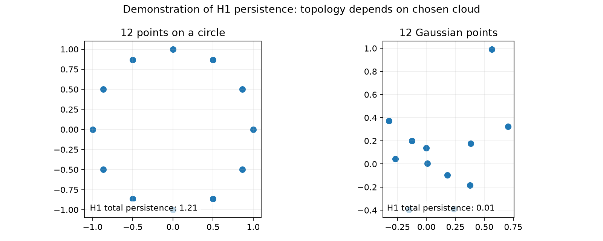
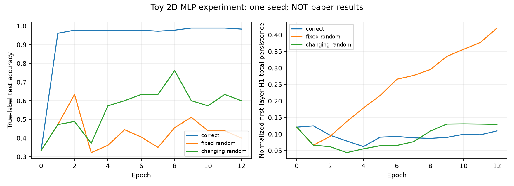
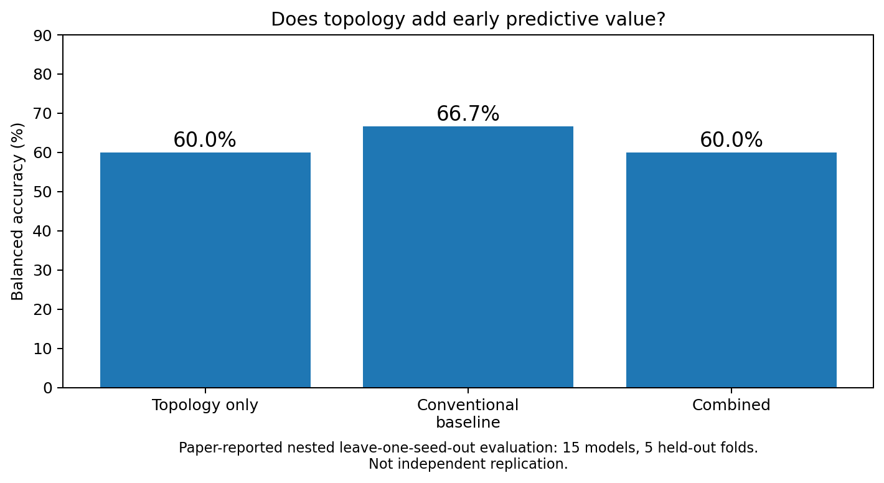

# Neural Weight Topology: Persistent Homology of Weight Evolution

<div align="center">

[](https://www.python.org/)
[](https://pytorch.org/)
[](https://numpy.org/)
[](tests/test_topology.py)
[](https://arxiv.org/abs/2611.13701)
[](LICENSE)

*An educational, CPU-friendly laboratory investigating the topological dynamics of neural network weights under stationary versus non-stationary supervision via exact Vietoris–Rips persistent homology ($H_0$ and $H_1$) and $\mathbb{F}_2$ boundary reduction.*

Based on research by Mitra Varun Gogulapati:  
**["Topological Dynamics Under Non-Stationary Supervision: Persistent Homology of Neural Network Weight Evolution"](https://arxiv.org/abs/2611.13701)** (arXiv:2611.13701, Nov 10, 2026).

</div>

---

## Executive Summary

When neural networks train under different data regimes (e.g. true task labels, fixed random label memorization, or continuously changing random labels), their loss curves and training accuracies often behave similarly in early epochs. Can the **topological shape** of the network's internal weight space reveal differences in the underlying optimization dynamics?

In *Topological Dynamics Under Non-Stationary Supervision*, Gogulapati (2026) tracks the evolution of weight matrices by treating the incoming weight vectors of neurons in each hidden layer as a point cloud in Euclidean space and computing its **persistent homology** across training checkpoints.

```
Incoming Weight Space as a Metric Point Cloud:
Hidden Layer l (M neurons, D inputs):
  Neuron 1: [ w_11, w_12, ..., w_1D ] ∈ ℝᴰ
  Neuron 2: [ w_21, w_22, ..., w_2D ] ∈ ℝᴰ
  ...
  Neuron M: [ w_M1, w_M2, ..., w_MD ] ∈ ℝᴰ

Vietoris–Rips Complex Filtration:
  At scale ε: Connect pairs of neurons with distance d(u, v) ≤ ε.
  Track when 0D connected components merge (H0) and when 1D loops form and fill (H1).
```

### Three Supervision Regimes Investigated:
1. **`correct` (Stationary Genuine Supervision)**: Original labels are consistent and reflect true underlying task geometry.
2. **`fixed_random` (Stationary Memorization Control)**: Labels are randomly permuted across training examples at initialization and held static for all epochs. Targets are meaningless but stationary (Zhang et al., ICLR 2017).
3. **`changing_random` (Non-Stationary Supervision Control)**: A fresh random permutation of the label vector is sampled every epoch. Targets are meaningless and dynamic, preventing convergence.

---

## Visual Gallery: Topological Dynamics

<div align="center">

### 1. Geometric Persistence: Circle Loop vs. Random Gaussian Point Cloud



*Figure 1: Comparison of persistent homology on 12 points sampled along a circle (left) versus 12 random Gaussian points (right). The circle features a prominent persistent $H_1$ loop (long lifetime $d - b$), while the blob exhibits only brief topological noise.*

---

### 2. Weight Evolution Across Supervision Regimes



*Figure 2: Training loss, test accuracy, and first-layer normalized $H_1$ persistence totals across 12 epochs on synthetic Gaussian clusters under correct, fixed-random, and changing-random supervision.*

---

### 3. Early Condition Prediction Benchmark (Reported Paper Results)



*Figure 3: Reconstructed diagnostic benchmark from Gogulapati (2026) evaluating whether early topological weight features distinguish supervision regimes compared to conventional gradient/loss metrics.*

</div>

---

## Mathematical Foundations

### 1. Weight Matrix as Point Cloud & Unit Sphere Normalization

For hidden layer $l$ with incoming weight matrix $W^{(l)} \in \mathbb{R}^{M \times D}$, each row represents the incoming connection weights for neuron $i$:
$$x_i = W^{(l)}_{i, :} \in \mathbb{R}^D, \quad i \in \{1, \dots, M\}$$

To decouple geometric orientation from global weight magnitude growth during gradient descent, weights are optionally normalized onto the unit sphere $S^{D-1}$:
$$\hat{x}_i = \frac{x_i}{\|x_i\|_2}$$

### 2. Vietoris–Rips Complex & Filtration

Given point cloud $X = \{x_1, \dots, x_M\}$, the Vietoris–Rips simplicial complex at filtration radius $\epsilon \ge 0$ is defined as:
$$\text{VR}_\epsilon(X) = \left\{ \sigma \subseteq X : \text{diam}(\sigma) \le \epsilon \right\}$$
- A 0-simplex (vertex) is a single neuron $[x_i]$.
- A 1-simplex (edge) $[x_i, x_j]$ enters the complex when $\|x_i - x_j\| \le \epsilon$.
- A 2-simplex (triangle) $[x_i, x_j, x_k]$ enters when all pairwise distances are $\le \epsilon$.

As $\epsilon$ increases from $0$ to $\infty$, we obtain a nested sequence of simplicial complexes:
$$\emptyset = \text{VR}_0(X) \subseteq \text{VR}_{\epsilon_1}(X) \subseteq \text{VR}_{\epsilon_2}(X) \subseteq \dots \subseteq \text{VR}_\infty(X)$$

### 3. Exact Persistence via $\mathbb{F}_2$ Boundary Reduction

The chain groups $C_k$ and boundary operators $\partial_k: C_k \to C_{k-1}$ over field $\mathbb{F}_2$ satisfy $\partial_k \circ \partial_{k+1} = 0$:
$$\partial_1([u, v]) = [u] + [v], \quad \partial_2([u, v, w]) = [v, w] + [u, w] + [u, v]$$

The boundary matrix $D$ is reduced to column-echelon form $R = D \cdot V$ using column additions over $\mathbb{F}_2$:
- When column $j$ has a lowest non-zero entry at row $i = \text{low}(j)$, a topological feature born at filtration time $t_i$ dies at filtration time $t_j$.
- If column $j$ reduces to 0, it gives birth to an independent homology cycle at time $t_j$.
- Persistent lifetime is: $L = t_{\text{death}} - t_{\text{birth}}$.
- Total persistence metric:
  $$\text{Total Persistence}(H_k) = \sum_{(b, d) \in \text{Dgm}_k, \, d < \infty} (d - b)$$

---

## Rigorous Scope Disclosures & Faithfulness

> [!IMPORTANT]
> **What this laboratory implements:**
> - An original, CPU-friendly, transparent implementation of Vietoris–Rips $H_0$ and $H_1$ persistent homology using pure NumPy and SciPy (`weight_topology_lab/topology.py`).
> - A controlled synthetic experiment (`experiment.py`) training matched MLPs on 2D data under three rigorously isolated label conditions (`correct`, `fixed_random`, and `changing_random`).
> - Exact label permutation across examples (preserving class marginals) rather than global class ID remapping.
> - An optional integration bridge with `Ripser.py` (`ripser_optional.py`) for scaling to larger clouds.
> - Full test suite with 18 mathematical and invariant unit tests.
>
> **What this laboratory does NOT do:**
> - It does **not** claim to replicate the exact numerical accuracy or 3,300 persistence diagrams from the paper's 15 Fashion-MNIST models.
> - It does **not** claim persistent homology provides a magic generalization certificate; the paper itself found that early-condition classifiers based on topology achieved 60.0% accuracy vs 66.7% for conventional diagnostics.

---

## Quickstart & CLI Commands

```bash
cd neural-weight-topology-lab

# 1. Run unit test suite
python3 -m unittest discover -s tests -v

# 2. Generate geometric shape persistence diagrams (Circle vs Blob)
python3 -m weight_topology_lab shapes --output results

# 3. Run synthetic 3-regime training experiment
python3 -m weight_topology_lab demo --epochs 12 --seed 42 --output results

# 4. Inspect a custom weight cloud CSV (one row per neuron)
python3 -m weight_topology_lab inspect --cloud examples_weights.csv
```

---

## Unit Testing & Verification

18 comprehensive tests verify Euclidean distance matrices, Vietoris–Rips filtration ordering, $\mathbb{Z}_2$ boundary reduction, rotational and row-permutation invariance, and training label dynamics:

```bash
python3 -m unittest discover -s tests -v
```

```
test_bad_input (test_topology.PersistenceTests.test_bad_input) ... ok
test_betti (test_topology.PersistenceTests.test_betti) ... ok
test_changing_labels (test_topology.PersistenceTests.test_changing_labels) ... ok
test_data_split (test_topology.PersistenceTests.test_data_split) ... ok
test_empty (test_topology.PersistenceTests.test_empty) ... ok
test_fixed_labels (test_topology.PersistenceTests.test_fixed_labels) ... ok
test_histogram_preserved (test_topology.PersistenceTests.test_histogram_preserved) ... ok
test_invariant_under_rotation (test_topology.PersistenceTests.test_invariant_under_rotation) ... ok
test_invariant_under_row_permutation (test_topology.PersistenceTests.test_invariant_under_row_permutation) ... ok
test_label_digests (test_topology.PersistenceTests.test_label_digests) ... ok
test_model_shapes (test_topology.PersistenceTests.test_model_shapes) ... ok
test_neuron_rows (test_topology.PersistenceTests.test_neuron_rows) ... ok
test_normalization_unit_length (test_topology.PersistenceTests.test_normalization_unit_length) ... ok
test_pairwise (test_topology.PersistenceTests.test_pairwise) ... ok
test_scaling_changes_raw (test_topology.PersistenceTests.test_scaling_changes_raw) ... ok
test_square_loop (test_topology.PersistenceTests.test_square_loop) ... ok
test_triangle_no_h1 (test_topology.PersistenceTests.test_triangle_no_h1) ... ok
test_zero_dim (test_topology.PersistenceTests.test_zero_dim) ... ok

----------------------------------------------------------------------
Ran 18 tests in 0.578s

OK
```

---

## Repository Structure

```
neural-weight-topology-lab/
├── README.md                   # This comprehensive technical guide and mathematical reference
├── SOURCES.md                  # Literature links and research context
├── examples_weights.csv        # Sample 4-neuron 3D incoming weight vectors
├── requirements.txt            # Minimal dependencies (numpy, scipy, matplotlib, torch)
├── requirements-optional.txt   # Optional dependencies for scaled experiments (ripser, torchvision)
├── weight_topology_lab/        # Core educational module
│   ├── __init__.py             # Public module interface
│   ├── __main__.py             # CLI entrypoint for demo, shapes, and inspect commands
│   ├── experiment.py           # Controlled 3-regime training loop and data generator
│   ├── fashion_optional.py     # Optional Fashion-MNIST full-architecture exploration
│   ├── plotting.py             # Publication diagram and persistence barcode plotter
│   ├── ripser_optional.py      # Adapter for C++-accelerated Ripser.py
│   └── topology.py             # Pure-NumPy Vietoris–Rips H0/H1 persistence engine
├── notebooks/                  # Interactive tutorial
│   └── weight_topology_walkthrough.ipynb # Jupyter notebook walking through topological data analysis
├── results/                    # Generated benchmark figures and JSON metrics
│   ├── 01_circle_vs_blob.png   # Persistence diagrams on geometric test shapes
│   ├── 02_toy_training.png     # Training curves and H1 total across supervision conditions
│   ├── 03_paper_reported_early_prediction.png # Reconstructed benchmark from paper
│   └── toy_metrics.json        # Machine-readable output metrics
└── tests/                      # Formal unit test suite
    └── test_topology.py        # 18 invariant tests
```

---

## Academic References

1. **Mitra Varun Gogulapati (2026)**. *Topological Dynamics Under Non-Stationary Supervision: Persistent Homology of Neural Network Weight Evolution*. arXiv preprint [arXiv:2611.13701](https://arxiv.org/abs/2611.13701).
2. **Chiyuan Zhang, Samy Bengio, Moritz Hardt, Benjamin Recht, Oriol Vinyals (2017)**. *Understanding deep learning requires rethinking generalization*. ICLR 2017. [arXiv:1611.03530](https://arxiv.org/abs/1611.03530).
3. **Bastian Rieck, Christian Tita, Filip Sadlo, Heike Leitte (2019)**. *Neural Persistence: A Complexity Measure for Deep Neural Networks Using Algebraic Topology*. ICLR 2019. [arXiv:1812.09764](https://arxiv.org/abs/1812.09764).
4. **Christopher Tralie, Nathaniel Saul, Rann Bar-On (2018)**. *Ripser.py: A Lean Persistent Homology Library for Python*. Journal of Open Source Software. [GitHub](https://github.com/scikit-tda/ripser.py).
5. **Peter Bubenik (2015)**. *Statistical Topological Data Analysis using Persistence Landscapes*. Journal of Machine Learning Research, 16(1), 77–102.

---

## License

This companion lab is released under the [MIT License](LICENSE).
