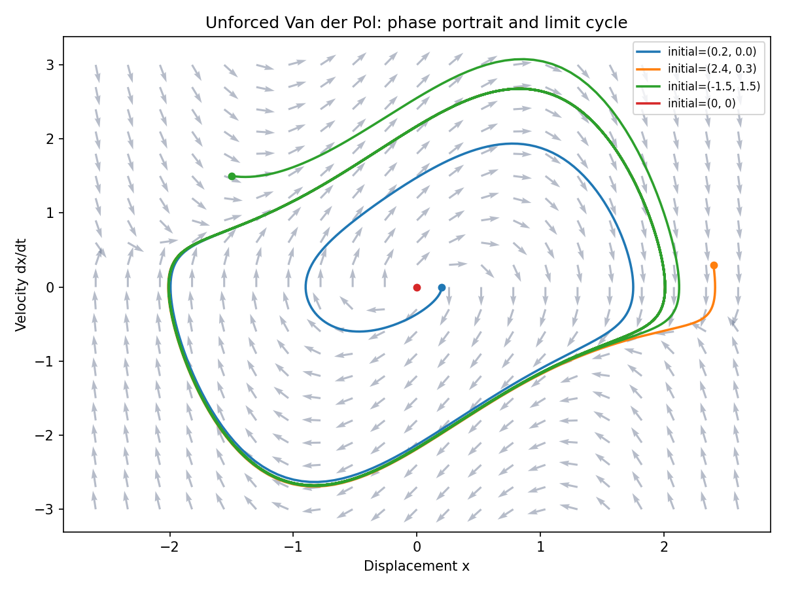
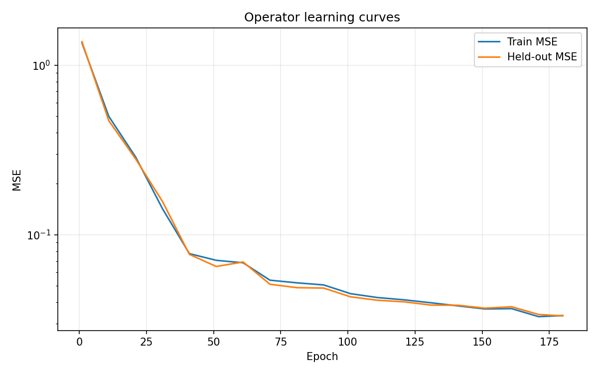
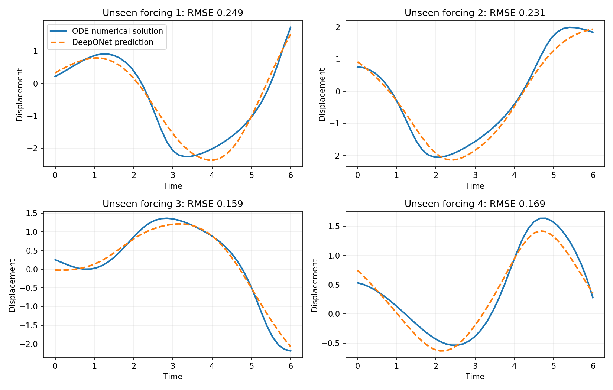

# Forced Van der Pol Solution Operator with DeepONet

[](https://www.python.org/downloads/)
[](https://pytorch.org/)
[](#architecture--formulation)
[](#mathematical-formulation)
[](#test-suite)
[](https://opensource.org/licenses/MIT)

A reproducible PyTorch + SciPy companion lab for learning an approximate **solution operator** of the nonlinear forced **Van der Pol oscillator** using a compact **DeepONet** (branch/trunk) architecture. Given 41 discrete sensor readings of an unseen smooth forcing function $f(t)$ plus arbitrary initial conditions $(x_0, v_0)$, the network predicts the displacement trajectory $\hat{x}(t)$ directly without re-running an ODE solver.

> [!IMPORTANT]
> **Scope & Limitations:** This is a fixed-sensor branch/trunk DeepONet demonstration—**not** a Fourier Neural Operator (FNO) or discretization-invariant PDE solver. Although the trunk accepts arbitrary query times $t \in [0, T]$, the branch expects a fixed 41-point input sensor grid, and evaluation measures within-family interpolation rather than out-of-distribution extrapolation.

---

## Mathematical Formulation

### 1. Forced Nonlinear Van der Pol Oscillator ($\mu = 1$)
$$x''(t) - \mu(1 - x^2)\,x'(t) + x(t) = f(t), \qquad x(0) = x_0, \quad x'(0) = v_0$$
In the unforced regime ($f \equiv 0$), the nonlinear damping term $-\mu(1 - x^2)x'$ injects energy for $|x| < 1$ and dissipates energy for $|x| > 1$, pulling all nonzero initial states onto a unique attracting **limit cycle**.

### 2. DeepONet Branch–Trunk Operator
The branch MLP encodes the discretized forcing vector $\mathbf{f} = [f(t_0), \dots, f(t_{40})]$ concatenated with $(x_0, v_0)$, while the trunk MLP encodes the normalized query time $\tilde{t} = t / T_{\text{end}} \in [0, 1]$:
$$\hat{x}(t) = \frac{1}{\sqrt{p}} \Big\langle \text{Branch}(\mathbf{f}, x_0, v_0),\; \text{Trunk}(\tilde{t}) \Big\rangle + b_0$$

```
  f(t_0)...f(t_40), x0, v0  (43-D)  --->  [ Branch MLP (43 -> 64 -> 64 -> 64) ]  --->  z_f (64-D)
                                                                                           |
                                                                                      dot / sqrt(64) + bias  --->  x_hat(t)
                                                                                           |
  query time t / T_end       (1-D)  --->  [ Trunk  MLP ( 1 -> 64 -> 64 -> 64) ]  --->  z_t (64-D)
```

---

## Generated Visualizations

| Unforced Phase Portrait & Limit Cycle | Learning Curves (Train vs. Held-Out MSE) |
| :---: | :---: |
|  |  |

### Held-Out Unseen Forcing Predictions vs. SciPy `solve_ivp`


---

## Baseline Results (`figures/metrics.json`)

Trained on `192` random forcing trajectories (`40` held-out unseen forcings, `180` epochs, Adam `lr=2e-3`):

| Metric | Value |
|:---|---:|
| Time Domain & Grid | $[0, 6.0]$, `41` sensors |
| Mean-Curve Baseline RMSE | `1.1923` |
| **DeepONet Held-Out RMSE** | **`0.1825`** ($6.5\times$ reduction) |
| First 4 Unseen Forcing RMSEs | `0.249`, `0.231`, `0.159`, `0.169` |

---

## Quickstart

### 1. Setup & Train

```bash
# Clone the repository
git clone https://github.com/AdityaInamdar334/Deep-Learning-Implementations.git
cd Deep-Learning-Implementations/neural_operator_vanderpol_lab

# Create virtual environment and install dependencies
python3 -m venv .venv
source .venv/bin/activate
python3 -m pip install -r requirements.txt

# Train DeepONet and regenerate figures + metrics.json
python3 operator_lab.py --epochs 180 --out figures
```

### 2. Test Suite

```bash
python3 -m unittest discover -s tests -v
```

The 6 automated unit tests verify:
- **`test_vector_field_matches_first_order_equation`**: Exact Van der Pol first-order system RHS.
- **`test_equilibrium`**: Unforced origin $(0, 0)$ is a fixed point.
- **`test_initial_conditions`**: `solve_ivp` trajectory honors $(x_0, v_0)$ to $10^{-12}$.
- **`test_dataset_dimensions`**: Input `(N, 43)` and target `(N, 41)` tensor shapes.
- **`test_model_output_and_gradient`**: Arbitrary query-time batching `(2, 13)` and non-null backward gradients.
- **`test_holdout_seed_differs`**: Train and held-out seeds generate distinct forcing samples.

---

## File Structure

```
neural_operator_vanderpol_lab/
├── README.md                        # Equations, DeepONet diagram, figures, and metrics
├── requirements.txt                 # numpy, scipy, matplotlib, torch
├── .gitignore                       # Ignores __pycache__, bytecode, and *.pt checkpoints
├── operator_lab.py                  # Van der Pol solver, DeepONet, training loop, and plots
├── figures/
│   ├── phase_portrait.png           # Unforced Van der Pol vector field & limit cycle
│   ├── heldout_predictions.png      # 4 unseen forcing trajectories vs SciPy reference
│   ├── learning_curves.png          # Log-scale train vs held-out MSE curves
│   ├── training_history.csv         # Epoch-by-epoch MSE log
│   └── metrics.json                 # Summary RMSE and baseline comparison
└── tests/
    └── test_operator_lab.py         # 6 automated unit tests
```
