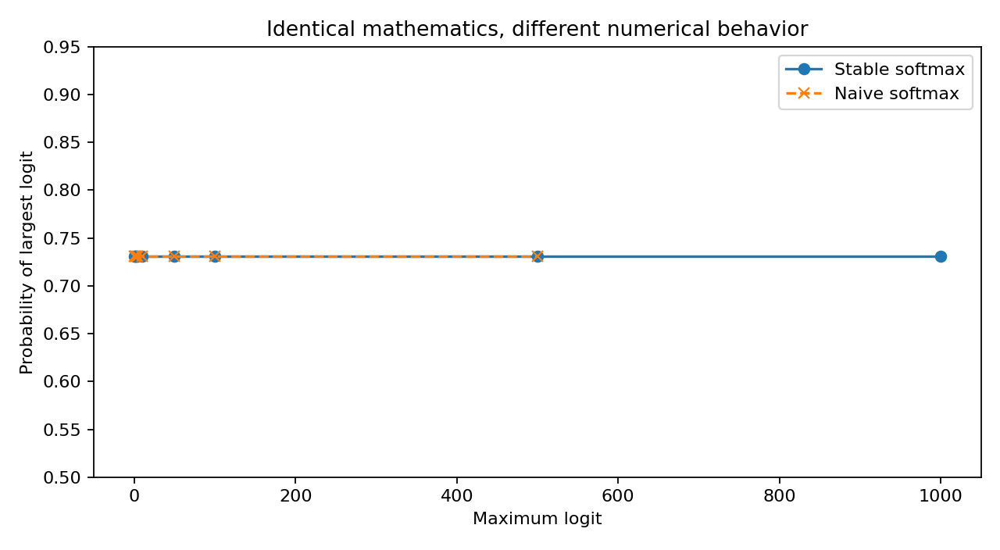
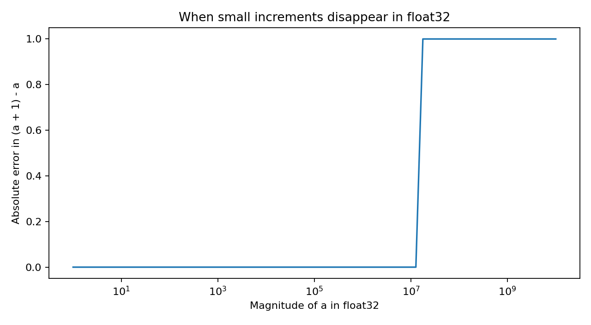
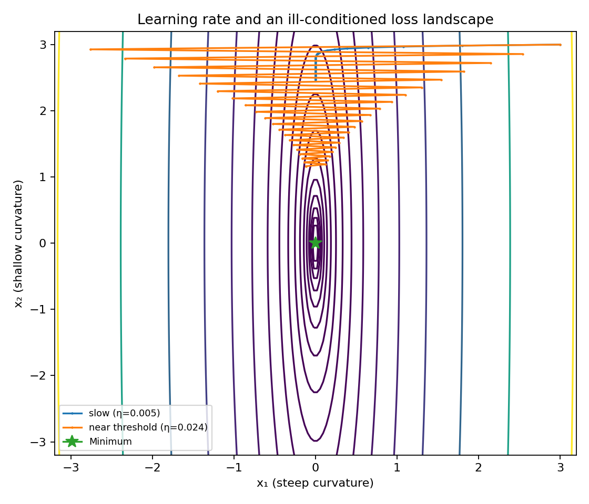
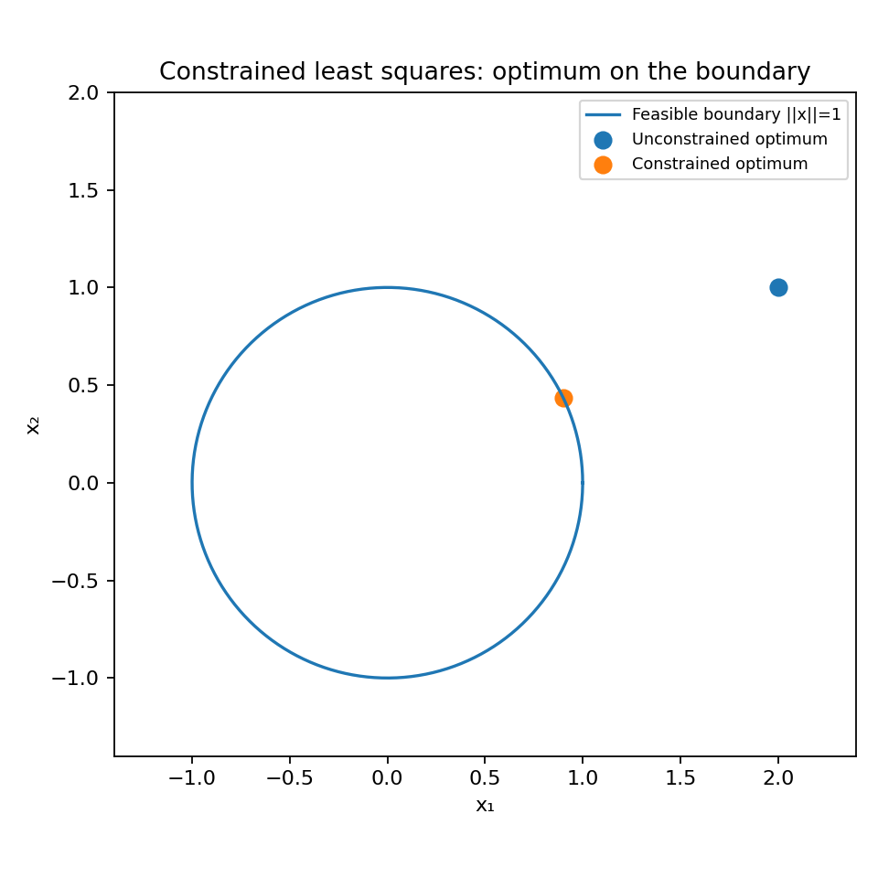

# Numerical Computation in Deep Learning: Stability, Conditioning & KKT Lab

[](https://www.python.org/downloads/)
[](https://numpy.org/)
[](#core-experiments)
[](#test-suite)
[](https://opensource.org/licenses/MIT)

A reproducible NumPy companion lab illustrating Chapter 4 of *Deep Learning* (Goodfellow, Bengio, & Courville, 2016): **log-sum-exp softmax stability**, **float32 precision absorption**, **ill-conditioned gradient descent vs. Newton's method**, and **ball-constrained least squares with exact KKT verification**.

---

## Core Experiments

1. **Overflow & Log-Sum-Exp Softmax**: On logits `[1000, 999, 998]`, naive $\exp(x)/\sum \exp(x)$ overflows to `NaN`, whereas subtracting $m = \max(x)$ via $\text{logsumexp}$ yields `[0.6652, 0.2447, 0.0900]`. Similarly, `stable_log_softmax([0, -1000])[1]` evaluates cleanly to `-1000.0` where `log(softmax)` underflows to `-inf`.
2. **Float32 Absorption**: Because `float32` machine epsilon is $\epsilon \approx 1.19 \times 10^{-7}$, adding `1.0` to `1e8` loses the increment completely: `(float32(1e8) + float32(1)) - float32(1e8) == 0.0` (while `float64` preserves `1.0`).
3. **Ill-Conditioned Optimization ($\kappa(H) = 80$)**: On $f(x) = \frac{1}{2} x^\top \operatorname{diag}(80, 1) x$, gradient descent requires $\eta < 2/\lambda_{\max} = 0.025$ to stay stable—oscillating near the canyon walls at $\eta = 0.024$ and creeping slowly at $\eta = 0.005$—whereas a single Newton step $x - H^{-1} \nabla f(x)$ hits exact loss `0.0`.
4. **Constrained Least Squares & KKT Conditions**: Solving $\min \frac{1}{2}\|Ax - b\|_2^2$ subject to $\|x\|_2 \le 1$ via 90-step bisection on the Lagrange multiplier $\lambda > 0$ satisfies KKT stationarity $\|A^\top(Ax - b) + 2\lambda x\|_2 = 8.88 \times 10^{-16}$ and complementary slackness $\lambda(\|x\|_2^2 - 1) = 7.69 \times 10^{-16}$.

---

## Generated Visualizations

| Naive vs. Stable Softmax | Float32 Precision Absorption |
| :---: | :---: |
|  |  |

| Gradient Descent in an Ill-Conditioned Canyon | Ball-Constrained Least Squares (KKT) |
| :---: | :---: |
|  |  |

---

## Baseline Results (`figures/metrics.json`)

| Experiment | Key Result |
|:---|:---|
| Softmax `[1000, 999, 998]` | Naive: `[NaN, NaN, NaN]` → Stable: `[0.6652, 0.2447, 0.0900]` |
| `log_softmax([0, -1000])[1]` | Naive: `-inf` → Stable: `-1000.0` |
| `(1e8 + 1) - 1e8` | `float32`: `0.0` → `float64`: `1.0` |
| Quadratic ($\kappa = 80$, start `364.5`) | GD ($\eta=0.005$): `1.106` · GD ($\eta=0.024$): `0.005` · 1-Step Newton: `0.0` |
| Ball-Constrained Least Squares | $\|x\| = 1.0$, $\lambda = 3.4646$, KKT residual `8.88e-16` |

---

## Quickstart

### 1. Setup & Run

```bash
# Clone the repository
git clone https://github.com/AdityaInamdar334/Deep-Learning-Implementations.git
cd Deep-Learning-Implementations/numerical_computation_lab

# Install dependencies
python3 -m pip install -r requirements.txt

# Regenerate all 4 figures + figures/metrics.json
python3 lab.py --out figures
```

### 2. Test Suite

```bash
python3 -m unittest discover -s tests -v
```

The 8 automated unit tests verify:
- **`test_extreme_softmax`**, **`test_log_softmax_tail`**, **`test_shift_invariance`**, **`test_logsumexp`**: Overflow-free, underflow-free, shift-invariant softmax/log-softmax math.
- **`test_gd_decreases`** & **`test_newton_quadratic`**: Monotonic GD decrease and exact one-step Newton optimum on positive-definite quadratics.
- **`test_ball_constraint_active`** & **`test_ball_constraint_inactive`**: Boundary KKT stationarity when unconstrained solution lies outside the ball, and $\lambda = 0$ exact recovery when inside.

---

## File Structure

```
numerical_computation_lab/
├── README.md                              # Experiments, figures, metrics, and caveats
├── requirements.txt                       # numpy, matplotlib
├── .gitignore                             # Ignores __pycache__ and bytecode
├── lab.py                                 # Softmax, float32, GD/Newton, KKT solver, plots
├── figures/
│   ├── softmax_stability.png              # Naive vs stable softmax across logit scales
│   ├── floating_point_precision.png       # Float32 (a + 1) - a absorption curve
│   ├── gradient_descent_canyon.png        # Contours & GD trajectories on H=diag(80, 1)
│   ├── constrained_optimization.png       # Unconstrained vs ball-constrained optimum
│   └── metrics.json                       # Machine-readable numerical outputs
└── tests/
    └── test_lab.py                        # 8 automated unit tests
```

---

## References

- Ian Goodfellow, Yoshua Bengio, & Aaron Courville (2016), *Deep Learning*, Chapter 4: Numerical Computation. [deeplearningbook.org](https://www.deeplearningbook.org/contents/numerical.html)
