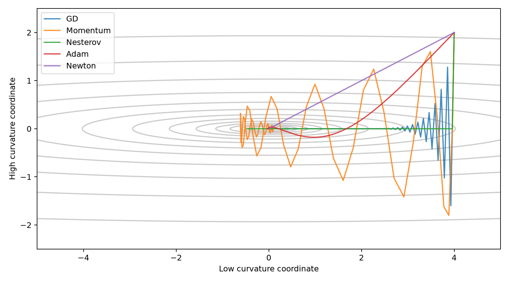
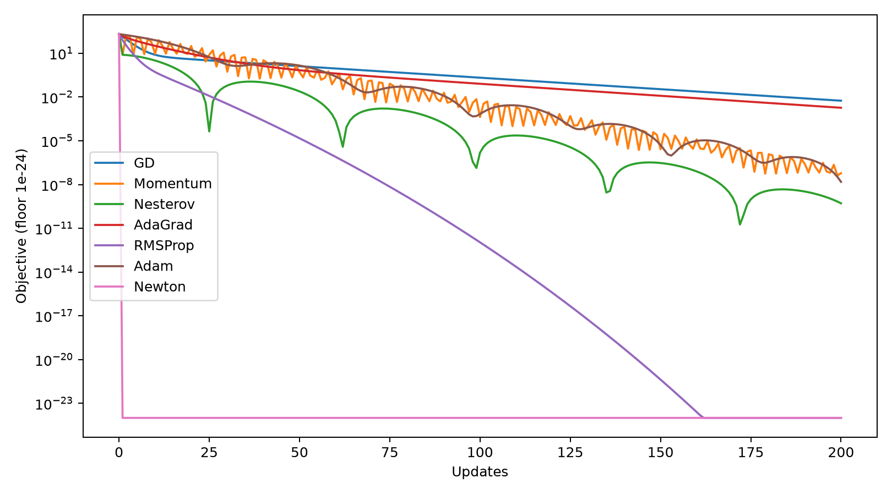
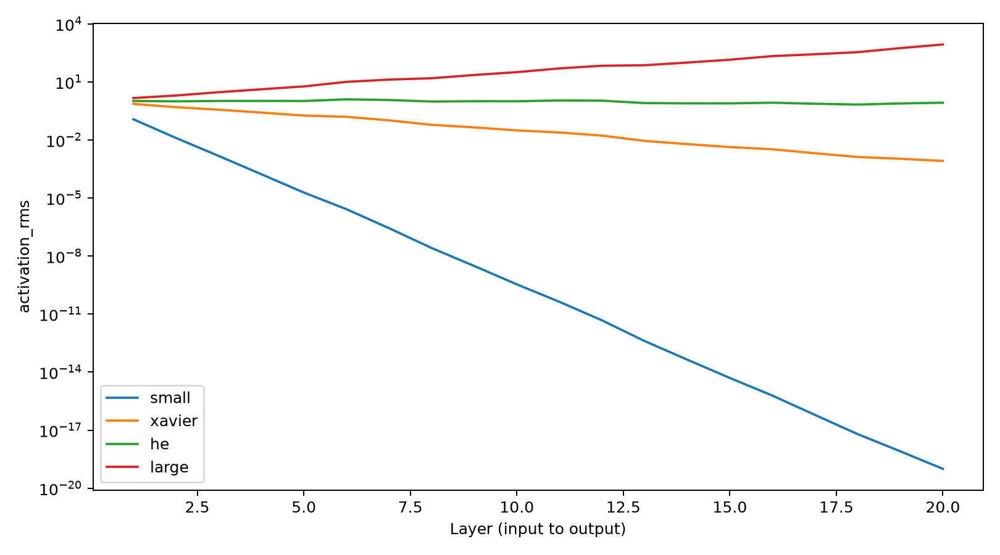
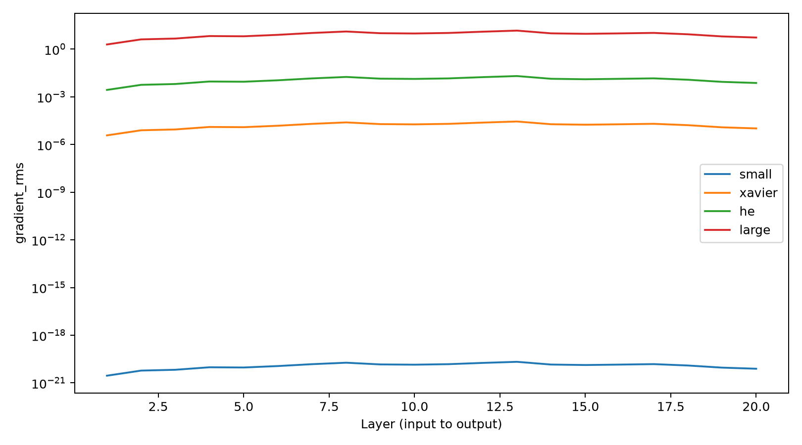
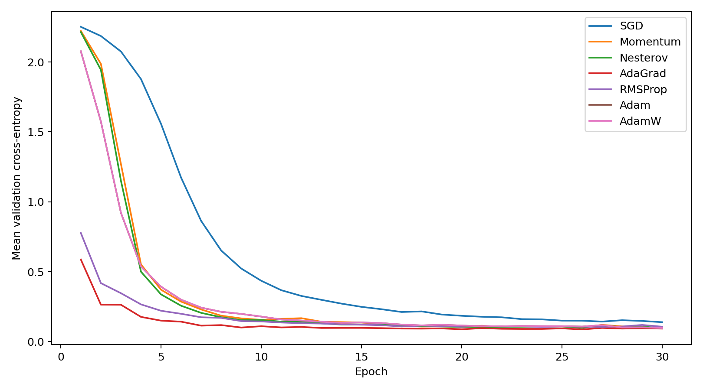

# Optimization for Training Deep Models: Trajectories, Init & 7-Optimizer Lab

[](https://www.python.org/downloads/)
[](https://pytorch.org/)
[](#recorded-results)
[](#test-suite)
[](https://opensource.org/licenses/MIT)

A CPU-only reproducible research companion to Chapter 8 of *Deep Learning* (Goodfellow, Bengio, & Courville, 2016) and [`article.md`](./article.md). It runs three controlled optimization studies: (1) a **7-optimizer quadratic canyon** ($\kappa = 100$), (2) a **20-layer ReLU signal-propagation probe** across 4 initialization scales, and (3) **21 matched-seed Digits classifier runs** comparing SGD, Momentum, Nesterov, AdaGrad, RMSProp, Adam, and AdamW.

---

## Recorded Results (`results.json` & `run.log`)

### 1. Ill-Conditioned Quadratic Canyon ($H = \operatorname{diag}(1, 100)$, 200 Steps)
| Optimizer | Final Objective |
|:---|---:|
| **Newton** | **`0.0`** *(1 step)* |
| RMSProp (`lr=0.08`) | `1.27e-34` |
| Nesterov (`lr=0.01, β=0.9`) | `5.17e-10` |
| Adam (`lr=0.08`) | `1.52e-08` |
| Momentum (`lr=0.01, β=0.9`) | `6.01e-08` |
| AdaGrad (`lr=0.30`) | `1.83e-03` |
| GD (`lr=0.018`) | `5.59e-03` |

### 2. 21-Run Digits Classifier Benchmark (3 Seeds, Early-Stopped on Val Loss)
| Optimizer | Mean Test Acc | Mean Test NLL | Mean Best Epoch |
|:---|---:|---:|---:|
| **AdaGrad** (`lr=0.03`) | **`97.41%`** | **`0.0964`** | `22.7` |
| Adam (`lr=0.001`) | `97.04%` | `0.1143` | `29.7` |
| AdamW (`lr=0.001, wd=0.01`) | `97.04%` | `0.1144` | `29.7` |
| Momentum (`lr=0.03, β=0.9`) | `96.81%` | `0.1313` | `29.7` |
| RMSProp (`lr=0.001`) | `96.59%` | `0.1113` | `25.3` |
| Nesterov (`lr=0.03, β=0.9`) | `96.37%` | `0.1299` | `25.3` |
| SGD (`lr=0.10`) | `95.19%` | `0.1592` | `29.0` |

---

## Generated Visualizations (`figures/`)

| Quadratic Optimization Paths | Quadratic Objective Decay |
| :---: | :---: |
|  |  |

| 20-Layer Activation RMS | 20-Layer Gradient RMS |
| :---: | :---: |
|  |  |

### Validation Cross-Entropy Across 7 Optimizers (3-Seed Mean)


---

## Quickstart

### 1. Setup & Run

```bash
# Clone the repository
git clone https://github.com/AdityaInamdar334/Deep-Learning-Implementations.git
cd Deep-Learning-Implementations/optimization-lab

# Create virtual environment and install dependencies
python3 -m venv .venv
source .venv/bin/activate
pip install -r requirements.txt

# Run all 3 experiments (writes figures/ and results.json)
python3 lab.py
```

### 2. Test Suite

```bash
python3 -m unittest discover -s tests -v
```

The 3 automated unit tests verify:
- **`test_quadratic_optimizers_ordering`**: Exact 1-step Newton convergence (`0.0`) and expected momentum/Nesterov/Adam improvements over vanilla GD.
- **`test_initialization_signal_propagation`**: 20-layer signal collapse under `small` init vs. order-unity preservation under `he` init.
- **`test_artifacts_present`**: Confirms `article.md`, `results.json`, `run.log`, and all 5 PNG figures exist.

---

## File Structure

```
optimization-lab/
├── README.md                  # Benchmark tables, figures, and quickstart
├── article.md                 # Full companion technical article
├── requirements.txt           # numpy, torch, scikit-learn, matplotlib
├── .gitignore                 # Ignores __pycache__ and bytecode
├── lab.py                     # Quadratic, initialization, and 21-run Digits harness
├── results.json               # Full per-epoch metrics and summaries
├── run.log                    # Recorded execution stdout
├── figures/                   # 5 generated PNG figures
└── tests/
    └── test_optimization.py   # 3 automated unit tests
```

---

## References

- Ian Goodfellow, Yoshua Bengio, & Aaron Courville (2016), *Deep Learning*, Chapter 8: Optimization for Training Deep Models. [deeplearningbook.org](https://www.deeplearningbook.org/contents/optimization.html)
- Diederik P. Kingma & Jimmy Ba (2015), *Adam: A Method for Stochastic Optimization* (ICLR). [arXiv:1412.6980](https://arxiv.org/abs/1412.6980)
- Ilya Loshchilov & Frank Hutter (2019), *Decoupled Weight Decay Regularization* (ICLR). [arXiv:1711.05101](https://arxiv.org/abs/1711.05101)
