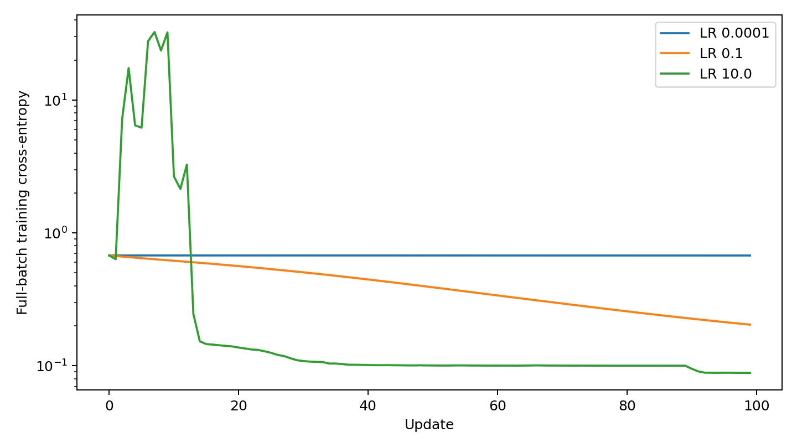
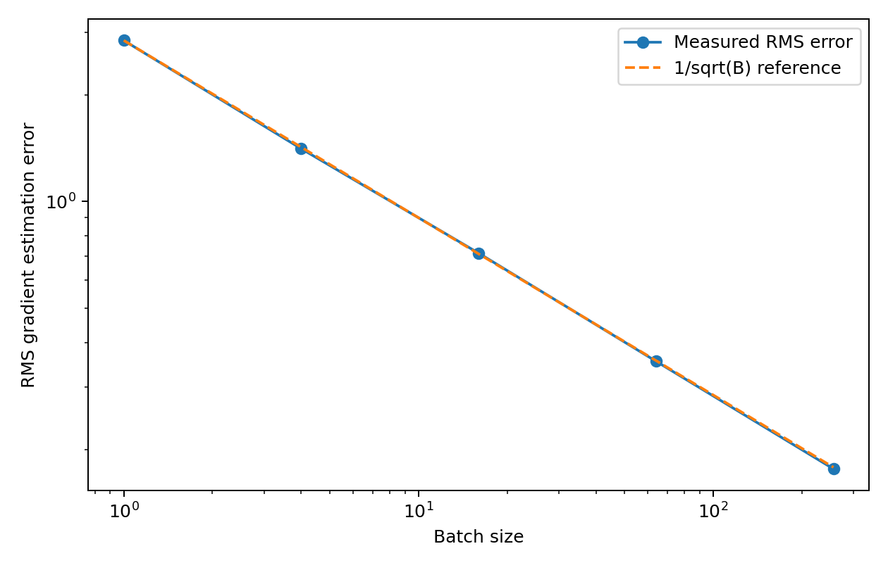
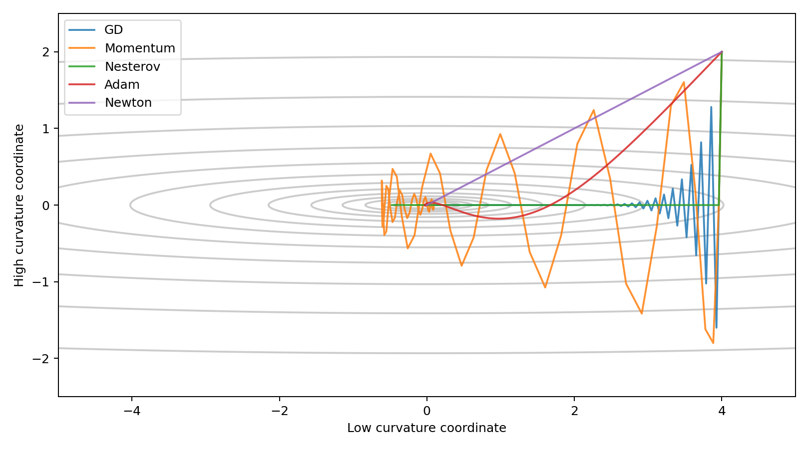
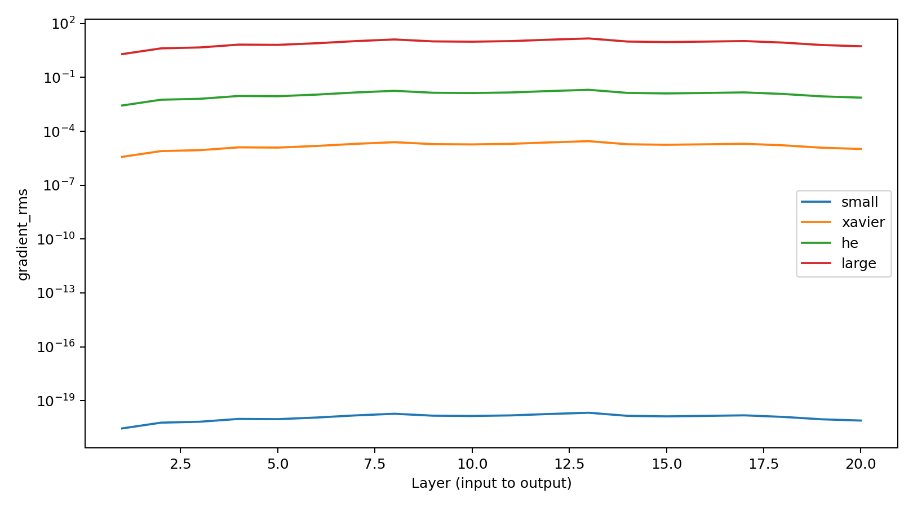
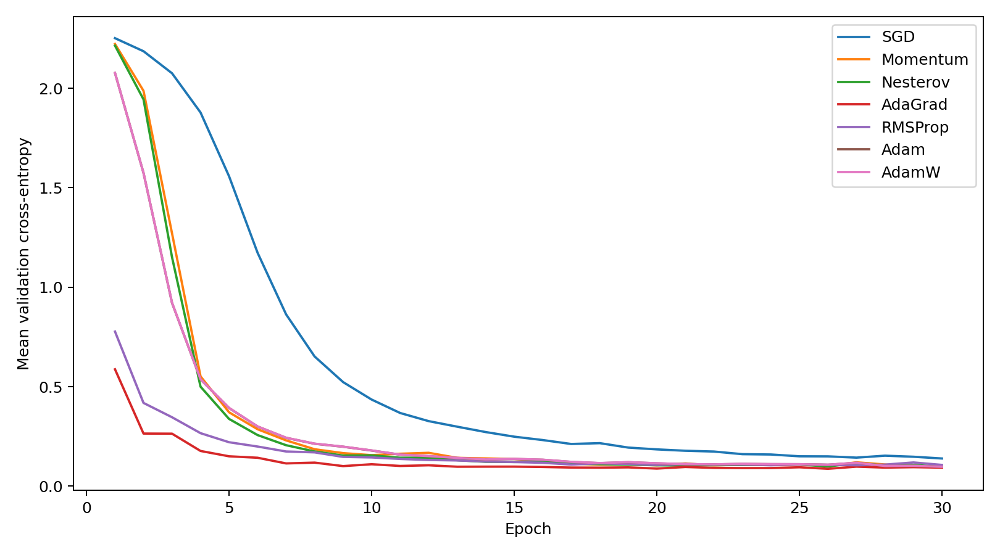

# Optimizer Debugging & Gradient-Flow Diagnostics Lab

[](https://www.python.org/downloads/)
[](https://pytorch.org/)
[%20Noise-purple.svg)](#diagnostic-results)
[](#test-suite)
[](https://opensource.org/licenses/MIT)

A CPU-only reproducible debugging lab extending the 7-optimizer benchmark (`lab.py`) with controlled **learning-rate diagnostics** and **minibatch gradient-noise scaling** (`diagnostics.py`), accompanying [`article.md`](./article.md).

---

## Diagnostic Results (`diagnostics.log` & `diagnostics.json`)

### 1. Learning-Rate Regimes & Update-to-Weight Ratios ($\eta \|\nabla \mathcal{L}\| / \|W\|$)
| Learning Rate ($\eta$) | Start Loss | Final Loss (100 Steps) | Peak Loss | Max Relative Update | Regime Diagnosis |
|:---|---:|---:|---:|---:|:---|
| `0.0001` | `0.6771` | `0.6765` | `0.6771` | `7.64e-6` | Under-stepped flatline |
| **`0.1`** | `0.6771` | `0.2040` | `0.6771` | `7.64e-3` | Healthy monotonic descent |
| `10.0` | `0.6771` | `0.0883` | **`32.60`** | **`3.54`** | Violent early spike / catapult |

### 2. Empirical Minibatch Gradient Noise ($1/\sqrt{B}$ Scaling Law)
| Batch Size ($B$) | Measured RMS Error | Theoretical $1/\sqrt{B}$ Ratio |
|:---:|---:|---:|
| `1` | `2.847` | `1.00×` |
| `4` | `1.409` | `0.50×` |
| `16` | `0.715` | `0.25×` |
| `64` | `0.354` | `0.125×` |
| `256` | `0.176` | `0.0625×` |

---

## Generated Visualizations (`figures/`)

| Learning-Rate Regimes (`lr_diagnostics.png`) | Minibatch Gradient Noise (`gradient_noise.png`) |
| :---: | :---: |
|  |  |

| Quadratic Canyon Paths | 20-Layer Gradient RMS | 7-Optimizer Validation Curves |
| :---: | :---: | :---: |
|  |  |  |

---

## Quickstart

### 1. Setup & Run

```bash
# Clone the repository
git clone https://github.com/AdityaInamdar334/Deep-Learning-Implementations.git
cd Deep-Learning-Implementations/optimizer-debug-lab

# Create virtual environment and install dependencies
python3 -m venv .venv
source .venv/bin/activate
pip install -r requirements.txt

# Run learning-rate & gradient-noise diagnostics
python3 diagnostics.py

# Run full quadratic + initialization + 21-run Digits benchmark
python3 lab.py
```

### 2. Test Suite

```bash
python3 -m unittest discover -s tests -v
```

The 3 automated unit tests verify:
- **`test_lr_regimes_in_diagnostics`**: Flatline (`<1e-4` update ratio), healthy descent, and violent `lr=10.0` overshoot (`peak > 10.0`, `ratio > 1.0`).
- **`test_gradient_noise_inverse_sqrt_scaling`**: Exact $1/\sqrt{B}$ RMS noise decay within `5%` from `B=1` to `B=256`.
- **`test_artifacts_present`**: Confirms `article.md`, both scripts, logs, JSON outputs, and all 7 PNG figures exist.

---

## File Structure

```
optimizer-debug-lab/
├── README.md                  # Diagnostic tables, figures, and quickstart
├── article.md                 # Full companion technical article
├── requirements.txt           # numpy, torch, scikit-learn, matplotlib
├── .gitignore                 # Ignores __pycache__ and bytecode
├── diagnostics.py             # Learning-rate regime & 1/sqrt(B) noise probes
├── lab.py                     # Quadratic canyon, 20-layer init, and 21-run benchmark
├── diagnostics.json / .log    # Recorded diagnostic probe metrics
├── results.json / run.log     # Recorded benchmark metrics
├── figures/                   # 7 generated PNG figures
└── tests/
    └── test_diagnostics.py    # 3 automated unit tests
```
