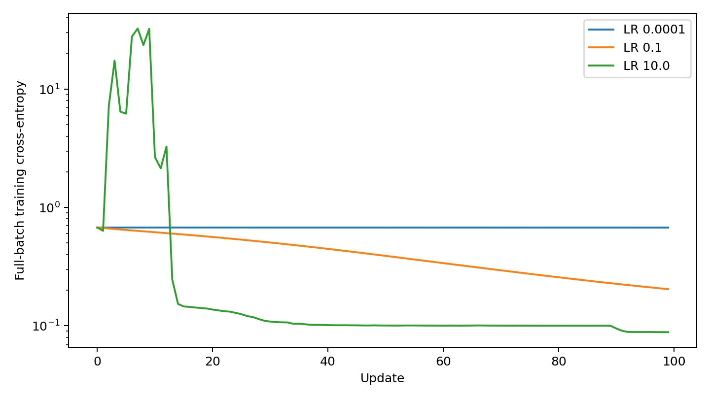
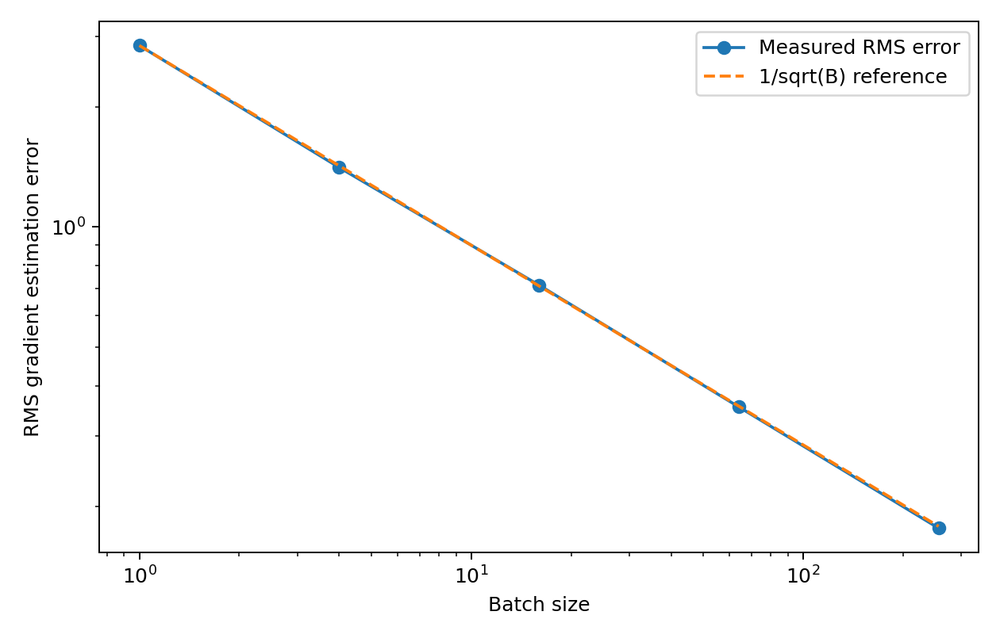
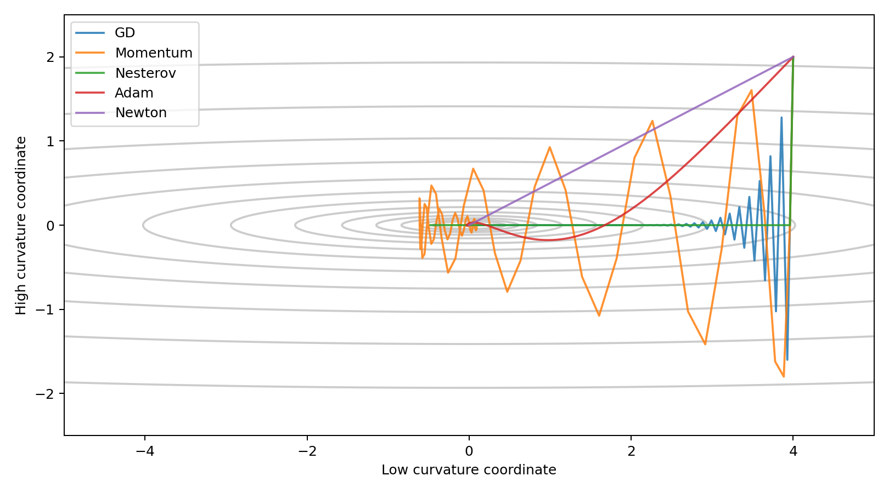
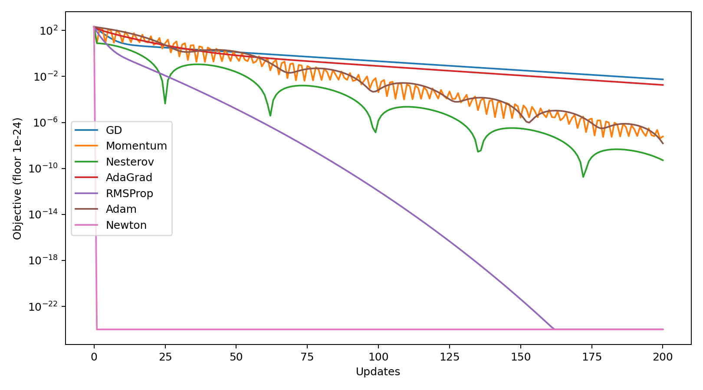
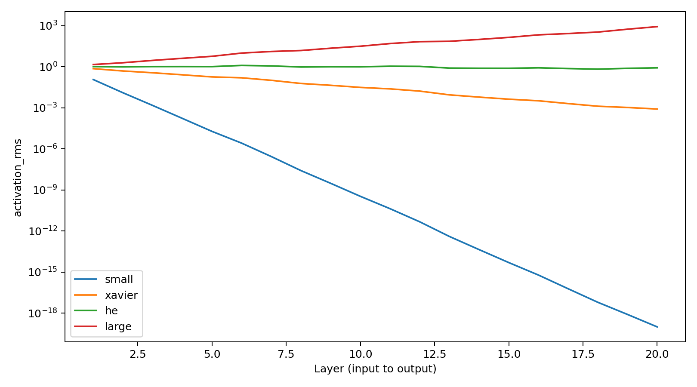
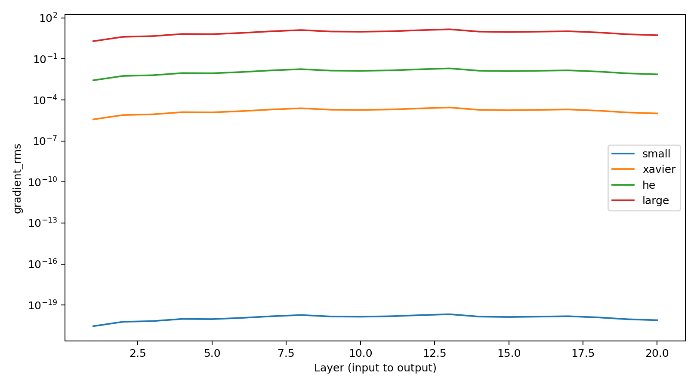
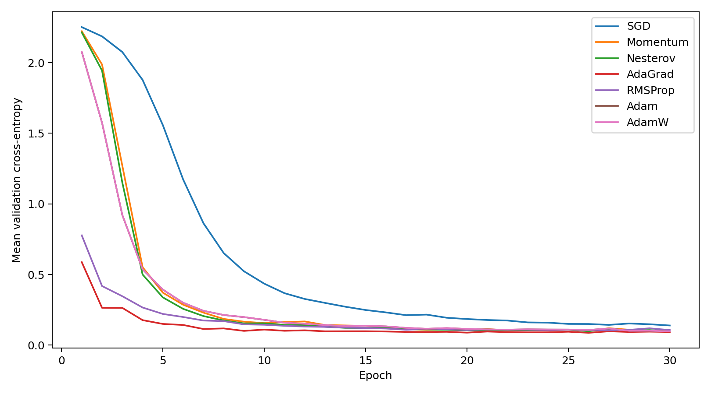

# What Actually Happens When You Call optimizer.step() in PyTorch?

*From SGD to AdamW, Muon and SOAP: a hands-on investigation into why neural networks struggle to learn and how to diagnose the problem.*

You've checked the tensor dimensions, cleaned the dataset and verified the loss function. PyTorch isn't throwing any exceptions. But the model isn't learning. You change the learning rate, switch optimizers, and suddenly the loss starts moving. Why should changing the update rule matter so much when the architecture stays the same?

Consider three lines that appear in almost every PyTorch training loop:

```python
optimizer.zero_grad()
loss.backward()
optimizer.step()
```

The first clears accumulated gradients, the second computes derivatives, and the third turns derivatives into a parameter update. That last decision is where decades of numerical optimization research come together. A gradient is a local measurement, not a roadmap to a useful model.

This article takes the perspective of an engineer debugging a training run. We will begin with a controlled failure, then build the mathematical tools needed to explain it. We will revisit a previously executed 21-run classifier study and add two new diagnostic experiments. The point is not to crown an optimizer, but to understand which problem each algorithm solves.

## Abstract

This tutorial reviews optimization for deep neural networks, using Chapter 8 of Goodfellow et al. (2016) as its theoretical foundation. We examine empirical risk, stochastic gradient estimates, curvature, momentum, adaptive preconditioning, initialization, approximate second-order methods, normalization, parameter averaging, and curriculum learning. Three previously executed experiments investigate optimizer trajectories on a positive definite quadratic, signal propagation through a deep ReLU network, and seven optimizer configurations on a fixed classification task. We connect the results to contemporary work on structured preconditioning, schedule-free training, and language-model optimization through November 2026. Two additional diagnostic experiments measure learning-rate instability and sampling noise. The code, metrics, and figures are provided in a CPU-compatible companion lab.

**Keywords:** stochastic gradient descent, AdamW, conditioning, initialization, neural networks, Muon, optimization.

## Contents

0. Start with a reproducible training failure
1. What are we actually optimizing?
2. The geometry of a difficult training problem
3. SGD, momentum and Nesterov acceleration
4. Adaptive learning rates: AdaGrad, RMSProp, Adam and AdamW
5. Initialization and the disappearing gradient
6. Second-order optimization and structured preconditioning
7. Why architecture can be more important than the optimizer
8. Training schedules, averaging and curriculum learning
9. A reproducible 21-run PyTorch experiment
10. From AdamW to modern language-model optimizers
11. Debugging a training system and designing fair experiments
12. Discussion, limitations and references

## 0. Start with a failure you can reproduce

Install the companion lab's dependencies in a virtual environment and run `python diagnostics.py`. The script uses synthetic data, so no downloads or GPU are needed. Run `python lab.py` separately to reproduce the original three experiments. From this point forward, the article's code blocks are educational excerpts; the complete scripts are the runnable source of truth.

Imagine a two-class classification service. Before committing to a training job, we can test whether its optimization loop learns on a small, controlled problem. We generate 256 vectors with 16 features, assign a label according to the sign of the sum of the first two features, and train the same 16→32→2 ReLU MLP with three learning rates. We reset the model seed before each run and use full-batch SGD to remove minibatch noise as a confounder.

```python
import torch
from torch import nn

torch.set_num_threads(1)
torch.manual_seed(42)
x = torch.randn(256, 16)
y = (x[:, 0] + x[:, 1] > 0).long()

for lr in [0.0001, 0.1, 10.0]:
    torch.manual_seed(7)
    model = nn.Sequential(nn.Linear(16, 32), nn.ReLU(), nn.Linear(32, 2))
    optimizer = torch.optim.SGD(model.parameters(), lr=lr)
    for step in range(100):
        optimizer.zero_grad(set_to_none=True)
        loss = nn.functional.cross_entropy(model(x), y)
        loss.backward()
        optimizer.step()
```

We record loss before each update, alongside the global gradient norm and relative update norm. All three runs start at cross-entropy 0.67715. At the last recorded step, learning rate 0.0001 achieves 0.67646, learning rate 0.1 achieves 0.20402, and learning rate 10 achieves 0.08832. However, the last configuration reaches a peak loss of 32.60281 along the way. Its maximum relative update norm is 3.54, compared with 0.00764 for the middle learning rate.



*Figure A. Newly measured full-batch training loss across 100 updates. The high learning rate produces large excursions before recovering. These are training losses, not generalization measurements.*

This outcome is worth pausing over: the highest learning rate did not permanently diverge. It recovered and achieved the lowest final recorded training loss. A single final metric would have hidden its instability. In a more expensive model, an update several times the weight norm may be a serious risk. Conversely, an almost flat loss may indicate that the learning rate is too small, not that the gradient has vanished.

For plain SGD without momentum or weight decay, the relative update norm is η‖g‖/‖θ‖. For adaptive optimizers, measure the actual parameter difference instead, because gradients are transformed before the update. Inspect these quantities per layer as well as globally; a global average can hide a problematic embedding or projection.

The experiment is intentionally not a learning-rate recommendation. It uses one synthetic dataset, one initialization, and no held-out evaluation. Its purpose is to teach instrumentation. Now we can investigate why these behaviors arise.

## 1. What are we actually optimizing?

Suppose a classifier correctly predicts nine out of ten images. Accuracy tells us what happened, but it does not tell us how to change the weights. A tiny change to a logit may leave the predicted class unchanged. The derivative of the classification error is therefore zero almost everywhere, and undefined at some boundaries.

Instead, we minimize a differentiable surrogate such as cross-entropy. For a correctly labeled class with predicted probability p, the loss is −log(p). Moving from probability 0.51 to 0.90 changes the loss even if the predicted class remains the same. This provides a useful learning signal after training accuracy reaches 100%.

The population risk is the expected loss over the unknown data-generating distribution. Empirical risk is the average loss over our observed dataset. We optimize the latter as a proxy for the former, often with a regularizer and a validation-based checkpoint rule (Goodfellow et al., 2016). Empirical risk minimization with a surrogate is still empirical risk minimization; it is simply not direct optimization of test accuracy.

Write the training objective as `J(θ) = (1/N) Σ L(fθ(xᵢ), yᵢ)`. The gradient is the corresponding average of per-example gradients. This decomposition is what makes minibatch training possible.

### Why not calculate the exact gradient?

At fixed parameters, a uniformly sampled minibatch provides an unbiased estimate of the empirical gradient. For independent samples with finite variance, the standard error scales as 1/√B. Increasing batch size by a factor of 100 reduces this standard error by a factor of ten, not 100. Sampling without replacement introduces a finite-population correction. Reusing a finite dataset does not magically provide fresh independent samples from the population.

Large batches can improve device utilization, but use more activation memory and may require changes to the learning rate or training budget. Small batches create noisier estimates that sometimes aid generalization. Neither is inherently best (Goyal et al., 2017; McCandlish et al., 2018).

An epoch counts passes through data; a step counts parameter updates. With 1,024 examples and batches of 32, one epoch has 32 updates. With batches of 128, it has eight. Comparing equal epochs and equal steps answers different questions.

### Measure the gradient noise rather than guessing

The second new experiment generates a fixed population of 4,096 synthetic eight-dimensional gradient vectors and repeatedly samples with replacement. Across 1,000 sampled minibatches per size, the RMS Euclidean error of the minibatch mean relative to the population mean is 2.8470, 1.4095, 0.7152, 0.3543 and 0.1761 for batch sizes 1, 4, 16, 64 and 256 respectively. This is a controlled simulation of sampling noise, not a measurement of a trained network's gradient distribution.



*Figure B. Newly measured RMS gradient estimation error and the theoretical inverse square-root reference.*

At fixed parameters, independent draws give covariance Σ/B for their sample mean. Therefore E‖g_batch − g_full‖² = trace(Σ)/B. The observed 16-fold reduction when increasing batch size from 1 to 256 is consistent with this prediction. During real training the distribution changes with the parameters, so this is not a promise of a fixed gradient-noise scale throughout training. If using gradient accumulation, divide summed loss contributions by the correct number of examples or tokens; unequal microbatches require weighting rather than a simple mean of means.

## 2. The geometry of a difficult training problem

The standard image of gradient descent is a ball rolling down a smooth hill. Real optimization is often closer to walking along a narrow canyon. The steep sides determine how large a step you can take, even when most of your journey lies along the gently sloped valley.

Consider an exactly solvable objective:

`J(x, y) = 0.5 × (x² + 100y²)`

Its gradient is `(x, 100y)`, and its Hessian is diagonal with eigenvalues 1 and 100. The condition number is 100. Along the y direction, curvature is 100 times greater. Gradient descent with a scalar learning rate η is stable for 0 < η < 0.02 on this quadratic. A step size suitable for x alone can cause y to diverge.

```python
import numpy as np
H = np.diag([1., 100.])
w = np.array([4., 2.])
for step in range(200):
    g = H @ w
    w -= 0.018 * g
print(0.5 * w @ H @ w)
```

The recorded final loss is 0.0055935, starting from 208. That sounds good, but we will see how other methods approach the same solution with different trajectories.



*Figure 1. Original experiment. Different update rules traverse the same ill-conditioned quadratic. The learning rates are illustrative, not independently tuned.*

### Saddles, minima and plateaus

At a differentiable local minimum the gradient vanishes and the Hessian is positive semidefinite. At a strict saddle it has a negative eigenvalue. For example, `J(x,y)=x²−y²` has zero gradient at the origin, but moving along y decreases the objective. An undamped Newton step can jump to this stationary point even when it is not a minimum.

Dauphin et al. (2014) argued that high-dimensional saddle structures deserve attention rather than blaming every training problem on poor local minima. This is not a theorem that all practical networks lack bad minima. Neural networks also have parameter symmetries: permuting hidden neurons together with their outgoing weights can preserve the function, and positive rescaling in ReLU networks can create equivalent parameterizations.

Plateaus may occur without strict saddle geometry. A saturated activation can produce tiny gradients, and a long curved valley can make locally sensible steps globally inefficient. If gradient norms remain substantial while loss stagnates, inspect conditioning, numerical precision and learning rates before claiming you are trapped at a stationary point.

Some training objectives do not attain a finite minimizer. In separable logistic regression, the cross-entropy approaches zero as the separating weights grow. Soudry et al. (2018) showed that gradient descent can converge in direction to a max-margin solution under specific assumptions even as parameter norms diverge.

The edge-of-stability phenomenon further complicates the classical picture: Cohen et al. (2021) observed full-batch neural-network training at sharpness near or above the nominal quadratic stability threshold, with nonmonotonic short-term loss but progress over longer periods. This is an observation about dynamic neural-network geometry, not permission to ignore instability.

## 3. SGD, momentum and Nesterov acceleration

Stochastic approximation dates to Robbins and Monro (1951). SGD uses a sampled gradient g and updates `θ ← θ − ηg`. Under appropriate convexity, bounded-noise and step-size assumptions, diminishing learning rates give classical convergence guarantees. For modern nonconvex networks these guarantees do not imply convergence to a global optimum.

The simplest useful training loop is:

```python
for x, y in loader:
    optimizer.zero_grad()
    loss = criterion(model(x), y)
    loss.backward()
    optimizer.step()
```

Backward computes derivatives, not updates. The optimizer consumes those derivatives and maintains any required state. Forgetting to clear gradients changes the update rule because PyTorch accumulates gradients by default.

### Momentum: remember the direction that worked

Polyak (1964) proposed acceleration through a velocity term. With velocity initialized to zero, `v ← μv − ηg`, followed by `θ ← θ + v`. A persistent gradient accumulates velocity; alternating gradients partially cancel. For a constant gradient the limiting velocity is `−ηg/(1−μ)`. Therefore comparing the same nominal learning rate with and without momentum is not necessarily comparing the same update scale.

```python
w = np.array([4., 2.])
v = np.zeros_like(w)
for step in range(200):
    v = 0.9 * v - 0.01 * (H @ w)
    w += v
print(0.5 * w @ H @ w)
```

Our recorded loss was 6.01 × 10⁻⁸. Momentum travels more effectively along the valley for this configuration.

### Nesterov: look before moving

Instead of evaluating the gradient at the current position, evaluate it at a look-ahead position `θ + μv`. Then update the velocity as before. This anticipates where momentum is taking us. Nesterov's accelerated method has an O(1/t²) objective-gap guarantee for suitable smooth convex problems; it is not a universal rate for stochastic deep learning. Sutskever et al. (2013) demonstrated the practical interaction between momentum and initialization.

```python
w = np.array([4., 2.])
v = np.zeros_like(w)
for step in range(200):
    g = H @ (w + 0.9 * v)
    v = 0.9 * v - 0.01 * g
    w += v
```

PyTorch offers an equivalent commonly used Nesterov parameterization via `torch.optim.SGD(..., momentum=0.9, nesterov=True)`. The internal buffer is not necessarily the same velocity variable as in our NumPy derivation.

## 4. Adaptive learning rates: AdaGrad, RMSProp, Adam and AdamW

Momentum improves the direction of travel. Adaptive optimizers address a second question: should every parameter move by the same scale?

### AdaGrad: remember every squared gradient

Duchi et al. (2011) proposed accumulating squared gradients elementwise, `r ← r + g²`, and updating `θ ← θ − ηg/(√r + ε)`. Parameters that receive frequent large gradients accumulate larger denominators. Rarely updated features can retain comparatively large effective learning rates.

```python
w = np.array([4., 2.])
r = np.zeros_like(w)
for step in range(200):
    g = H @ w
    r += g*g
    w -= 0.3 * g / (np.sqrt(r) + 1e-8)
```

The problem is that r only grows. In a nonstationary training landscape, very old gradients may continue suppressing updates long after they are informative. AdaGrad remains useful, especially in certain sparse-feature problems.

### RMSProp: allow old information to fade

RMSProp, introduced in Tieleman and Hinton's 2012 lectures, replaces the cumulative sum with an exponential moving average: `r ← ρr + (1−ρ)g²`. This enables the denominator to adapt when the gradient scale changes. Implementations differ in epsilon placement; the code here follows the outside-square-root convention.

```python
w = np.array([4., 2.])
r = np.zeros_like(w)
for step in range(200):
    g = H @ w
    r = 0.99*r + 0.01*g*g
    w -= 0.08*g/(np.sqrt(r)+1e-8)
```

### Adam: first and second moments

Adam (Kingma & Ba, 2015) combines a moving average of gradients with a moving average of squared gradients. The second quantity is an uncentered second moment, not a variance. With both initialized at zero, bias correction divides the first by `1−β₁ᵗ` and the second by `1−β₂ᵗ`.

```python
w = np.array([4., 2.])
m = np.zeros_like(w)
r = np.zeros_like(w)
for t in range(1, 201):
    g = H @ w
    m = 0.9*m + 0.1*g
    r = 0.999*r + 0.001*g*g
    m_hat = m/(1-0.9**t)
    r_hat = r/(1-0.999**t)
    w -= 0.08*m_hat/(np.sqrt(r_hat)+1e-8)
```

The bias correction matters especially at the beginning of training. The division changes the relative scale of coordinate updates, while the first moment supplies directional memory. Adam is a diagonal preconditioner, not an exact Hessian inverse.

Reddi et al. (2018) constructed convex counterexamples to Adam convergence and proposed AMSGrad, which uses a nondecreasing maximum of second-moment estimates. The lesson is that empirical robustness and theoretical guarantees are distinct.

### AdamW: separate regularization from adaptation

Adding λθ to a gradient causes Adam to incorporate the penalty into its moment estimates and adaptive scaling. AdamW instead applies direct decay to the parameters and computes the adaptive update using the task gradient (Loshchilov & Hutter, 2019):

`θ ← (1−ηλ)θ − η m_hat/(√r_hat+ε)`

With ordinary SGD without momentum, L2 regularization and multiplicative decay are equivalent under matched conventions. Adaptive preconditioning breaks that simple equivalence. In many transformer recipes, bias and normalization parameters are excluded from decay, but this is an engineering convention to validate, not a mathematical requirement.



*Figure 2. Original measurements. After 200 iterations, GD: 5.59e−3; momentum: 6.01e−8; Nesterov: 5.17e−10; AdaGrad: 1.83e−3; RMSProp: 1.27e−34; Adam: 1.52e−8; Newton: zero. Values below 1e−24 are clipped in the plot. These are deterministic full-gradient updates, not stochastic training results. The favorable RMSProp result is specific to the chosen function and learning rate.*

## 5. Initialization and the disappearing gradient

An optimizer cannot recover information that the computational graph fails to transmit. In a deep network the chain rule multiplies Jacobians. Repeated products of factors smaller than one can vanish; factors larger than one can explode. For recurrent networks the same transformation is reused across time, making long-term dependencies particularly difficult (Bengio et al., 1994; Pascanu et al., 2013).

For a fixed diagonalizable matrix W, repeated application gives `Wᵗ = VΛᵗV⁻¹`. This simple linear illustration captures exponential scaling in eigendirections. General nonlinear networks involve varying Jacobians, and singular values and nonnormal dynamics matter as well.

### Xavier and He initialization

Glorot and Bengio (2010) derived a scaling rule that balances forward and backward variance in approximately linear networks. Xavier uniform uses bounds ±√(6/(fan_in+fan_out)). ReLU discards negative activations; under symmetric Gaussian assumptions it halves the second moment. He et al. (2015) proposed variance `2/fan_in` to compensate. These are initialization-time approximations, not promises that every gradient remains stable throughout learning.

Zero initialization of all hidden weights can preserve unwanted neuron symmetry. Zero biases with random weights are normally fine. A final classifier bias can encode log class priors, and gated recurrent architectures sometimes initialize forget-gate biases positively. Orthogonal initialization helps control singular values in linear networks (Saxe et al., 2014); LSUV uses data-driven sequential variance adjustment (Mishkin & Matas, 2016).

### Experiment: observe signal propagation through 20 layers

```python
import torch
from torch import nn
torch.manual_seed(42)
x = torch.randn(128, 64)
for _ in range(20):
    layer = nn.Linear(64, 64, bias=False)
    nn.init.kaiming_normal_(layer.weight, nonlinearity='relu')
    x = layer(x).relu()
    print(float(x.detach().square().mean().sqrt()))
```

The companion code repeats this experiment with normal standard deviations of 0.02 and 0.25, Xavier normal, and He normal. It measures activation root mean square (RMS) and weight-gradient RMS after differentiating the mean final activation. RMS differs from standard deviation for nonzero-mean activations.



*Figure 3. Original results. Final-layer activation RMS: small initialization 9.98e−20; Xavier 8.26e−4; He 0.846; large initialization 865.83.*



*Figure 4. Original weight-gradient RMS under the same initialization settings. The plotted floor prevents log(0).* 

Our He-initialized model maintains a usable signal much better in this particular ReLU stack. The experiment uses random inputs and a synthetic scalar objective, so it does not measure classifier accuracy or establish a universal initialization ranking.

### Gradient clipping

Clipping the global gradient norm rescales the entire gradient if it exceeds a threshold. It can prevent a single large gradient from ruining an otherwise useful training trajectory (Pascanu et al., 2013).

```python
loss.backward()
torch.nn.utils.clip_grad_norm_(model.parameters(), max_norm=1.0)
optimizer.step()
```

For adaptive optimizers, clipping the gradient does not strictly bound the final parameter update. It cannot fix vanishing gradients or already nonfinite values. Log the pre-clipping norm and the fraction of clipped steps; constant clipping may indicate a deeper problem.

## 6. Second-order optimization and structured preconditioning

Newton's method uses a local quadratic approximation. The update solves `H Δ = −g`. For our positive definite quadratic, one exact Newton step reaches the minimum from any start.

```python
w = np.array([4., 2.])
w -= np.linalg.solve(H, H @ w)
assert np.allclose(w, 0)
```

Do not explicitly invert the Hessian when a linear solve suffices. A dense Hessian with P parameters needs P² entries and a generic dense solve costs order P³ operations. At one billion parameters, even storing a float32 dense Hessian would require approximately four exabytes (decimal). Indefinite curvature also means the undamped Newton direction need not be a descent direction.

Damping adds λI to the curvature matrix. If the shift makes it positive definite, the direction is descending for a nonzero gradient. Levenberg–Marquardt uses related damping for nonlinear least squares. Saddle-free Newton replaces signed curvature eigenvalues by their magnitudes in its idealized update (Dauphin et al., 2014).

### Conjugate gradients and Hessian-vector products

For a positive definite quadratic, conjugate directions satisfy `dᵢᵀ H dⱼ = 0` for distinct directions. Linear conjugate gradients solves such a system in at most P iterations in exact arithmetic, without storing an inverse. A practical implementation only needs matrix-vector multiplication. Nonlinear conjugate gradients instead uses line searches and restarts; its finite-step quadratic guarantee does not carry over.

Automatic differentiation can compute Hessian-vector products without materializing H:

```python
w = torch.tensor([4., 2.], requires_grad=True)
loss = 0.5*(w[0]**2 + 100*w[1]**2)
g, = torch.autograd.grad(loss, w, create_graph=True)
v = torch.tensor([1., 1.])
hv, = torch.autograd.grad((g*v).sum(), w)
print(hv)  # tensor([1., 100.])
```

Martens (2010) used Hessian-free optimization for deep models, leveraging curvature-vector products and iterative solves. Damping, curvature approximation and stopping rules are crucial to practical behavior.

### BFGS and L-BFGS

Quasi-Newton methods estimate curvature from successive parameter and gradient differences: `s = θ_new−θ_old`, `y = g_new−g_old`. BFGS updates an inverse-curvature approximation subject to a secant relationship. Positive curvature `sᵀy > 0` helps maintain positive definiteness. A descent direction is `−M g`, not `+M g`.

L-BFGS stores a limited number of these vector pairs and applies a two-loop recursion instead of maintaining a dense matrix (Liu & Nocedal, 1989). It can work well on small deterministic problems. For noisy minibatches, curvature differences can be contaminated by sampling changes. PyTorch's L-BFGS requires a closure because it may evaluate the objective repeatedly during a step. Do not compare its outer iteration count directly with Adam's without counting function and gradient evaluations.

### Natural gradient, K-FAC and Shampoo

Natural gradient uses the Fisher information geometry rather than ordinary Euclidean parameter geometry (Amari, 1998). The Fisher and Hessian are related in certain probabilistic settings but not identical generally. K-FAC approximates layerwise Fisher blocks with Kronecker products, making non-diagonal preconditioning practical at some scales (Martens & Grosse, 2015).

Shampoo accumulates structured gradient second moments along tensor dimensions (Gupta et al., 2018). For a matrix gradient G, illustrative statistics are `L ← L + GGᵀ` and `R ← R + GᵀG`; a matrix-shaped update can use inverse fourth roots on both sides. This preserves cross-coordinate information that Adam's elementwise moments discard, at the price of matrix operations, memory and communication. Damping and periodic factor updates are essential implementation choices.

## 7. Why architecture can be more important than the optimizer

The textbook's most durable insight is that optimization is also a model-design problem. If a neural network has poor signal propagation, changing the learning rule is only one possible intervention.

Batch normalization standardizes each feature using minibatch mean and variance, then applies learned scale and shift. Training uses current batch statistics; ordinary inference uses running statistics. It changes the parameterization through which gradients flow, not merely the distribution of input data (Ioffe & Szegedy, 2015). Later work questioned internal covariate shift as the sole explanation and emphasized smoother optimization behavior (Santurkar et al., 2018).

```python
block = nn.Sequential(nn.Linear(64, 128, bias=False),
                      nn.BatchNorm1d(128), nn.ReLU())
```

Layer normalization computes statistics over features within an example or token, not over the batch (Ba et al., 2016). RMSNorm removes mean-centering and normalizes by RMS, with learned scaling (Zhang & Sennrich, 2019). Both are convenient for variable-length sequence workloads where batch-level statistics are awkward.

Residual connections changed the problem again. If `h_next = h + F(h)`, the local Jacobian includes an identity term. This creates shorter paths for gradient propagation, though it does not guarantee stable norms (He et al., 2016). In transformers, the placement of normalization matters: Pre-LN applies normalization inside the residual branch, whereas Post-LN normalizes after the addition. Xiong et al. (2020) investigated their differing gradient behavior at initialization. DeepNorm subsequently combined residual scaling with initialization to train very deep transformers (Wang et al., 2022).

Auxiliary heads and teacher hints offer additional gradient routes. FitNets (Romero et al., 2015) trained a deeper, thinner student using intermediate representations from a teacher. Modern distillation and transfer learning similarly change the starting point or supervision, not merely the optimizer. These connections should not be read as claims that the methods are interchangeable.

## 8. Training schedules, averaging and curriculum learning

Even an adaptive optimizer has a global learning rate. Warmup starts below the target rate and gradually increases it, reducing the risk of unstable early updates. Goyal et al. (2017) combined warmup and a linear scaling rule in large-batch ImageNet training; scaling the learning rate with batch size is a useful starting hypothesis, not a general law.

Cosine decay decreases the learning rate smoothly using a cosine curve. SGDR introduced cosine annealing with warm restarts (Loshchilov & Hutter, 2017); a single cosine decay does not require restarts. Warmup-stable-decay schedules instead hold a plateau before a final decay, useful when the training horizon may change. One-cycle schedules vary learning rate up and down and often adjust momentum in the opposite direction (Smith, 2018).

A simple warmup-plus-cosine multiplier:

```python
import math
def multiplier(step, total, warmup):
    if step < warmup:
        return (step+1)/max(1,warmup)
    progress = min(1., (step-warmup)/max(1,total-warmup-1))
    return 0.1 + 0.9*0.5*(1+math.cos(math.pi*progress))
```

### Gradient accumulation is not magic memory

With K equally sized microbatches, divide each mean loss by K before backward, then perform one optimizer update. For unequal sizes, weight by example or token count. Accumulation matches a larger batch gradient only under compatible randomness, normalization and loss reduction. BatchNorm, dropout masks, clipping timing and floating-point rounding can change behavior. A distributed training system must also account for gradients being averaged across workers.

### Parameter averaging

Polyak and Juditsky (1992) established strong results for averaging iterates in stochastic approximation under suitable assumptions. Exponential moving average (EMA) weights recent iterates more heavily. Stochastic weight averaging (SWA) averages selected late-training weights to improve generalization in some models (Izmailov et al., 2018). Averaging weights is not averaging predictions, and distant, symmetry-misaligned checkpoints can yield a poor model. Batch normalization statistics may need recomputation after averaging.

Schedule-free optimization combines iterate averaging and update interpolation to avoid a prescribed decay schedule (Defazio et al., 2024). It still needs hyperparameters and may use warmup. The implementation's train/eval parameter semantics matter when evaluating or saving checkpoints.

### Coordinate descent and curriculum

Block coordinate descent alternates optimization over parameter subsets. Sparse coding, for example, can alternate between latent codes and a dictionary, with dictionary norm constraints to prevent rescaling degeneracy. Jointly nonconvex problems can have simpler convex subproblems, but coordinatewise optimality does not automatically imply global or even local optimality under arbitrary assumptions.

Continuation methods solve a sequence of easier-to-harder objectives, hoping that each solution supplies a useful initialization for the next. Curriculum learning adapts the training distribution over time (Bengio et al., 2009). For a language model, one could vary context length or the mix of tasks, but difficulty must be defined carefully. Easy-first is not guaranteed to beat uniform sampling. Pretraining and fine-tuning are related in spirit, although their objectives and datasets can be quite different.

## 9. A reproducible 21-run PyTorch experiment

Now we can return to the question that motivated this article: how much does the update procedure matter when the model and dataset stay fixed?

### Methodology

We use scikit-learn's 1,797 handwritten digit images, each 8×8 pixels. The fixed stratified split contains 1,077 training, 270 validation, and 450 test examples. Pixels are divided by 16, the dataset's documented maximum. The architecture is a 64→128→128→10 MLP with ReLU hidden activations (26,122 trainable parameters). Each run uses the default PyTorch linear initialization, cross-entropy, 30 epochs and 17 approximately equal minibatches per epoch. Seeds 11, 22 and 33 control the initial weights and training permutations. For each seed these are matched across optimizers.

Install dependencies and run the full lab:

```bash
python -m venv .venv
source .venv/bin/activate
pip install -r requirements.txt
python lab.py
```

Windows users can activate with `.venv\Scripts\activate`. No GPU or dataset download is needed. The code records validation cross-entropy at every epoch and selects the checkpoint with lowest validation loss. The test set is evaluated at the selected checkpoint for each predetermined configuration; no test-driven hyperparameter selection is performed.

### Build the model

```python
model = nn.Sequential(nn.Linear(64,128), nn.ReLU(),
                      nn.Linear(128,128), nn.ReLU(),
                      nn.Linear(128,10))
optimizer = torch.optim.AdamW(model.parameters(), lr=0.001,
                              weight_decay=0.01)
criterion = nn.CrossEntropyLoss()
```

The benchmark compares SGD (lr 0.1), momentum and Nesterov (lr 0.03, momentum 0.9), AdaGrad (lr 0.03), RMSProp (lr 0.001), Adam (lr 0.001), AdamW (lr 0.001, decay 0.01). Other optimizer options use PyTorch defaults. These are deliberately fixed recipes, not the result of equivalent hyperparameter searches. AdamW also differs from Adam in regularization; the comparison is between complete training configurations.

The full training loop is in `lab.py`. This is the central checkpoint selection pattern:

```python
best_loss = float('inf')
for epoch in range(30):
    model.train()
    for ids in np.array_split(rng.permutation(tr), 17):
        optimizer.zero_grad()
        loss = criterion(model(X[ids]), y[ids])
        loss.backward()
        optimizer.step()
    model.eval()
    with torch.no_grad():
        val_loss = float(criterion(model(X[va]), y[va]))
    if val_loss < best_loss:
        best_loss = val_loss
        best_state = {k: v.clone() for k,v in model.state_dict().items()}
model.load_state_dict(best_state)
```

The preceding block assumes the dataset tensors, split indices and NumPy generator defined in the full lab. `clone()` matters: saving references to mutable tensors would silently change the supposedly best checkpoint on subsequent updates.



*Figure 5. Mean validation cross-entropy across three matched seeds for each optimizer configuration.*

### Results

- **SGD:** 95.19% accuracy (sample SD 1.05 percentage points), test NLL 0.1592, mean selected epoch 29.0.
- **Momentum:** 96.81% accuracy (sample SD 0.13 percentage points), test NLL 0.1313, mean selected epoch 29.7.
- **Nesterov:** 96.37% accuracy (sample SD 0.46 percentage points), test NLL 0.1299, mean selected epoch 25.3.
- **AdaGrad:** 97.41% accuracy (sample SD 0.34 percentage points), test NLL 0.0964, mean selected epoch 22.7.
- **RMSProp:** 96.59% accuracy (sample SD 0.78 percentage points), test NLL 0.1113, mean selected epoch 25.3.
- **Adam:** 97.04% accuracy (sample SD 0.46 percentage points), test NLL 0.1143, mean selected epoch 29.7.
- **AdamW:** 97.04% accuracy (sample SD 0.46 percentage points), test NLL 0.1144, mean selected epoch 29.7.

AdaGrad leads both reported mean metrics under these particular settings. Adam and AdamW have identical test accuracy across our three seeds, but their NLLs differ slightly. Accuracy discards information about confidence, whereas NLL measures how much probability is assigned to the true class. Plain SGD trails the adaptive and momentum configurations at this budget. None of this establishes an optimizer hierarchy: the learning rates, dataset, architecture, regularization and training duration determine the comparison.

Try a controlled extension: choose a learning-rate grid for every optimizer, select configurations only on validation data, then compare on a fresh held-out dataset or nested cross-validation. Run longer budgets and report the time to reach a predefined loss target. Plot per-seed trajectories rather than just the mean. A stronger experiment varies the dataset split as well as the initialization seed.

## 10. From AdamW to modern language-model optimizers

Why is optimizer research still active when AdamW already works? The answer lies in scale. Every persistent state tensor costs memory, every additional matrix operation costs compute, and every extra step costs accelerator time. At large scale, an optimizer that achieves the same loss with fewer tokens may be valuable even if it is more expensive per step. The reverse can also be true.

### Memory-efficient adaptation: Adafactor and Lion

Adafactor (Shazeer & Stern, 2018) approximates a matrix's second-moment statistics using row and column summaries. For an m×n matrix this reduces second-moment storage from order mn to order m+n. Other aspects of the algorithm include relative step sizing and update clipping. This is not simply Adam with fewer bits.

Lion (Chen et al., 2023) was discovered through program search. It uses sign-based updates with momentum, avoiding the second-moment tensor. The update's magnitude is largely controlled by learning rate and decay, so transferring AdamW hyperparameters blindly is inappropriate. A lower memory footprint does not establish higher accuracy or faster wall-clock convergence.

### Sophia: diagonal curvature

Sophia (Liu et al., 2024) uses a diagonal curvature estimate with clipping to scale gradient updates. Curvature is refreshed periodically rather than forming the full Hessian. This approach attempts to exploit more informative local geometry than gradient magnitude alone, but its overhead, estimator quality and clipping behavior must be accounted for in comparisons.

### Muon: treat a weight matrix as a matrix

An important limitation of Adam is that it processes matrix entries coordinate by coordinate. Muon, introduced in Jordan's 2024 technical write-up, transforms a momentum matrix using approximate orthogonalization. If a matrix has singular value decomposition `G = UΣVᵀ`, the ideal polar-factor update is `UVᵀ` in the full-rank case (with a partial isometry for a rank-deficient matrix). This changes the relative singular-value scale instead of independently normalizing entries.

Here is an educational demonstration, not a production Muon implementation:

```python
G = torch.tensor([[10., 0.], [0., 0.1]])
U, S, Vh = torch.linalg.svd(G, full_matrices=False)
Q = U @ Vh
print(torch.linalg.svdvals(Q))  # tensor([1., 1.])
```

A practical Muon implementation approximates the transformation using Newton–Schulz-style matrix iterations rather than performing an exact SVD every step. It typically routes eligible two-dimensional hidden weight matrices through Muon and uses another optimizer for embeddings, biases, normalization and sometimes output heads. Scaling, momentum and decay conventions are implementation-dependent.

Liu et al. (2025) investigated Muon at larger language-model scale, reporting a 3B-active/16B-total mixture-of-experts model trained on 5.7 trillion tokens and emphasizing update scaling and weight decay. These are reported results from that research, not measurements from our digits lab.

### SOAP: an adaptive optimizer in a different basis

SOAP (Vyas et al., 2025) relates Shampoo to adaptive methods in the preconditioner's eigenbasis. Rather than adapting directly in the original coordinate system, SOAP uses a structured basis in which it maintains Adam-style statistics. Matrix-factor refresh costs and optimizer state distribution matter. The 2026 preprint *SOAP, Muon, and Beyond: Pushing LLM Pretraining Scales* reports favorable results relative to AdamW on the multi-billion-parameter workloads it studies and introduces a layerwise distributed optimizer. These results do not settle the question for all architectures and budgets.

### Recent research: benchmarking, not declaring a winner

The 2025 AlgoPerf competition analysis (Kasimbeg et al., 2025) emphasizes time-to-target and tuning budgets rather than a single fixed learning-rate comparison. Its self-tuning winner used Schedule-Free AdamW. The October 2026 update (Kasimbeg et al., 2026) reports that Schedule-Free AdamW ranked first among 13 submissions on nine workloads under its benchmark protocol. This is a stronger reason to investigate tuning robustness, not proof that the algorithm always wins.

Other 2026 directions include MONA (Li et al., 2026), combining Muon with Nesterov-style acceleration, and spectral scaling work examining how orthogonalization behaves as model size changes. The research trend is toward coordinating optimizer geometry, model architecture, learning-rate scaling and distributed implementation. Recent claims should be interpreted in the context of their specific experimental setup and publication status.

### Systems considerations

For P float32 parameters, Adam's two persistent moment tensors occupy approximately 8P bytes, separate from parameters and gradients. For a billion parameters this is 8 GB in decimal units. Mixed-precision training may additionally maintain master weights; exact memory depends on implementation and state dtype. ZeRO-style sharding distributes state across devices (Rajbhandari et al., 2020). Matrix preconditioning can require extra temporary buffers and communication, making practical kernel design as important as the mathematical update rule.

In FP16, loss scaling helps avoid gradient underflow. Unscale before clipping and step only when gradients are finite. BF16 has a wider exponent range but lower mantissa precision than FP16; it commonly does not need loss scaling, though numerical problems can still occur. Measure tokens per second, wall-clock time to target loss, memory, and validation quality together (Micikevicius et al., 2018).

### November 2026: reducing the price of matrix preconditioning

The preprint *Factored One-sided Adam-Moment for Practical and Scalable SOAP* (2026) introduces FOAM, which combines one-sided input preconditioning with a factored moment estimator. Its authors report comparable validation loss to strong SOAP and Muon baselines in their tested language-model configurations, with reduced optimizer-state memory relative to SOAP. This is a recent preprint result, not an independently replicated conclusion here. The engineering question it raises is important: a preconditioner that improves loss per update is only worthwhile if memory use, communication and computation do not erase the improvement. See https://arxiv.org/abs/2611.16905 and the October 2026 AlgoPerf update for complementary evidence on practical optimizer evaluation.

## 11. Debugging a training system and designing fair experiments

A useful debugging procedure starts with the symptom, not a favorite optimizer.

- Loss is NaN: inspect input ranges, nonfinite gradients, log/division operations, precision, and learning rate. Restore a valid checkpoint before trying a smaller update.
- Training loss is flat: verify labels, loss reduction, parameter registration, gradients and optimizer state. Try overfitting a tiny training subset to isolate implementation errors.
- Early layers have tiny gradients: inspect activation RMS and per-layer gradient norms; investigate initialization, saturation, residual paths and normalization.
- Loss oscillates: inspect update-to-weight norms, learning rate, curvature and clipping frequency. Check whether oscillation persists on a fixed evaluation batch rather than only noisy training minibatches.
- Training loss falls while validation loss rises: address generalization, not just optimization. Early stopping and regularization are often more relevant than a faster optimizer.
- Resuming training behaves differently: checkpoint optimizer moments, schedule counters, scaler state, RNG state and data-loader position where reproducibility requires them.

When testing optimizers, decide what is held fixed. Equal steps isolates update count but ignores per-step cost. Equal tokens controls data exposure but not compute. Equal wall time measures practical throughput but depends on kernels and hardware. Equal tuning budgets assess how easy each method is to deploy. Report all these axes when feasible.

A practical default for a transformer project is a documented AdamW baseline with warmup and a validated decay schedule; for a small deterministic inverse problem, L-BFGS may deserve a trial. For sparse-feature problems AdaGrad can be a sensible candidate. Investigate Muon or SOAP only after establishing a baseline and confirming parameter routing and infrastructure support. Do not treat these as universal prescriptions.

## 12. Discussion and conclusion

The experiments began with a simple quadratic where the minimum is known exactly. Even there, gradient descent can waste steps because curvature is uneven. Momentum, adaptive scaling and Newton's method each address different aspects of that problem. The deep initialization experiment then demonstrated how changing parameter scale alone can determine whether a useful signal reaches the end of a network. Finally, the digits benchmark showed that optimizer recipes change the learning trajectory and finite-budget performance.

There are limits to what we have established. The quadratic is two-dimensional and axis-aligned, favoring methods that adapt coordinatewise. The initialization probe is one seed and not a training benchmark. The classifier uses a small dataset, three initialization seeds, a single fixed split, and preset learning rates. No statistical significance or universal optimizer ranking is claimed. The modern optimizer discussion is literature-based; we did not train an LLM or implement full production Muon, SOAP, Sophia, or distributed curvature estimation. The standalone lab implements the three core experiments and the two new diagnostic probes; additional snippets are explanatory and have not all been independently executed. The literature selection is broad but not an exhaustive systematic review.

What makes neural network optimization interesting is not simply that gradients exist. It is the relationship between local geometry, noisy estimates, parameterization, computational constraints and the distant goal of generalization.

Next time you write `optimizer.step()`, remember that this one line embodies decades of research about how to turn a local derivative into useful learning. The best update is not necessarily the one that goes downhill fastest today. It is the one that produces a useful model within the resources and constraints of the problem you are actually solving.

## References

- *Factored One-sided Adam-Moment for Practical and Scalable SOAP* (2026). Preprint. https://arxiv.org/abs/2611.16905

- Amari, S. (1998). Natural gradient works efficiently in learning. *Neural Computation, 10*, 251–276. https://doi.org/10.1162/089976698300017746
- Ba, J. L., Kiros, J. R., & Hinton, G. E. (2016). Layer normalization. arXiv. https://arxiv.org/abs/1607.06450
- Bengio, Y., Simard, P., & Frasconi, P. (1994). Learning long-term dependencies with gradient descent is difficult. *IEEE Transactions on Neural Networks, 5*, 157–166. https://doi.org/10.1109/72.279181
- Bengio, Y., Louradour, J., Collobert, R., & Weston, J. (2009). Curriculum learning. *ICML*. https://doi.org/10.1145/1553374.1553380
- Chen, X., et al. (2023). Symbolic discovery of optimization algorithms. *NeurIPS*. https://arxiv.org/abs/2302.06675
- Cohen, J. M., Kaur, S., Li, Y., Kolter, J. Z., & Talwalkar, A. (2021). Gradient descent on neural networks typically occurs at the edge of stability. *ICLR*. https://arxiv.org/abs/2103.00065
- Dauphin, Y. N., et al. (2014). Identifying and attacking the saddle point problem in high-dimensional non-convex optimization. *NeurIPS*. https://arxiv.org/abs/1406.2572
- Defazio, A., et al. (2024). The road less scheduled. *NeurIPS*. https://arxiv.org/abs/2405.15682
- Duchi, J., Hazan, E., & Singer, Y. (2011). Adaptive subgradient methods for online learning and stochastic optimization. *JMLR, 12*, 2121–2159. https://jmlr.org/papers/v12/duchi11a.html
- Glorot, X., & Bengio, Y. (2010). Understanding the difficulty of training deep feedforward neural networks. *AISTATS*. https://proceedings.mlr.press/v9/glorot10a.html
- Goodfellow, I., Bengio, Y., & Courville, A. (2016). *Deep Learning*, Chapter 8. MIT Press. https://www.deeplearningbook.org/contents/optimization.html
- Goyal, P., et al. (2017). Accurate, large minibatch SGD: Training ImageNet in 1 hour. arXiv. https://arxiv.org/abs/1706.02677
- Gupta, V., Koren, T., & Singer, Y. (2018). Shampoo: Preconditioned stochastic tensor optimization. *ICML*. https://proceedings.mlr.press/v80/gupta18a.html
- He, K., Zhang, X., Ren, S., & Sun, J. (2015). Delving deep into rectifiers. *ICCV*. https://arxiv.org/abs/1502.01852
- He, K., Zhang, X., Ren, S., & Sun, J. (2016). Deep residual learning for image recognition. *CVPR*. https://arxiv.org/abs/1512.03385
- Ioffe, S., & Szegedy, C. (2015). Batch normalization. *ICML*. https://proceedings.mlr.press/v37/ioffe15.html
- Izmailov, P., et al. (2018). Averaging weights leads to wider optima and better generalization. *UAI*. https://arxiv.org/abs/1803.05407
- Jordan, K. (2024). Muon: An optimizer for hidden layers in neural networks. Technical blog. https://kellerjordan.github.io/posts/muon/
- Kasimbeg, P., et al. (2025). Accelerating neural network training: An analysis of the AlgoPerf competition. *ICLR*. https://arxiv.org/abs/2502.15015
- Kasimbeg, P., et al. (2026). Towards easier-to-tune training algorithms: New results from AlgoPerf. Preprint. https://arxiv.org/abs/2610.13036
- Kingma, D. P., & Ba, J. (2015). Adam: A method for stochastic optimization. *ICLR*. https://arxiv.org/abs/1412.6980
- Li, et al. (2026). MONA: Muon optimizer with Nesterov acceleration for scalable language model training. *Findings of EMNLP*. https://aclanthology.org/2026.findings-emnlp.733/
- Liu, D. C., & Nocedal, J. (1989). On the limited memory BFGS method for large scale optimization. *Mathematical Programming, 45*, 503–528. https://doi.org/10.1007/BF01589116
- Liu, H., Li, Z., Hall, D., Liang, P., & Ma, T. (2024). Sophia: A scalable stochastic second-order optimizer for language model pre-training. *ICLR*. https://arxiv.org/abs/2305.14342
- Liu, et al. (2025). Muon is scalable for LLM training. Preprint. https://arxiv.org/abs/2502.16982
- Loshchilov, I., & Hutter, F. (2017). SGDR: Stochastic gradient descent with warm restarts. *ICLR*. https://arxiv.org/abs/1608.03983
- Loshchilov, I., & Hutter, F. (2019). Decoupled weight decay regularization. *ICLR*. https://arxiv.org/abs/1711.05101
- Martens, J. (2010). Deep learning via Hessian-free optimization. *ICML*. https://www.cs.toronto.edu/~jmartens/docs/Deep_HessianFree.pdf
- Martens, J., & Grosse, R. (2015). Optimizing neural networks with Kronecker-factored approximate curvature. *ICML*. https://proceedings.mlr.press/v37/martens15.html
- McCandlish, S., Kaplan, J., Amodei, D., & OpenAI Dota Team. (2018). An empirical model of large-batch training. arXiv. https://arxiv.org/abs/1812.06162
- Micikevicius, P., et al. (2018). Mixed precision training. *ICLR*. https://arxiv.org/abs/1710.03740
- Mishkin, D., & Matas, J. (2016). All you need is a good init. *ICLR*. https://arxiv.org/abs/1511.06422
- Nesterov, Y. (1983). A method of solving a convex programming problem with convergence rate O(1/k²). *Soviet Mathematics Doklady, 27*, 372–376.
- Pascanu, R., Mikolov, T., & Bengio, Y. (2013). On the difficulty of training recurrent neural networks. *ICML*. https://proceedings.mlr.press/v28/pascanu13.html
- Polyak, B. T. (1964). Some methods of speeding up the convergence of iteration methods. *USSR Computational Mathematics and Mathematical Physics, 4*, 1–17. https://doi.org/10.1016/0041-5553(64)90137-5
- Polyak, B. T., & Juditsky, A. B. (1992). Acceleration of stochastic approximation by averaging. *SIAM Journal on Control and Optimization, 30*, 838–855. https://doi.org/10.1137/0330046
- Rajbhandari, S., Rasley, J., Ruwase, O., & He, Y. (2020). ZeRO: Memory optimizations toward training trillion parameter models. *SC*. https://arxiv.org/abs/1910.02054
- Reddi, S. J., Kale, S., & Kumar, S. (2018). On the convergence of Adam and beyond. *ICLR*. https://openreview.net/forum?id=ryQu7f-RZ
- Robbins, H., & Monro, S. (1951). A stochastic approximation method. *Annals of Mathematical Statistics, 22*, 400–407. https://doi.org/10.1214/aoms/1177729586
- Romero, A., et al. (2015). FitNets: Hints for thin deep nets. *ICLR*. https://arxiv.org/abs/1412.6550
- Ruder, S. (2016). An overview of gradient descent optimization algorithms. Technical survey and blog. https://www.ruder.io/optimizing-gradient-descent/
- Santurkar, S., Tsipras, D., Ilyas, A., & Madry, A. (2018). How does batch normalization help optimization? *NeurIPS*. https://arxiv.org/abs/1805.11604
- Saxe, A. M., McClelland, J. L., & Ganguli, S. (2014). Exact solutions to the nonlinear dynamics of learning in deep linear neural networks. *ICLR*. https://arxiv.org/abs/1312.6120
- Shazeer, N., & Stern, M. (2018). Adafactor: Adaptive learning rates with sublinear memory cost. *ICML*. https://proceedings.mlr.press/v80/shazeer18a.html
- Smith, L. N. (2018). A disciplined approach to neural network hyper-parameters: Part 1. arXiv. https://arxiv.org/abs/1803.09820
- Soudry, D., et al. (2018). The implicit bias of gradient descent on separable data. *JMLR, 19*. https://jmlr.org/papers/v19/18-188.html
- Sutskever, I., Martens, J., Dahl, G., & Hinton, G. (2013). On the importance of initialization and momentum in deep learning. *ICML*. https://proceedings.mlr.press/v28/sutskever13.html
- Tieleman, T., & Hinton, G. (2012). Lecture 6.5: RMSProp. *Neural Networks for Machine Learning*, Coursera lecture. See Ruder (2016) for an accessible description.
- Vyas, N., et al. (2025). SOAP: Improving and stabilizing Shampoo using Adam for language modeling. *ICLR*. https://arxiv.org/abs/2409.11321
- Wang, H., et al. (2022). DeepNet: Scaling transformers to 1,000 layers. arXiv. https://arxiv.org/abs/2203.00555
- Xiong, R., et al. (2020). On layer normalization in the transformer architecture. *ICML*. https://proceedings.mlr.press/v119/xiong20b.html
- Zhang, B., & Sennrich, R. (2019). Root mean square layer normalization. *NeurIPS*. https://arxiv.org/abs/1910.07467
- *SOAP, Muon, and Beyond: Pushing LLM Pretraining Scales* (2026). Preprint. https://arxiv.org/abs/2607.20548
- *Spectral Scaling Laws of Muon* (2026). Preprint. https://arxiv.org/abs/2606.04058
- PyTorch. Optimizer documentation. https://docs.pytorch.org/docs/stable/optim.html
- scikit-learn. Handwritten digits dataset. https://scikit-learn.org/stable/modules/generated/sklearn.datasets.load_digits.html
