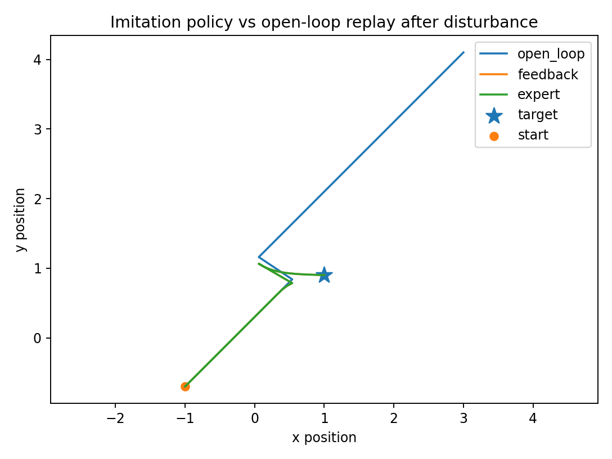

# From Demonstrations to Deployment: Physical AI Companion Lab

[](https://www.python.org/downloads/)
[](https://numpy.org/)
[](#core-mechanics)
[](#test-suite)
[](https://opensource.org/licenses/MIT)

A deterministic, CPU-only 2D reaching lab illustrating why **open-loop demonstration replay** fails under real-world deployment disturbances, whereas a **closed-loop feedback policy** learned via ridge-regularized behavioral cloning recovers smoothly to the target.

> [!IMPORTANT]
> **Safety & Scope:** This lab is an educational toy simulation using linear ridge regression in 2D—it is **not** a Diffusion Policy, vision-language-action model, or physical robot controller. Never connect its outputs to real actuators.

---

## Core Mechanics

```
  [1] Synthetic Expert Demos (N=600)    a_expert = clip(1.25 * (target - state), -0.35, 0.35)
                |                       Sampled near targets -> learned policy must extrapolate
                v
  [2] Ridge Behavioral Cloning          W = (X^T X + lambda * I_nobias)^(-1) X^T Y
                |                       Maps relative offset [dx, dy, 1] -> 2D velocity command
                v
  [3] Deployment Rollout (H=65, dt=0.2) Surprise displacement (-0.55, +0.25) injected at step 22
        |                       |
        v                       v
  [Open-Loop Replay]      [Closed-Loop Feedback]
  Repeats initial action  Recomputes action from live state
  -> Permanent drift      -> Recovers cleanly to target
```

---

## Trajectory Visualization



---

## Quickstart

### 1. Setup & Run

```bash
# Clone the repository
git clone https://github.com/AdityaInamdar334/Deep-Learning-Implementations.git
cd Deep-Learning-Implementations/physical_ai_deployment_lab

# Create virtual environment and install dependencies
python3 -m venv .venv
source .venv/bin/activate
pip install -r requirements.txt

# Run comparison
python3 robot_lab.py
python3 robot_lab.py --json
python3 robot_lab.py --plot   # regenerates deployment_feedback.png
```

### 2. Test Suite

```bash
python3 -m unittest discover -s tests -v
```

The 5 automated unit tests verify:
- **`test_data`**: Demonstration tensor shapes `(50, 3)` and `(50, 2)`.
- **`test_fitted`**: Finite ridge-regression weights of shape `(3, 2)`.
- **`test_limits`**: Strict actuator clamping within `[-0.35, 0.35]`.
- **`test_feedback_recovers_better`**: Closed-loop policy achieves strictly lower final error than open-loop replay after the step-22 disturbance.
- **`test_repeatability`**: Exact deterministic trajectory parity across runs.

---

## File Structure

```
physical_ai_deployment_lab/
├── README.md                    # Architecture, plot, limitations, and exercises
├── requirements.txt             # numpy, matplotlib
├── .gitignore                   # Ignores __pycache__ and bytecode
├── robot_lab.py                 # Expert generator, ridge BC solver, rollout simulator, CLI
├── deployment_feedback.png      # Open-loop vs closed-loop vs expert trajectory plot
└── tests/
    └── test_robot_lab.py        # 5 automated unit tests
```

---

## References

- Cheng Chi et al., *Diffusion Policy: Visuomotor Policy Learning via Action Diffusion* (RSS 2023). [Project Page](https://diffusion-policy.cs.columbia.edu/) | [GitHub](https://github.com/real-stanford/diffusion_policy)
- Toyota Research Institute, *Large Behavior Models* (2026). [Project Page](https://toyotaresearchinstitute.github.io/lbm1/)
- ISO 10218-2:2025, *Robotics — Safety requirements — Part 2: Industrial robot applications and robot cells*. [ISO Standard](https://www.iso.org/standard/73934.html)
