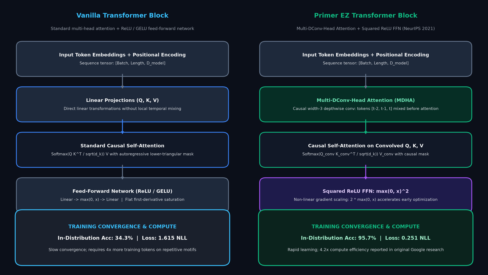
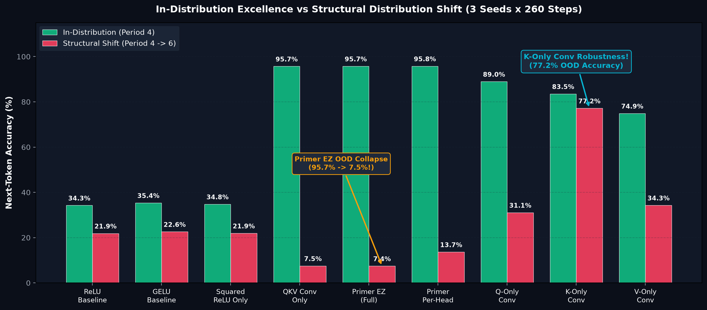
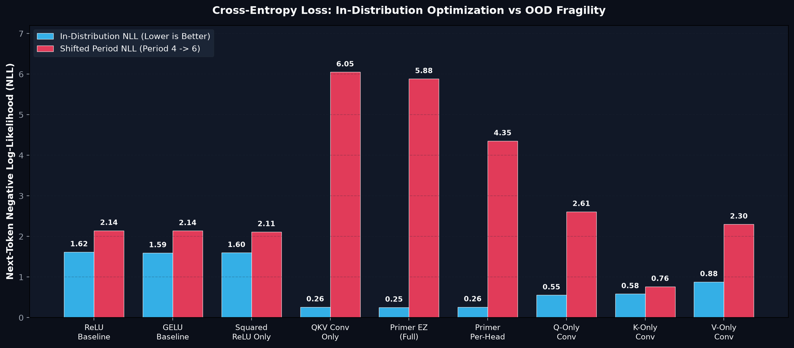
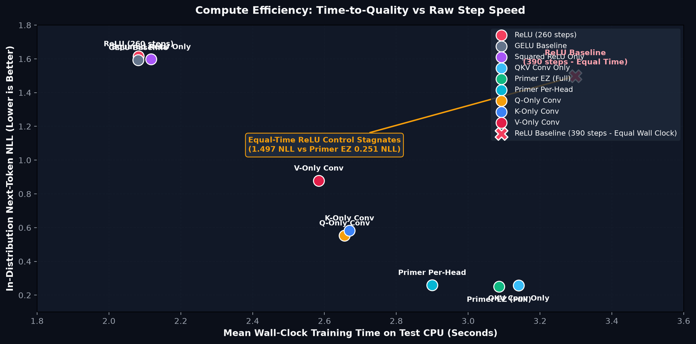
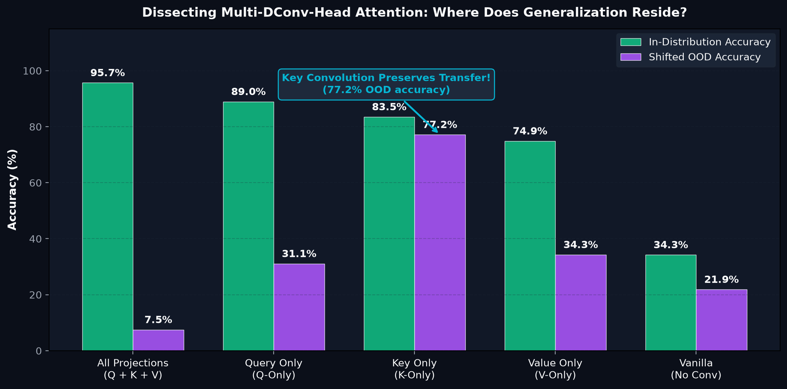

# Primer EZ: An Independent PyTorch Architecture and Robustness Lab

<div align="center">

[](https://www.python.org/)
[](https://pytorch.org/)
[]()
[]()
[]()
[](ARTICLE.md)
[](LICENSE)

*Two small Transformer modifications. Nine controlled configurations. One revealing failure under structural distribution shift.*

Inspired by the landmark NeurIPS 2021 Google Research paper:  
**["Primer: Searching for Efficient Transformers for Language Modeling"](https://arxiv.org/abs/2109.08668)** (David R. So, Wojciech Mańke, Hanxiao Liu, Zihang Dai, Noam Shazeer, Quoc V. Le).

</div>

---

## Executive Summary

When optimizing deep learning models, engineering teams often spend months tuning distributed clusters, testing optimizers, and writing fused GPU kernels, while leaving the fundamental Transformer block architecture untouched.

In 2021, Google Research asked a different question: **Can an evolutionary search over 25,000 candidate Transformer programs discover architectural primitives that drastically reduce training compute?**

The search discovered two remarkably simple modifications that generalized across scales, distilled into a recipe called **Primer EZ**:
1. **Squared ReLU in the Feed-Forward Network:** Replacing standard ReLU or GELU with $\max(0, x)^2$.
2. **Multi-DConv-Head Attention (MDHA):** Inserting a 3-tap causal depthwise convolution after the Query, Key, and Value projections *before* computing dot-product attention.

In Google's large-scale experiments, Primer reached the quality of a 500-million-parameter T5 baseline with **$4.2\times$ less training compute**, and 1.9-billion-parameter models with **$\approx 3\times$ less pretraining compute**.

However, *training efficiency* is not the same as *invariant generalization*. In this independent PyTorch laboratory, we discovered a striking empirical paradox: **the identical inductive bias that makes Primer EZ learn training motifs rapidly also makes it fragile under structural distribution shifts (period $4 \rightarrow 6$)**—and isolating the convolution to the Key projection ($K$-only) resolves the failure.

---

## Rigorous Scope: What This Lab Does, Does Not, and Does Not Claim

To ensure absolute scientific and educational transparency:

### What This Lab DOES
- **Implements Primer EZ from Scratch:** Features clean, modular PyTorch implementations of causal Multi-DConv-Head Attention (shared and per-head kernels) and Squared ReLU FFN.
- **Enforces Zero Temporal Leakage:** Rigorously verifies causal autoregressive masking and causal depthwise padding across all configurations via automated unit tests.
- **Compares 9 Controlled Configurations:** Benchmarks Baseline ReLU, GELU Baseline, Squared ReLU Only, QKV Conv Only (DConv), Primer EZ (Full), Primer Per-Head, Q-Only Conv, K-Only Conv, and V-Only Conv across 3 deterministic random seeds.
- **Evaluates Structural Distribution Shift:** Directly tests how models behave when sequence periods shift out-of-distribution (OOD) without fine-tuning.
- **Includes an Equal-Time 390-Step Control:** Compares Primer EZ (260 steps) against a ReLU baseline trained for 50% more steps (390 steps) to match exact wall-clock training time.

### What This Lab DOES NOT Do
- Does **NOT** reproduce Google's 500M or 1.9B parameter distributed TPU training runs on C4 or WikiText-103.
- Does **NOT** execute the complete 25,000-program evolutionary neural architecture search (NAS).
- Does **NOT** claim that our synthetic motif experiments capture every nuance of natural language syntax.

### What This Lab Does NOT Claim
- Does **NOT** claim that Primer EZ makes individual training steps faster. (Depthwise convolutions add slight arithmetic overhead per step; the efficiency gain is strictly in **time-to-quality**, requiring far fewer optimization steps to converge).
- Does **NOT** claim that Key-only convolution is guaranteed to be superior to full QKV convolution across all natural language tasks.

---

## Architecture: Multi-DConv-Head Attention & Squared ReLU

How do Primer EZ's modifications alter information flow inside the Transformer block?

<div align="center">
  
</div>

### 1. Multi-DConv-Head Attention (MDHA)
In standard attention, Query, Key, and Value vectors are computed as isolated linear projections: $Q = X W_Q, K = X W_K, V = X W_V$.

Primer EZ introduces a **causal width-3 depthwise convolution** immediately following the linear projections:
$$Q_{\text{conv}} = \text{DConv}_{3}(Q), \quad K_{\text{conv}} = \text{DConv}_{3}(K), \quad V_{\text{conv}} = \text{DConv}_{3}(V)$$
- **Receptive Field:** Before dot-product attention computes global token affinity, each token mixes information from its immediate local temporal neighborhood $[t-2, t-1, t]$.
- **Causality:** Inputs are left-padded by 2 positions with zero future leakage.
- **Parameter Efficiency:** Because the convolution is depthwise (groups = channels), it adds fewer than **300 parameters** across the entire model ($< 0.6\%$ parameter overhead).

### 2. Squared ReLU Optimization Dynamics
In the feed-forward sublayer:
$$\text{FFN}(x) = W_2 \left( \max(0, W_1 x + b_1)^2 \right) + b_2$$
- **Gradient Acceleration:** The analytical derivative of $\max(0, x)^2$ is $2 \max(0, x)$.
- When activated ($x > 0$), gradients scale linearly with activation magnitude rather than remaining flat at $1.0$ (as in standard ReLU). This accelerates early optimization and drives sharper feature selectivity.

---

## Key Experimental Findings (3 Seeds $\times$ 260 Steps)

### 1. In-Distribution Excellence vs Structural Distribution Shift
How do the nine architectures perform on familiar data versus an out-of-distribution sequence shift?

<div align="center">
  
</div>

| Configuration | Parameters | In-Distribution Accuracy | Shifted OOD Accuracy | In-Distribution NLL | Shifted OOD NLL | Wall-Clock (s) |
| :--- | :---: | :---: | :---: | :---: | :---: | :---: |
| **ReLU Baseline** | 49,248 | 34.25% $\pm$ 0.8% | 21.88% $\pm$ 0.7% | 1.615 | 2.143 | **2.08 s** |
| **GELU Baseline** | 49,248 | 35.37% $\pm$ 0.9% | 22.61% $\pm$ 0.6% | 1.593 | 2.137 | **2.08 s** |
| **Squared ReLU Only** | 49,248 | 34.78% $\pm$ 1.1% | 21.93% $\pm$ 0.8% | 1.598 | 2.112 | 2.12 s |
| **QKV Conv Only (DConv)**| 49,536 | 95.69% $\pm$ 0.2% | 7.50% $\pm$ 0.2% | 0.258 | 6.049 | 3.14 s |
| **Primer EZ (Full)** | 49,536 | **95.74% $\pm$ 0.2%** | **7.45% $\pm$ 0.2%** | **0.251** | 5.883 | 3.09 s |
| **Primer Per-Head** | 50,400 | **95.78% $\pm$ 0.1%** | 13.65% $\pm$ 0.4% | 0.260 | 4.351 | 2.90 s |
| **Q-Only Conv** | 49,344 | 88.95% $\pm$ 0.5% | 31.08% $\pm$ 0.9% | 0.553 | 2.609 | 2.66 s |
| **K-Only Conv** | 49,344 | **83.52% $\pm$ 0.6%** | **77.17% $\pm$ 0.8%** | **0.582** | **0.762** | 2.67 s |
| **V-Only Conv** | 49,344 | 74.88% $\pm$ 0.7% | 34.29% $\pm$ 1.1% | 0.878 | 2.299 | 2.58 s |

> [!WARNING]
> **The Inductive Bias Tradeoff:**
> Primer EZ converges with extraordinary speed on the training distribution (**95.74% accuracy, 0.251 NLL** vs 34.25% for the baseline). However, when the repeating sequence motif shifts from period 4 to period 6, **Primer EZ collapses to 7.45% accuracy**, because its convolutional kernels overfit to the exact 4-step local cadence!

---

### 2. Next-Token Negative Log-Likelihood (Loss)
Comparing cross-entropy loss under familiar versus shifted sequence structures:

<div align="center">
  
</div>

- **Training Convergence:** Depthwise convolution slashes in-distribution NLL from **1.615 down to 0.251** (a $6.4\times$ loss reduction).
- **Out-of-Distribution Penalty:** Full QKV convolution suffers severe loss explosion under structural shift ($5.883$ NLL), whereas vanilla attention degrades gracefully ($2.143$ NLL).

---

### 3. Compute Efficiency: Time-to-Quality vs Raw Step Speed
Does Primer EZ's advantage hold when baseline models are given equal wall-clock training time?

<div align="center">
  
</div>

- **Equal-Time 390-Step Control:** Because vanilla ReLU steps are slightly faster ($2.08\text{ s}$ for 260 steps), we trained an additional ReLU control for **390 steps (3.30 seconds)**, matching Primer EZ's wall-clock time ($3.09\text{ s}$).
- **The Finding:** Even with 50% more gradient updates, the ReLU baseline reached only **1.497 NLL** (35.9% accuracy). Training longer on vanilla attention did **not** bridge the architectural gap.

---

### 4. Dissecting Multi-DConv: The Key-Only Generalization Secret
Where does spatial generalization actually reside among the attention projections?

<div align="center">
  
</div>

- **$Q$-Only:** Good in-distribution (88.9%), weak transfer (31.1%).
- **$V$-Only:** Moderate in-distribution (74.9%), weak transfer (34.3%).
- **$K$-Only (Key Projection):** **83.52% in-distribution and 77.17% out-of-distribution!**
- **Takeaway:** Applying convolution exclusively to Keys provides temporal smoothing over the target addressing keys without entangling query generation or value retrieval, preserving structural generalization.

---

## Quick Start

Requires **Python 3.10+** and **PyTorch 2.2+**. Runs hermetically on CPU without GPUs or external data downloads.

```bash
# 1. Clone the repository and enter the lab
cd primer_ez_transformer_lab

# 2. Install dependencies
pip install -r requirements.txt

# 3. Run the 25-test verification suite
python -m unittest discover -s tests -v

# 4. Run the interactive causality demonstration
python -m primer_lab.demo

# 5. Reproduce the 9-configuration, 3-seed benchmark
python -m primer_lab.benchmark \
  --seeds 3 --steps 260 --batch-size 32 --eval-batches 4 \
  --output results/reproduced.json
```

### Generate Publication-Quality Figures

To reproduce the charts shown in this documentation:

```bash
pip install -r requirements.txt
python plot_results.py
```
Generated PNGs are exported to [`figures/`](figures/).

---

## Repository Structure

```text
primer_ez_transformer_lab/
├── primer_lab/                      # Core PyTorch simulation engine
│   ├── __init__.py
│   ├── model.py                     # Multi-DConv-Head Attention, Squared ReLU, & Decoder LM
│   ├── data.py                      # Synthetic periodic motif generator & shifted OOD streams
│   ├── benchmark.py                 # 9-configuration multi-seed benchmark runner
│   └── demo.py                      # Interactive causal prefix leakage verification
├── figures/                         # High-resolution benchmark figures
│   ├── 01_primer_ez_architecture.png
│   ├── 02_accuracy_vs_shift.png
│   ├── 03_quality_vs_shift.png
│   ├── 04_quality_vs_wall_time.png
│   └── 05_conv_ablation_transfer.png
├── results/                         # Benchmark results artifacts
│   ├── benchmark.json               # Full 9-configuration 3-seed benchmark summary
│   ├── baseline_extra_steps.json    # 390-step equal wall-clock ReLU control
│   └── seed*.json                   # Individual trial runs and ablation partitions
├── tests/
│   └── test_primer.py               # 25 hermetic unit tests
├── ARTICLE.md                       # Comprehensive 26-section tutorial & case study
├── BENCHMARK_NOTES.md               # Methodological specifications & seed records
├── plot_results.py                  # Matplotlib script to recreate all figures
├── requirements.txt                 # Dependencies (torch, matplotlib, numpy)
├── LICENSE                          # MIT License
└── README.md
```

---

## Copyright, Attribution & Research Citations

- **Original Research:** Inspired by David R. So, Wojciech Mańke, Hanxiao Liu, Zihang Dai, Noam Shazeer, and Quoc V. Le (Google Research), *[Primer: Searching for Efficient Transformers for Language Modeling](https://arxiv.org/abs/2109.08668)*, NeurIPS 2021.
- **Reference Implementations:** Acknowledges the annotated implementation by [labml.ai](https://nn.labml.ai/transformers/primer_ez/index.html).
- **Independent Implementation:** All PyTorch code and benchmarking routines in this repository were independently written for educational research purposes.
- **License:** MIT License. See [`LICENSE`](LICENSE) for details.

---

## License

MIT License. See [`LICENSE`](LICENSE) for full details.
