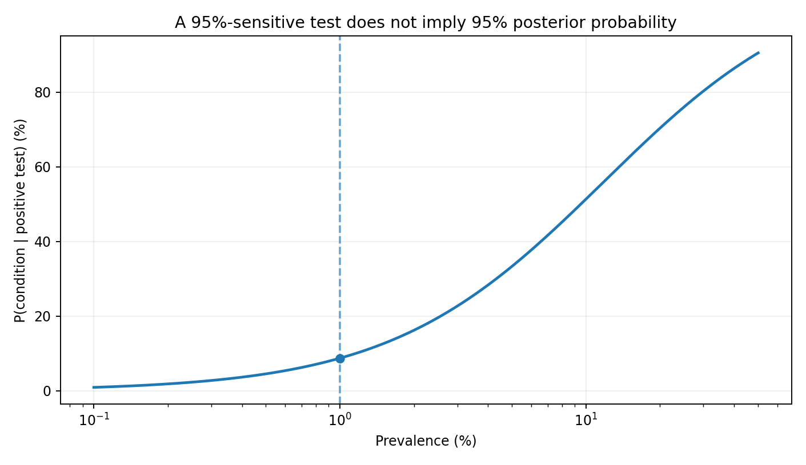
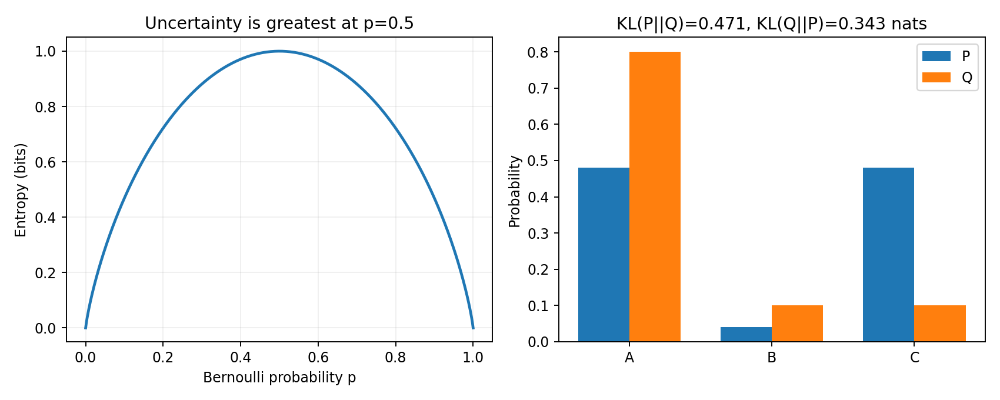
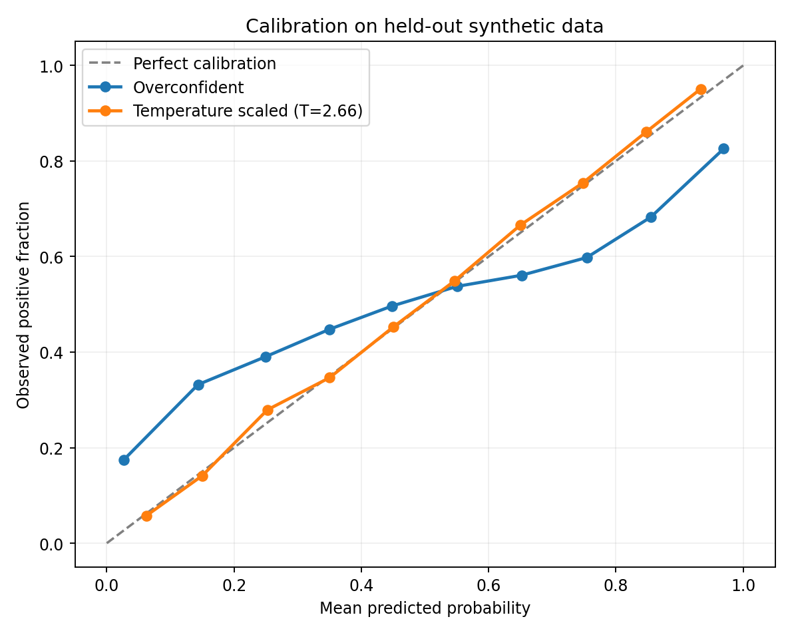
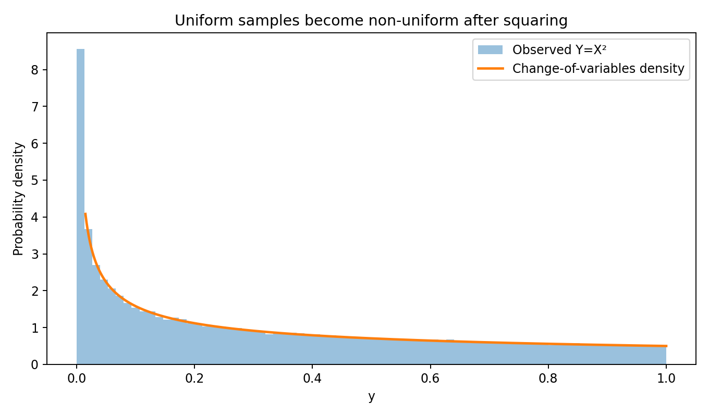

# Probability & Information Theory: From Bayes to Calibration

[](https://www.python.org/downloads/)
[](https://numpy.org/)
[](#core-experiments)
[](#test-suite)
[](https://opensource.org/licenses/MIT)

A reproducible NumPy companion lab illustrating Chapter 3 of *Deep Learning* (Goodfellow, Bengio, & Courville, 2016): **Bayesian base-rate effects**, **binary entropy & KL divergence asymmetry**, **temperature-scaling probability calibration**, and **change-of-variables density transformations**.

---

## Core Experiments

1. **Bayesian Base Rates**: With $1\%$ prevalence, $95\%$ sensitivity, and $90\%$ specificity, a positive test yields only an **$8.76\%$** posterior probability—demonstrating why likelihoods cannot be read as posteriors without the prior.
2. **Entropy & KL Asymmetry**: Binary entropy peaks at $H(0.5) = 1.0\text{ bit}$, while $D_{\text{KL}}(P \parallel Q) = 0.471\text{ nats} \neq D_{\text{KL}}(Q \parallel P) = 0.343\text{ nats}$ for $P = [0.48, 0.04, 0.48]$ and $Q = [0.8, 0.1, 0.1]$.
3. **Temperature-Scaling Calibration**: Fitting a single scalar temperature $T = 2.665$ on a 6,000-sample validation split leaves binary decisions and accuracy **bit-for-bit identical** (`72.62%`) on the 6,000-sample held-out test set while cutting NLL (`0.684 -> 0.535`), Brier score (`0.203 -> 0.180`), and 10-bin ECE (`0.136 -> 0.010`).
4. **Change-of-Variables Density**: Transforming $X \sim \mathcal{U}(0, 1)$ by $Y = X^2$ produces the exact Jacobian-scaled density $p_Y(y) = p_X(\sqrt{y})\left|\frac{dx}{dy}\right| = \frac{1}{2\sqrt{y}}$ on $(0, 1)$, verified against 75,000 Monte Carlo draws.

---

## Generated Visualizations

| Bayesian Base-Rate Posterior | Binary Entropy & KL Asymmetry |
| :---: | :---: |
|  |  |

| Reliability Diagram & Temperature Scaling | Change of Variables ($Y = X^2$) |
| :---: | :---: |
|  |  |

---

## Baseline Results (`figures/metrics.json`)

| Calibration Metric (6,000 Held-Out Samples) | Uncalibrated | Temperature Scaled ($T = 2.665$) |
|:---|---:|---:|
| Negative Log-Likelihood (NLL) | `0.6843` | **`0.5355`** |
| Brier Score | `0.2027` | **`0.1803`** |
| Expected Calibration Error (10-bin ECE) | `0.1362` | **`0.0099`** |
| Classification Accuracy | `72.62%` | `72.62%` *(invariant)* |

---

## Quickstart

### 1. Setup & Run

```bash
# Clone the repository
git clone https://github.com/AdityaInamdar334/Deep-Learning-Implementations.git
cd Deep-Learning-Implementations/probability_information_lab

# Install dependencies
python3 -m pip install -r requirements.txt

# Regenerate all 4 figures + figures/metrics.json
python3 lab.py --out figures
```

### 2. Test Suite

```bash
python3 -m unittest discover -s tests -v
```

The 7 automated unit tests verify:
- **`test_bayes`**: Exact posterior probability `0.0875576`.
- **`test_entropy`**: Exact boundary and peak binary entropies ($0$ and $1$ bit).
- **`test_kl`**: Non-negativity, zero self-divergence, and $+\infty$ on support mismatch.
- **`test_softmax_equiv_logistic`**: Numerically stable `logaddexp` sigmoid parity.
- **`test_temperature_fit`** & **`test_temperature_keeps_decisions`**: Lower held-out NLL with exact decision invariance.
- **`test_brier`**: Zero Brier score on perfect binary predictions.

---

## File Structure

```
probability_information_lab/
├── README.md                        # Experiments, figures, metrics, and caveats
├── requirements.txt                 # numpy, matplotlib
├── .gitignore                       # Ignores __pycache__ and bytecode
├── lab.py                           # Bayes, entropy/KL, calibration, density, and plots
├── figures/
│   ├── bayes_base_rates.png         # Posterior vs log-prevalence curve
│   ├── entropy_and_kl.png           # Binary entropy + asymmetric KL bars
│   ├── calibration.png              # Reliability diagram before/after temperature scaling
│   ├── density_change.png           # Monte Carlo Y=X^2 histogram vs 1/(2 sqrt(y))
│   └── metrics.json                 # Deterministic summary metrics
└── tests/
    └── test_lab.py                  # 7 automated unit tests
```

---

## References

- Ian Goodfellow, Yoshua Bengio, & Aaron Courville (2016), *Deep Learning*, Chapter 3: Probability and Information Theory. [deeplearningbook.org](https://www.deeplearningbook.org/contents/prob.html)
- Chuan Guo et al. (2017), *On Calibration of Modern Neural Networks* (ICML). [PMLR](https://proceedings.mlr.press/v70/guo17a.html)
- scikit-learn Documentation: [Probability Calibration](https://scikit-learn.org/stable/modules/calibration.html)
