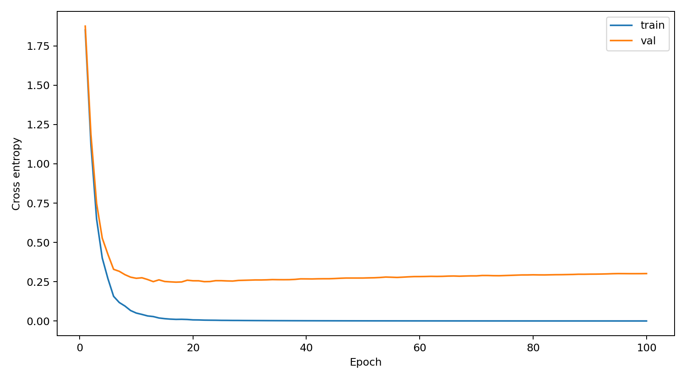
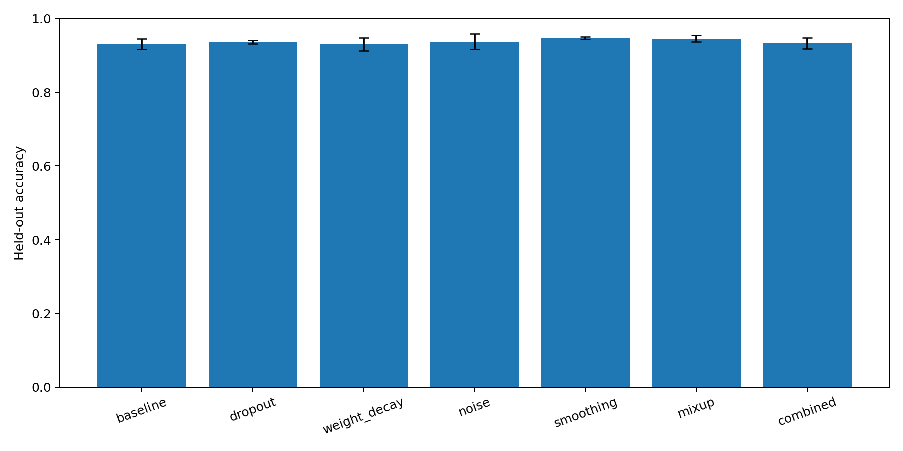
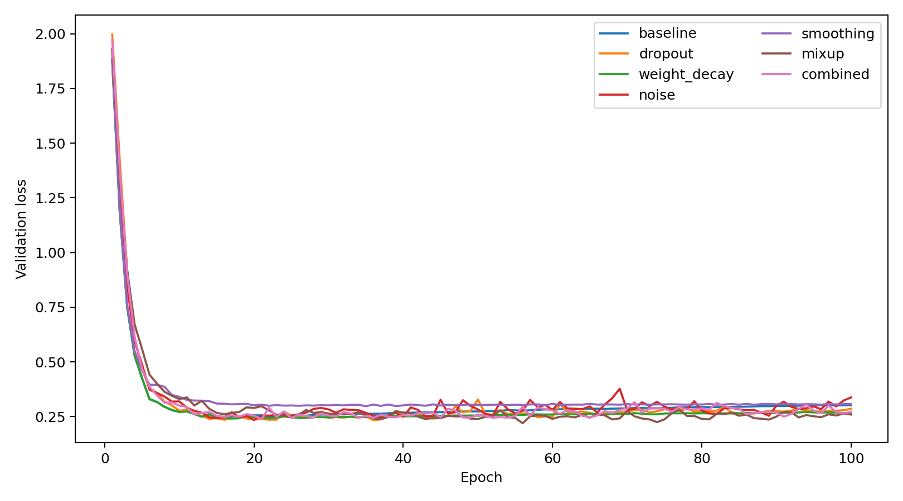
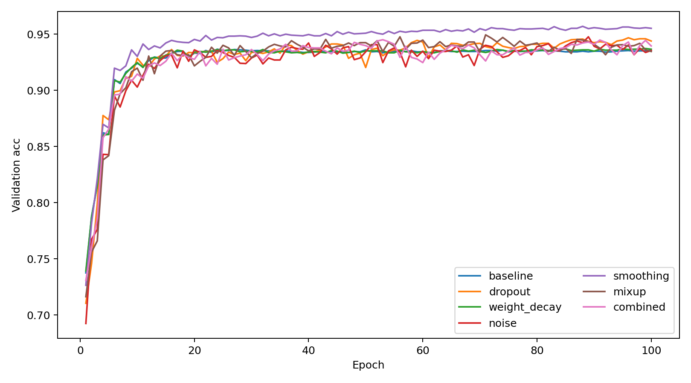

# Regularization for Deep Learning: 7-Way Controlled Ablation Lab

[](https://www.python.org/downloads/)
[](https://pytorch.org/)
[](#ablation-results-3-seeds)
[](#test-suite)
[](https://opensource.org/licenses/MIT)

A CPU-only reproducible research companion to Chapter 7 of *Deep Learning* (Goodfellow, Bengio, & Courville, 2016) and [`article.md`](./article.md). Using a deliberate low-data regime (`200` train / `1,147` validation / `450` test on scikit-learn Digits) over 3 seeds, it compares **7 regularization configurations**—tracking not only held-out accuracy and early-stopping epoch, but also **NLL** and **10-bin Expected Calibration Error (ECE)**.

---

## Ablation Results (3 Seeds, `results.txt`)

| Configuration | Final Test Acc | Early-Stopped Acc | Early-Stopped NLL | Early-Stopped ECE | Best Val Epochs |
|:---|---:|---:|---:|---:|:---|
| `baseline` | `93.33%` | `93.11%` | `0.2338` | **`0.0159`** | `[18, 13, 15]` |
| `weight_decay` (`wd=0.1`, biases exempt) | `93.85%` | `93.04%` | `0.2313` | `0.0214` | `[30, 13, 15]` |
| `dropout` (`p=0.3`) | `93.70%` | `93.63%` | `0.2181` | `0.0216` | `[54, 32, 17]` |
| `noise` (Gaussian $\sigma=0.15$) | `93.56%` | `93.78%` | `0.2218` | `0.0179` | `[81, 15, 19]` |
| `mixup` ($\text{Beta}(0.4, 0.4)$) | `93.26%` | `94.59%` | **`0.2158`** | `0.0663` | `[35, 80, 74]` |
| **`smoothing`** ($\epsilon=0.1$) | **`95.19%`** | **`94.74%`** | `0.2962` | `0.1389` | `[20, 40, 35]` |
| `combined` (`drop=0.2, wd=0.03, noise=0.1`) | `93.19%` | `93.33%` | `0.2254` | `0.0271` | `[53, 21, 61]` |

### Key Takeaways
- **Accuracy vs. Calibration Tradeoff**: Label smoothing achieves the highest accuracy (`94.74%`) while increasing ECE by nearly $9\times$ (`0.0159 -> 0.1389`) due to intentional probability softening.
- **Best Proper Scoring Rule**: Mixup delivers the lowest NLL (`0.2158`) and delays overfitting well past epoch 70.
- **Stacking Isn't Automatically Additive**: Combining un-tuned regularizers (`combined`) underperforms standalone Mixup or smoothing, showing why hyperparameters interact.

---

## Generated Visualizations (`figures/`)

| Baseline Train vs. Validation Gap | 7-Way Held-Out Accuracy Ablation |
| :---: | :---: |
|  |  |

| Validation Loss Curves (100 Epochs) | Validation Accuracy Curves (100 Epochs) |
| :---: | :---: |
|  |  |

---

## Quickstart

### 1. Setup & Run

```bash
# Clone the repository
git clone https://github.com/AdityaInamdar334/Deep-Learning-Implementations.git
cd Deep-Learning-Implementations/regularization-lab

# Create virtual environment and install dependencies
python3 -m venv .venv
source .venv/bin/activate
pip install -r requirements.txt

# Run full 7-way x 3-seed ablation (writes figures/ and results.json)
python3 lab.py

# Run smoke tests (L1 vs L2 shrinkage, dropout scaling)
python3 smoke_tests.py
```

### 2. Test Suite

```bash
python3 -m unittest discover -s tests -v
```

The 4 automated unit tests verify:
- **`test_l1_sparsity_vs_l2_shrinkage`**: Exact L1 soft-thresholding sparsity `[1.95, 0, 0]` vs. non-zero L2 shrinkage.
- **`test_dropout_scaling_and_eval_identity`**: Unbiased inverted dropout mean in `.train()` and exact identity in `.eval()`.
- **`test_model_and_evaluate`**: Forward shape `(B, 10)` and valid `loss`, `acc`, and `ece` bounds.
- **`test_artifacts_present`**: Confirms `article.md`, `results.json`, `results.txt`, and all 4 PNG figures exist.

---

## File Structure

```
regularization-lab/
├── README.md                    # Ablation table, figures, and quickstart
├── article.md                   # Full companion technical article
├── requirements.txt             # torch, numpy, scikit-learn, matplotlib
├── environment.txt              # Recorded environment snapshot
├── .gitignore                   # Ignores __pycache__ and bytecode
├── lab.py                       # 7-way x 3-seed PyTorch ablation harness
├── smoke_tests.py               # L1/L2 shrinkage & dropout smoke checks
├── results.json                 # Per-epoch metrics and checkpoint evaluations
├── results.txt                  # Recorded summary stdout
├── figures/                     # 4 generated PNG figures
└── tests/
    └── test_regularization.py   # 4 automated unit tests
```

---

## References

- Ian Goodfellow, Yoshua Bengio, & Aaron Courville (2016), *Deep Learning*, Chapter 7: Regularization for Deep Learning. [deeplearningbook.org](https://www.deeplearningbook.org/contents/regularization.html)
- Nitish Srivastava et al. (2014), *Dropout: A Simple Way to Prevent Neural Networks from Overfitting* (JMLR).
- Hongyi Zhang et al. (2018), *mixup: Beyond Empirical Risk Minimization* (ICLR). [arXiv:1710.09412](https://arxiv.org/abs/1710.09412)
- Rafael Müller, Simon Kornblith, & Geoffrey Hinton (2019), *When Does Label Smoothing Help?* (NeurIPS). [arXiv:1906.02629](https://arxiv.org/abs/1906.02629)
