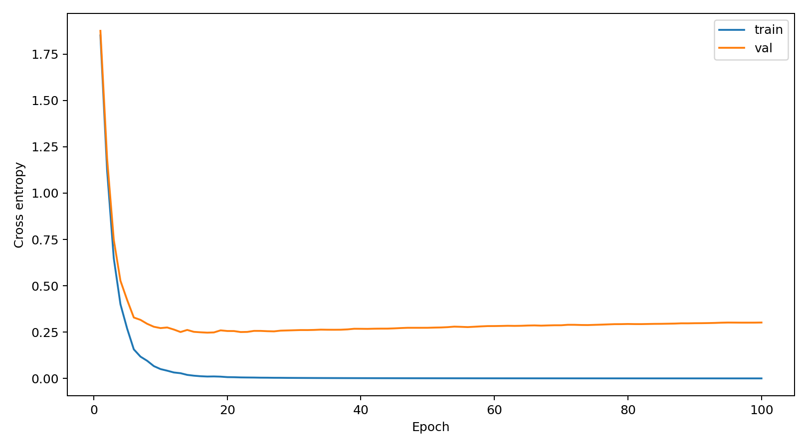
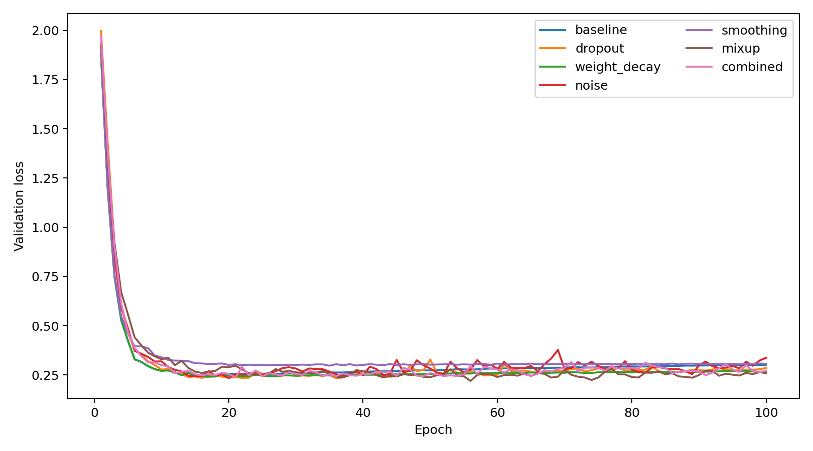
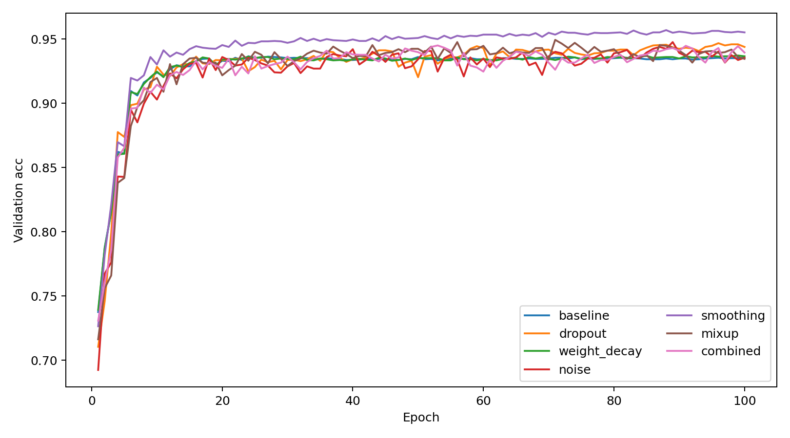
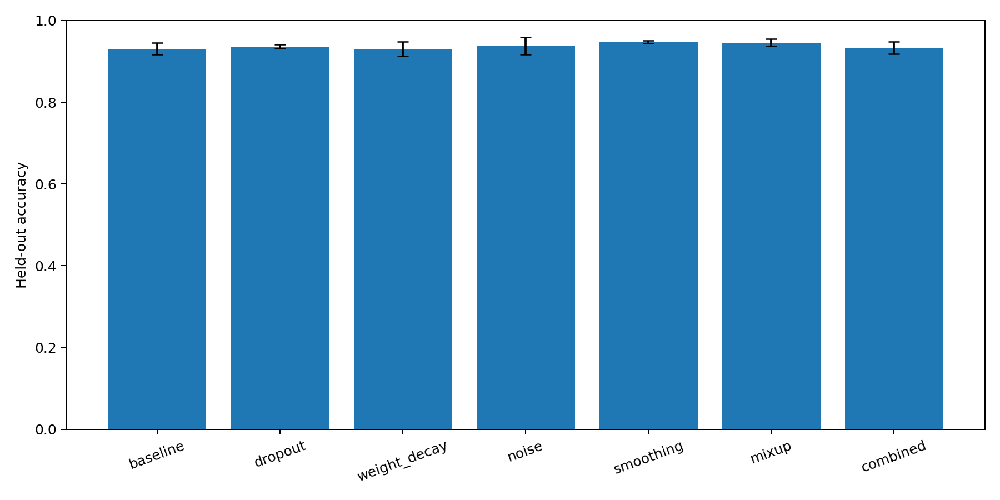

# Why Making a Neural Network Worse During Training Can Make It Better at Everything Else

*The science of deep learning regularization, from L1 and L2 penalties to dropout, AdamW, Mixup, and modern transformers, explored through research papers and reproducible PyTorch experiments.*

Imagine spending hours training a neural network. The training loss keeps falling, the predictions become increasingly confident, and eventually the model gets every training example right. Naturally, you keep training. Why stop a system that is still improving?

Except that the validation loss has started rising. The model is becoming more certain without becoming more reliable.

Now imagine deliberately making its training harder. Switch off random neurons. Perturb its inputs. Replace its perfectly certain labels with probability distributions. Penalize its weights. Stop it before it finishes optimizing.

These are not mistakes. They are some of the most important tools in deep learning.

In this article, we train the same neural network under seven regularization configurations and three random seeds. Label smoothing gives the highest mean held-out accuracy, Mixup gives the lowest mean test cross-entropy, and combining dropout, noise and weight decay fails to beat either. There is no single winner across every metric.

The question is not merely how to prevent overfitting. It is how to choose which kinds of solutions a model should learn.

## Abstract

Regularization modifies a learning procedure to promote generalization, often at the expense of empirical fit. This article develops a unified perspective on parameter penalties, constraints, stochastic perturbations, data augmentation, model averaging, shared representations and optimization-time restrictions. Chapter 7 of Goodfellow, Bengio and Courville (2016) provides the theoretical foundation; subsequent research extends the discussion to decoupled weight decay, mixed-example augmentation, calibration, semi-supervised consistency, sharpness-aware optimization and scheduled dropout. An original CPU-based experiment compares seven configurations of a 256-unit, two-hidden-layer multilayer perceptron trained on only 200 labeled handwritten digits per split. Across three seeds, label smoothing achieves 94.74% mean held-out accuracy versus 93.11% for the baseline, but yields worse negative log-likelihood and calibration error. Mixup obtains the lowest mean test negative log-likelihood. These results illustrate metric-dependent benefits rather than a universal ranking of regularizers.

**Keywords:** Regularization, generalization, dropout, AdamW, label smoothing, Mixup, calibration, implicit bias.

## Contents

1. Why optimization is not learning
2. L1 and L2: the geometry of preferences
3. AdamW, constraints and ill-conditioned problems
4. Dropout and stochastic regularization
5. Augmentation, noise and soft targets
6. Early stopping and the spectral view of learning
7. Sharing, sparsity and ensembles
8. Consistency, adversarial training and manifolds
9. Reproducible experimental methodology
10. Results and interpretation
11. Modern transformers and recent research
12. Practical decisions and limitations
13. Conclusion and references

## 1. Why optimization is not learning

The central problem of statistical learning is not finding parameters that explain observed data. It is finding parameters whose predictions remain useful on future data. The distinction matters because a flexible neural network may represent many functions that agree on every training observation but disagree everywhere else (Goodfellow et al., 2016, Chapters 5 and 7).

A training objective is an empirical approximation to a population objective. We can write the distinction using plain-text mathematics:

    R(θ) = E[(loss(fθ(X), Y))]
    R_train(θ) = (1/n) Σ loss(fθ(xᵢ), yᵢ)

The first quantity is expected risk under the relevant data distribution; the second is its finite-sample approximation. We only observe the second directly. A held-out dataset provides another estimate of the first, assuming its sampling process matches the intended deployment conditions.

Regularization is an intervention intended to improve generalization, rather than necessarily improving empirical training error. An explicit penalty is just one possible intervention:

    J_total(θ) = J_data(θ) + α Ω(θ)

Here Ω is a preference over solutions, and α sets its strength. But dropout changes the stochastic training objective; augmentation changes the examples; early stopping changes the reachable parameter trajectory. All can influence generalization without reducing the number of parameters.

The classical explanation is the bias-variance trade-off. Under squared-error prediction, expected error decomposes into squared bias, variance across training samples, and irreducible noise. A useful regularizer can introduce some bias while reducing variance sufficiently to lower expected error. This decomposition is not a universal formula for classification accuracy.

Modern networks complicate the story. Zhang et al. (2017) showed that deep models can fit random labels. Belkin et al. (2019) and Nakkiran et al. (2020) documented double descent, where test error can decline again beyond an interpolation regime. Capacity alone does not determine the solution that a training algorithm chooses.

This is why shrinking a model is not always the right answer. A wide model with appropriate inductive biases can outperform a smaller model. Regularization is about the behavior of a learning system, not just its parameter count.

## 2. L1 and L2: the geometry of preferences

Suppose a model predicts house prices using floor area, neighborhood, age and hundreds of other features. Some relationships are well supported by the data, while others appear useful because of random correlations. A regularizer can discourage excessive dependence on the latter.

### 2.1 L2 regularization

The squared L2 penalty adds half the squared Euclidean norm of the weights:

    J_total(w) = J_data(w) + (α/2) Σ wᵢ²
    ∇J_total(w) = ∇J_data(w) + αw

For plain gradient descent with learning rate η, the update becomes:

    w_next = (1 − ηα) w − η ∇J_data(w)

Every step includes a multiplicative shrinkage. This is the origin of the term weight decay in ordinary gradient descent. The relationship becomes subtler with momentum and adaptive optimizers, as we will see shortly.

The more interesting question is which directions are shrunk. Near an unregularized minimum w*, approximate the loss by a quadratic with Hessian H. The regularized optimum of this approximation is:

    w_regularized = (H + αI)⁻¹ H w*

If H has eigenvalue λ along a direction, the corresponding component is scaled by λ/(λ+α). A high-curvature direction changes the objective rapidly, so its coefficient is relatively preserved. A low-curvature direction is easier to shrink without increasing data loss much (Goodfellow et al., 2016, §7.1).

This is a local geometric explanation, not proof that a high-curvature direction is semantically important or that small weights imply good generalization in every deep network. Reparameterizing a ReLU network can change weight magnitudes without changing its function.

### 2.2 L1 regularization and sparsity

L1 instead penalizes absolute values:

    J_total(w) = J_data(w) + α Σ |wᵢ|

Away from zero its penalty gradient is α sign(wᵢ). At zero the subgradient is an interval. For a separable quadratic with positive diagonal Hessian entries, the optimum is the soft-thresholding rule:

    wᵢ = sign(wᵢ*) max(|wᵢ*| − α/Hᵢᵢ, 0)

Unlike L2 shrinkage, this can produce exact zeros. Tibshirani (1996) developed the Lasso around this property. In a correlated feature space, however, a selected feature is not necessarily the uniquely correct causal variable; Lasso may select among redundant predictors.

Try the following independent NumPy example. It implements the exact solutions for a diagonal quadratic, rather than pretending that every neural network has a diagonal Hessian.

```python
import numpy as np

w_star = np.array([2.0, 2.0, 0.4])
curvature = np.array([10.0, 0.1, 1.0])
alpha = 0.5

l2 = curvature / (curvature + alpha) * w_star
l1 = np.sign(w_star) * np.maximum(
    np.abs(w_star) - alpha / curvature, 0
)
print('L2:', l2)
print('L1:', l1)
```

The first coordinate is largely preserved under both penalties. The second is weakly constrained by the data and shrinks dramatically. L1 removes the second and third coordinates entirely. The exact numerical output is included in the companion's smoke tests.

### 2.3 A Bayesian interpretation

A zero-centered independent Gaussian prior on weights produces a squared L2 penalty in maximum a posteriori (MAP) estimation; independent Laplace priors produce L1 penalties. The scaling depends on the likelihood, prior variance and whether losses are summed or averaged. MAP returns a point estimate, not a posterior predictive distribution. This interpretation is useful because it reveals the assumptions that a regularizer imposes, rather than treating α as a mysterious knob (Goodfellow et al., 2016).

## 3. AdamW, constraints and ill-conditioned problems

### 3.1 Why Adam and AdamW are not the same

In an adaptive optimizer, gradients are transformed by estimates of their moments. If the L2 term is added to the gradient before these estimates, its influence is transformed too. That is not generally equivalent to directly shrinking parameters.

Loshchilov and Hutter (2019) introduced decoupled weight decay to separate these operations. In simplified notation:

    coupled Adam: g = ∇J_data(w) + αw; update using Adam(g)
    AdamW: w_next = (1 − ηλ)w − η Adam_direction(∇J_data(w))

AdamW keeps the regularization term out of the moment estimates. The practical implication is that the optimizer and its decay coefficient must be interpreted together. The same numerical coefficient in Ridge, SGD and AdamW does not describe identical interventions.

```python
import torch
from torch import nn

net = nn.Linear(64, 10)
optimizer = torch.optim.AdamW([
    {'params': [net.weight], 'weight_decay': 0.1},
    {'params': [net.bias], 'weight_decay': 0.0},
], lr=0.003)
```

Excluding biases and often normalization parameters is a common engineering choice, not a mathematical requirement. The lab excludes biases and uses the same AdamW optimizer in every run, including the baseline with zero decay.

### 3.2 Constraints versus penalties

A penalized optimization problem may correspond to a norm-constrained problem for suitable multipliers. A constraint limits the feasible region; a penalty discourages leaving a preferred region without necessarily making it impossible. Under convexity and appropriate constraint qualifications, Lagrangian duality makes the relationship precise. In a nonconvex network, global equivalence is not automatic.

Projected gradient descent takes a step and then projects back into the feasible set. For an L2 ball of radius r, multiply a vector outside the ball by r/||w||. A max-norm constraint on each unit's incoming weights is a different choice from gradient clipping, which limits update gradients rather than parameter norms.

### 3.3 When regularization makes the problem solvable

If a regression dataset has more features than examples, XᵀX can be singular. The least-squares optimum need not be unique. With the objective ||Xw − y||² + α||w||², the ridge solution satisfies:

    (XᵀX + αI)w = Xᵀy

For α > 0, the matrix is positive definite. Solve the system instead of explicitly computing an inverse. The convention here uses α without a factor of one-half in either term, avoiding a common factor-of-two ambiguity.

A related issue appears in linearly separable logistic regression: cross-entropy can approach its infimum while weight norms grow without bound. Soudry et al. (2018) showed that gradient descent can converge in direction to a max-margin separator under particular assumptions, even without a finite parameter optimum. This is an example of implicit bias, and explains why regularization is not always reducible to adding a penalty.

## 4. Dropout: training a network that cannot rely on every feature

Imagine a team that can solve a problem only when one particular member is present. A team that learns to function with different members absent may become more adaptable. Dropout applies a related idea to learned representations.

Srivastava et al. (2014) introduced dropout as a practical technique for reducing co-adaptation. During training, independently sampled masks zero out activations. The modern inverted-dropout convention scales surviving activations:

    mᵢ ~ Bernoulli(1 − p)
    h̃ᵢ = mᵢ hᵢ / (1 − p)
    E[h̃ᵢ | hᵢ] = hᵢ

The conditional variance is p hᵢ²/(1−p). Increasing the drop rate therefore increases the perturbation strength. At evaluation time the layer becomes the identity; no additional scaling is needed.

```python
import torch
from torch import nn

x = torch.ones(10000)
dropout = nn.Dropout(0.3)
dropout.train()
print('Training mean:', dropout(x).mean().item())
dropout.eval()
assert torch.equal(dropout(x), x)
```

The mean will fluctuate around one during training. Inference is deterministic with respect to dropout. Forgetting `model.eval()` is an easy way to introduce random predictions into evaluation.

The ensemble interpretation is illuminating: each mask selects a subnetwork, but these subnetworks share parameters. There are exponentially many possible masks, and ordinary deterministic inference approximates their aggregate behavior rather than exactly averaging nonlinear network predictions. This is not the same as training independent bagged models (Goodfellow et al., 2016; Srivastava et al., 2014).

DropConnect masks individual weight connections rather than activations (Wan et al., 2013). Stochastic depth drops residual branches during training (Huang et al., 2016). Monte Carlo dropout intentionally samples masks at inference to estimate predictive variability (Gal & Ghahramani, 2016); it is an approximate uncertainty method, not a guarantee of calibrated uncertainty under distribution shift.

One important qualification: dropout does not always improve results. It can slow convergence, interfere with other regularizers, or induce underfitting at a high rate. Its placement, schedule, architecture and data regime matter.

## 5. Augmentation, noise and soft targets

### 5.1 Teaching invariance through data

A handwritten seven should generally remain a seven after a small translation, but a 180-degree rotation can change a six into a nine. Augmentation encodes an assumption that a transformation preserves the target, or transforms it predictably in a structured task such as segmentation.

Goodfellow et al. (2016, §7.4) emphasize controlled comparisons: if one architecture receives better augmentation than another, the resulting performance difference cannot be attributed solely to architecture.

Input noise offers a simple form of augmentation. For a linear predictor with squared error and independent zero-mean Gaussian input noise with covariance σ²I, the expected squared error is exactly the original error plus σ²||w||². The cross term vanishes because the noise has zero mean. For nonlinear networks, the relationship depends on derivatives and the noise scale (Bishop, 1995).

```python
import torch

images = torch.rand(32, 64)
noisy = (images + 0.15 * torch.randn_like(images)).clamp(0, 1)
assert noisy.shape == images.shape
```

Clamping is appropriate for normalized pixels, but changes the exact Gaussian-noise distribution; the linear equivalence above assumes unclipped noise. Noise magnitude must be tuned to preserve task-relevant information.

### 5.2 Label smoothing: correcting excessive certainty

Cross-entropy with one-hot targets rewards putting ever more probability mass on the correct class. Once classification is correct, the model can still lower the objective by increasing its logit margins.

Label smoothing mixes a one-hot target with a uniform distribution. For K classes and smoothing ε, PyTorch uses:

    q = (1 − ε) one_hot(y) + ε/K

For ten classes and ε=0.1, the correct class receives 0.91 and each other class 0.01. The textbook describes another convention that gives the correct class 1−ε and distributes ε over the other K−1 classes. They are similar but not identical.

```python
import torch
import torch.nn.functional as F

logits = torch.tensor([[4.0, 0.0, -1.0]])
y = torch.tensor([0])
print(F.cross_entropy(logits, y))
print(F.cross_entropy(logits, y, label_smoothing=0.1))
```

Szegedy et al. (2016) popularized this strategy in modern image classification. Müller et al. (2019) found that label smoothing can improve calibration and generalization but can also remove information about relative class similarities useful for knowledge distillation. Our experiment provides a useful counterexample to treating improved calibration as guaranteed: smoothing improves accuracy but increases aggregate ECE relative to the baseline; ECE alone does not establish the direction of miscalibration.

### 5.3 Mixup and the geometry between examples

Mixup extends empirical risk minimization by generating convex combinations of training pairs (Zhang et al., 2018):

    λ ~ Beta(a, a)
    x_mix = λxᵢ + (1−λ)xⱼ
    y_mix = λyᵢ + (1−λ)yⱼ

Rather than demanding a confident answer on a blended image, the algorithm trains against a correspondingly blended target. This encourages more predictable behavior between observed examples. It does not imply that interpolated images are realistic samples from the natural data distribution.

```python
import numpy as np
import torch
import torch.nn.functional as F

rng = np.random.default_rng(42)
x = torch.rand(32, 64)
y = torch.randint(0, 10, (32,))
net = torch.nn.Linear(64, 10)
lam = rng.beta(0.4, 0.4)
perm = torch.randperm(len(x))
logits = net(lam*x + (1-lam)*x[perm])
loss = lam*F.cross_entropy(logits, y) + (1-lam)*F.cross_entropy(logits, y[perm])
loss.backward()
```

CutMix replaces spatial patches rather than blending all pixels, weighting targets by the actual replaced area (Yun et al., 2019). RandAugment reduces augmentation-policy search to a small set of controls (Cubuk et al., 2020). These are valuable extensions for vision, but not automatically suitable for every domain. Text interpolation, for instance, may be more sensible in representation space than in discrete token IDs.

## 6. Early stopping: training time is itself a regularizer

Suppose validation loss reaches its minimum at epoch 15 but training loss continues falling through epoch 100. Which checkpoint should we deploy? If validation cross-entropy is the predefined selection criterion, the earlier one is preferable, even if its training loss is worse.



*Figure 1. Original experiment: mean baseline training and validation cross-entropy across three seeds. The figure is generated by lab.py.*

Early stopping tracks a held-out metric, saves the best parameters and ends training after a patience interval without sufficient improvement. Saving is important: the last epoch before stopping is usually not the best epoch.

```python
import copy

# Within a training loop, after validation:
# best_loss = float('inf'); best_state = None
# if validation_loss < best_loss:
#     best_loss = validation_loss
#     best_state = copy.deepcopy(model.state_dict())
# Restore best_state after stopping.
```

Our experiment instead trains every configuration for the same 100 epochs and saves the minimum-validation-loss checkpoint. This isolates checkpoint selection from the computational savings of actual patience-based termination.

The deeper mathematical connection is to spectral filtering. For a quadratic loss with Hessian eigenvalue λ, gradient descent from zero with stable step size η learns a component of the optimum with multiplier:

    early stopping: 1 − (1 − ηλ)^t
    L2 penalty: λ/(λ+α)

High-curvature directions tend to be learned faster under a sufficiently small positive step size. Low-curvature directions are suppressed by limited training time, much as they are by L2 regularization. These filters are not identical across a general spectrum; the approximation α ≈ 1/(ηt) follows in a restricted small-eigenvalue regime (Goodfellow et al., 2016, §7.8).

This explains why increasing the number of epochs changes effective capacity even with a fixed architecture. But stopping too early also prevents learning useful patterns. In modern overparameterized systems, late improvements and nonmonotonic validation curves make patience selection especially important.

## 7. Sharing, sparsity and ensembles

### 7.1 Parameter sharing and multitask learning

Convolutional networks reuse filters at multiple spatial positions. A convolution is translation equivariant under suitable boundary and stride assumptions, not inherently invariant to arbitrary translations. Pooling, training objectives and augmentation can help build invariance. Sharing is an architectural preference that reduces the number of independently fitted parameters.

Multitask learning similarly shares part of a network across related tasks (Caruana, 1997). Consider a chest image system predicting several findings. A shared visual encoder may learn useful common representations, while task-specific heads specialize. Negative transfer is possible if tasks conflict or if one loss dominates.

Soft parameter tying adds a penalty on the difference between related parameter vectors. Hard tying forces them to be equal. In language models, tying input embeddings and output projection weights is a common example (Press & Wolf, 2017). These techniques can reduce storage and constrain solutions, but the intended sharing assumption must be justified.

### 7.2 Sparse representations are not sparse weights

An L1 penalty on weights encourages sparse parameters. An L1 penalty on hidden activations encourages sparse representations. The latter can occur even when the model's weights are dense.

    J_total = J_task + β mean(|h|)

This idea connects to sparse coding and learned features (Olshausen & Field, 1996). A practical issue is scale: shrinking activations while increasing downstream weights can leave a network's predictions unchanged. Weight constraints or normalization can be necessary to make an activation penalty meaningful. Sparse activations do not automatically translate into faster hardware execution.

### 7.3 Why ensembles work

Bagging trains models on bootstrap resamples and combines predictions (Breiman, 1996). A bootstrap sample of n draws contains about 63.2% of the original observations uniquely in the large-n limit. Diversity is essential.

For k unbiased regression predictors whose errors have common variance v and pairwise covariance c, the mean predictor has error variance:

    v/k + (k−1)c/k

Independent errors yield the familiar 1/k reduction. Perfectly correlated errors provide no reduction. Shared systematic bias is not eliminated by averaging. In classification, averaging probabilities is distinct from averaging logits or majority voting. Deep ensembles can provide useful uncertainty estimates but incur extra training and inference cost (Lakshminarayanan et al., 2017).

## 8. Consistency, adversarial training and manifolds

Unlabeled examples can constrain the set of functions a classifier learns if assumptions about the input distribution are appropriate. Semi-supervised learning exploits this idea, while multitask learning exploits relationships between supervision signals.

FixMatch generates a pseudo-label from a weakly augmented input, keeps it only above a confidence threshold, and trains a strongly augmented version to match it (Sohn et al., 2020). It can improve label efficiency, but a confident incorrect pseudo-label can reinforce errors. Thresholds and augmentation policies matter.

Adversarial training replaces random perturbations with perturbations chosen to increase model loss within an allowed neighborhood. Goodfellow et al. (2015) connected vulnerabilities to local linear behavior; Madry et al. (2018) formulated robustness through a min-max objective:

    minimize over θ: E[maximum over allowed δ of loss(fθ(x+δ), y)]

Random-noise robustness is not evidence of adversarial robustness. A meaningful robustness evaluation must specify the perturbation norm, magnitude and evaluation procedure. The lab in this article does not measure adversarial robustness.

Virtual adversarial training instead encourages predictive distributions to remain similar under locally worst-case perturbations, including at unlabeled observations (Miyato et al., 2019). It shares a conceptual connection with consistency-based semi-supervised learning.

Tangent propagation encodes known invariances through directional derivatives (Simard et al., 1992). If v is a tangent corresponding to an identity-preserving transformation, a penalty on (∇ₓf · v)² discourages output changes along that direction. Manifold tangent classifiers estimate useful directions from learned representations rather than requiring all of them to be specified manually (Rifai et al., 2011). A small rotation may be harmless along a digit's manifold, whereas a transformation crossing class boundaries is not. This is the distinction between useful invariance and indiscriminate smoothness.

## 9. Experimental methodology: one network, seven training strategies

We now test a narrow subset of these ideas. The goal is an interpretable educational ablation, not a state-of-the-art benchmark. The dataset is scikit-learn's 1,797 handwritten digits, each represented by 64 pixel intensities. We normalize by the known maximum intensity, 16. For each seed, 450 examples are held out for testing, 200 are sampled for training, and the remaining 1,147 are used for validation. Stratified splits preserve approximate class frequencies.

The deliberately small training subset makes overfitting visible. All runs use the same architecture: 64 → 256 → 256 → 10 with ReLU hidden layers (85,002 trainable parameters). We use AdamW at learning rate 0.003, batch size 32, 100 epochs, and seeds 11, 22 and 33. Within a seed, initialization, data splits and minibatch order are matched across configurations. Stochastic regularizers introduce their own random operations. No data-dependent preprocessing is fitted on validation or test examples.

The seven configurations are baseline, dropout p=0.3, AdamW decay 0.1, Gaussian input noise σ=0.15, label smoothing ε=0.1, Mixup a=0.4, and a combination of dropout p=0.2, decay 0.03 and input noise σ=0.1. These are illustrative fixed strengths, not optimally tuned values.

### Reproduce the experiment

Download the companion project and run these commands from its directory:

```bash
python -m venv .venv
source .venv/bin/activate
pip install -r requirements.txt
python lab.py
python smoke_tests.py
```

On Windows, activate the environment using `.venv\Scripts\activate` in Command Prompt or its PowerShell equivalent. The dataset is bundled with scikit-learn, so no separate dataset download is needed. All experiments run on CPU.

The full training loop is in `lab.py`. The key differences are the perturbation and loss used for each minibatch. For reference, the architecture is:

```python
from torch import nn

def model(drop=0):
    return nn.Sequential(
        nn.Linear(64, 256), nn.ReLU(), nn.Dropout(drop),
        nn.Linear(256, 256), nn.ReLU(), nn.Dropout(drop),
        nn.Linear(256, 10)
    )
```

The model returns logits, not softmax probabilities. PyTorch cross-entropy performs the appropriate log-softmax internally. Training metrics are recomputed on the clean training images in evaluation mode, using hard labels and ordinary cross-entropy, so they are comparable even when the optimization objectives differ. Validation and test use the same clean metrics.

The best checkpoint is selected by validation cross-entropy, not test accuracy. We report test accuracy, negative log-likelihood (NLL), and ten-bin expected calibration error (ECE). ECE measures the weighted absolute difference between confidence and empirical correctness across confidence bins (Guo et al., 2017); it is sensitive to binning and sample size.

## 10. Experimental results



*Figure 2. Mean validation cross-entropy trajectories across three seeds.*



*Figure 3. Mean validation accuracy trajectories. Accuracy and cross-entropy need not improve together.*



*Figure 4. Held-out accuracy of validation-selected checkpoints, mean ± sample standard deviation over three seeds. Error bars are descriptive, not confidence intervals.*

The following values are measured by the companion implementation. NLL and ECE are averaged over the three separate test splits. Accuracy is reported as a percentage.

- **Baseline:** 93.11% ± 1.39 percentage points; NLL 0.2338; ECE 0.0159; best epochs 18, 13, 15.
- **Dropout:** 93.63% ± 0.46 percentage points; NLL 0.2181; ECE 0.0216; best epochs 54, 32, 17.
- **Weight Decay:** 93.04% ± 1.80 percentage points; NLL 0.2313; ECE 0.0214; best epochs 30, 13, 15.
- **Noise:** 93.78% ± 2.12 percentage points; NLL 0.2218; ECE 0.0179; best epochs 81, 15, 19.
- **Smoothing:** 94.74% ± 0.34 percentage points; NLL 0.2962; ECE 0.1389; best epochs 20, 40, 35.
- **Mixup:** 94.59% ± 0.90 percentage points; NLL 0.2158; ECE 0.0663; best epochs 35, 80, 74.
- **Combined:** 93.33% ± 1.56 percentage points; NLL 0.2254; ECE 0.0271; best epochs 53, 21, 61.

### 10.1 Accuracy is not confidence quality

Label smoothing increases mean held-out accuracy by about 1.63 percentage points relative to the baseline. However, its mean NLL rises from 0.2338 to 0.2962, and its ECE rises from 0.0159 to 0.1389. This is not evidence that label smoothing generally worsens calibration; it demonstrates that its effect depends on the starting model, dataset and strength. A method can improve the argmax prediction while worsening the probabilities assigned to the correct classes.

Mixup has the lowest mean NLL (0.2158), with accuracy close to label smoothing. Its ECE is still worse than the baseline's. Different metrics answer different questions. If we were deploying a system that used confidence to decide whether to abstain, we would not select it on accuracy alone.

### 10.2 Combining techniques is not automatically better

The combined configuration achieves 93.33% mean accuracy, below the individual smoothing and Mixup configurations. It is not a factorial experiment: the combined configuration uses different strengths from the individual arms, and does not include smoothing or Mixup. Consequently, the results do not establish a negative interaction between any particular pair of regularizers. They establish only that this recipe did not dominate the other tested recipes.

### 10.3 More training does not always help

Baseline checkpoints selected by validation loss occur at epochs 18, 13 and 15. Some regularized models select considerably later checkpoints. This is consistent with the idea that stochastic regularization can change the pace of fitting, though it does not isolate the mechanism.

The baseline's final-epoch mean accuracy is 93.33%, slightly above its selected-checkpoint accuracy of 93.11%. This is not a contradiction: selection optimizes validation NLL, not accuracy, and test scores vary across finite samples. A practitioner should decide the selection metric in advance rather than retrospectively choosing whichever checkpoint looks best on test data.

## 11. From classical regularization to modern deep learning

The source textbook was published in 2016. Much of its theoretical foundation remains useful, but research since then has challenged several oversimplified rules.

### 11.1 Flatness and sharpness-aware minimization

Sharpness-aware minimization (SAM) seeks parameters whose nearby neighborhoods also have low loss (Foret et al., 2021). Unlike ordinary weight decay, its objective concerns loss sensitivity to parameter perturbations. A practical implementation approximates a worst-case perturbation in a first gradient computation and evaluates a second gradient near that perturbed point. This usually costs extra compute per update. Flatness is sensitive to parameterization, so a visually flat landscape is not a universal explanation of generalization.

### 11.2 Training time can produce delayed generalization

Power et al. (2022) demonstrated grokking on small algorithmic datasets: a network can fit training examples long before its performance on withheld combinations improves dramatically. This does not contradict early stopping's practical utility, but demonstrates that a fixed patience heuristic can fail when useful solutions emerge late. Junior et al. (2025) investigated regularization mechanisms beyond Euclidean parameter norms in grokking. These controlled algorithmic settings should not be taken as proof that arbitrary LLM training will grok after longer training.

### 11.3 Dropout can address more than overfitting

Liu et al. (2023) explored early dropout and late dropout, finding benefits from changing when dropout is active in particular vision training regimes. This complicates the standard advice that dropout is only for overfitting. The regularizer can change optimization dynamics as well as statistical capacity.

Two newer conference studies illustrate ongoing research. Elhoushi et al. (2026) investigate layer dropout in language-model training, including its implications for layer pruning. Fernandez-Sarmiento (2026) studies scheduled dropout through a mean-field theory and empirical experiments in MLPs and vision transformers. Neither result implies that ordinary activation dropout at a fixed rate is universally beneficial for LLMs. Both motivate measuring schedules and placement, rather than treating regularization as a constant scalar.

### 11.4 Transformers and large-scale training

In transformer training, AdamW is widely used. Depending on architecture and data regime, regularization may also involve attention or residual dropout, stochastic depth, weight sharing, augmentation, or data curation. Vision transformers trained on limited datasets can benefit from strong augmentation and distillation (Touvron et al., 2021). The recipe for an image classifier is not directly transferable to a language model trained on billions of tokens.

An LLM also presents challenges that classic regularization cannot solve alone: benchmark contamination, duplicate training records, data distribution shifts, and memorization of rare sequences. Deduplication can reduce memorization and evaluation overlap (Lee et al., 2022); it changes the training distribution rather than adding a parameter penalty. Regularization cannot substitute for careful dataset construction and independent evaluation.

## 12. Practical decisions and experimental limitations

When a model performs poorly, first determine whether the issue is empirical fit, generalization, calibration or deployment mismatch. A regularizer is not a cure for broken labels, data leakage or an inappropriate evaluation split.

Start with a baseline, then change one mechanism at a time. If both training and validation losses remain high, check optimization and model capacity before strengthening regularization. If training loss is low and validation loss rises, inspect checkpoint selection, decay and augmentation. If predictions are confident but wrong, assess calibration separately; smoothing or temperature scaling may help, but their effects should be measured. If the model fails under a particular transformation, choose augmentation or consistency objectives that reflect that transformation. If the dataset is small and labels are expensive, consider justified transfer or semi-supervised learning.

A useful workflow is to predefine the target metric, hold out the test set, tune regularization strengths within the validation set, repeat across multiple seeds, and report compute and uncertainty. The Google Research Deep Learning Tuning Playbook offers additional guidance on treating regularizer inclusion and its strength as separate experimental questions.

Our own study has important limitations. The digits dataset is small and low-resolution; a two-hidden-layer MLP is not a CNN or transformer. We used only three seeds, and their test sets overlap, so the reported dispersion is descriptive rather than a population confidence interval. The configurations have unequal optimization difficulty, and no exhaustive hyperparameter search was conducted. The validation set is unusually large relative to the training set. ECE is computed with ten equal-width confidence bins and can be noisy. No significance test, distribution-shift evaluation, adversarial evaluation or compute-matched comparison was performed. The evidence supports the observed results for these configurations, not universal rankings. The theoretical sections describe mechanisms that are not all included in the experimental ablation.

To extend the lab, try training on 100, 400 and 800 examples; sweep each regularizer's strength using only validation scores; compare a convolutional architecture; repeat over ten or more seeds; add reliability diagrams and class-wise calibration; then reserve a fresh holdout for the finalized procedure. A particularly valuable extension is a factorial ablation of dropout and weight decay at matched strengths.

## 13. Conclusion

Regularization is often taught as a collection of tricks to prevent overfitting. It is more useful to think of it as the collection of choices that determine what kinds of functions a learning system prefers.

L2 changes the geometry of the objective. L1 encourages sparse solutions. Dropout introduces stochastic feature availability. Augmentation encodes invariance. Label smoothing changes the target distribution. Early stopping limits optimization time. Parameter sharing imposes structure. Ensembles average different solutions. Consistency methods constrain predictions around data.

They are not interchangeable. Our experiment shows why: the method that gives the highest accuracy does not necessarily give the best probabilities, and a combination does not necessarily outperform individual interventions.

The next time you watch training loss approach zero, ask what other solutions could explain the same data, why your training process prefers this particular solution, and whether your evidence actually supports deployment.

A model is not useful merely because it has learned its training examples. It is useful because the choices we made during training help it respond appropriately to examples it has never seen.

## References

Belkin, M., Hsu, D., Ma, S., & Mandal, S. (2019). Reconciling modern machine-learning practice and the classical bias-variance trade-off. *PNAS, 116*(32), 15849–15854. https://doi.org/10.1073/pnas.1903070116

Bishop, C. M. (1995). Training with noise is equivalent to Tikhonov regularization. *Neural Computation, 7*(1), 108–116. https://doi.org/10.1162/neco.1995.7.1.108

Breiman, L. (1996). Bagging predictors. *Machine Learning, 24*, 123–140. https://doi.org/10.1007/BF00058655

Caruana, R. (1997). Multitask learning. *Machine Learning, 28*, 41–75. https://doi.org/10.1023/A:1007379606734

Cubuk, E. D., Zoph, B., Shlens, J., & Le, Q. V. (2020). RandAugment: Practical automated data augmentation with a reduced search space. *CVPR Workshops*. https://arxiv.org/abs/1909.13719

Elhoushi, M., et al. (2026). Don't Drop Dropout: Optimizing layer sparsity for efficient LLM training and inference. *ICML, PMLR 306*, 27844–27860. https://proceedings.mlr.press/v306/elhoushi26a.html

Fernandez-Sarmiento, L. (2026). Dropout universality: Scaling laws and optimal scheduling at the edge-of-chaos. *ICML, PMLR 306*, 30825–30860. https://proceedings.mlr.press/v306/fernandez-sarmiento26a.html

Foret, P., Kleiner, A., Mobahi, H., & Neyshabur, B. (2021). Sharpness-aware minimization for efficiently improving generalization. *ICLR*. https://arxiv.org/abs/2010.01412

Gal, Y., & Ghahramani, Z. (2016). Dropout as a Bayesian approximation: Representing model uncertainty in deep learning. *ICML, PMLR 48*, 1050–1059. https://proceedings.mlr.press/v48/gal16.html

Goodfellow, I., Bengio, Y., & Courville, A. (2016). *Deep Learning*. MIT Press. Chapter 7: Regularization for Deep Learning. https://www.deeplearningbook.org/contents/regularization.html

Goodfellow, I. J., Shlens, J., & Szegedy, C. (2015). Explaining and harnessing adversarial examples. *ICLR*. https://arxiv.org/abs/1412.6572

Guo, C., Pleiss, G., Sun, Y., & Weinberger, K. Q. (2017). On calibration of modern neural networks. *ICML, PMLR 70*, 1321–1330. https://proceedings.mlr.press/v70/guo17a.html

Huang, G., Sun, Y., Liu, Z., Sedra, D., & Weinberger, K. Q. (2016). Deep networks with stochastic depth. *ECCV*. https://arxiv.org/abs/1603.09382

Junior, T. N. P., Dumas, G., & Rabusseau, G. (2025). Grokking beyond the Euclidean norm of model parameters. *ICML, PMLR 267*, 28552–28618. https://proceedings.mlr.press/v267/junior25a.html

Lakshminarayanan, B., Pritzel, A., & Blundell, C. (2017). Simple and scalable predictive uncertainty estimation using deep ensembles. *NeurIPS*. https://arxiv.org/abs/1612.01474

Lee, K., et al. (2022). Deduplicating training data makes language models better. *ACL*. https://aclanthology.org/2022.acl-long.577/

Liu, Z., Xu, Z., Jin, J., Shen, Z., & Darrell, T. (2023). Dropout reduces underfitting. *ICML, PMLR 202*, 22233–22248. https://proceedings.mlr.press/v202/liu23aq.html

Loshchilov, I., & Hutter, F. (2019). Decoupled weight decay regularization. *ICLR*. https://arxiv.org/abs/1711.05101

Madry, A., Makelov, A., Schmidt, L., Tsipras, D., & Vladu, A. (2018). Towards deep learning models resistant to adversarial attacks. *ICLR*. https://arxiv.org/abs/1706.06083

Miyato, T., Maeda, S., Koyama, M., & Ishii, S. (2019). Virtual adversarial training: A regularization method for supervised and semi-supervised learning. *IEEE TPAMI, 41*(8), 1979–1993. https://arxiv.org/abs/1704.03976

Müller, R., Kornblith, S., & Hinton, G. (2019). When does label smoothing help? *NeurIPS*. https://arxiv.org/abs/1906.02629

Nakkiran, P., et al. (2020). Deep double descent: Where bigger models and more data hurt. *ICLR*. https://arxiv.org/abs/1912.02292

Olshausen, B. A., & Field, D. J. (1996). Emergence of simple-cell receptive field properties by learning a sparse code for natural images. *Nature, 381*, 607–609. https://doi.org/10.1038/381607a0

Power, A., Burda, Y., Edwards, H., Babuschkin, I., & Misra, V. (2022). Grokking: Generalization beyond overfitting on small algorithmic datasets. *arXiv preprint*. https://arxiv.org/abs/2201.02177

Press, O., & Wolf, L. (2017). Using the output embedding to improve language models. *EACL*. https://aclanthology.org/E17-2025/

Rifai, S., Dauphin, Y. N., Vincent, P., Bengio, Y., & Muller, X. (2011). The manifold tangent classifier. *NeurIPS*. https://papers.nips.cc/paper/2011/hash/4c5bde74a8f110656874902f07378009-Abstract.html

Simard, P., Victorri, B., LeCun, Y., & Denker, J. (1992). Tangent prop: A formalism for specifying selected invariances in an adaptive network. *Advances in Neural Information Processing Systems 4*. https://papers.nips.cc/paper/1991

Sohn, K., et al. (2020). FixMatch: Simplifying semi-supervised learning with consistency and confidence. *NeurIPS*. https://arxiv.org/abs/2001.07685

Soudry, D., Hoffer, E., Nacson, M. S., Gunasekar, S., & Srebro, N. (2018). The implicit bias of gradient descent on separable data. *JMLR, 19*(70), 1–57. https://jmlr.org/papers/v19/18-188.html

Srivastava, N., Hinton, G., Krizhevsky, A., Sutskever, I., & Salakhutdinov, R. (2014). Dropout: A simple way to prevent neural networks from overfitting. *JMLR, 15*, 1929–1958. https://jmlr.org/papers/v15/srivastava14a.html

Szegedy, C., Vanhoucke, V., Ioffe, S., Shlens, J., & Wojna, Z. (2016). Rethinking the Inception architecture for computer vision. *CVPR*. https://arxiv.org/abs/1512.00567

Tibshirani, R. (1996). Regression shrinkage and selection via the lasso. *JRSS B, 58*(1), 267–288. https://doi.org/10.1111/j.2517-6161.1996.tb02080.x

Touvron, H., et al. (2021). Training data-efficient image transformers & distillation through attention. *ICML*. https://arxiv.org/abs/2012.12877

Wan, L., Zeiler, M., Zhang, S., LeCun, Y., & Fergus, R. (2013). Regularization of neural networks using DropConnect. *ICML*. https://proceedings.mlr.press/v28/wan13.html

Yun, S., Han, D., Oh, S. J., Chun, S., Choe, J., & Yoo, Y. (2019). CutMix: Regularization strategy to train strong classifiers with localizable features. *ICCV*. https://arxiv.org/abs/1905.04899

Zhang, C., Bengio, S., Hardt, M., Recht, B., & Vinyals, O. (2017). Understanding deep learning requires rethinking generalization. *ICLR*. https://arxiv.org/abs/1611.03530

Zhang, H., Cissé, M., Dauphin, Y. N., & Lopez-Paz, D. (2018). mixup: Beyond empirical risk minimization. *ICLR*. https://arxiv.org/abs/1710.09412

### Implementation resources

- PyTorch documentation: [Dropout](https://docs.pytorch.org/docs/stable/generated/torch.nn.Dropout.html), [AdamW](https://docs.pytorch.org/docs/stable/generated/torch.optim.AdamW.html), [CrossEntropyLoss](https://docs.pytorch.org/docs/stable/generated/torch.nn.CrossEntropyLoss.html).
- Scikit-learn: [load_digits](https://scikit-learn.org/stable/modules/generated/sklearn.datasets.load_digits.html).
- Google Research: [Deep Learning Tuning Playbook](https://github.com/google-research/tuning_playbook).

*This article is an educational research synthesis with an original small-scale experiment, not a peer-reviewed claim of a novel regularization method.*
