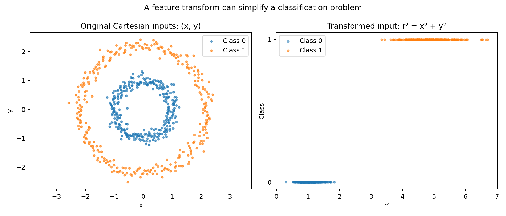
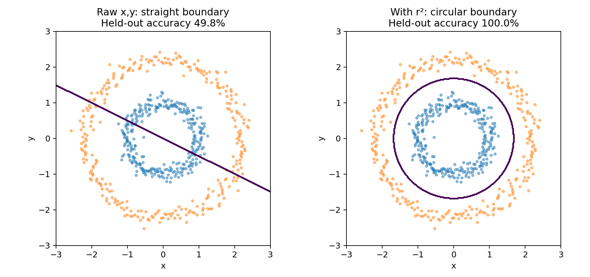

# Why Representation Matters: Concentric Rings & Coordinate Transforms

[](https://www.python.org/downloads/)
[](https://numpy.org/)
[](#core-concept)
[](#test-suite)
[](https://opensource.org/licenses/MIT)

A clean, NumPy-only educational experiment inspired by Chapter 1 of *Deep Learning* (Goodfellow, Bengio, & Courville, 2016). Using the **exact same logistic regression classifier**, changing only the input representation from Cartesian coordinates $(x, y)$ to squared radial distance $r^2 = x^2 + y^2$ transforms a linearly inseparable concentric-rings task from chance accuracy (**49.8%**) to perfect held-out classification (**100.0%**).

> [!IMPORTANT]
> **Scope & Limitations:** This lab uses a hand-engineered radial feature on synthetic rings to isolate *why* representations matter. It does **not** train a neural network to discover the representation automatically.

---

## Core Concept

Class 0 sits on a noisy inner ring ($r \approx 1.0$) and Class 1 sits on an outer ring ($r \approx 2.2$). No straight line $w_1 x + w_2 y + b = 0$ can separate nested circles in $\mathbb{R}^2$. Mapping inputs via $\phi(x, y) = x^2 + y^2$ adds **no new information**, yet makes the two classes cleanly separable by a single scalar threshold $w \cdot r^2 + b = 0$ (a circle in the original space).

```
  Cartesian (x, y)   --> [ Identical Logistic Regression ] --> Straight line boundary -->  49.8% held-out accuracy
  Radial r^2=x^2+y^2 --> [ Identical Logistic Regression ] --> Circular boundary      --> 100.0% held-out accuracy
```

---

## Generated Visualizations

| Coordinate Transform: $(x, y) \mapsto r^2$ | Decision Boundaries on Held-Out Test Set |
| :---: | :---: |
|  |  |

---

## Baseline Results (`figures/metrics.json`)

Trained on `1,400` stratified samples (`seed=43`), evaluated on `600` held-out samples (`seed=2026`):

| Representation | Classifier | Held-Out Accuracy |
|:---|:---|---:|
| Raw Cartesian $(x, y)$ | Logistic Regression (`3000` steps) | `49.83%` |
| **Radial $r^2 = x^2 + y^2$** | **Identical Logistic Regression** | **`100.00%`** |

---

## Quickstart

### 1. Setup & Run

```bash
# Clone the repository
git clone https://github.com/AdityaInamdar334/Deep-Learning-Implementations.git
cd Deep-Learning-Implementations/representation_learning_lab

# Install NumPy & Matplotlib
python3 -m pip install -r requirements.txt

# Run experiment and regenerate figures + metrics.json
python3 representation_lab.py --out figures
```

### 2. Test Suite

```bash
python3 -m unittest discover -s tests -v
```

The 5 automated unit tests verify:
- **`test_reproducible`**: Identical seeds generate bitwise-identical ring datasets.
- **`test_shapes`**: Exact `(N, 2)` feature and `(N,)` label shapes.
- **`test_radial_features`**: Exact $x^2 + y^2$ computation (`(3, 4) -> 25`, `(0, 2) -> 4`).
- **`test_accuracy`**: Radial logistic regression exceeds `97%` held-out accuracy.
- **`test_probabilities`**: Clipped sigmoid stays strictly in $[0, 1]$ for extreme inputs $\pm 1000$.

---

## File Structure

```
representation_learning_lab/
├── README.md                        # Concept, figures, metrics, and caveats
├── requirements.txt                 # numpy, matplotlib
├── .gitignore                       # Ignores __pycache__ and bytecode
├── representation_lab.py            # Ring generator, logistic regression, and plots
├── figures/
│   ├── representation_shift.png     # Cartesian vs r^2 scatter comparison
│   ├── decision_boundaries.png      # Linear vs circular decision boundary contours
│   └── metrics.json                 # Held-out test accuracy comparison
└── tests/
    └── test_representation.py       # 5 automated unit tests
```

---

## References

- Ian Goodfellow, Yoshua Bengio, & Aaron Courville (2016), *Deep Learning*, Chapter 1: Introduction. [deeplearningbook.org](https://www.deeplearningbook.org/contents/intro.html)
