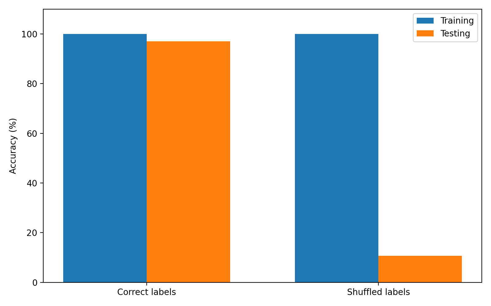
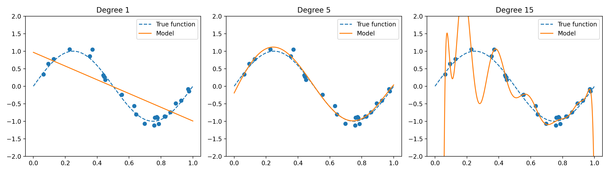
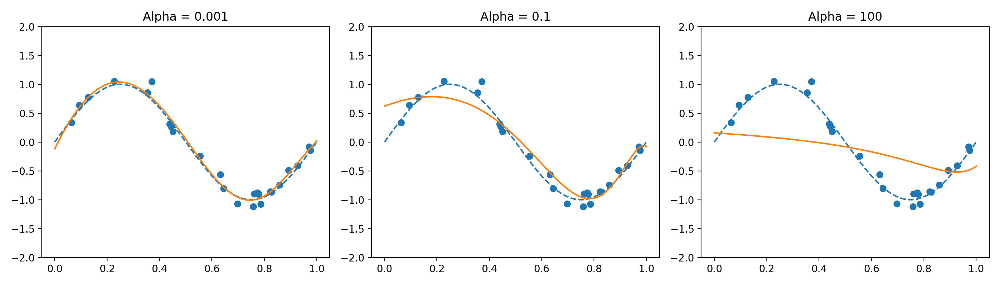
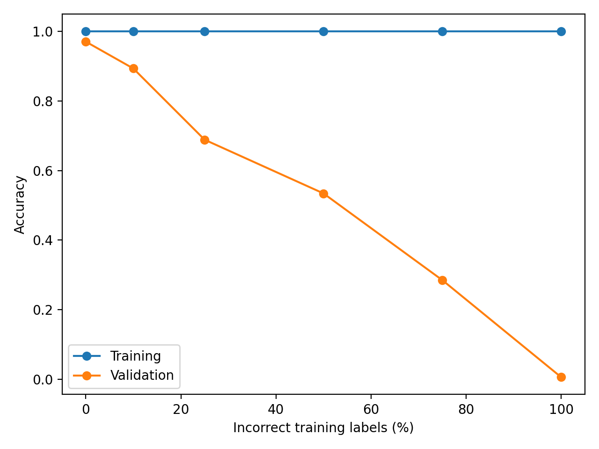
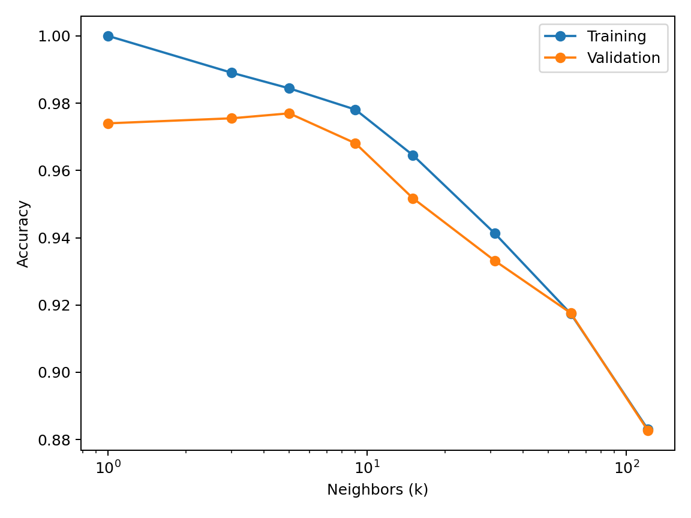
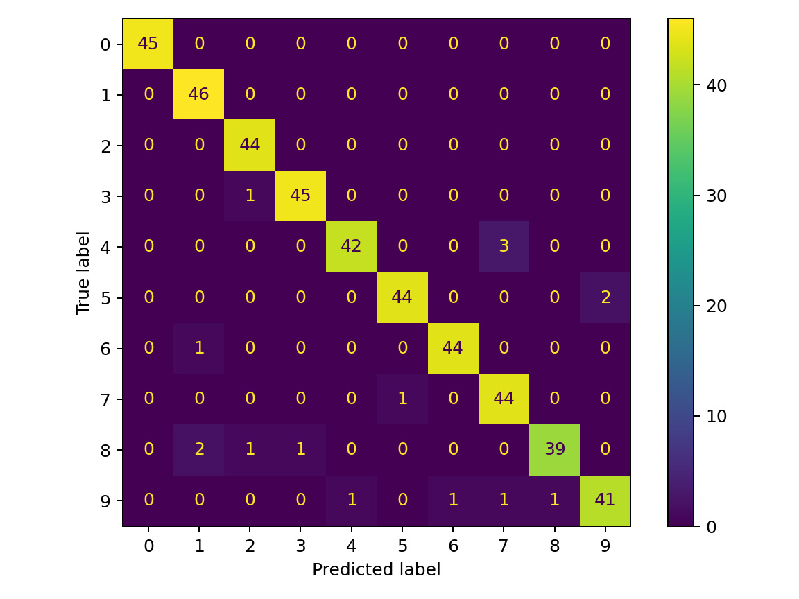

# Generalization & Machine Learning Basics: 15-Experiment Lab

[](https://www.python.org/downloads/)
[](https://scikit-learn.org/)
[](#core-experiments)
[](#test-suite)
[](https://opensource.org/licenses/MIT)

A comprehensive, 15-block reproducible study companion to Chapter 5 of *Deep Learning* (Goodfellow, Bengio, & Courville, 2016) and [`article.md`](./article.md), empirically illustrating **memorization vs. generalization**, **capacity curves**, **Ridge regularization**, **label corruption**, **irrelevant noise features**, **MLE vs. Bayesian shrinkage**, and **gradient descent**.

---

## Core Experiments & Recorded Findings (`results.txt`)

| Experiment | Key Measured Finding |
|:---|:---|
| **Clean vs. Shuffled Labels (1-NN on Digits)** | Clean: `100.0%` train / **`97.1%` test** · Shuffled: `100.0%` train / **`10.7%` test** (pure memorization) |
| **Polynomial Capacity on $\sin(2\pi x)$** | Degree 1 MSE `0.198` (underfit) · Degree 5 MSE **`0.0042`** · Degree 15 MSE `1115.67` (severe overfit) |
| **5-Fold Cross-Validation (`k`-NN)** | Selected `k = 5` (`97.70%` CV accuracy, `96.44%` held-out test accuracy) |
| **Label Corruption Sweep ($0\% \to 100\%$)** | Train accuracy stays `100.0%` throughout while test accuracy falls linearly (`97.0% -> 89.3% -> 68.8% -> 53.4% -> 0.6%`) |
| **MLE vs. Bayesian Posterior Mean** | On small coin counts: MLE `80.00%` vs. Beta-prior posterior mean `71.43%` |

---

## Selected Visualizations (`figures/`)

| Memorization vs. Generalization | Polynomial Capacity (Degrees 1, 5, 15) |
| :---: | :---: |
|  |  |

| Ridge Regularization | Label Corruption Degradation |
| :---: | :---: |
|  |  |

| `k`-NN Capacity Curve (5-Fold CV) | Held-Out Confusion Matrix |
| :---: | :---: |
|  |  |

---

## Quickstart

### 1. Setup & Run

```bash
# Clone the repository
git clone https://github.com/AdityaInamdar334/Deep-Learning-Implementations.git
cd Deep-Learning-Implementations/research-generalization-lab

# Create virtual environment and install dependencies
python3 -m venv .venv
source .venv/bin/activate
pip install -r requirements.txt

# Run all 15 experiments (writes figures/ and stdout)
python3 experiments.py

# Run standalone core k-NN experiment (writes outputs/)
python3 core.py
```

### 2. Test Suite

```bash
python3 -m unittest discover -s tests -v
```

The 3 automated unit tests verify:
- **`test_memorization_vs_generalization`**: 1-NN memorizes shuffled labels (`100%` train, `<20%` test) while generalizing to `>95%` test on clean labels.
- **`test_polynomial_capacity_and_ridge`**: Degree-5 outperforms degree-1 and degree-15; Ridge regularization strictly improves degree-15 MSE.
- **`test_artifacts_present`**: Confirms `article.md`, `results.txt`, and all 10 PNG figures exist.

---

## File Structure

```
research-generalization-lab/
├── README.md                  # Experiment overview, figures, and quickstart
├── article.md                 # Full companion technical article
├── requirements.txt           # numpy, matplotlib, scikit-learn
├── .gitignore                 # Ignores __pycache__ and outputs/
├── core.py                    # Core k-NN capacity & confusion-matrix script
├── experiments.py             # All 15 article code blocks in sequence
├── results.txt                # Recorded stdout from experiments.py
├── figures/                   # 10 generated PNG figures
└── tests/
    └── test_generalization.py # 3 automated unit tests
```

---

## References

- Ian Goodfellow, Yoshua Bengio, & Aaron Courville (2016), *Deep Learning*, Chapter 5: Machine Learning Basics. [deeplearningbook.org](https://www.deeplearningbook.org/contents/ml.html)
- Chiyuan Zhang et al. (2017), *Understanding Deep Learning Requires Rethinking Generalization* (ICLR). [arXiv:1611.03530](https://arxiv.org/abs/1611.03530)
